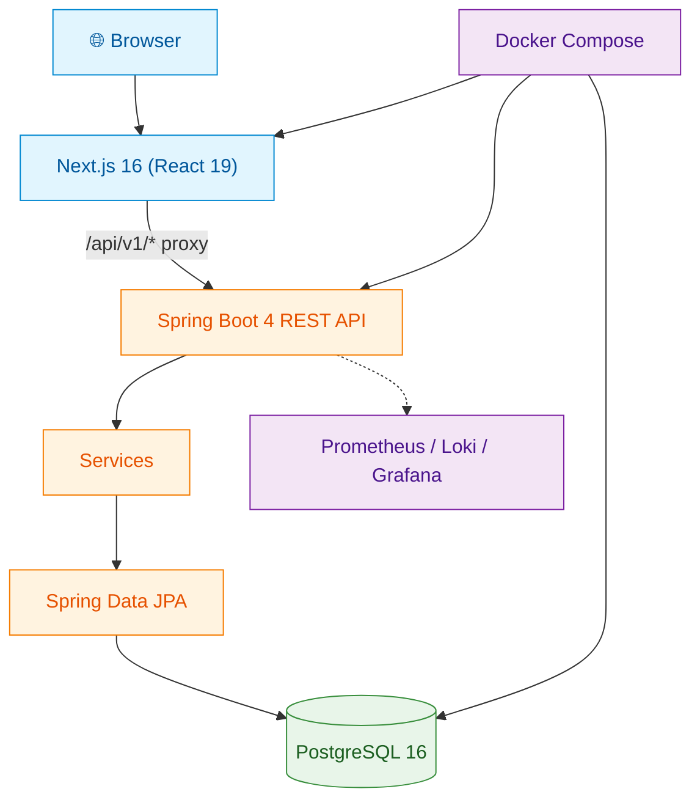

# 📜 Notaire — Modernization of a notary management system

<div align="center">

[](https://openjdk.org/projects/jdk/26/)
[](https://spring.io/projects/spring-boot)
[](https://nextjs.org/)
[](https://react.dev/)
[](https://www.postgresql.org/)
[](https://www.docker.com/)
[](https://www.typescriptlang.org/)
[](https://tailwindcss.com/)

[](https://github.com/matiaspakua/notaire/actions/workflows/ci.yml)
[](https://github.com/matiaspakua/notaire/actions/workflows/cd.yml)
[](https://github.com/matiaspakua/notaire/actions/workflows/pr-validation.yml)
[](https://github.com/matiaspakua/notaire/actions/workflows/frontend-ci.yml)
[](https://github.com/matiaspakua/notaire/actions/workflows/playwright-e2e.yml)
[](https://trivy.dev/)
[](LICENSE)

Migration of a Java 1.6 / Swing monolith to a modern architecture:
REST API (Spring Boot 4) + web frontend (Next.js 16), with CI/CD and
production-grade observability.

</div>

## Contents

- [Project vision](#-project-vision)
- [Architecture](#️-architecture)
- [Repository layout](#-repository-layout)
- [Technology stack](#-technology-stack)
- [Quick start](#-quick-start)
- [Testing and quality](#-testing-and-quality)
- [Observability and security](#-observability-and-security)
- [Documentation](#-documentation)
- [Contributing](#-contributing)
- [License](#-license)

---

## 🎯 Project vision

The original system was a **Java 1.6 Swing monolith**: business logic,
data access, and the graphical interface were tightly coupled, the MySQL 5
database had no version control, passwords used MD5, and there were no
containers and no automated tests.

**Notaire** is the result of moving it to:

- **Backend**: REST API with **Spring Boot 4.1.1** and **Java 26**.
- **Frontend**: **Next.js 16** + **React 19** + **TypeScript** + **Tailwind CSS 4**, with a custom design system inspired by Apple.
- **Active client**: the Next.js frontend only. The legacy Swing client was removed from the tree (#1046); do not recreate it.
- **Database**: **PostgreSQL 16** with **Flyway** as the only source of truth for the schema.
- **Infrastructure**: multi-stage Docker Compose, 11 GitHub Actions workflows, Prometheus/Grafana/Loki observability.

## 🏗️ Architecture



The full diagram (Building Block View, Runtime View, Deployment View) is in the
**[SAD (arc42)](docs/200-architecture/201-SAD/sad.md)**.

**Delivery status (live sources, not archived dashboards):**
[Delivery Board](https://github.com/users/matiaspakua/projects/1) ·
[`docs/github/README.md`](docs/github/README.md) ·
[phase plan](docs/300-development/DEVELOPMENT-PLAN.md#5-architecture-migration-roadmap).
Historical snapshots: [`docs/000-archive/github/`](docs/000-archive/github/).

## 📁 Repository layout

```text
notaire/
├── backend-api/          # Spring Boot 4 REST API (Java 26)
├── frontend/              # Next.js 16 web app
├── docs/                  # Documentation (see docs/README.md)
│   ├── 100-business/      # Requirements, use cases, data model
│   ├── 200-architecture/  # SAD, ADRs, design, diagrams, security, deploy
│   ├── 300-development/   # Setup, standards, testing
│   └── 000-archive/       # Historical or superseded documentation
├── infra/                 # Infrastructure (repo-ready): observability, deploy (Kustomize, nginx), k6 — see infra/README.md
├── github-page/           # Informational/portfolio site (Next.js, deployed to GitHub Pages)
├── docs/openspec/               # SDLC specifications (schema notaire-sdlc)
├── docker-compose.yml      # Development stack (published ports, pgAdmin)
├── docker-compose.prod.yml # Production stack (#1044; only the reverse proxy on the host)
├── CONSTITUTION.md         # Highest authority for the development process
└── CLAUDE.md / AGENTS.md   # Guide for AI agents
```

## 🧰 Technology stack

| Layer | Technologies |
|:-----|:------------|
| **Backend** | Java 26, Spring Boot 4.1.1 (Web, Data JPA, Security, Actuator), SpringDoc OpenAPI |
| **Persistence** | PostgreSQL 16, Flyway, HikariCP |
| **PDF reports** | Apache PDFBox (generated in-process, no templates) |
| **Frontend** | Next.js 16, React 19, TypeScript 5.7, Tailwind CSS 4, TanStack Query, shadcn/ui, Zustand |
| **Testing** | JUnit 5 + Mockito + Testcontainers (backend), Vitest + Playwright (frontend), Bruno (API) |
| **Quality** | JaCoCo, Checkstyle, SpotBugs, Trivy |
| **Observability** | Micrometer, Prometheus, Loki + Promtail, Grafana |
| **CI/CD** | GitHub Actions (11 workflows), multi-stage Docker |

Full detail and the reason for each choice: [ADRs](docs/200-architecture/202-ADR/).

## 🚀 Quick start

### Prerequisites

```bash
# Backend
Java 26 / Maven 3.9+ / Docker + Compose

# Frontend (local development without Docker)
Node.js 22+ / npm 10+
```

### With Docker (recommended)

```bash
git clone https://github.com/matiaspakua/notaire.git
cd notaire
cp .env.example .env
bash workspace/stack/start.sh          # starts PostgreSQL + backend
bash scripts/health.sh         # checks that everything is up
```

### In development (without Docker for the app/frontend)

```bash
cd backend-api && mvn spring-boot:run -Dspring-boot.run.profiles=dev
cd frontend && npm run dev
# PostgreSQL 16 must be running on :5432
```

### Available services

| Service | URL |
|:---------|:----|
| Backend API | http://localhost:8080 |
| Swagger UI | http://localhost:8080/swagger-ui.html |
| Health check | http://localhost:8080/actuator/health |
| Frontend | http://localhost:3000 |
| pgAdmin | http://localhost:5050 |

Full stack (Prometheus, Grafana, SonarQube, Homer): `bash workspace/stack/start-all.sh` — see [`infra/README.md`](infra/README.md).

## 🧪 Testing and quality

```bash
mvn test -pl backend-api                 # backend unit + integration
cd testing/e2e && npm test              # Playwright E2E
bash workspace/sdlc/preflight.sh --full         # local replica of every CI gate
```

Current coverage: ~84% lines / ~74% branches (mandatory floor: 70%/25%,
target: 80%/80% — see [`code-quality.md`](.claude/rules/code-quality.md)).

The full testing strategy (unit, integration, API, E2E, CU↔API matrix):
[`docs/300-development/303-testing/`](docs/300-development/303-testing/).
Local ↔ CI mapping of each gate: [`docs/300-development/CI-PREFLIGHT.md`](docs/300-development/CI-PREFLIGHT.md).

## 🔍 Observability and security

- **Observability**: metrics (Prometheus), structured JSON logs (Loki),
  dashboards (Grafana) — see [`docs/200-architecture/207-monitoring/`](docs/200-architecture/207-monitoring/).
- **Security**: BCrypt, Spring Security, CORS, input validation, Trivy
  scanning — see [`docs/200-architecture/206-security/`](docs/200-architecture/206-security/).
- **DevSecOps / deployment**: [`docs/200-architecture/208-devsecops/`](docs/200-architecture/208-devsecops/) and [`docs/200-architecture/209-deployment/`](docs/200-architecture/209-deployment/).

## 📚 Documentation

All documentation lives under [`docs/`](docs/README.md), organized in three
areas (business, architecture, development) plus a historical archive:

| Area | Location | Contents |
|:-----|:----------|:----------|
| Business | `docs/100-business/` | 121 requirements (RF/RNF), 87 use cases, data model |
| Architecture | `docs/200-architecture/` | SAD (arc42), 20 ADRs, API/frontend design, diagrams, security, monitoring, deploy |
| Development | `docs/300-development/` | Setup, standards, testing, [phase roadmap](docs/300-development/DEVELOPMENT-PLAN.md) |
| Delivery | `docs/github/` | [Delivery Board, milestones, labels](docs/github/README.md) |
| Archive | `docs/000-archive/` | Historical or superseded documentation (including old MIGRATION-* notes) |

Recommended entry point: [`docs/README.md`](docs/README.md).

## 🤝 Contributing

Every change follows the mandatory process defined in
**[`CONSTITUTION.md`](CONSTITUTION.md)** and
**[`.claude/rules/ai-agent-workflow.md`](.claude/rules/ai-agent-workflow.md)**:
Issue + Use Case (Caso de Uso) → branch (`<type>/<issue>_<description>`) → TDD → tests →
commit (Conventional Commits, `Closes #<issue>`) → `workspace/sdlc/preflight.sh` → PR.

- **Commits**: [Conventional Commits](https://www.conventionalcommits.org/)
- **Branches**: `<type>/<issue-number>_<description>`
- **Java**: Google Style, Checkstyle, SpotBugs
- **TypeScript**: strict mode
- **PRs**: reviewed (human + AI code review)

## 📄 License

Distributed under the **MIT License**. See [LICENSE](LICENSE).

---

<div align="center">

**Developed by [Matías Miguez](https://github.com/matiaspakua)**

</div>
