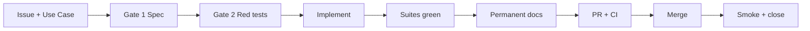

# AI SDLC Framework — derived from Notaire

> Portfolio / transfer report for issue [#1958](https://github.com/matiaspakua/notaire/issues/1958).
> Kit: [`framework/ai-sdlc/`](framework/ai-sdlc/). Case study: GitHub Pages `/ai-sdlc/case-study/`.

## Purpose

Give another product a **reusable, technology-agnostic AI software-delivery
lifecycle**: policy first, specification before code, red-before-green tests,
mechanical gates, and a human Owner on irreversible decisions — without copying
Notaire's Maven/Next.js paths or Spanish use-case IDs into the core kit.

## Principles

1. **Policy first** — one Constitution (or equivalent) above tools and agents.
2. **Spec before code** — Issue + Use Case + written change plan before implementation.
3. **Red before green** — observe failing tests before writing production code.
4. **Machines check machines** — gates are commands with exit codes; model claims are not evidence.
5. **Traceability** — Issue → spec → tests → code → docs → PR → deploy is recorded.
6. **Humans own decisions** — Owner approves policy, exceptions, and merge authority for harness changes.
7. **KISS / bounded Boy Scout** — simplest fix; clean only what you touch in the same change.

## Non-Goals

- Replacing a project's existing Constitution with this report.
- Shipping a published npm/PyPI package in this change.
- Encoding Notaire domain rules (notarial workflows) into the kit.
- Claiming the framework is complete for every industry regulated process.

## Components

| Component | Generic role | Notaire incarnation |
|-----------|--------------|---------------------|
| Constitution | Policy source of truth | `CONSTITUTION.md` |
| Spec schema | Change planning artifacts | OpenSpec `notaire-sdlc` |
| Gate runner | Profile-driven commands | `framework/ai-sdlc/run_gates.py` + `workspace/sdlc/` |
| Agent roles | Owner / Foreman / Workers | `.claude/agents/`, Cloud fleet |
| Skills | Executable guidance | `.claude/skills/` |
| Case study site | Narrative + metrics | `github-page/app/ai-sdlc/` |

## Workflow

Plan → Prove → Publish → Ship. Exact step counts may vary by adopter; the five
gate *kinds* (spec, red, green+docs, CI/review, deploy/smoke) should not.

## Roles

| Role | Authority |
|------|-----------|
| Owner | Policy, exceptions, harness merges, irreversible product decisions |
| Foreman | Queue, claim protocol, merge Worker PRs when heavy CI is green |
| Worker / specialist | Implement inside a claimed Issue and derived lane |

## Gates

Generic gate kinds mapped by the adopter profile:

| Kind | Intent | Example Notaire command |
|------|--------|-------------------------|
| Plan validation | Spec/change coherent | `validate-sdlc-plan.sh` |
| Archive hygiene | Closed work archived | `check-openspec-archive-hygiene.py` |
| Local mirror of CI | Pre-push confidence | `preflight.sh` / `run_pipeline.sh` |
| Security cases | Local SAST/SCA/secrets | `security/run_gates.py --profile local` |

## State

Recommended board states: Todo → Ready → In Progress → In Review → Done, with
labels for `status:ready` / `in-progress` / `blocked`. A dead agent's claim must
expire so lanes do not freeze.

## Observability

- Pipeline dashboards and phase logs (local `reports/pipeline/`).
- CI required checks + heavy-CI steward script before merge.
- Fleet lessons written back into permanent docs when incidents repeat.

## Cost

- Serialize heavy CI; prefer one expensive PR at a time (fleet lesson).
- Context budget for always-loaded agent instructions (token ceiling).
- Models claiming "all green" without command output waste Owner time — treat as defect.

## Adaptation

1. Copy `framework/ai-sdlc/`.
2. Author `profiles/<product>/profile.yaml` with your gate commands.
3. Keep or write a Constitution; point agents at it.
4. Adapt OpenSpec (or equivalent) schema to your language and DoD.
5. Publish a short case study so newcomers see problem → solution, not only files.

## Derivation from Notaire evidence

### Evidence (repo artifacts)

| Claim | Evidence |
|-------|----------|
| Constitution is highest process authority | `CONSTITUTION.md`, `AGENTS.md`, agent card |
| Spec-before-code is enforced | OpenSpec + `validate-sdlc-plan.sh` |
| Archive-in-PR prevents leftovers | `check-openspec-archive-hygiene.py`, #1252 / #1623 |
| Scaffold lint debt was real | #1689; MD022/MD032/MD040 on generated OpenSpec |
| Fleet lessons encode merge cadence | `docs/300-development/304-ai-sdlc-cloud/FLEET-LESSONS-HEX-1693.md` |
| Path-scoped CI and heavy merge gate | #1257, `CI-MERGE-GATE.md`, `check-heavy-ci.sh` |

### Inference (reasonable but not a single file)

- Three agent bands (Owner / Foreman / Worker) generalize beyond Cursor Cloud.
- Profile YAML is enough for a first kit; a package registry can wait.
- Case-study narrative improves adoption more than another skill file alone.

### Open questions

- Should gate results emit a machine-readable JSON ledger for external dashboards?
- How much of OpenSpec must be vendored vs. referenced as a CLI dependency?
- What is the minimum viable Constitution for a greenfield two-person team?

---

*First adopter: Notaire. Kit tests: `python3 -m unittest discover -s framework/ai-sdlc/tests`.*
