# Software Architecture Document (SAD) — Notaire

> **arc42 Template v8.2** — based on [docs.arc42.org](https://docs.arc42.org/home/)
>
> **Version:** 4.0 | **Date:** 2026-11-24 | **Author:** Architecture Team
>
> **Changelog v4.0**: Architecture views are generated from the [LikeC4 model](../210-architecture-model/README.md) ([ADR-033](../202-ADR/ADR-033-likec4-architecture-model.md), #2483): no PlantUML left. Corrected drift: no Swing client, no `jpa`/`service` packages, frontend hexagon complete, module grants and MFA enforced, ingress and observability in the topology, backend memory limits. §11 lists the findings of the modelling pass (#2484–#2489).
>
> **Changelog v3.5**: Spring Boot 4.1.2, Flyway through V53, and the technology assessment in [TECHNOLOGY-STACK.md](../TECHNOLOGY-STACK.md) (#1976).
>
> **Changelog v3.4**: §6 points at [GESTION.md](../203-design/GESTION.md) for the case-process analysis. States stay in CICLO-DE-VIDA.md.
>
> **Changelog v3.3**: English names for the current schema (Java 26, Spring Boot 4.1.1, Flyway through V46). §6 points at [CICLO-DE-VIDA.md](../203-design/CICLO-DE-VIDA.md) as the single domain lifecycle. Stored labels such as `Escribano` stay. Existing PlantUML runtime sketches stay legacy (ADR-027).
>
> **Changelog v3.2**: Delivery tracking points at [Notaire — Delivery Board #1](https://github.com/users/matiaspakua/projects/1) (Project #4 is gone). In-repo module ownership: [MODULE-OWNERSHIP.md](../../300-development/MODULE-OWNERSHIP.md) / ADR-026. Active diagrams: Mermaid only (ADR-027). Technical docs also render on GitHub Pages `/docs/`.
>
> **Changelog v3.1**: §11.3 Evolution Roadmap aligned with GitHub Project milestones #6–#11, tracking issues #898–#902, tech-debt and risk issue references (board link corrected in v3.2).

---

## Table of Contents

1. [Introduction and Goals](#1-introduction-and-goals)
2. [Constraints](#2-constraints)
3. [Context and Scope](#3-context-and-scope)
4. [Solution Strategy](#4-solution-strategy)
5. [Building Block View](#5-building-block-view)
6. [Runtime View](#6-runtime-view)
7. [Deployment View](#7-deployment-view)
8. [Cross-cutting Concepts](#8-cross-cutting-concepts)
9. [Architectural Decisions](#9-architectural-decisions)
10. [Quality Requirements](#10-quality-requirements)
11. [Risks and Technical Debt](#11-risks-and-technical-debt)
12. [Glossary](#12-glossary)

---

## 1. Introduction and Goals

### 1.1 Requirements Overview

**Notaire** is a notarial management system for Argentine notary offices. It manages the complete lifecycle of notarial operations including:

- **Deed managements** — Notarial case workflows
- **People** — Registry of individuals and legal entities involved in deeds
- **Deeds** — Deed registry with folios, copies, and testimonies
- **Budgets** — Quotes and payment tracking
- **Procedures** — Notarial acts linked to people and deed managements
- **Audit** — Audit trail for legal compliance

The system originated as a monolithic Java Swing desktop application with direct MySQL access. It is being modernized into a three-tier web architecture while preserving all 73 original use cases.

### 1.2 Quality Goals

| Priority | Quality Goal | Scenario |
|----------|-------------|----------|
| 1 | **Maintainability** | New features delivered in < 6 months; developers onboard in < 2 weeks |
| 2 | **Testability** | ≥ 80% code coverage; all changes validated by unit, integration, and E2E tests |
| 3 | **Security** | JWT authentication, `ROLE_ADMIN` on admin paths and admin writes, full audit trail for legal compliance. Tenants are isolated by deployment; module grants are not yet enforced server-side (ADR-029) |
| 4 | **Scalability** | Backend scales horizontally via stateless containers |
| 5 | **Observability** | Real-time metrics, structured logs, and alerts via LPG stack |

### 1.3 Stakeholders

| Role | Expectations |
|------|-------------|
| **Escribano (Notary)** | Reliable system for daily operations; data integrity; legal compliance |
| **Gestor (Clerk)** | Efficient workflow for managing deed managements and procedures |
| **Architect / Lead Dev** | Clean architecture; testable; documented decisions (ADRs) |
| **DevOps / SRE** | Observable system; automated deployments; container orchestration |
| **Product Owner** | Feature velocity; migration from legacy without data loss |

---

## 2. Constraints

### 2.1 Technical Constraints

| Constraint | Description |
|-----------|-------------|
| Java 26 | Backend runtime, from the root `pom.xml` |
| Spring Boot 4.1.2 | Backend framework |
| PostgreSQL 16 | Database — migrated from MySQL 5.7 |
| Next.js 16 / React 19 | Frontend framework with App Router |
| Docker / Docker Compose | Containerization for all services |
| Flyway | Database schema versioning — single source of truth |
| Maven 3.9+ | Build system for Java modules |

### 2.2 Organizational Constraints

| Constraint | Description |
|-----------|-------------|
| CONSTITUTION.md | Engineering process mandated for every change |
| OpenSpec SDLC | All changes require proposal → specs → design → tasks workflow |
| TDD | Failing tests written before implementation |
| Conventional Commits | Commit message format enforced by git hooks |
| ADR process | Architectural decisions documented before implementation |

### 2.3 Legal Constraints

| Constraint | Description |
|-----------|-------------|
| Audit trail | All CRUD operations must be recorded for legal compliance |
| Data retention | Notarial records must be preserved indefinitely |
| Access control | Authenticated access to sensitive notarial data. `ROLE_ADMIN` guards admin paths and admin writes; each installation serves one notary (ADR-029); module grants are not yet enforced server-side |

---

## 3. Context and Scope

### 3.1 Business Context

Who uses Notaire and what it depends on. Generated from the [LikeC4 model](../210-architecture-model/README.md); every view is also interactive on
[GitHub Pages](https://matiaspakua.github.io/notaire/architecture-model/#/view/index/).

<!-- likec4-view: index -->
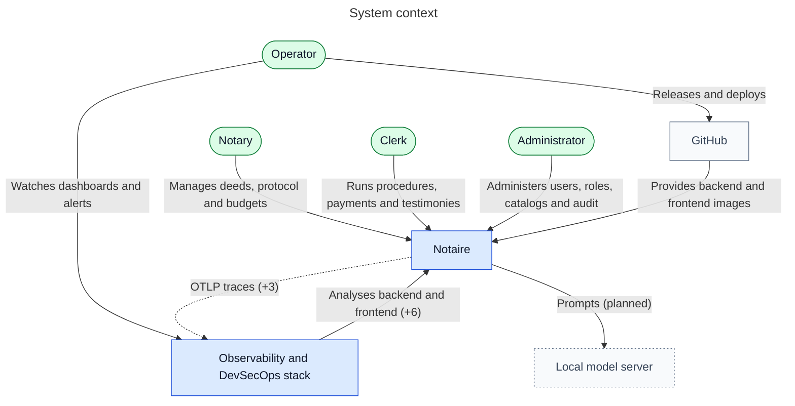
<!-- /likec4-view -->

**External Interfaces:**

| Interface | Description |
|-----------|-------------|
| Reverse proxy | Production and staging ingress at `:80` (TLS terminates in front of it) |
| Web Browser | Next.js frontend served at `:3000` |
| REST API | Spring Boot backend at `:8080/api/v1` |
| pgAdmin | Database administration at `:5050` |
| Grafana | Monitoring dashboards at `:3001` |

### 3.2 Technical Context

The browser only talks to the Next.js server: route handlers proxy `/api/v1` to the backend and keep the JWT in
an httpOnly cookie. The backend is the only component that connects to PostgreSQL. The AI assistant
(CU88, #1964) is specified but waits for Owner Gate 1, so it is drawn as planned.

<!-- likec4-view: containers -->
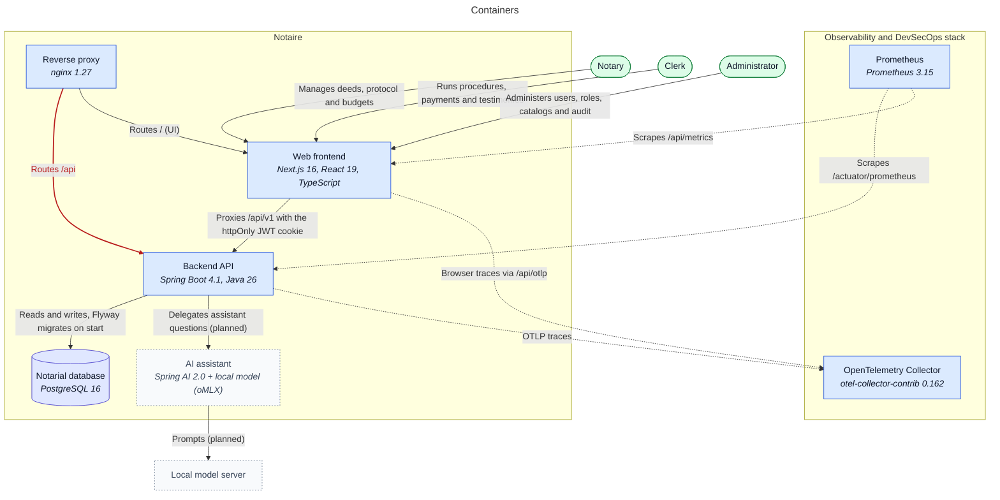
<!-- /likec4-view -->

---

## 4. Solution Strategy

### 4.1 Technology Decisions

| Decision | Rationale | ADR |
|----------|-----------|-----|
| Spring Boot 4.1.2 + Java 26 | Current platform in the root `pom.xml` | ADR-001 |
| Maven multi-module | Separation of shared, backend, and frontend concerns | ADR-002 |
| URL-path API versioning (`/api/v1`) | Simple, explicit, cacheable | ADR-003 |
| PostgreSQL 16 (from MySQL 5.7) | Superior JSON support, CTEs, full-text search | ADR-004 |
| Next.js 16 + React 19 | Modern SSR/SSG, App Router, TypeScript | ADR-005 |
| TDD + JaCoCo ≥ 80% + Playwright | Quality assurance at all levels | ADR-006 |
| Flyway migrations | Versioned, reproducible schema evolution | ADR-007 |
| JWT + Spring Security | Stateless auth for multi-client support | ADR-008 |
| LPG observability stack | Lightweight, Kubernetes-ready monitoring | ADR-009 |
| `@ControllerAdvice` error handling | Uniform error responses across all endpoints | ADR-010 |
| Token-based design system | Consistent Apple-inspired UI across all forms | ADR-011 |

### 4.2 Migration Strategy

The modernization follows a **strangler fig pattern**: new features are built only in the modern stack while
legacy components are replaced slice by slice.

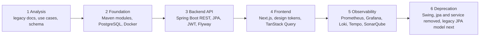

### 4.3 Current Migration Status

| Phase | Status | Details |
|-------|--------|---------|
| Phase 1: Analysis | ✅ Complete | Legacy Swing retired (removed under #1046; history in git); use cases cataloged in `docs/100-business/102-use-cases/` |
| Phase 2: Foundation | ✅ Complete | Shared DTO module (retired, ADR-025), Maven multi-module, Docker Compose |
| Phase 3: Backend API | ✅ Complete | Controllers, repositories, entities, Flyway migrations |
| Phase 4: Frontend | 🔄 In Progress | Next.js 16 app (`frontend/`) — Swing is not a target client |
| Phase 5: Observability | ✅ Complete | Full LPG stack + SonarQube + Homer dashboard |
| Phase 6: Deprecation | 🔶 Partial | Swing, `jpa` and `service` removed (#1046, #576, #1918); ArchUnit baselines empty (#1693). Left: the JPA model in `business`/`repository` ([#2486](https://github.com/matiaspakua/notaire/issues/2486)) and ports on legacy DTOs ([#2485](https://github.com/matiaspakua/notaire/issues/2485)) |

Live delivery status: [Delivery Board](https://github.com/users/matiaspakua/projects/1) /
[docs/github/README.md](../../github/README.md). Phase narrative:
[DEVELOPMENT-PLAN.md §5](../../300-development/DEVELOPMENT-PLAN.md).

---

## 5. Building Block View

### 5.1 Level 1 — System Decomposition

The containers are drawn in §3.2. Both tiers follow Ports & Adapters (ADR-030): dependencies point inward and
infrastructure is reached only through ports. Sections 5.2 and 5.3 show each hexagon as built, including the
debt that remains.

### 5.2 Level 2 — Backend API Internal Structure

Root package `com.licensis.notaire`. Amber boxes are measured debt and red ones are findings, each with its Issue.

<!-- likec4-view: backend -->
```mermaid
---
title: "Backend hexagon"
---
flowchart TB
  notaire_ingress["Reverse proxy<br/><i>nginx 1.27</i>"]
  observability["Observability and DevSecOps stack"]
  subgraph notaire_backend["Backend API<br/><i>Spring Boot 4.1, Java 26</i>"]
    subgraph notaire_backend_inbound["Inbound adapters"]
      notaire_backend_inbound_openapi["OpenAPI contract<br/><i>springdoc</i>"]
      notaire_backend_inbound_web["REST controllers<br/><i>Spring MVC</i>"]
      notaire_backend_inbound_errors["Global exception handler<br/><i>@RestControllerAdvice</i>"]
    end
    subgraph notaire_backend_security["Security filter chain"]
      notaire_backend_security_csrf["CSRF double submit<br/><i>Spring Security CSRF</i>"]
      notaire_backend_security_lockout["Login lockout<br/><i>LoginAttemptService</i>"]
      notaire_backend_security_jwtFilter["JWT authentication filter<br/><i>JwtAuthenticationFilter, JwtTokenService</i>"]
      notaire_backend_security_mfaGate["MFA login gate<br/><i>TokenLoginMfaGate, TOTP</i>"]
      notaire_backend_security_rateLimit["API rate limit<br/><i>ApiRateLimitFilter</i>"]
      notaire_backend_security_moduleAuthz["Role-module authorization<br/><i>RoleModuleAuthorizationFilter</i>"]
    end
    subgraph notaire_backend_crosscutting["Cross-cutting"]
      notaire_backend_crosscutting_config["Composition root<br/><i>config.*</i>"]
      notaire_backend_crosscutting_audit["Audit aspect<br/><i>Spring AOP</i>"]
      notaire_backend_crosscutting_flyway["Flyway migrations<br/><i>Flyway</i>"]
      notaire_backend_crosscutting_observe["Observability<br/><i>Micrometer, OTLP, logback JSON</i>"]
    end
    subgraph notaire_backend_outbound["Outbound adapters"]
      notaire_backend_outbound_persistence["Persistence adapters<br/><i>Spring Data JPA, Hibernate 7</i>"]
      notaire_backend_outbound_reports["PDF reports<br/><i>PDFBox</i>"]
      notaire_backend_outbound_crypto["Security adapters<br/><i>AES-GCM, SecureRandom, Clock</i>"]
      notaire_backend_outbound_legacyJpa["Legacy JPA model<br/><i>com.licensis.notaire.business, .repository</i>"]
    end
    subgraph notaire_backend_application["Application"]
      notaire_backend_application_useCases["Use cases<br/><i>@Service @Transactional</i>"]
      notaire_backend_application_legacyDtoPorts["Ports speaking legacy web DTOs"]
      notaire_backend_application_portsOut["Outbound ports"]
      notaire_backend_application_portsIn["Inbound ports"]
    end
    subgraph notaire_backend_domain["Domain"]
      notaire_backend_domain_model["Domain model<br/><i>Java records and classes</i>"]
      notaire_backend_domain_missingDomain["Contexts without a domain model"]
    end
  end
  notaire_frontend["Web frontend<br/><i>Next.js 16, React 19, TypeScript</i>"]
  notaire_database[("Notarial database<br/><i>PostgreSQL 16</i>")]
  notaire_backend_inbound_web -- "Exceptions mapped by" --> notaire_backend_inbound_errors
  notaire_frontend -- "Every /api/v1 call" --> notaire_backend_security_jwtFilter
  notaire_ingress -- "Production compose and Kustomize omit the MFA key, policy and COOKIE_SECURE" --> notaire_backend_security_mfaGate
  notaire_backend_security_moduleAuthz -- "Granted module" --> notaire_backend_inbound_web
  notaire_backend_security_jwtFilter -- "Authenticated request" --> notaire_backend_security_rateLimit
  notaire_backend_security_rateLimit -- "Within quota" --> notaire_backend_security_moduleAuthz
  notaire_backend_inbound_web -- "Calls" --> notaire_backend_application_portsIn
  notaire_backend_security_mfaGate -- "Login and MFA use cases" --> notaire_backend_application_portsIn
  notaire_backend_security_lockout -- "Records failed logins" --> notaire_backend_application_portsIn
  notaire_backend_application_useCases -- "Implements" --> notaire_backend_application_portsIn
  notaire_backend_application_legacyDtoPorts -- "Part of" --> notaire_backend_application_portsIn
  notaire_backend_application_useCases -- "Uses" --> notaire_backend_application_portsOut
  notaire_backend_application_useCases -- "Applies rules of" --> notaire_backend_domain_model
  notaire_backend_outbound_persistence -- "Implements" --> notaire_backend_application_portsOut
  notaire_backend_outbound_persistence -- "Maps to and from" --> notaire_backend_domain_model
  notaire_backend_outbound_persistence -- "Holds the rules of" --> notaire_backend_domain_missingDomain
  notaire_backend_outbound_legacyJpa -- "Hibernate" --> notaire_database
  notaire_backend_outbound_reports -- "Implements GenerateReportsUseCase (finding)" --> notaire_backend_application_portsIn
  notaire_backend_outbound_reports -- "Implements" --> notaire_backend_application_portsOut
  notaire_backend_outbound_crypto -- "Implements" --> notaire_backend_application_portsOut
  notaire_backend_outbound_persistence -- "Still uses entities and repositories of" --> notaire_backend_outbound_legacyJpa
  observability -. "Scrapes /actuator/prometheus" .-> notaire_backend_crosscutting_observe
  notaire_backend_crosscutting_audit -- "Appends" --> notaire_database
  notaire_backend_crosscutting_audit -- "Writes AuditRecord" --> notaire_backend_outbound_legacyJpa
  notaire_backend_crosscutting_observe -. "Traces" .-> observability
  notaire_backend_crosscutting_flyway -- "Migrates on start" --> notaire_database
  observability -. "Scrapes /api/metrics" .-> notaire_frontend
  notaire_ingress -- "Routes / (UI)" --> notaire_frontend
  notaire_frontend -. "Browser traces via /api/otlp (+1)" .-> observability
  observability -- "Reads pg_stat (+1)" --> notaire_database
  notaire_backend_crosscutting_config -- "Builds" --> notaire_backend_security
  notaire_frontend -- "Forwards the request and the httpOnly cookie" --> notaire_backend
  classDef c_primary fill:#dbeafe,stroke:#1d4ed8,color:#0f172a
  classDef c_sky fill:#e0f2fe,stroke:#0369a1,color:#0f172a
  classDef c_indigo fill:#e0e7ff,stroke:#4338ca,color:#0f172a
  classDef c_red fill:#fee2e2,stroke:#b91c1c,color:#0f172a
  classDef finding fill:#fee2e2,stroke:#b91c1c,stroke-width:2px,stroke-dasharray:6 3,color:#0f172a
  class notaire_ingress,observability,notaire_frontend c_primary
  class notaire_backend_inbound_openapi,notaire_backend_crosscutting_config,notaire_backend_crosscutting_audit,notaire_backend_crosscutting_flyway,notaire_backend_crosscutting_observe,notaire_backend_outbound_persistence,notaire_backend_outbound_reports,notaire_backend_outbound_crypto,notaire_backend_inbound_web,notaire_backend_inbound_errors,notaire_backend_application_useCases,notaire_backend_application_portsOut,notaire_backend_application_portsIn,notaire_backend_domain_model c_sky
  class notaire_backend_security_csrf,notaire_backend_security_lockout,notaire_backend_security_jwtFilter,notaire_backend_security_mfaGate,notaire_backend_security_rateLimit,notaire_backend_security_moduleAuthz c_red
  class notaire_backend_outbound_legacyJpa,notaire_backend_application_legacyDtoPorts,notaire_backend_domain_missingDomain finding
  class notaire_database c_indigo
  linkStyle 2 stroke:#b91c1c,stroke-width:2px,color:#b91c1c
  linkStyle 17 stroke:#b91c1c,stroke-width:2px,color:#b91c1c
```
<!-- /likec4-view -->

| Package | Role |
|---|---|
| `adapter.in.web.<context>` | 24 contexts: thin controllers, web DTOs, mappers; inbound ports only (R1) |
| `application.port.in/out`, `application.usecase.<context>` | 24 use-case slices, `@Service` + `@Transactional` only (R2), acyclic (R7) |
| `domain.<context>` | 19 contexts with a plain-Java model (R3) |
| `adapter.out.persistence.<context>`, `.pdf`, `.report`, `.security` | Port implementations (R4) |
| `config` | Composition root: Spring wiring, security chains, OpenAPI, global exception handler |
| `exception` | Domain and application exceptions; the inbound adapter maps HTTP status |
| `audit`, `observability`, `security` | Cross-cutting: audit aspect, metrics and logging, rate limit and module grants |

**Current state** (measured on `main` @ `68321620`, 2026-11-24; executable truth: the ArchUnit baselines in
`src/test/resources/architecture/`, all empty):

| Aspect | Today |
|---|---|
| ArchUnit R1–R7 | Empty baselines; `jpa` and `service` packages deleted (#576, #1918) |
| JPA model | 36 `@Entity` classes (47 classes) in `business` and 36 Spring Data repositories in `repository`, used by the persistence adapters, `config`, `audit` and `security` ([#2486](https://github.com/matiaspakua/notaire/issues/2486)) |
| Ports on legacy DTOs | 40 application files in 8 contexts import `com.licensis.notaire.dto` ([#2485](https://github.com/matiaspakua/notaire/issues/2485)); R2 does not forbid it and R6 only watches the empty legacy packages ([#2484](https://github.com/matiaspakua/notaire/issues/2484)) |
| Contexts without a domain model | audit, budget, item, report, catalog, documentcosttemplate; `GenerateReportsUseCase` is implemented in `adapter.out.report` ([#2486](https://github.com/matiaspakua/notaire/issues/2486)) |

### 5.3 Level 2 — Frontend Internal Structure

`frontend/src` (ADR-030). The server-side edge (`proxy.ts` and the `app/api` route handlers) keeps the token out
of browser JavaScript.

<!-- likec4-view: frontend -->
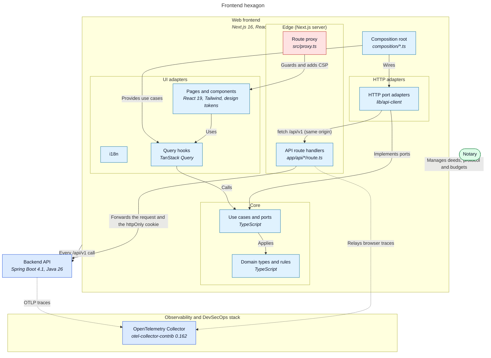
<!-- /likec4-view -->

Supporting areas: `theme` (design tokens and form patterns), `i18n` (es/en), `store` (client state), `lib` (API
client, query client, logger, utilities).

**Current state** (same measurement): 34 `core/<context>` folders, 35 HTTP adapter contexts and a composition
root. `frontend/eslint-suppressions.json` is `{}`: no page, component or hook imports `lib/api-client` or calls
`fetch` (#1696 ratchet done).

### 5.4 Level 2 — Shared Module (retired)

The `notaire-shared` module was retired under #1255 (see
[ADR-025](../202-ADR/ADR-025-retire-notaire-shared.md)). Its DTO classes
(`com.licensis.notaire.dto`, `dto.exceptions`, `dto.interfaces`) now live in
`backend-api`, and the folder is archived in `deprecated/notaire-shared/`. External
services consume the REST API through the OpenAPI contract, not a Java library.

### 5.5 Core Domain Model

Relationships between the core tables (columns live in the data dictionary below).

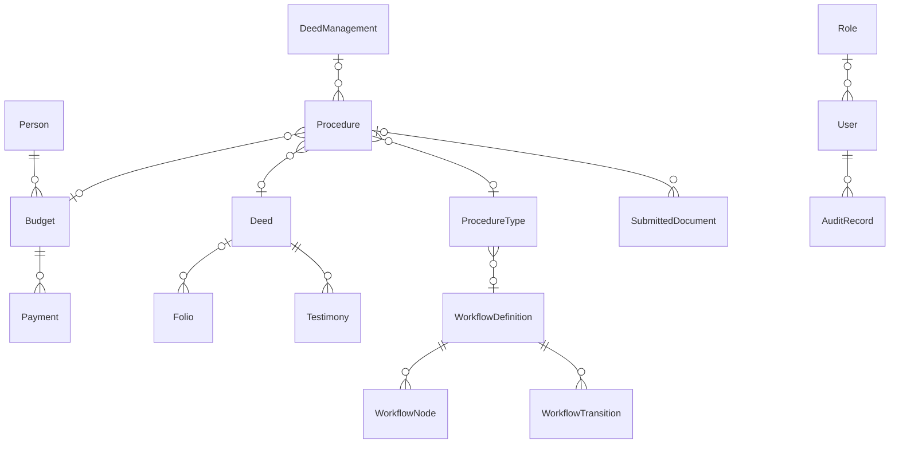

This is a simplified view of the core entities. The full 37-table
schema — every column, type, foreign key, and its Flyway provenance (V1 through V46)
— is maintained in the
[Diccionario de Datos](../205-data-model/Diccionario%20de%20Datos.md), with the
complete ERD at
[`205-data-model/ERD/`](../205-data-model/ERD/). `docs/tests/test_data_dictionary_sync.py`
fails when the dictionary drifts from that ERD. A budget links to a procedure
through `procedures.fk_id_budget`. `budgets.fk_id_tramite` was removed in V14.

---

## 6. Runtime View

Domain lifecycles — management, deed, testimony, registration draft, documents,
budget, payment, procedure folder — are specified once in
[CICLO-DE-VIDA.md](../203-design/CICLO-DE-VIDA.md). The step-by-step case
process (use cases, dependencies, sequences) is
[GESTION.md](../203-design/GESTION.md). The two flows below are generated from the architecture model
([ADR-033](../202-ADR/ADR-033-likec4-architecture-model.md)); §6.3 is a hand-written Mermaid sequence.
Do not add a second state machine here.

### 6.1 User Authentication Flow

Login with a password, then a TOTP code when the role requires it (ADR-032, CU84). `LoginAttemptService` locks a
username after repeated failures; the session is an httpOnly JWT cookie that `TokenRevocationService` revokes on
logout.

<!-- likec4-view: loginMfa -->
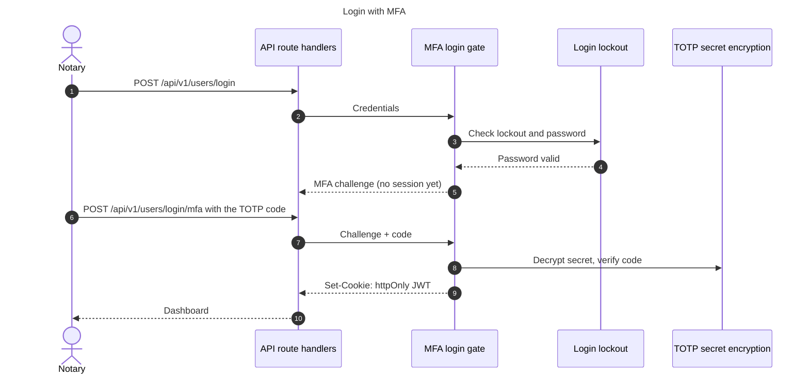
<!-- /likec4-view -->

### 6.2 A request through both hexagons

A clerk saves a payment. The UI calls a use case, the HTTP adapter posts to the same-origin route handler, the
backend filter chain authenticates, rate-limits and checks the module grant, and the use case persists through
its outbound port. The `AuditAspect` records the mutation (CU73).

<!-- likec4-view: apiRequest -->
```mermaid
---
title: "Request through both hexagons"
---
flowchart LR
  notary(["Notary"])
  notaire_frontend_ui_pages["Pages and components<br/><i>React 19, Tailwind, design tokens</i>"]
  notaire_frontend_ui_hooks["Query hooks<br/><i>TanStack Query</i>"]
  notaire_frontend_core_usecases["Use cases and ports<br/><i>TypeScript</i>"]
  notaire_frontend_adapters_http["HTTP port adapters<br/><i>lib/api-client</i>"]
  notaire_frontend_edge_bff["API route handlers<br/><i>app/api/*/route.ts</i>"]
  notaire_backend_security_jwtFilter["JWT authentication filter<br/><i>JwtAuthenticationFilter, JwtTokenService</i>"]
  notaire_backend_security_rateLimit["API rate limit<br/><i>ApiRateLimitFilter</i>"]
  notaire_backend_security_moduleAuthz["Role-module authorization<br/><i>RoleModuleAuthorizationFilter</i>"]
  notaire_backend_inbound_web["REST controllers<br/><i>Spring MVC</i>"]
  notaire_backend_application_portsIn["Inbound ports"]
  notaire_backend_application_useCases["Use cases<br/><i>@Service @Transactional</i>"]
  notaire_backend_domain_model["Domain model<br/><i>Java records and classes</i>"]
  notaire_backend_application_portsOut["Outbound ports"]
  notaire_backend_outbound_persistence["Persistence adapters<br/><i>Spring Data JPA, Hibernate 7</i>"]
  notaire_backend_outbound_legacyJpa["Legacy JPA model<br/><i>com.licensis.notaire.business, .repository</i>"]
  notaire_database[("Notarial database<br/><i>PostgreSQL 16</i>")]
  notary -- "1. Saves the form" --> notaire_frontend_ui_pages
  notaire_frontend_ui_pages -- "2. mutate()" --> notaire_frontend_ui_hooks
  notaire_frontend_ui_hooks -- "3. execute(command)" --> notaire_frontend_core_usecases
  notaire_frontend_adapters_http -- "4. POST /api/v1/payments" --> notaire_frontend_edge_bff
  notaire_frontend_edge_bff -- "5. Forwards with the httpOnly cookie" --> notaire_backend_security_jwtFilter
  notaire_backend_security_jwtFilter -- "6. Token valid" --> notaire_backend_security_rateLimit
  notaire_backend_security_rateLimit -- "7. Within quota" --> notaire_backend_security_moduleAuthz
  notaire_backend_security_moduleAuthz -- "8. Module granted" --> notaire_backend_inbound_web
  notaire_backend_inbound_web -- "9. Validated command" --> notaire_backend_application_portsIn
  notaire_backend_application_useCases -- "10. Applies balance rules" --> notaire_backend_domain_model
  notaire_backend_application_useCases -- "11. save(payment)" --> notaire_backend_application_portsOut
  notaire_backend_outbound_persistence -- "12. Maps to the entity" --> notaire_backend_outbound_legacyJpa
  notaire_backend_outbound_legacyJpa -- "13. INSERT" --> notaire_database
  classDef c_sky fill:#e0f2fe,stroke:#0369a1,color:#0f172a
  classDef c_indigo fill:#e0e7ff,stroke:#4338ca,color:#0f172a
  classDef c_green fill:#dcfce7,stroke:#15803d,color:#0f172a
  classDef c_red fill:#fee2e2,stroke:#b91c1c,color:#0f172a
  classDef finding fill:#fee2e2,stroke:#b91c1c,stroke-width:2px,stroke-dasharray:6 3,color:#0f172a
  class notary c_green
  class notaire_frontend_ui_pages,notaire_frontend_ui_hooks,notaire_frontend_core_usecases,notaire_frontend_adapters_http,notaire_frontend_edge_bff,notaire_backend_inbound_web,notaire_backend_application_portsIn,notaire_backend_application_useCases,notaire_backend_domain_model,notaire_backend_application_portsOut,notaire_backend_outbound_persistence c_sky
  class notaire_backend_security_jwtFilter,notaire_backend_security_rateLimit,notaire_backend_security_moduleAuthz c_red
  class notaire_backend_outbound_legacyJpa finding
  class notaire_database c_indigo
```
<!-- /likec4-view -->

### 6.3 Report Generation

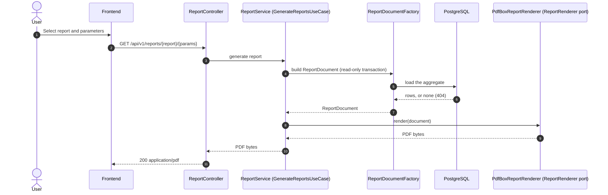

`ReportService` implements the inbound port but lives in `adapter.out.report`; moving the orchestration into
`application.usecase.report` is part of [#2486](https://github.com/matiaspakua/notaire/issues/2486).

Reports are generated in-house since #567: the six JasperReports 3.5.3 templates queried
the legacy MySQL schema and were replaced by `ReportDocumentFactory` (current domain model)
and a PDFBox adapter behind the `ReportRenderer` outbound port. The PDF library stays out of
the application layer. Slice 1 (#1593) adds the shared design system — embedded Liberation
Sans, text wordmark, repeating chrome, injected clock/zone, and centralized PDF headers.
See [pdf-report-design-system.md](pdf-report-design-system.md).

---

## 7. Deployment View

### 7.1 Development Environment

`docker-compose.yml` plus `infra/observability/docker-compose.yml`. Published ports: frontend 3000, backend 8080,
PostgreSQL 5432, pgAdmin 5050, Grafana 3001 (loopback), Prometheus 9090, Loki 3100, Alertmanager 9093, Homer 8888.

<!-- likec4-view: dev -->
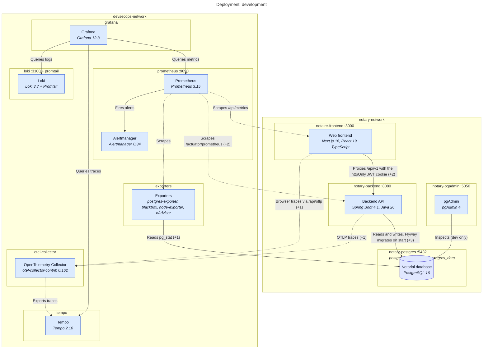
<!-- /likec4-view -->

#### Production (`docker-compose.prod.yml`)

The reverse proxy is the only published port; TLS terminates in front of it
([HTTPS-TLS-RUNBOOK](../206-security/HTTPS-TLS-RUNBOOK.md)). Red arrows are open findings:
[#2487](https://github.com/matiaspakua/notaire/issues/2487) (actuator on the ingress) and
[#2488](https://github.com/matiaspakua/notaire/issues/2488) (MFA key, MFA policy and `COOKIE_SECURE` missing).

<!-- likec4-view: prod -->
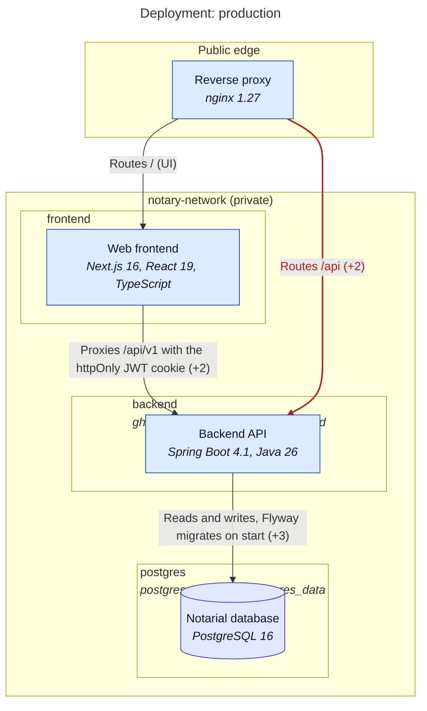
<!-- /likec4-view -->

#### Staging (Kustomize)

<!-- likec4-view: staging -->
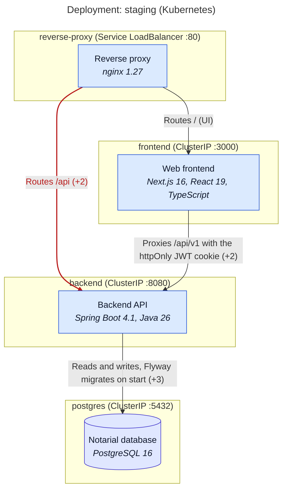
<!-- /likec4-view -->

The staging PostgreSQL keeps its data on `emptyDir` ([#2489](https://github.com/matiaspakua/notaire/issues/2489)).

### 7.2 Network Configuration

| Network | Services | Purpose |
|---------|----------|---------|
| `notary-network` | postgres, backend, pgadmin, frontend | Application communication |
| `devsecops-network` | prometheus, alertmanager, grafana, loki, promtail, tempo, otel-collector, exporters, sonarqube, homer | DevSecOps internal |
| `notaire_notary-network` (external) | Shared between app and infra stacks | Cross-stack monitoring |

### 7.3 Container Resource Limits

| Container | Memory Limit | Memory Reserved |
|-----------|-------------|----------------|
| `notary-backend` | 1024 MB | 512 MB |
| All others | Docker defaults | — |

### 7.4 Startup Dependencies

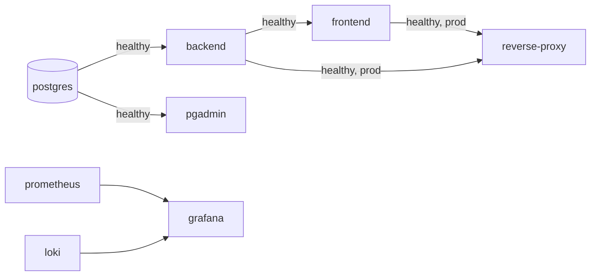

### 7.5 Tenancy and Isolation

The system is **single tenant per notary** (ADR-029). Every installation runs the same versioned product
release (backend, frontend, data model; ADR-028) but owns its data: database, `JWT_SECRET`, actuator
credentials, application admin account, backups and observability stack. Installations never share a
database or a signing secret, so a token or an id from one notary is meaningless in another installation.

The standard roles and permissions are part of database initialization (Flyway, insert-if-absent), so a new
installation starts with a working default configuration that the tenant can later customize. Upgrades never
overwrite a tenant's changes.

---

## 8. Cross-cutting Concepts

### 8.1 Security

**Authentication:**

- JWT tokens issued by `JwtTokenService` upon successful login.
- `JwtAuthenticationFilter` accepts HttpOnly cookie `notaire-auth-token` **or**
  `Authorization: Bearer` (issue #1051).
- Browser token storage: HttpOnly cookie (not `localStorage`). Zustand persists
  user profile only; UX cookies `notaire-auth-status` / `notaire-auth-role` are
  non-credential route markers (#1052). API tooling still uses Bearer.
- Production CSP: nonce-based `script-src`, no `'unsafe-eval'` (#1051).
- `LoginAttemptService` locks out a username after repeated failed attempts
  (in-memory, single-instance — not a general API rate limiter).
- `ProductionCredentialsGuard` blocks startup if default passwords are used in production.

**Authorization:**

- Every `/api/**` request must be authenticated (valid JWT), except login and logout.
- `UserAuthorityResolver` grants `ROLE_ADMIN` to active users of type Administrador or Admin,
  `ROLE_NOTARY` to type Escribano (#1638) and `ROLE_USER` to other active users.
  `SecurityAndCorsConfig` requires `ROLE_ADMIN` for user, role, and audit-log paths and for admin
  catalog writes (#559).
- Tenancy (ADR-029): one installation serves one notary; the office shares its files, so there is no
  per-record ownership check. Cross-notary isolation comes from the deployment (section 7.5).
- Roles and their module grants (`roles`, `role_modules`) are the customizable permission model: a
  standard template is seeded at database initialization and each tenant may change it.
  `RoleModuleAuthorizationFilter` enforces the grants on every API path (ADR-029 W2, #1683), after
  `JwtAuthenticationFilter` and `ApiRateLimitFilter` (per-user quota, ADR-018).
- Administrators and notaries complete a TOTP challenge before a session is issued when the MFA policy
  requires it (ADR-032, #1640); TOTP secrets are encrypted with AES-256-GCM.
- Extending enforcement means adding a path in `SecurityAndCorsConfig` and a case
  in `RbacIntegrationTest` (see [API Authentication Guide](../206-security/API-AUTHENTICATION-GUIDE.md#extending-rbac)).

**API Security:**

- CORS configured in `SecurityAndCorsConfig`.
- All endpoints under `/api/v1/**` require JWT (except login).
- Actuator endpoints secured with separate credentials; health and info are public.

The controls, and the open findings on the production ingress, are drawn in the
[security view](../206-security/README.md#security-architecture-views).

### 8.2 Error Handling

All errors follow a uniform response structure defined in `ErrorResponse`:

```json
{
  "timestamp": "2026-08-18T12:00:00Z",
  "status": 400,
  "error": "Bad Request",
  "message": "Validation failed",
  "path": "/api/v1/people",
  "traceId": "abc123",
  "details": { "field": "identificationNumber", "message": "Must be numeric" }
}
```

**Exception Hierarchy:**

- `NotaireException` — Base exception
- `BusinessValidationException` — 400 Bad Request
- `ResourceNotFoundException` — 404 Not Found
- Global handling via `GlobalExceptionHandler` (`@ControllerAdvice`)

### 8.3 Audit Trail

- `AuditAspect` (Spring AOP) intercepts annotated controller methods.
- `AuditModuleResolver` maps controllers to functional modules.
- `AuditOperationDescriber` generates human-readable operation descriptions.
- Records stored in the `audit_records` table.
- Queryable via `AuditRecordController` → `/api/v1/audit-log`.
- Frontend audit view at `/dashboard/audit`.

### 8.4 Database Schema Management

- **Flyway** is the single source of truth for database schema.
- Migrations located at `backend-api/src/main/resources/db/migration/`.
- Docker starts PostgreSQL **empty**; Flyway applies the versioned migrations on backend startup, through V53 at the time of v3.5. Applied files stay immutable. The full, current list is rendered on GitHub Pages at `/docs/database/`, straight from `db/migration/`.
- Historical `init-db/` scripts archived at `docs/000-archive/init-db/`.
- Repeatable migrations (`R__`) used for reversible operations.

**Current Migrations:**

| Version | Description |
|---------|------------|
| V1 | Initial schema (all tables) |
| V2 | Initial seed data |
| V3 | Add missing entity columns |
| V4 | Fix missing schema columns |
| V5 | Align `testimony_movements` with the JPA entity |
| V6 | Make `submitted_documents.fk_id_procedure` optional |
| V7 | Add workflow tables |
| V8 | Link `procedure_types` to a workflow |
| V9 | Add roles and permissions |
| V10 | Seed workflow demo data |
| V11 | Align `concepts.version` with the archived init script |
| V12 | Create postgres_exporter role (pg_monitor) |
| V13 | Make `procedures.name` and `procedures.number` optional |
| V14 | Drop `budgets.fk_id_tramite`. The canonical link is `procedures.fk_id_budget` |
| R14 | Manual rollback script that restores `budgets.fk_id_tramite`. Flyway does not run it |
| V45 | Rename the remaining Spanish identifiers. `R45` reverses that rename |
| V46 | Rename Spanish constraint names. `R46` restores the previous names |
| V47–V53 | Append-only audit, login attempts, admin promotion, standard role template, exporter grants (`R51`), bcrypt seed password, office staff catalog module |

### 8.5 Observability

**Metrics (Prometheus):**

- Spring Boot Actuator exposes `/actuator/prometheus`.
- Custom metrics via `MetricsUtil`; the frontend exposes `/api/metrics`.
- OTLP traces from backend and frontend go through the OpenTelemetry Collector to Tempo; Prometheus fires alerts to Alertmanager.
- `ApplicationHealthIndicator` for custom health checks.
- `postgres-exporter` provides database-level metrics.

**Logging (Loki):**

- Structured JSON logging via `StructuredLogger`.
- Logback configuration with JSON appender.
- Promtail collects logs from Docker containers.
- Centralized viewing in Grafana.

**Dashboards (Grafana :3001):**

- Application metrics (JVM, HTTP, custom).
- Database metrics (connections, query time, table sizes).
- Log exploration and alerting.

**Code Quality (SonarQube :9000):**

- Static analysis on every build.
- Coverage: raise-only floors, JaCoCo 85% line / 70% branch and Vitest 87/79/85/88; Owner target above 90%
  (#2046, [Code Quality](../../300-development/303-testing/README.md)).

### 8.6 Design System (Frontend)

- **Single source of truth**: `frontend/src/theme/tokens.ts`.
- **Design language**: Apple-inspired (macOS Sequoia / iOS 18).
- **Token categories**: Colors (neutral 0-900, semantic), typography (SF Pro), spacing (8px grid), border-radius, shadows, transitions.
- **Form pattern**: `FormContainer → FormSection → FormField → FormActions`.
- **Rule**: No hardcoded CSS values — all styling via tokens.

### 8.7 API Design

- All endpoints under `/api/v1/` prefix.
- RESTful resource naming (English collections: `/managements`, `/people`, `/deeds`).
- OpenAPI 3.0 documentation via `OpenApiConfig` at `/swagger-ui.html`.
- Response wrapping with the DTOs in `backend-api` (`com.licensis.notaire.dto`).
- Pagination support on list endpoints.

### 8.8 Testing Strategy

| Level | Tool | Scope | Size (2026-11-24) |
|-------|------|-------|--------|
| Unit + architecture (backend) | JUnit 5, Mockito, ArchUnit | Use cases, domain, mappers, R1–R7 | 430 test classes in `backend-api` |
| Unit / Component (frontend) | Vitest + Testing Library | Core, adapters, hooks, components, boundaries | 148 test files |
| Integration | Spring Boot Test, H2 and Testcontainers PostgreSQL | Controllers, security chains, Flyway, JPA | — |
| API | Bruno (`backend-api/api-test/`) | Endpoints per use case (`CU-API-MATRIX.csv`) | 423 requests |
| E2E (UI/UX) | Playwright + axe | User flows per use case at 320/768/1024 px | 107 specs |
| Static Analysis | Checkstyle, SpotBugs, SonarQube | New code | No new blocker, critical or major |

Which suite verifies which part of the system, and the gates around them, are drawn in
[TEST-PLAN.md](../../300-development/303-testing/TEST-PLAN.md#architecture-views).

### 8.9 Legacy Coexistence

The `jpa` and `service` packages are gone (#576, #1918). What remains of the legacy layer:

- `business`: the JPA model (36 `@Entity` classes among 47), used by the persistence adapters, `config`,
  `audit` and `security` ([#2486](https://github.com/matiaspakua/notaire/issues/2486));
- `repository`: 36 Spring Data repositories, same users;
- `dto`: web DTOs that eight contexts still use in their ports and use cases
  ([#2485](https://github.com/matiaspakua/notaire/issues/2485)).

**Rule**: no new dependents on these packages. ArchUnit does not enforce it yet
([#2484](https://github.com/matiaspakua/notaire/issues/2484)).

---

## 9. Architectural Decisions

All decisions are documented as Architecture Decision Records (ADRs) in `docs/200-architecture/202-ADR/`.

| ADR | Title | Status | Scope |
|-----|-------|--------|-------|
| [ADR-001](../202-ADR/ADR-001-microservices-architecture.md) | Microservices Architecture | Accepted | System architecture |
| [ADR-002](../202-ADR/ADR-002-module-structure.md) | Module Structure | Accepted | Code organization |
| [ADR-003](../202-ADR/ADR-003-rest-api-versioning.md) | REST API Versioning | Accepted | API evolution |
| [ADR-004](../202-ADR/ADR-004-database-migration.md) | Database Migration | Accepted | Data persistence |
| [ADR-005](../202-ADR/ADR-005-modern-frontend-migration.md) | Modern Frontend Migration | Accepted | Frontend architecture |
| [ADR-006](../202-ADR/ADR-006-testing-strategy.md) | Testing Strategy | Accepted | QA & validation |
| [ADR-007](../202-ADR/ADR-007-database-schema-versioning-flyway.md) | Database Schema Versioning (Flyway) | Accepted | Data persistence |
| [ADR-008](../202-ADR/ADR-008-security-authentication.md) | Security & Authentication | Accepted | Security |
| [ADR-009](../202-ADR/ADR-009-logging-monitoring.md) | Logging & Monitoring | Accepted | Observability |
| [ADR-010](../202-ADR/ADR-010-error-handling.md) | Error Handling | Accepted | Resilience |
| [ADR-011](../202-ADR/ADR-011-centralized-design-system.md) | Centralized Design System | Accepted | UI/UX |
| [ADR-012](../202-ADR/ADR-012-ci-cd-pipeline.md) | CI/CD Pipeline Strategy | Accepted | DevOps |
| [ADR-013](../202-ADR/ADR-013-audit-trail.md) | Audit Trail Implementation | Accepted | Compliance |
| [ADR-014](../202-ADR/ADR-014-workflow-engine.md) | Workflow Engine | Accepted | Business logic |
| [ADR-015](../202-ADR/ADR-015-internationalization.md) | Internationalization | Accepted | UX |
| [ADR-016](../202-ADR/ADR-016-observability-stack.md) | Observability Stack Topology | Accepted | Observability |
| [ADR-017](../202-ADR/ADR-017-container-base-images.md) | Container / Base-Image Strategy | Accepted | DevOps |
| [ADR-018](../202-ADR/ADR-018-rate-limiting-policy.md) | Rate-Limiting Policy | Accepted | Security |
| [ADR-019](../202-ADR/ADR-019-secrets-management.md) | Secrets Management | Accepted | Security |
| [ADR-020](../202-ADR/ADR-020-openapi-exposure-policy.md) | OpenAPI Exposure Policy | Accepted | Security & API |
| [ADR-021](../202-ADR/ADR-021-hexagonal-architecture-pilot.md) | Hexagonal Architecture Pilot | Accepted | Code organization |
| [ADR-022](../202-ADR/ADR-022-git-history-rewrite-and-large-binaries.md) | Git History Rewrite and Large Binaries | Accepted | Repository |
| [ADR-023](../202-ADR/ADR-023-rest-resource-naming.md) | REST Resource Naming | Accepted | API |
| [ADR-024](../202-ADR/ADR-024-repository-topology.md) | Repository Topology | Proposed | Repository |
| [ADR-025](../202-ADR/ADR-025-retire-notaire-shared.md) | Retire notaire-shared | Accepted | Code organization |
| [ADR-026](../202-ADR/ADR-026-module-separation.md) | Module Separation | Accepted | Code organization |
| [ADR-027](../202-ADR/ADR-027-mermaid-diagrams.md) | Mermaid Diagrams (amended by ADR-033) | Accepted | Documentation |
| [ADR-028](../202-ADR/ADR-028-release-and-version-identity.md) | Release and Version Identity | Accepted | Release |
| [ADR-029](../202-ADR/ADR-029-object-level-authorization.md) | Object-level Authorization | Proposed | Security |
| [ADR-030](../202-ADR/ADR-030-hexagonal-architecture-full-adoption.md) | Full Ports & Adapters | Accepted | Code organization |
| [ADR-031](../202-ADR/ADR-031-local-ai-assistant.md) | Local AI Assistant | Proposed | AI |
| [ADR-032](../202-ADR/ADR-032-multi-factor-authentication-totp.md) | Multi-factor Authentication (TOTP) | Accepted | Security |
| [ADR-033](../202-ADR/ADR-033-likec4-architecture-model.md) | LikeC4 Architecture Model | Accepted | Documentation |

---

## 10. Quality Requirements

### 10.1 Quality Tree

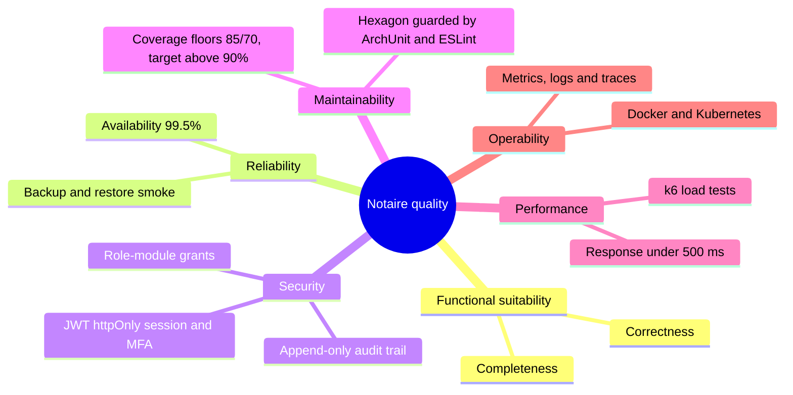

### 10.2 Quality Scenarios

| ID | Quality Attribute | Scenario | Metric |
|----|------------------|----------|--------|
| QS-01 | Performance | API response for single-entity CRUD | < 500ms avg |
| QS-02 | Performance | Report generation with complex queries | < 3s |
| QS-03 | Availability | System uptime during business hours | 99.5% |
| QS-04 | Security | All create/update/delete operations (and logins) logged in audit trail; read-only GETs excluded | 100% coverage of mutating operations |
| QS-05 | Security | Failed login attempts trigger a per-username lockout (`LoginAttemptService`, single-instance, not a general API rate limiter) | 5 failed attempts → 15 min lockout |
| QS-06 | Testability | Code coverage across backend | Floor 85% line / 70% branch; target > 90% (#2046) |
| QS-07 | Maintainability | New feature development time | < 6 months |
| QS-08 | Maintainability | Developer onboarding time | < 2 weeks |
| QS-09 | Scalability | Backend horizontal scaling | Stateless containers |
| QS-10 | Deployability | Full stack startup time | < 3 minutes |

---

## 11. Risks and Technical Debt

### 11.1 Current Risks

| Risk | Impact | Probability | Mitigation |
|------|--------|-------------|------------|
| JPA model and web DTOs still in legacy packages | High — persistence types and web DTOs reach ports | Certain | One context per PR ([#2485](https://github.com/matiaspakua/notaire/issues/2485), [#2486](https://github.com/matiaspakua/notaire/issues/2486)); guard them in ArchUnit ([#2484](https://github.com/matiaspakua/notaire/issues/2484)) |
| Production ingress publishes every actuator endpoint | High — threaddump, loggers and mappings behind one shared credential | Certain | Forward only `/actuator/health` ([#2487](https://github.com/matiaspakua/notaire/issues/2487)) |
| Production deployments omit the MFA key, the MFA policy and `COOKIE_SECURE` | High — MFA cannot be enrolled, session cookie without `Secure` | Certain | Wire them in compose and Kustomize ([#2488](https://github.com/matiaspakua/notaire/issues/2488)) |
| Kustomize PostgreSQL on `emptyDir` | High for any real use — data lost on restart | Certain in staging | PVC or a documented ephemeral base ([#2489](https://github.com/matiaspakua/notaire/issues/2489)) |
| ~~`ControllerNegocio.java` (5,337 lines) — God class~~ (renamed `BusinessController`, removed in #900) | Resolved — only two identification-type lookups were reachable; now `business/IdentificationTypeLookup` | — | Done (#900) |
| Legacy Swing client resurrected on `main` | Low — Dependabot noise / confusion | Low | Keep deleted (#1046); do not recreate; history in git |
| No production deployment target defined | Medium — no deployment pipeline to production | Medium | Mitigated for topology: `docker-compose.prod.yml` (#1044) + staging Kustomize (#901). CD remains publish-only; TLS/backups/SLOs are separate issues |
| Default credentials in `.env` | Critical — security risk if deployed as-is | Medium | `ProductionCredentialsGuard` blocks startup with defaults |

### 11.2 Technical Debt Inventory

| Item | Location | Severity | Effort |
|------|----------|----------|--------|
| ~~~35 legacy JPA controllers~~ | `jpa` deleted (#576) | Resolved | — |
| JPA model outside the persistence adapters | `business`, `repository` | High | Large — [#2486](https://github.com/matiaspakua/notaire/issues/2486) |
| Ports and use cases on legacy web DTOs | `application.*` → `dto` (40 files) | Medium | Medium — [#2485](https://github.com/matiaspakua/notaire/issues/2485) |
| ~~`ControllerNegocio.java` God class (5,337 lines)~~ | removed in #900 (`business/BusinessController.java` deleted) | Resolved | — |
| ~~`JpaAdministrator` + `LegacyJpaEmfConfig`~~ | `service` deleted (#1918) | Resolved | — |
| ~~`ValidationAdministrator` / `SessionAdministrator`~~ | deleted in #1918 | Resolved | — |
| Missing service classes for some entities | `service/` | Low | Superseded by hex adapters |
| Legacy Swing tree deleted from `main` (#1046) | git history only | Resolved | — |
| `GuiConstants.java` in audit package | `audit/GuiConstants.java` | Low | Small |

The findings of the modelling pass, each with its Issue:

<!-- likec4-view: findings -->
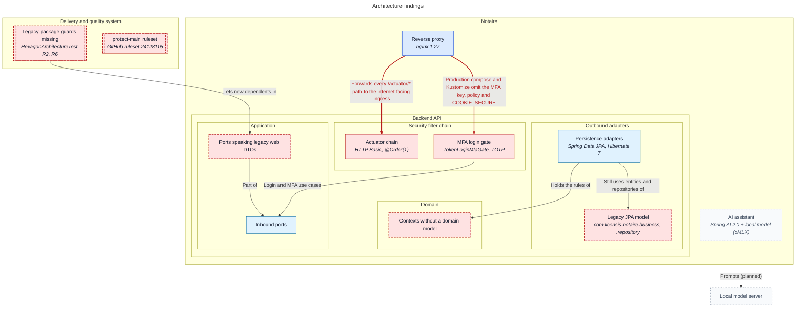
<!-- /likec4-view -->

### 11.3 Evolution Roadmap

> 📊 **Live status**: [Notaire — Delivery Board](https://github.com/users/matiaspakua/projects/1) ·
> [`docs/github/README.md`](../../github/README.md) ·
> [DEVELOPMENT-PLAN §5](../../300-development/DEVELOPMENT-PLAN.md).
> Historical snapshots (do not update): [`docs/000-archive/github/`](../../000-archive/github/).
>
> The manager's roadmap is [Project management](../../300-development/305-project-management/README.md)
> (history cohorts, delivery trains, requirements catalog, parallel-agent lanes).
> Product semver cuts are a separate clock ([RELEASES.md](../../300-development/305-project-management/RELEASES.md)).
> Counts and the Pages chart live there. This section keeps the phase narrative.
> Milestone numbers **#6, #7, #8, and #10** from earlier revisions were deleted.
> Do not recreate those numbers.

#### Migration phases

| Phase | Status | Where the work is tracked |
|-------|--------|---------------------------|
| Phase 1 — Analysis | Complete | `H1 · Revival & foundations (2026-03–2026-04)` and the Q2 cohort |
| Phase 2 — Foundation | Complete | Shared DTO module retired (ADR-025); preserved in Q2 history |
| Phase 3 — Backend API | Complete | `H2 · REST API migration (2026-05)` and the Q2 cohort |
| Phase 4 — Modern Frontend | In progress | `v0.4 · Product completeness (2026-12)`; tracker [#898](https://github.com/matiaspakua/notaire/issues/898) |
| Phase 5 — Observability | Complete | `H3 · Platform & observability (2026-06)` and the Q3 cohort |
| Phase 6 — Deprecation | Partial | `v1.0 · GA: legacy-free (2027-03)`; Swing is gone and `jpa` cleanup moved into `v0.3` with #1693 ([#899](https://github.com/matiaspakua/notaire/issues/899)) |

#### Short Term (`v0.4 · Product completeness (2026-12)`)

1. **Complete Next.js frontend pages for all 73 use cases** — tracking issue [#898](https://github.com/matiaspakua/notaire/issues/898).
   Key open items: deed managements (#804, #806), deeds (#838, #839), budgets (#797, #821, #822, #823), people (#829, #835).
2. **Fix critical bugs blocking frontend** — #829 (Person create), #835 (person deduplication), #799 (uniqueness), #801 (SubmittedDocument mapping).
3. ~~Extract `ControllerNegocio` logic into dedicated service classes~~ — resolved by deleting the class ([#900](https://github.com/matiaspakua/notaire/issues/900)); its only live behaviour moved to `IdentificationTypeLookup`.

#### Medium Term (`v1.0 · GA: legacy-free (2027-03)`)

1. **Replace all `jpa` package controllers** with `repository` + `service` — [#576](https://github.com/matiaspakua/notaire/issues/576).
2. **Swing client retirement** — complete: directory removed under [#1046](https://github.com/matiaspakua/notaire/issues/1046) (do not recreate). Remaining Phase 6 focus is `jpa` cleanup — [#899](https://github.com/matiaspakua/notaire/issues/899).
3. **Enable quality gates** that are currently advisory-only: Checkstyle [#710](https://github.com/matiaspakua/notaire/issues/710), SpotBugs [#711](https://github.com/matiaspakua/notaire/issues/711), Trivy [#712](https://github.com/matiaspakua/notaire/issues/712).
4. **Implement RBAC enforcement** (per-role authorization) — [#559](https://github.com/matiaspakua/notaire/issues/559).

#### Long Term (post-legacy-retirement)

1. **Add Kubernetes deployment manifests** for production — [#901](https://github.com/matiaspakua/notaire/issues/901) (production deployment risk) — **shipped** as Kustomize base + staging overlay under `infra/deploy/kustomize/` (mirrors #1044 four-service stack; CD apply-to-cluster still future work).
2. **Implement WebSocket support** for real-time workflow updates.
3. **Add batch processing** for report generation.

#### Tech Debt Priority Queue (SAD §11.2 mapped to GitHub Issues)

| Severity | Item | GitHub Issue | Scheduling rule |
|----------|------|-------------|-----------|
| ✅ Resolved | `ControllerNegocio` God class (5,337 lines) removed | [#568](https://github.com/matiaspakua/notaire/issues/568), [#900](https://github.com/matiaspakua/notaire/issues/900) | Closed history |
| 🔴 Critical | Controllers instantiate JPA directly (no Spring DI) | [#574](https://github.com/matiaspakua/notaire/issues/574) | v0.3 |
| 🔴 Critical | Raw-JDBC `Conexion` singleton bypasses HikariCP | [#575](https://github.com/matiaspakua/notaire/issues/575) | v0.3 |
| 🟠 High | 26 legacy JPA controllers | [#576](https://github.com/matiaspakua/notaire/issues/576) | v0.3 |
| 🟠 High | Business logic in controllers, not services | [#578](https://github.com/matiaspakua/notaire/issues/578) | v0.3 |
| 🟠 High | Controllers return JPA entities instead of DTOs | [#577](https://github.com/matiaspakua/notaire/issues/577) | v0.3 |
| 🟠 High | `GlobalExceptionHandler` bypassed in 26 controllers | [#579](https://github.com/matiaspakua/notaire/issues/579) | v0.3 |
| 🟡 Medium | `JpaAdministrator` singleton in service layer | [#584](https://github.com/matiaspakua/notaire/issues/584) | v0.3 |
| 🟡 Medium | Domain entities depend on DTOs (inverted dependency) | [#580](https://github.com/matiaspakua/notaire/issues/580) | v0.3 |

---

## 12. Glossary

| Term | Definition |
|------|-----------|
| **Notary office** | Argentine notary office. The Spanish word escribanía remains in some stored labels. |
| **Notary (Escribano)** | Licensed notary public. The stored role name `ESCRIBANO` stays. |
| **Clerk (Gestor)** | Assistant who manages daily procedures |
| **Deed management** | Notarial case. Table `deed_managements`. |
| **Deed** | Notarial deed (legal document). Table `deeds`. |
| **Folio** | Numbered page in the notarial protocol book |
| **Testimony** | Certified copy of a notarial deed |
| **Copy** | Copy of a folio or deed |
| **Budget** | Quote for notarial services. Table `budgets`. Stored statuses such as `BORRADOR` stay. |
| **Procedure** | Notarial act linked to a deed management. Table `procedures`. Message keys such as `gestiones` stay. |
| **Person** | Individual or legal entity involved in notarial acts |
| **Property** | Real estate property involved in notarial acts |
| **API REST** | HTTP/JSON interface between frontend and backend |
| **DTO** | Data Transfer Object — API contract between layers |
| **JPA** | Java Persistence API (Hibernate implementation) |
| **JWT** | JSON Web Token for stateless authentication |
| **RBAC** | Role-Based Access Control |
| **Flyway** | Database schema migration tool |
| **LPG Stack** | Loki + Prometheus + Grafana observability stack |
| **TDD** | Test-Driven Development |
| **ADR** | Architecture Decision Record |
| **OpenSpec** | Specification tool for SDLC workflow |

---

## References

### Project Documents

- [CONSTITUTION.md](../../../CONSTITUTION.md) — Engineering process
- [AGENTS.md](../../../AGENTS.md) — Agent configuration
- [CHANGELOG.md](../../../CHANGELOG.md) — Version history
- [ADR Index](../202-ADR/README.md) — All architectural decisions
- [Design System](../203-design/FRONTEND-DESIGN-SYSTEM.md) — Frontend design guide
- [ADR-007](../202-ADR/ADR-007-database-schema-versioning-flyway.md) — Flyway implementation details

### External References

- [arc42 Template](https://docs.arc42.org/home/)
- [Spring Boot 4.1 Documentation](https://docs.spring.io/spring-boot/docs/current/reference/htmlsingle/)
- [Next.js Documentation](https://nextjs.org/docs)
- [Flyway Documentation](https://flywaydb.org/documentation/)
- [PostgreSQL 16 Documentation](https://www.postgresql.org/docs/16/)

### Diagram Sources

**Architecture views come from the [LikeC4 model](../210-architecture-model/README.md)**
([ADR-033](../202-ADR/ADR-033-likec4-architecture-model.md)); the Mermaid blocks between `likec4-view` markers are
generated by `npm run generate` and must not be edited by hand. The interactive model is published on
[GitHub Pages](https://matiaspakua.github.io/notaire/architecture-model/). Other active diagrams are Mermaid
([ADR-027](../202-ADR/ADR-027-mermaid-diagrams.md)); policy in [`204-diagrams/README.md`](../204-diagrams/README.md).
The superseded architecture PlantUML files are archived in `docs/000-archive/200-architecture/204-diagrams/`.

Business PlantUML sources remain in `docs/200-architecture/204-diagrams/` until migrated:

- `data-model-core.puml` — Core entity relationships
- [`Casos de Uso/`](../204-diagrams/Casos%20de%20Uso/) — Use-case diagrams grouped by module (deed managements, administration, clients, payments, protocols, budgets). The folder name stays.
