# Software Architecture Document (SAD) — Notaire

> **arc42 Template v8.2** — based on [docs.arc42.org](https://docs.arc42.org/home/)
>
> **Version:** 3.4 | **Date:** 2026-10-11 | **Author:** Architecture Team
>
> **Changelog v3.4**: §6 points at [GESTION.md](../203-design/GESTION.md) for the case-process analysis. States stay in CICLO-DE-VIDA.md.
>
> **Changelog v3.3**: English names for the current schema (Java 26, Spring Boot 4.1.1, Flyway through V46). §6 points at [CICLO-DE-VIDA.md](../203-design/CICLO-DE-VIDA.md) as the single domain lifecycle. Stored labels such as `Escribano` stay. Existing PlantUML runtime sketches stay legacy (ADR-027).
>
> **Changelog v3.2**: Delivery tracking points at [Notaire — Delivery Board #1](https://github.com/users/matiaspakua/projects/1) (Project #4 is gone). In-repo module ownership: [MODULE-OWNERSHIP.md](../../300-development/MODULE-OWNERSHIP.md) / ADR-026. Active diagrams: Mermaid only (ADR-027). Technical docs also render on GitHub Pages `/docs/`.
>
> **Changelog v3.1**: §11.3 Evolution Roadmap aligned with GitHub Project milestones #6–#11, tracking issues #898–#902, tech-debt and risk issue references (board link corrected in v3.2).

---

## Table of Contents

1. [Introduction and Goals](#1-introduction-and-goals)
2. [Constraints](#2-constraints)
3. [Context and Scope](#3-context-and-scope)
4. [Solution Strategy](#4-solution-strategy)
5. [Building Block View](#5-building-block-view)
6. [Runtime View](#6-runtime-view)
7. [Deployment View](#7-deployment-view)
8. [Cross-cutting Concepts](#8-cross-cutting-concepts)
9. [Architectural Decisions](#9-architectural-decisions)
10. [Quality Requirements](#10-quality-requirements)
11. [Risks and Technical Debt](#11-risks-and-technical-debt)
12. [Glossary](#12-glossary)

---

## 1. Introduction and Goals

### 1.1 Requirements Overview

**Notaire** is a notarial management system for Argentine notary offices. It manages the complete lifecycle of notarial operations including:

- **Deed managements** — Notarial case workflows
- **People** — Registry of individuals and legal entities involved in deeds
- **Deeds** — Deed registry with folios, copies, and testimonies
- **Budgets** — Quotes and payment tracking
- **Procedures** — Notarial acts linked to people and deed managements
- **Audit** — Audit trail for legal compliance

The system originated as a monolithic Java Swing desktop application with direct MySQL access. It is being modernized into a three-tier web architecture while preserving all 73 original use cases.

### 1.2 Quality Goals

| Priority | Quality Goal | Scenario |
|----------|-------------|----------|
| 1 | **Maintainability** | New features delivered in < 6 months; developers onboard in < 2 weeks |
| 2 | **Testability** | ≥ 80% code coverage; all changes validated by unit, integration, and E2E tests |
| 3 | **Security** | JWT authentication, `ROLE_ADMIN` on admin paths and admin writes, full audit trail for legal compliance. Object-level checks remain open (SR-11) |
| 4 | **Scalability** | Backend scales horizontally via stateless containers |
| 5 | **Observability** | Real-time metrics, structured logs, and alerts via LPG stack |

### 1.3 Stakeholders

| Role | Expectations |
|------|-------------|
| **Escribano (Notary)** | Reliable system for daily operations; data integrity; legal compliance |
| **Gestor (Clerk)** | Efficient workflow for managing deed managements and procedures |
| **Architect / Lead Dev** | Clean architecture; testable; documented decisions (ADRs) |
| **DevOps / SRE** | Observable system; automated deployments; container orchestration |
| **Product Owner** | Feature velocity; migration from legacy without data loss |

---

## 2. Constraints

### 2.1 Technical Constraints

| Constraint | Description |
|-----------|-------------|
| Java 26 | Backend runtime, from the root `pom.xml` |
| Spring Boot 4.1.1 | Backend framework |
| PostgreSQL 16 | Database — migrated from MySQL 5.7 |
| Next.js 16 / React 19 | Frontend framework with App Router |
| Docker / Docker Compose | Containerization for all services |
| Flyway | Database schema versioning — single source of truth |
| Maven 3.9+ | Build system for Java modules |

### 2.2 Organizational Constraints

| Constraint | Description |
|-----------|-------------|
| CONSTITUTION.md | Engineering process mandated for every change |
| OpenSpec SDLC | All changes require proposal → specs → design → tasks workflow |
| TDD | Failing tests written before implementation |
| Conventional Commits | Commit message format enforced by git hooks |
| ADR process | Architectural decisions documented before implementation |

### 2.3 Legal Constraints

| Constraint | Description |
|-----------|-------------|
| Audit trail | All CRUD operations must be recorded for legal compliance |
| Data retention | Notarial records must be preserved indefinitely |
| Access control | Authenticated access to sensitive notarial data. `ROLE_ADMIN` guards admin paths and admin writes; object-level checks are still open (SR-11) |

---

## 3. Context and Scope

### 3.1 Business Context

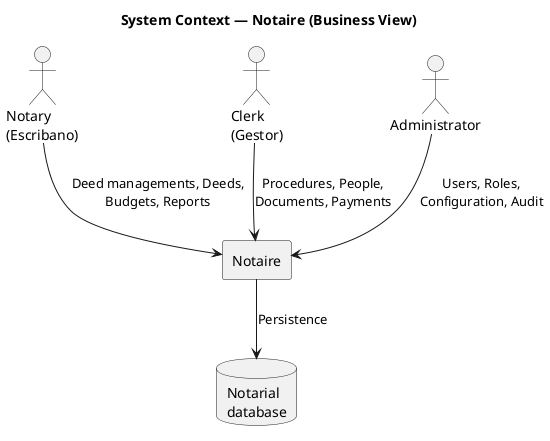

**External Interfaces:**

| Interface | Description |
|-----------|-------------|
| Web Browser | Next.js frontend served at `:3000` |
| REST API | Spring Boot backend at `:8080/api/v1` |
| pgAdmin | Database administration at `:5050` |
| Grafana | Monitoring dashboards at `:3001` |

### 3.2 Technical Context

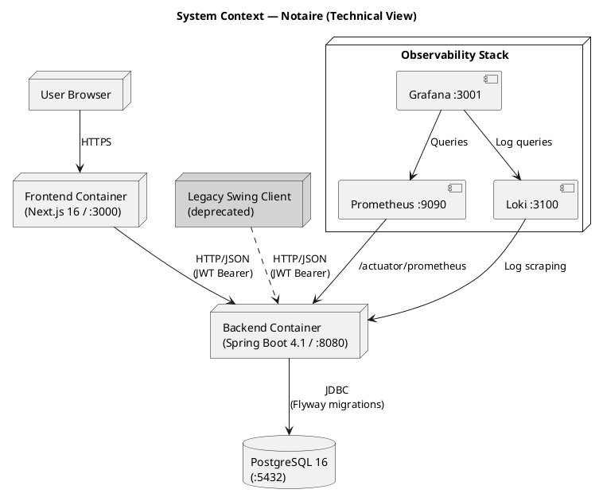

---

## 4. Solution Strategy

### 4.1 Technology Decisions

| Decision | Rationale | ADR |
|----------|-----------|-----|
| Spring Boot 4.1.1 + Java 26 | Current platform in the root `pom.xml` | ADR-001 |
| Maven multi-module | Separation of shared, backend, and frontend concerns | ADR-002 |
| URL-path API versioning (`/api/v1`) | Simple, explicit, cacheable | ADR-003 |
| PostgreSQL 16 (from MySQL 5.7) | Superior JSON support, CTEs, full-text search | ADR-004 |
| Next.js 16 + React 19 | Modern SSR/SSG, App Router, TypeScript | ADR-005 |
| TDD + JaCoCo ≥ 80% + Playwright | Quality assurance at all levels | ADR-006 |
| Flyway migrations | Versioned, reproducible schema evolution | ADR-007 |
| JWT + Spring Security | Stateless auth for multi-client support | ADR-008 |
| LPG observability stack | Lightweight, Kubernetes-ready monitoring | ADR-009 |
| `@ControllerAdvice` error handling | Uniform error responses across all endpoints | ADR-010 |
| Token-based design system | Consistent Apple-inspired UI across all forms | ADR-011 |

### 4.2 Migration Strategy

The modernization follows a **strangler fig pattern** — new features are built exclusively in the modern stack while legacy components are incrementally replaced.

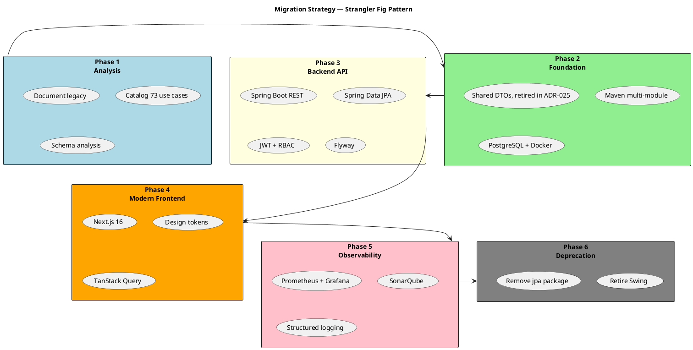

### 4.3 Current Migration Status

| Phase | Status | Details |
|-------|--------|---------|
| Phase 1: Analysis | ✅ Complete | Legacy Swing retired (removed under #1046; history in git); use cases cataloged in `docs/100-business/102-use-cases/` |
| Phase 2: Foundation | ✅ Complete | Shared DTO module (retired, ADR-025), Maven multi-module, Docker Compose |
| Phase 3: Backend API | ✅ Complete | Controllers, repositories, entities, Flyway migrations |
| Phase 4: Frontend | 🔄 In Progress | Next.js 16 app (`frontend/`) — Swing is not a target client |
| Phase 5: Observability | ✅ Complete | Full LPG stack + SonarQube + Homer dashboard |
| Phase 6: Deprecation | 🔶 Partial | Swing client removed from the active build; `jpa` → `repository` migration ongoing |

Live delivery status: [Delivery Board](https://github.com/users/matiaspakua/projects/1) /
[docs/github/README.md](../../github/README.md). Phase narrative:
[DEVELOPMENT-PLAN.md §5](../../300-development/DEVELOPMENT-PLAN.md).

---

## 5. Building Block View

### 5.1 Level 1 — System Decomposition

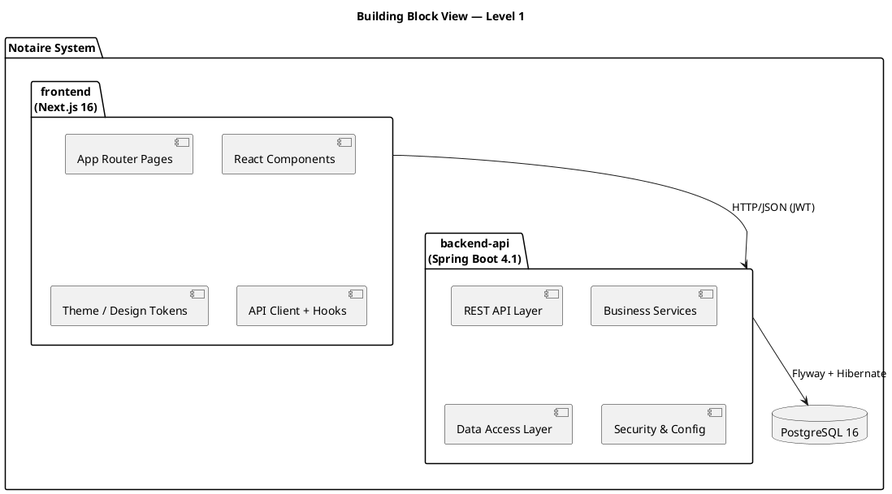

### 5.2 Level 2 — Backend API Internal Structure

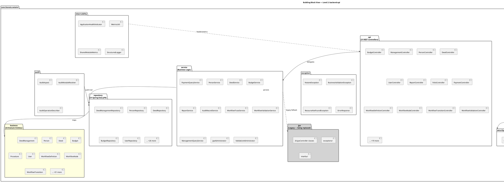

### 5.3 Level 2 — Frontend Internal Structure

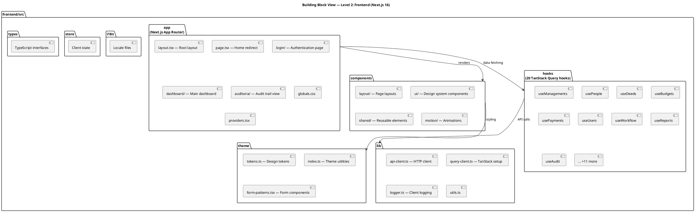

### 5.4 Level 2 — Shared Module (retired)

The `notaire-shared` module was retired under #1255 (see
[ADR-025](../202-ADR/ADR-025-retire-notaire-shared.md)). Its DTO classes
(`com.licensis.notaire.dto`, `dto.exceptions`, `dto.interfaces`) now live in
`backend-api`, and the folder is archived in `deprecated/notaire-shared/`. External
services consume the REST API through the OpenAPI contract, not a Java library.

### 5.5 Core Domain Model

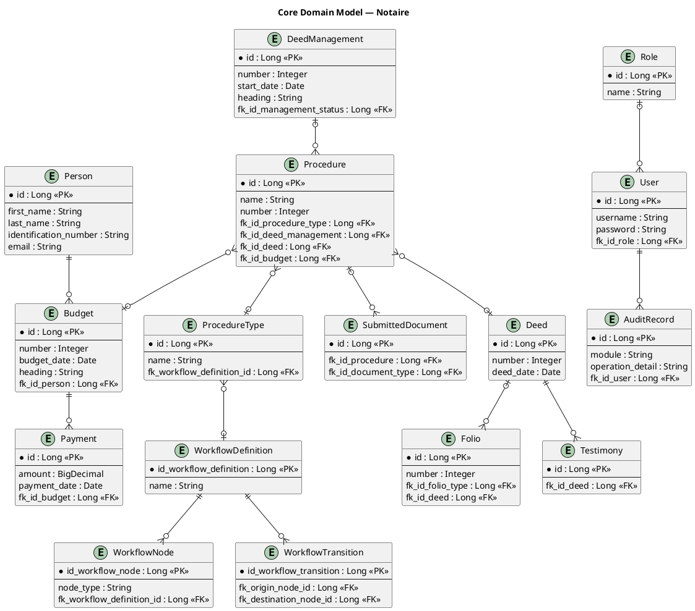

This is a simplified view of the core entities. The full 37-table
schema — every column, type, foreign key, and its Flyway provenance (V1 through V46)
— is maintained in the
[Diccionario de Datos](../205-data-model/Diccionario%20de%20Datos.md), with the
complete ERD at
[`205-data-model/ERD/`](../205-data-model/ERD/). `docs/tests/test_data_dictionary_sync.py`
fails when the dictionary drifts from that ERD. A budget links to a procedure
through `procedures.fk_id_budget`. `budgets.fk_id_tramite` was removed in V14.

---

## 6. Runtime View

Domain lifecycles — management, deed, testimony, registration draft, documents,
budget, payment, procedure folder — are specified once in
[CICLO-DE-VIDA.md](../203-design/CICLO-DE-VIDA.md). The step-by-step case
process (use cases, dependencies, sequences) is
[GESTION.md](../203-design/GESTION.md). The PlantUML sequences in
this section are legacy runtime sketches ([ADR-027](../202-ADR/ADR-027-mermaid-diagrams.md)).
Do not add a second state machine here.

### 6.1 User Authentication Flow

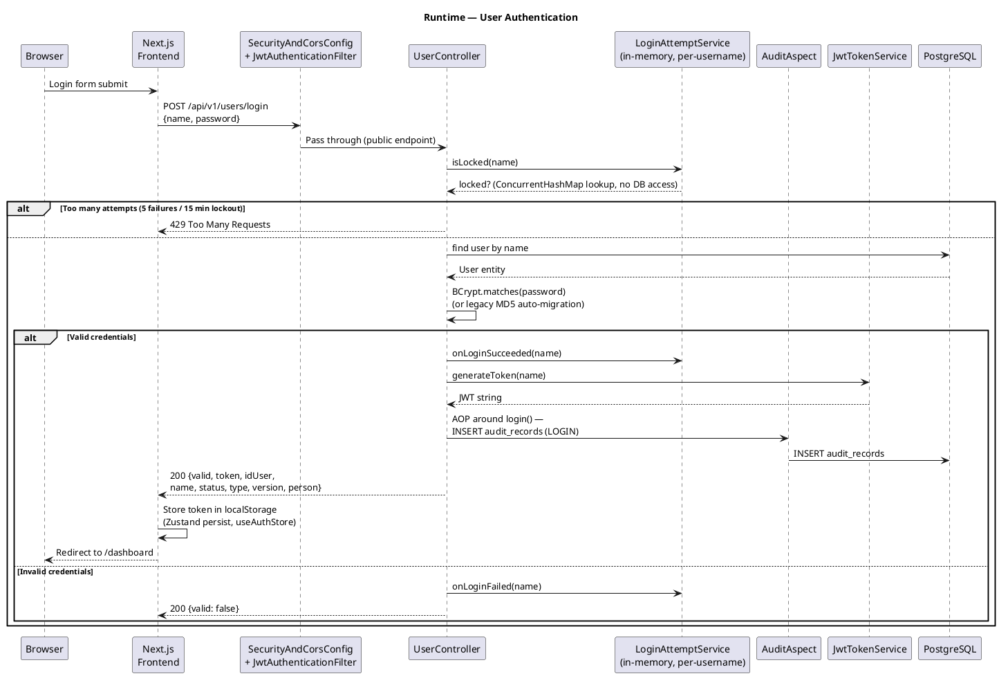

### 6.2 Create a deed management

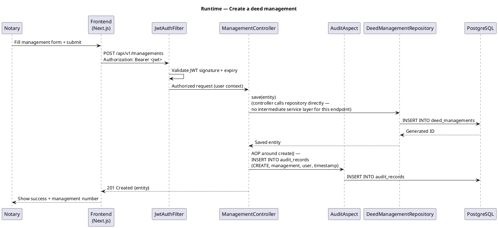

### 6.3 Report Generation

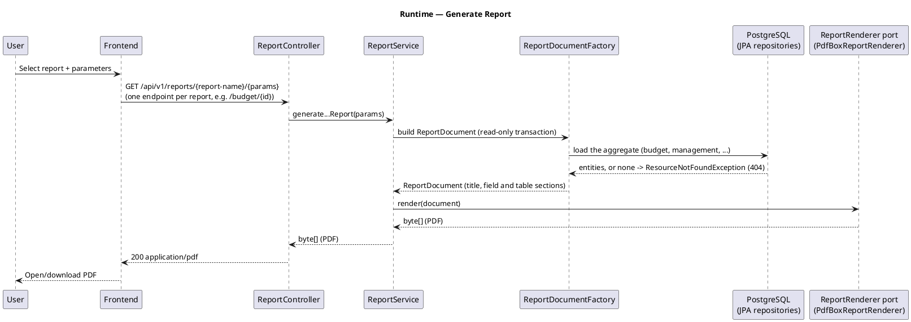

Reports are generated in-house since #567: the six JasperReports 3.5.3 templates queried
the legacy MySQL schema and were replaced by `ReportDocumentFactory` (current domain model)
and a PDFBox adapter behind the `ReportRenderer` outbound port. The PDF library stays out of
the application layer.

---

## 7. Deployment View

### 7.1 Development Environment

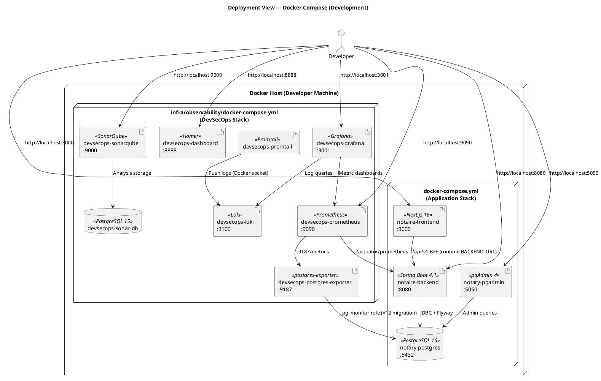

### 7.2 Network Configuration

| Network | Services | Purpose |
|---------|----------|---------|
| `notary-network` | postgres, backend, pgadmin, frontend | Application communication |
| `devsecops-network` | prometheus, grafana, loki, sonarqube | DevSecOps internal |
| `notaire_notary-network` (external) | Shared between app and infra stacks | Cross-stack monitoring |

### 7.3 Container Resource Limits

| Container | Memory Limit | Memory Reserved |
|-----------|-------------|----------------|
| `notaire-backend` | 512 MB | 256 MB |
| All others | Docker defaults | — |

### 7.4 Startup Dependencies

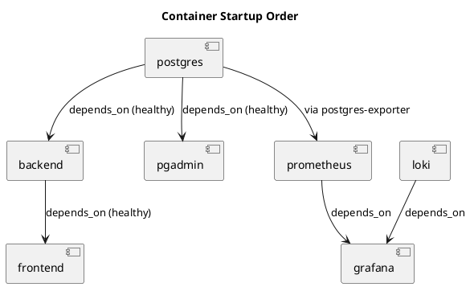

---

## 8. Cross-cutting Concepts

### 8.1 Security

**Authentication:**

- JWT tokens issued by `JwtTokenService` upon successful login.
- `JwtAuthenticationFilter` accepts HttpOnly cookie `notaire-auth-token` **or**
  `Authorization: Bearer` (issue #1051).
- Browser token storage: HttpOnly cookie (not `localStorage`). Zustand persists
  user profile only; UX cookies `notaire-auth-status` / `notaire-auth-role` are
  non-credential route markers (#1052). API tooling still uses Bearer.
- Production CSP: nonce-based `script-src`, no `'unsafe-eval'` (#1051).
- `LoginAttemptService` locks out a username after repeated failed attempts
  (in-memory, single-instance — not a general API rate limiter).
- `ProductionCredentialsGuard` blocks startup if default passwords are used in production.

**Authorization:**

- Every `/api/**` request must be authenticated (valid JWT), except login and logout.
- `UserAuthorityResolver` grants `ROLE_ADMIN` to active users of type Administrador,
  Admin, or Escribano, and `ROLE_USER` to other active users. `SecurityAndCorsConfig`
  requires `ROLE_ADMIN` for user, role, and audit-log paths and for admin catalog
  writes (#559). Other business records are reachable by any authenticated user
  (object-level gap SR-11).
- Extending enforcement means adding a path in `SecurityAndCorsConfig` and a case
  in `RbacIntegrationTest` (see [API Authentication Guide](../206-security/API-AUTHENTICATION-GUIDE.md#extending-rbac)).

**API Security:**

- CORS configured in `SecurityAndCorsConfig`.
- All endpoints under `/api/v1/**` require JWT (except login).
- Actuator endpoints secured with separate credentials.

### 8.2 Error Handling

All errors follow a uniform response structure defined in `ErrorResponse`:

```json
{
  "timestamp": "2026-08-18T12:00:00Z",
  "status": 400,
  "error": "Bad Request",
  "message": "Validation failed",
  "path": "/api/v1/people",
  "traceId": "abc123",
  "details": { "field": "identificationNumber", "message": "Must be numeric" }
}
```

**Exception Hierarchy:**

- `NotaireException` — Base exception
- `BusinessValidationException` — 400 Bad Request
- `ResourceNotFoundException` — 404 Not Found
- Global handling via `GlobalExceptionHandler` (`@ControllerAdvice`)

### 8.3 Audit Trail

- `AuditAspect` (Spring AOP) intercepts annotated controller methods.
- `AuditModuleResolver` maps controllers to functional modules.
- `AuditOperationDescriber` generates human-readable operation descriptions.
- Records stored in the `audit_records` table.
- Queryable via `AuditRecordController` → `/api/v1/audit-log`.
- Frontend audit view at `/dashboard/audit`.

### 8.4 Database Schema Management

- **Flyway** is the single source of truth for database schema.
- Migrations located at `backend-api/src/main/resources/db/migration/`.
- Docker starts PostgreSQL **empty**; Flyway applies the versioned migrations on backend startup, through V46. Applied files V1–V45 stay immutable.
- Historical `init-db/` scripts archived at `docs/000-archive/init-db/`.
- Repeatable migrations (`R__`) used for reversible operations.

**Current Migrations:**

| Version | Description |
|---------|------------|
| V1 | Initial schema (all tables) |
| V2 | Initial seed data |
| V3 | Add missing entity columns |
| V4 | Fix missing schema columns |
| V5 | Align `testimony_movements` with the JPA entity |
| V6 | Make `submitted_documents.fk_id_procedure` optional |
| V7 | Add workflow tables |
| V8 | Link `procedure_types` to a workflow |
| V9 | Add roles and permissions |
| V10 | Seed workflow demo data |
| V11 | Align `concepts.version` with the archived init script |
| V12 | Create postgres_exporter role (pg_monitor) |
| V13 | Make `procedures.name` and `procedures.number` optional |
| V14 | Drop `budgets.fk_id_tramite`. The canonical link is `procedures.fk_id_budget` |
| R14 | Manual rollback script that restores `budgets.fk_id_tramite`. Flyway does not run it |
| V45 | Rename the remaining Spanish identifiers. `R45` reverses that rename |
| V46 | Rename Spanish constraint names. `R46` restores the previous names |

### 8.5 Observability

**Metrics (Prometheus):**

- Spring Boot Actuator exposes `/actuator/prometheus`.
- Custom metrics via `MetricsUtil` and `SharedModuleMetrics`.
- `ApplicationHealthIndicator` for custom health checks.
- `postgres-exporter` provides database-level metrics.

**Logging (Loki):**

- Structured JSON logging via `StructuredLogger`.
- Logback configuration with JSON appender.
- Promtail collects logs from Docker containers.
- Centralized viewing in Grafana.

**Dashboards (Grafana :3001):**

- Application metrics (JVM, HTTP, custom).
- Database metrics (connections, query time, table sizes).
- Log exploration and alerting.

**Code Quality (SonarQube :9000):**

- Static analysis on every build.
- Coverage: enforced ratchet floor via JaCoCo (raised as coverage improves; long-term
  target 80% line / 80% branch — see [Code Quality](../../300-development/303-testing/README.md)).

### 8.6 Design System (Frontend)

- **Single source of truth**: `frontend/src/theme/tokens.ts`.
- **Design language**: Apple-inspired (macOS Sequoia / iOS 18).
- **Token categories**: Colors (neutral 0-900, semantic), typography (SF Pro), spacing (8px grid), border-radius, shadows, transitions.
- **Form pattern**: `FormContainer → FormSection → FormField → FormActions`.
- **Rule**: No hardcoded CSS values — all styling via tokens.

### 8.7 API Design

- All endpoints under `/api/v1/` prefix.
- RESTful resource naming (English collections: `/managements`, `/people`, `/deeds`).
- OpenAPI 3.0 documentation via `OpenApiConfig` at `/swagger-ui.html`.
- Response wrapping with the DTOs in `backend-api` (`com.licensis.notaire.dto`).
- Pagination support on list endpoints.

### 8.8 Testing Strategy

| Level | Tool | Scope | Target |
|-------|------|-------|--------|
| Unit (backend) | JUnit 5 + Mockito | Service/repository logic | Enforced ratchet floor (target 80%) |
| Unit / Component (frontend) | Vitest + Testing Library | `frontend/src/**/*.test.ts(x)` | 19+ test files |
| Integration | Spring Boot Test | Controller + DB (H2/PG) | API contract validation |
| API | Bruno, yml collection format (`backend-api/api-test/`) | Full API endpoints, per use case | See `CU-API-MATRIX.csv` |
| E2E (UI/UX) | Playwright | Frontend user flows, per use case (`cuNN-*.spec.ts`) | 33+ specs, critical paths |
| Static Analysis | Checkstyle + SpotBugs + SonarQube | Code quality | Zero critical issues |

Full pyramid and use-case traceability documented in
[`docs/300-development/303-testing/README.md`](../../300-development/303-testing/README.md).

### 8.9 Legacy Coexistence (`jpa` package)

The `jpa` package contains 26 `*JpaController` classes — a legacy data-access layer from the original Swing application. These classes contain raw EntityManager operations and are being incrementally replaced by:

1. **Spring Data JPA Repositories** (`repository` package) — declarative query methods.
2. **Service classes** (`service` package) — business logic extracted from JPA controllers.

**Migration rule**: New code **must not** use `jpa` package classes. Services may temporarily delegate to them as fallback during the transition.

---

## 9. Architectural Decisions

All decisions are documented as Architecture Decision Records (ADRs) in `docs/200-architecture/202-ADR/`.

| ADR | Title | Status | Scope |
|-----|-------|--------|-------|
| [ADR-001](../202-ADR/ADR-001-microservices-architecture.md) | Microservices Architecture | Accepted | System architecture |
| [ADR-002](../202-ADR/ADR-002-module-structure.md) | Module Structure | Accepted | Code organization |
| [ADR-003](../202-ADR/ADR-003-rest-api-versioning.md) | REST API Versioning | Accepted | API evolution |
| [ADR-004](../202-ADR/ADR-004-database-migration.md) | Database Migration | Accepted | Data persistence |
| [ADR-005](../202-ADR/ADR-005-modern-frontend-migration.md) | Modern Frontend Migration | Accepted | Frontend architecture |
| [ADR-006](../202-ADR/ADR-006-testing-strategy.md) | Testing Strategy | Accepted | QA & validation |
| [ADR-007](../202-ADR/ADR-007-database-schema-versioning-flyway.md) | Database Schema Versioning (Flyway) | Accepted | Data persistence |
| [ADR-008](../202-ADR/ADR-008-security-authentication.md) | Security & Authentication | Accepted | Security |
| [ADR-009](../202-ADR/ADR-009-logging-monitoring.md) | Logging & Monitoring | Accepted | Observability |
| [ADR-010](../202-ADR/ADR-010-error-handling.md) | Error Handling | Accepted | Resilience |
| [ADR-011](../202-ADR/ADR-011-centralized-design-system.md) | Centralized Design System | Accepted | UI/UX |
| [ADR-012](../202-ADR/ADR-012-ci-cd-pipeline.md) | CI/CD Pipeline Strategy | Accepted | DevOps |
| [ADR-013](../202-ADR/ADR-013-audit-trail.md) | Audit Trail Implementation | Accepted | Compliance |
| [ADR-014](../202-ADR/ADR-014-workflow-engine.md) | Workflow Engine | Accepted | Business logic |
| [ADR-015](../202-ADR/ADR-015-internationalization.md) | Internationalization | Accepted | UX |
| [ADR-016](../202-ADR/ADR-016-observability-stack.md) | Observability Stack Topology | Accepted | Observability |
| [ADR-017](../202-ADR/ADR-017-container-base-images.md) | Container / Base-Image Strategy | Accepted | DevOps |
| [ADR-018](../202-ADR/ADR-018-rate-limiting-policy.md) | Rate-Limiting Policy | Accepted | Security |
| [ADR-019](../202-ADR/ADR-019-secrets-management.md) | Secrets Management | Accepted | Security |
| [ADR-020](../202-ADR/ADR-020-openapi-exposure-policy.md) | OpenAPI Exposure Policy | Accepted | Security & API |

---

## 10. Quality Requirements

### 10.1 Quality Tree

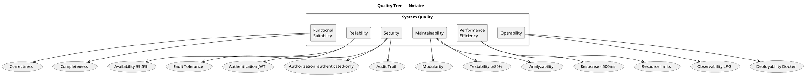

### 10.2 Quality Scenarios

| ID | Quality Attribute | Scenario | Metric |
|----|------------------|----------|--------|
| QS-01 | Performance | API response for single-entity CRUD | < 500ms avg |
| QS-02 | Performance | Report generation with complex queries | < 3s |
| QS-03 | Availability | System uptime during business hours | 99.5% |
| QS-04 | Security | All create/update/delete operations (and logins) logged in audit trail; read-only GETs excluded | 100% coverage of mutating operations |
| QS-05 | Security | Failed login attempts trigger a per-username lockout (`LoginAttemptService`, single-instance, not a general API rate limiter) | 5 failed attempts → 15 min lockout |
| QS-06 | Testability | Code coverage across backend | ≥ 80% |
| QS-07 | Maintainability | New feature development time | < 6 months |
| QS-08 | Maintainability | Developer onboarding time | < 2 weeks |
| QS-09 | Scalability | Backend horizontal scaling | Stateless containers |
| QS-10 | Deployability | Full stack startup time | < 3 minutes |

---

## 11. Risks and Technical Debt

### 11.1 Current Risks

| Risk | Impact | Probability | Mitigation |
|------|--------|-------------|------------|
| Legacy `jpa` package coexists with modern `repository` | High — code duplication, inconsistent patterns | Certain | Incremental migration per entity; new code uses only `repository` |
| ~~`ControllerNegocio.java` (5,337 lines) — God class~~ (renamed `BusinessController`, removed in #900) | Resolved — only two identification-type lookups were reachable; now `business/IdentificationTypeLookup` | — | Done (#900) |
| Legacy Swing client resurrected on `main` | Low — Dependabot noise / confusion | Low | Keep deleted (#1046); do not recreate; history in git |
| No production deployment target defined | Medium — no deployment pipeline to production | Medium | Mitigated for topology: `docker-compose.prod.yml` (#1044) + staging Kustomize (#901). CD remains publish-only; TLS/backups/SLOs are separate issues |
| Default credentials in `.env` | Critical — security risk if deployed as-is | Medium | `ProductionCredentialsGuard` blocks startup with defaults |

### 11.2 Technical Debt Inventory

| Item | Location | Severity | Effort |
|------|----------|----------|--------|
| 26 legacy JPA controllers | `com.licensis.notaire.jpa` | High | Large — one per entity |
| ~~`ControllerNegocio.java` God class (5,337 lines)~~ | removed in #900 (`business/BusinessController.java` deleted) | Resolved | — |
| `JpaAdministrator` in service layer | `service/JpaAdministrator.java` | Medium | Medium |
| `ValidationAdministrator` mixed concerns | `service/ValidationAdministrator.java` | Medium | Medium |
| Missing service classes for some entities | `service/` | Medium | Medium |
| Legacy Swing tree deleted from `main` (#1046) | git history only | Resolved | — |
| `GuiConstants.java` in audit package | `audit/GuiConstants.java` | Low | Small |

### 11.3 Evolution Roadmap

> 📊 **Live status**: [Notaire — Delivery Board](https://github.com/users/matiaspakua/projects/1) ·
> [`docs/github/README.md`](../../github/README.md) ·
> [DEVELOPMENT-PLAN §5](../../300-development/DEVELOPMENT-PLAN.md).
> Historical snapshots (do not update): [`docs/000-archive/github/`](../../000-archive/github/).
>
> The roadmap matches the GitHub milestones and the Delivery Board.
> Each item has a tracking issue with acceptance criteria, labels, and a milestone.

#### Migration Phases — Alignment with GitHub Milestones

| Phase | GitHub Milestone | Status | Tracking Issue |
|-------|-----------------|--------|----------------|
| Phase 1 — Analysis | [#6 Phase 1 — Analysis](https://github.com/matiaspakua/notaire/milestone/6) | ✅ Complete | Legacy documented, 73 use cases catalogued |
| Phase 2 — Foundation | [#7 Phase 2 — Foundation](https://github.com/matiaspakua/notaire/milestone/7) | ✅ Complete | Shared DTO module (retired, ADR-025), Maven multi-module, Docker Compose |
| Phase 3 — Backend API | [#8 Phase 3 — Backend API](https://github.com/matiaspakua/notaire/milestone/8) | ✅ Complete | 31 controllers, 32 entities, Flyway V1 through V14 |
| Phase 4 — Modern Frontend | [#9 Phase 4 — Modern Frontend](https://github.com/matiaspakua/notaire/milestone/9) | 🔄 In Progress | [#898](https://github.com/matiaspakua/notaire/issues/898) — 73 use cases in Next.js 16 |
| Phase 5 — Observability | [#10 Phase 5 — Observability](https://github.com/matiaspakua/notaire/milestone/10) | ✅ Complete | LPG stack + SonarQube + Homer |
| Phase 6 — Deprecation | [#11 Phase 6 — Deprecation](https://github.com/matiaspakua/notaire/milestone/11) | 🔶 Partial | Swing removed from active build; remaining work is `jpa` cleanup ([#899](https://github.com/matiaspakua/notaire/issues/899)) |

#### Short Term (Phase 4 — Modern Frontend)

1. **Complete Next.js frontend pages for all 73 use cases** — tracking issue [#898](https://github.com/matiaspakua/notaire/issues/898).
   Key open items: deed managements (#804, #806), deeds (#838, #839), budgets (#797, #821, #822, #823), people (#829, #835).
2. **Fix critical bugs blocking frontend** — #829 (Person create), #835 (person deduplication), #799 (uniqueness), #801 (SubmittedDocument mapping).
3. ~~Extract `ControllerNegocio` logic into dedicated service classes~~ — resolved by deleting the class ([#900](https://github.com/matiaspakua/notaire/issues/900)); its only live behaviour moved to `IdentificationTypeLookup`.

#### Medium Term (Phase 6 — Deprecation)

1. **Replace all `jpa` package controllers** with `repository` + `service` — [#576](https://github.com/matiaspakua/notaire/issues/576).
2. **Swing client retirement** — complete: directory removed under [#1046](https://github.com/matiaspakua/notaire/issues/1046) (do not recreate). Remaining Phase 6 focus is `jpa` cleanup — [#899](https://github.com/matiaspakua/notaire/issues/899).
3. **Enable quality gates** that are currently advisory-only: Checkstyle [#710](https://github.com/matiaspakua/notaire/issues/710), SpotBugs [#711](https://github.com/matiaspakua/notaire/issues/711), Trivy [#712](https://github.com/matiaspakua/notaire/issues/712).
4. **Implement RBAC enforcement** (per-role authorization) — [#559](https://github.com/matiaspakua/notaire/issues/559).

#### Long Term (Phase 6 — Deprecation / Post-Phase 6)

1. **Add Kubernetes deployment manifests** for production — [#901](https://github.com/matiaspakua/notaire/issues/901) (production deployment risk) — **shipped** as Kustomize base + staging overlay under `infra/deploy/kustomize/` (mirrors #1044 four-service stack; CD apply-to-cluster still future work).
2. **Implement WebSocket support** for real-time workflow updates.
3. **Add batch processing** for report generation.

#### Tech Debt Priority Queue (SAD §11.2 mapped to GitHub Issues)

| Severity | Item | GitHub Issue | Milestone |
|----------|------|-------------|-----------|
| ✅ Resolved | `ControllerNegocio` God class (5,337 lines) removed | [#568](https://github.com/matiaspakua/notaire/issues/568), [#900](https://github.com/matiaspakua/notaire/issues/900) | Phase 6 |
| 🔴 Critical | Controllers instantiate JPA directly (no Spring DI) | [#574](https://github.com/matiaspakua/notaire/issues/574) | Phase 6 |
| 🔴 Critical | Raw-JDBC `Conexion` singleton bypasses HikariCP | [#575](https://github.com/matiaspakua/notaire/issues/575) | Phase 6 |
| 🟠 High | 26 legacy JPA controllers | [#576](https://github.com/matiaspakua/notaire/issues/576) | Phase 6 |
| 🟠 High | Business logic in controllers, not services | [#578](https://github.com/matiaspakua/notaire/issues/578) | Phase 6 |
| 🟠 High | Controllers return JPA entities instead of DTOs | [#577](https://github.com/matiaspakua/notaire/issues/577) | Phase 6 |
| 🟠 High | `GlobalExceptionHandler` bypassed in 26 controllers | [#579](https://github.com/matiaspakua/notaire/issues/579) | Phase 6 |
| 🟡 Medium | `JpaAdministrator` singleton in service layer | [#584](https://github.com/matiaspakua/notaire/issues/584) | Phase 6 |
| 🟡 Medium | Domain entities depend on DTOs (inverted dependency) | [#580](https://github.com/matiaspakua/notaire/issues/580) | Phase 6 |

---

## 12. Glossary

| Term | Definition |
|------|-----------|
| **Notary office** | Argentine notary office. The Spanish word escribanía remains in some stored labels. |
| **Notary (Escribano)** | Licensed notary public. The stored role name `ESCRIBANO` stays. |
| **Clerk (Gestor)** | Assistant who manages daily procedures |
| **Deed management** | Notarial case. Table `deed_managements`. |
| **Deed** | Notarial deed (legal document). Table `deeds`. |
| **Folio** | Numbered page in the notarial protocol book |
| **Testimony** | Certified copy of a notarial deed |
| **Copy** | Copy of a folio or deed |
| **Budget** | Quote for notarial services. Table `budgets`. Stored statuses such as `BORRADOR` stay. |
| **Procedure** | Notarial act linked to a deed management. Table `procedures`. Message keys such as `gestiones` stay. |
| **Person** | Individual or legal entity involved in notarial acts |
| **Property** | Real estate property involved in notarial acts |
| **API REST** | HTTP/JSON interface between frontend and backend |
| **DTO** | Data Transfer Object — API contract between layers |
| **JPA** | Java Persistence API (Hibernate implementation) |
| **JWT** | JSON Web Token for stateless authentication |
| **RBAC** | Role-Based Access Control |
| **Flyway** | Database schema migration tool |
| **LPG Stack** | Loki + Prometheus + Grafana observability stack |
| **TDD** | Test-Driven Development |
| **ADR** | Architecture Decision Record |
| **OpenSpec** | Specification tool for SDLC workflow |

---

## References

### Project Documents

- [CONSTITUTION.md](../../../CONSTITUTION.md) — Engineering process
- [AGENTS.md](../../../AGENTS.md) — Agent configuration
- [CHANGELOG.md](../../../CHANGELOG.md) — Version history
- [ADR Index](../202-ADR/README.md) — All architectural decisions
- [Design System](../203-design/FRONTEND-DESIGN-SYSTEM.md) — Frontend design guide
- [ADR-007](../202-ADR/ADR-007-database-schema-versioning-flyway.md) — Flyway implementation details

### External References

- [arc42 Template](https://docs.arc42.org/home/)
- [Spring Boot 4.1 Documentation](https://docs.spring.io/spring-boot/docs/current/reference/htmlsingle/)
- [Next.js Documentation](https://nextjs.org/docs)
- [Flyway Documentation](https://flywaydb.org/documentation/)
- [PostgreSQL 16 Documentation](https://www.postgresql.org/docs/16/)

### Diagram Sources

**Active diagrams use Mermaid** ([ADR-027](../202-ADR/ADR-027-mermaid-diagrams.md)). Module ownership
Mermaid lives in [`MODULE-OWNERSHIP.md`](../../300-development/MODULE-OWNERSHIP.md) and on GitHub Pages
`/docs/`. Policy: [`204-diagrams/README.md`](../204-diagrams/README.md).

Legacy PlantUML sources remain in `docs/200-architecture/204-diagrams/` until migrated (do not add new
`.puml` for active docs):

- `architecture-legacy.puml` — Legacy monolithic architecture
- `architecture-target.puml` — Target three-tier architecture
- `deployment-docker.puml` — Docker Compose deployment
- `backend-package-structure.puml` — Backend internal structure
- `data-model-core.puml` — Core entity relationships
- `migration-phases.puml` — Migration phases overview
- [`Casos de Uso/`](../204-diagrams/Casos%20de%20Uso/) — Use-case diagrams grouped by module (deed managements, administration, clients, payments, protocols, budgets). The folder name stays.
