# Lifecycle — from requirement to operation

One model of the notarial system: value flow, use cases grouped by
capability, state machines, sequences of the main path, the components that
implement them, and how that is operated and managed.

The use cases (`docs/100-business/102-use-cases/`) stay the step-by-step
narrative. The management walkthrough, with the dependency of each step and
one sequence per step, is in [GESTION.md](GESTION.md). OpenSpec describes the
delta of a change. This document is the permanent picture of the states. If a
change moves a state, update this file in the same PR. Do not add a parallel
PlantUML ([ADR-027](../202-ADR/ADR-027-mermaid-diagrams.md)).

When a use-case narrative and the seeded graph disagree, the code and Flyway
win. The divergences are in [§8](#8-known-divergences).

**Method:** [INGENIERIA.md](../../300-development/INGENIERIA.md) (`DOC-ING`),
applied from the
[specialization guide](https://github.com/matiaspakua/tech.notes.io/blob/main/pages/sw_eng_specialization/final_projects_specialization.md).
This file is `DOC-CICLO`: the product model. The views below are C4 levels
1 to 3, plus the domain state machines.

**Sources:** `V2__initial_data.sql`, `V10__seed_workflow_demo_data.sql`,
`V41__extend_workflow_post_firma_testimony.sql`, `BusinessConstants`,
`PaymentStatus`, `BudgetStatus`, `DeedSigningService`, `DeedController`,
`ExternalEntityDocumentService`, `RegistrationDraftService`,
`ManagementArchiveDebtService`, `ProcedureFolderService`.

## 1. Value flow

A sale (procedure type 1) runs through budgets, a management, the documents,
the deed, the testimony, and collection. Collection runs in parallel: it
does not change the management status. Archiving does, and only if the
procedure type's workflow has that edge.

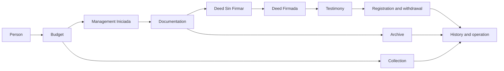

| Process | What it transforms | Use cases | Where the rule lives |
|---------|--------------------|-----------|----------------------|
| Budget | Items and total of a procedure | CU01, CU45, CU60 | `budgets.status` (vocabulary) |
| Collect | Payments against the balance | CU15, CU47 | Derived `PaymentStatus` |
| Open a management | Accepted budget → management on the initial node | CU02, CU83 | `WorkflowNode` INITIAL |
| Document | Certificates and papers from the client or an agency | CU04, CU10, CU43, CU72 | Flags on `submitted_documents` |
| Draw and sign the deed | Draft with a folio → signed deed | CU05, CU06 | `deeds.status` and the management status, separately |
| Testimony and registration | Movement before the Registry | CU07, CU11, CU12, CU44, CU82 | Testimony movement and registration draft |
| Archive | Closed management and folders, with or without debt | CU16, CU85 | Transition to `Archivada` |
| Operate | Audit, health, incidents | CU13, CU73, CU76, CU77 | History, actuator, observability |

## 2. Use-case map

One oval per use case does not read. The system is used in six capabilities.
The full catalog stays in `docs/100-business/102-use-cases/` (CU01–CU87).
Atomic actors: [actor list](../../100-business/103-actors/Lista%20de%20actores.md).

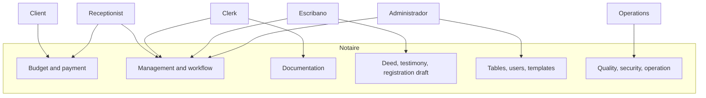

| Capability | Use cases that support it | Anchor requirement |
|------------|---------------------------|--------------------|
| Budget and payment | CU01, CU15, CU45, CU47, CU60 | RF to pay a procedure and installments |
| Management and workflow | CU02, CU14, CU16, CU30, CU35, CU67, CU83, CU85 | RF for statuses and transitions |
| Documentation | CU04, CU10, CU43, CU72 | RF for certificates and tracking |
| Deed and testimony | CU05, CU06, CU07, CU11, CU12, CU44, CU82, CU86 | RF for signing, registration, numbering |
| Administration | CU20–CU37, CU48, CU79, CU80 | RF for base tables and users |
| Operation | CU73–CU78 | RNF for audit, tests, monitoring, security |

The RF ↔ CU matrix stays in
[traceability](../../100-business/104-traceability/Matriz%20de%20Trazabilidad%20Requerimientos-Casos%20de%20Uso.md).
This map does not replace it.

## 3. State machines

There are several machines. They do not collapse into one: payment is not a
management status, and the testimony movement is not a node of the seeded
workflow.

### 3.1 Management — seeded standard workflow

Definition `Workflow de Gestión Estándar`, assigned to `Compraventa`,
`Donación`, and `Hipoteca` (`V10` + `V41`). Succession and power of attorney
have no workflow: any `POST /api/v1/managements/{id}/transition` is rejected.

The status of an existing management changes only through
`POST /api/v1/managements/{id}/transition` or through archiving. A `PUT` that
changes the status answers 400. Each valid transition writes the history
(CU13).

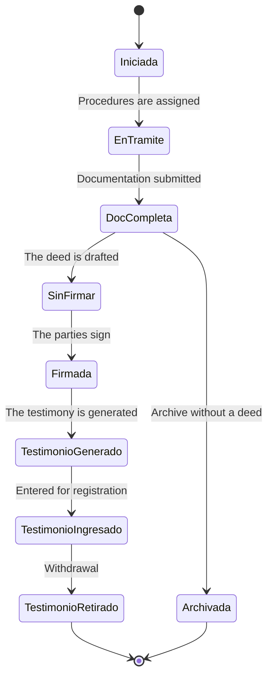

| Node | Management status | Type |
|------|-------------------|------|
| 1 | Iniciada | INITIAL |
| 2 | En Tramite | INTERMEDIATE |
| 3 | Documentacion Completa | INTERMEDIATE |
| 4 | Gestion con Escritura Sin Firmar | INTERMEDIATE |
| 5 | Gestion con Escritura Firmada | INTERMEDIATE |
| 8 | Testimonio Generado | INTERMEDIATE |
| 9 | Testimonio Ingresado a Inscripcion | INTERMEDIATE |
| 10 | Testimonio Retirado | FINAL |
| 7 | Archivada | FINAL |

The seeded edge to `Archivada` leaves only from `Documentacion Completa`.
Archiving from `Testimonio Retirado` requires an administrator to add that
edge (CU83). Archiving computes the balance of the management's budgets and
warns when it is greater than zero; the debt does not block. If a folder is
still `Espera`, the caller must confirm explicitly.

CU10, when the last external-entity document is marked delivered, tries to
move the management to `Documentacion Completa`. If that edge does not exist
from the current status, the document movement stays saved and the transition
is written to the log.

The animated dashboard board reads this same graph plus the history:
[FRONTEND-WORKFLOW-TRACKER.md](FRONTEND-WORKFLOW-TRACKER.md).

### 3.2 Management statuses the standard graph does not use

They stay in the catalog (`V2` and the remainder of `V41`). They are not
destinations of the seeded workflow. A procedure type can include them with
another `WorkflowDefinition`.

| Id | Name | Situation |
|----|------|-----------|
| 5 | Gestion Modificada | Catalog, no seeded edge |
| 8 | Gestion con Escritura Anulada | Catalog, no seeded edge |
| 9 | Gestion con Escritura No Paso | Catalog, no seeded edge |
| 10 | Gestion con Escritura Inscripta | Removed from the graph in V41; the row stays |

### 3.3 Deed

`deeds.status` starts at `Sin Firmar`. The only transition the signing
service requires is that one, and only when there is at least one folio
(CU06). `Anulada`, `No Paso`, and `Inscripta` are vocabulary values.
`GET /api/v1/deeds?status=` accepts only those five texts, in any case, and
answers 400 for any other value. The generic `PUT` persists the text it
receives: it does not consult the management workflow or that vocabulary.

Signing the deed does not move the management. The management moves to
`Gestion con Escritura Firmada` only when someone applies that workflow
transition.

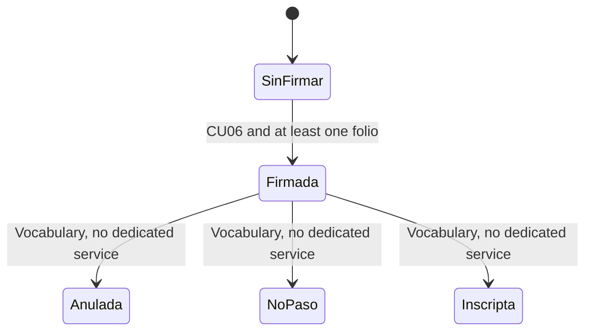

### 3.4 Testimony — a separate timeline

`V41` leaves the re-entry loop out of the management graph. The management
status (`Testimonio Generado` → `Ingresado` → `Retirado`) is the summary.
The detail is a list of movements.

Rules of `testimonio-movimiento-inscripcion`:

- Entering requires a verified testimony and no open movement (entry date
  without an exit date).
- Registering requires a previous entry and sets `registered` with a date.
- Withdrawing requires registered, and stores the exit date and card number.
- Re-entering requires the latest movement to have an exit date, and creates
  a new movement. The previous one is not overwritten.
- `observed_by_registry` is a mark on the movement, not a management node.

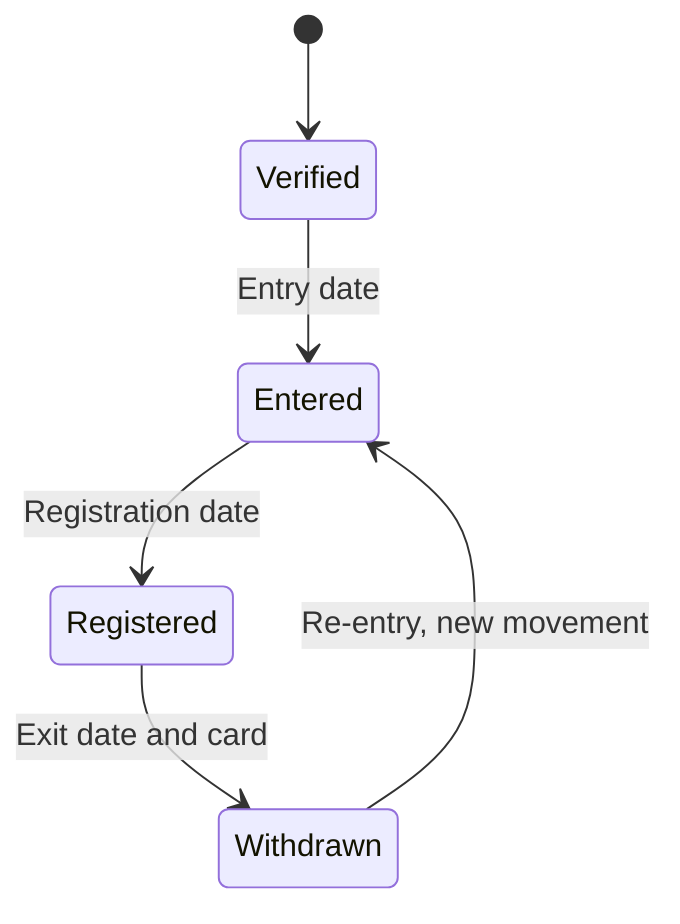

### 3.5 Registration draft

The draft's own circuit (`RegistrationDraftService`, CU82), not the
management's. Generating requires a deed in status `Firmada` and complete
cadastral and registry data on the property.

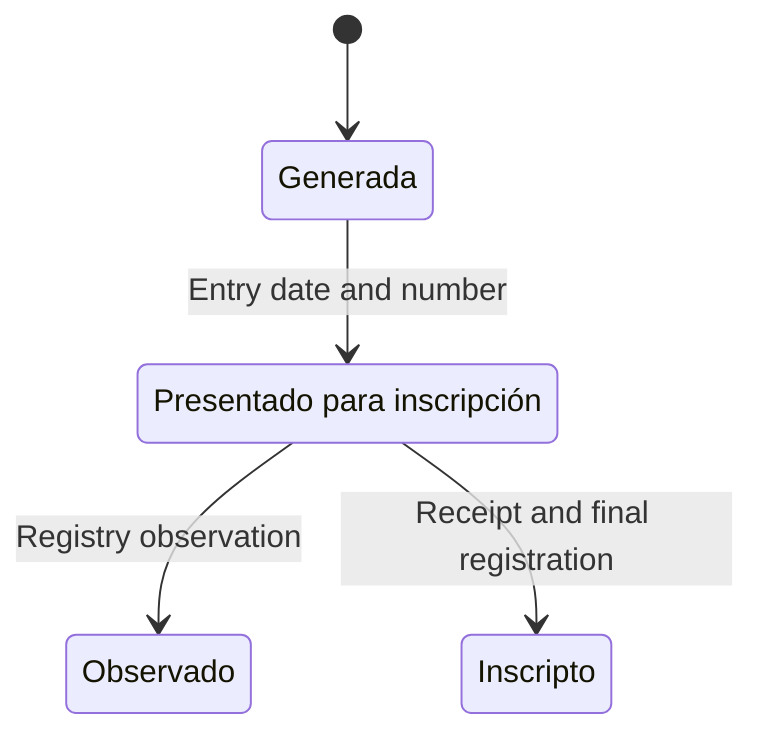

`Observado` has no coded return to `Presentado para inscripción` and no path to `Inscripto`.
Registering is accepted only from `Presentado para inscripción`.

### 3.6 Documentation

A submitted document has no status enum. Tracking is a set of marks, and
they can combine.

| Mark | Column | Business reading |
|------|--------|------------------|
| Prepared | `prepared` | The paper was already requested or assembled |
| Delivered | `delivered` | It arrived. If every external-entity document is delivered, CU10 tries to complete the management |
| Flagged | `observed` | The agency or the office flagged it |
| Released | `released` + `released_date` | It left the agency |
| Re-entered | `reentered` | It was submitted again (CU43) |
| Due | `expires`, `due_date` | Deadline inherited from the document type |

Who brings it (`delivered_by`): `Cliente` (CU72) or `Entidad Externa` (CU10).
The CU72 narrative says “Presentado”; in data that is `delivered` /
`prepared`, not a status named Presentado.

The progression the business reads, drawn as a line. The real marks can
leave this line.

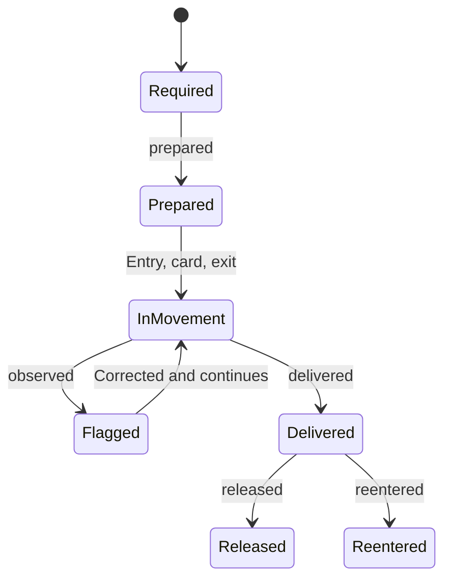

### 3.7 Budget

`budgets.status` accepts only these codes (any other `PUT` answers 400).
The enum comment orders them, but the controller does not validate the
edge: any of the five can be written.

`BORRADOR` → `PENDIENTE` → `APROBADO` or `RECHAZADO` → `FACTURADO`

That order is the business reading. It is not a guarded graph.

### 3.8 Payment

A payment is a fact: amount, date, method, notes, budget. It has no status
of its own. The budget's payment status is computed
(`GET /api/v1/payments/budget/{idBudget}/status`):

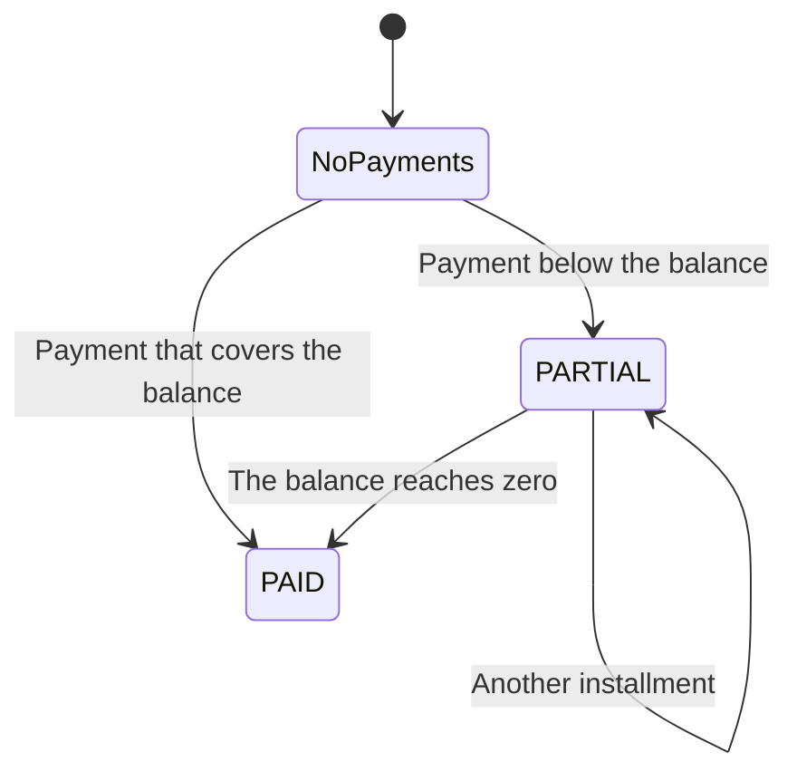

| Published code | Condition |
|----------------|-----------|
| `NoPayments` | Nothing paid, or the paid total is null or zero |
| `PARTIAL` | There are payments and the balance is still positive |
| `PAID` | There are payments and the balance is zero or negative |

The amount cannot exceed the balance (`BigDecimal` scale 2). A rejection
does not persist the payment and answers an empty 409. The name
`NoPayments` is a REST contract: it is not renamed without versioning the
API.

Collection does not transition the management. It only feeds the debt
warning at archive time.

### 3.9 Procedure folder

Each new procedure creates a folder in status `Activa` (CU85).

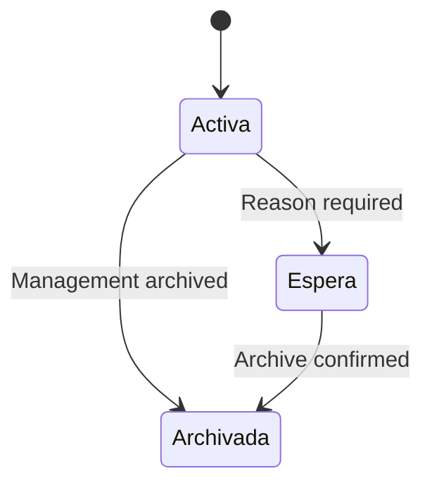

Archiving the management moves all of its folders to `Archivada`. If one is
`Espera` and the client does not confirm, archiving is rejected.

## 4. Sequences of the main path

One sequence per decision the system makes. The rest of the use cases stay
in their own write-up; the `.puml` files under `204-diagrams/Secuencias/`
are legacy.

### 4.1 Open the management and advance to the testimony

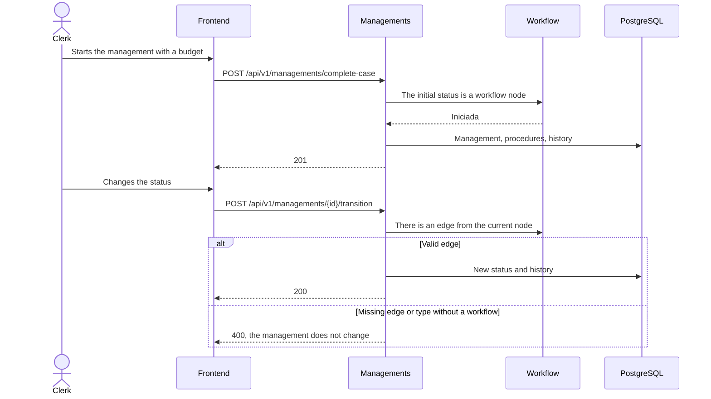

### 4.2 External-entity documentation

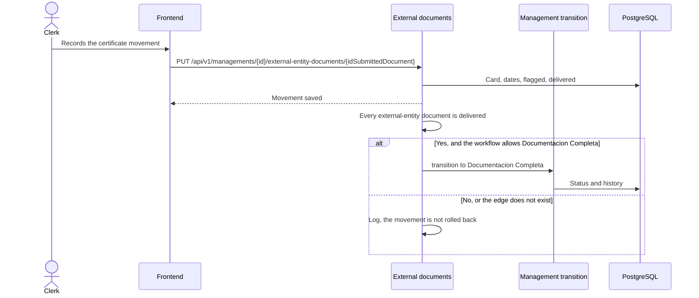

### 4.3 Collect and archive

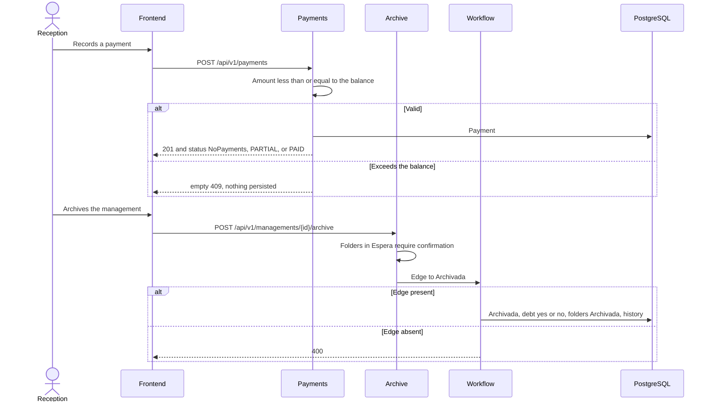

## 5. C4 views

Level 4 (classes) is not drawn here: the cost does not pay for the detail,
and the code is already that view. The arc42 SAD stays `DOC-SAD`.

### 5.1 Context

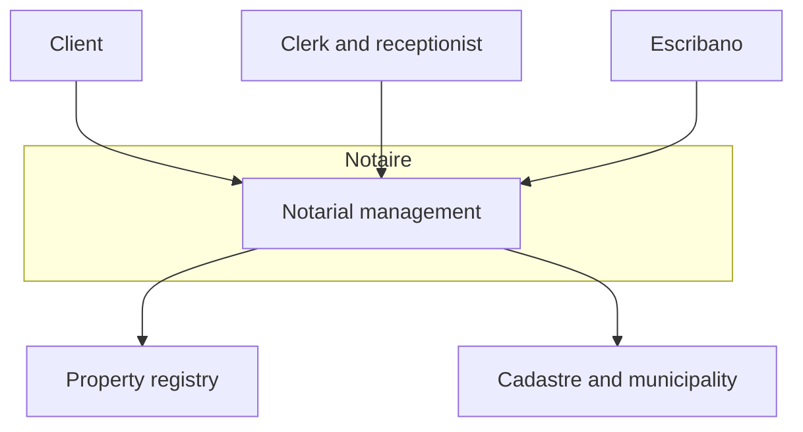

The client requests the procedure and pays. The clerk documents and advances
the management. The notary signs and archives. The registry and the cadastre
are outside the system: the registration draft and the certificates are
recorded in Notaire; the agency has no API in this model.

### 5.2 Containers

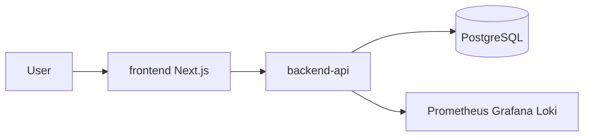

### 5.3 Backend components that carry the cycle

Payment is the hexagonal cut
([ADR-021](../202-ADR/ADR-021-hexagonal-architecture-pilot.md)).
Management, document, deed, testimony, and registration draft live in
application use cases over JPA entities. The frontend speaks HTTP only.

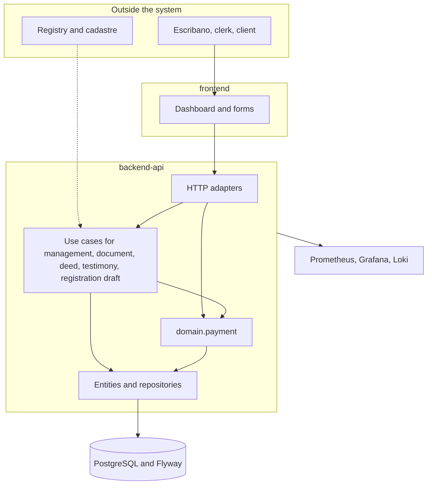

| Piece | Responsibility in the cycle | Module |
|-------|-----------------------------|--------|
| `adapter.in.web` | REST contracts for management, payment, document, deed | backend-api |
| `application.usecase.management` | Transition and archive with debt | backend-api |
| `application.usecase.document` | External movement and completeness | backend-api |
| `application.usecase.deed` | Signing with a folio | backend-api |
| `application.usecase.testimony` | Entry, registration, withdrawal, re-entry | backend-api |
| `application.usecase.registrationdraft` | Registration draft | backend-api |
| `domain.payment` | Balance, installments, derived status | backend-api |
| `frontend` | Workflow tracker and forms | frontend |
| Flyway | Status catalog and seeded graph | backend-api |
| Observability | Health, metrics, operational logs | infra |

The repository module map is in
[MODULE-OWNERSHIP.md](../../300-development/MODULE-OWNERSHIP.md). Deployment
and rollback are in
[DEPLOYMENT-PLAN.md](../../300-development/DEPLOYMENT-PLAN.md). Day-to-day
operation (metrics, logs, incidents) is in
[monitoring](../207-monitoring/README.md) and CU77.

## 6. End-to-end traceability

The thread forward and backward, with the CU15 example, is in
[INGENIERIA.md §3](../../300-development/INGENIERIA.md#3-traceability).
This table is the map of the domain documents.

| Question | Permanent document | Change contract | Code |
|----------|--------------------|-----------------|------|
| What the business must do | SRS and use cases | OpenSpec `specs/` | — |
| Which statuses a management can take | §3.1 of this file | `gestion-workflow-transicion` | `V10`, `V41`, `ManagementTransitionService` |
| How collection works | §3.8 | `pagos`, `pagos-parciales-cuotas` | `PaymentStatus`, `ProcessPaymentService` |
| How a certificate travels | §3.6 | `submitted-document-update` | `ExternalEntityDocumentService` |
| How registration works | §3.4 and §3.5 | `testimonio-movimiento-inscripcion`, `minuta-inscripcion` | `TestimonyMovementService`, `RegistrationDraftService` |
| How archiving with debt works | §3.1 and §3.9 | archive / CU16 | `ManagementArchiveDebtService` |
| How it is tested | [TEST-PLAN.md](../../300-development/303-testing/TEST-PLAN.md) | OpenSpec tasks | JUnit, Bruno, Playwright |
| How it is delivered | [github/README.md](../../github/README.md) | issue + PR | delivery board |
| How it is operated | [209-deployment](../209-deployment/README.md), CU77 | — | Compose, Kustomize, actuator |

## 7. Managing the work

The GitHub board is not the management workflow. An issue `In Progress` is
not a management in status `En Tramite`.

The `in-review` label marks a PR under review. The board column stays in
progress until the issue is closed.

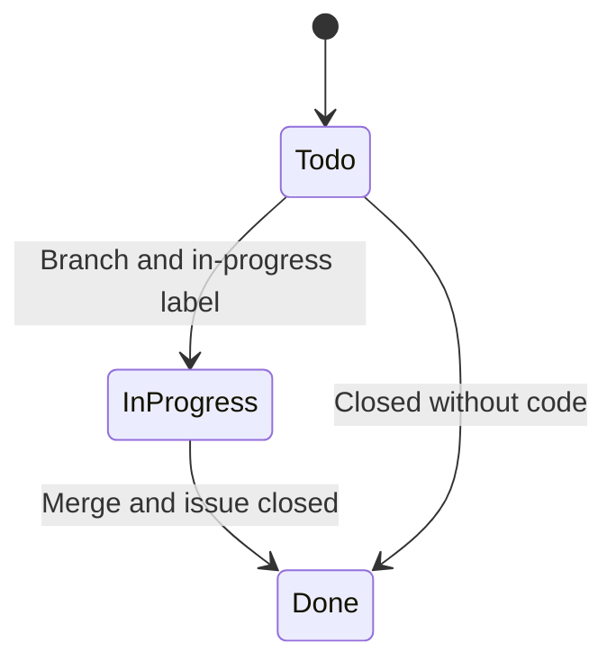

| Layer | Statuses | Where it is read |
|-------|----------|------------------|
| Work | Todo, In Progress, Done (`in-review` is a label, not a column) | [GitHub organization](../../github/README.md) |
| Engineering | Issue, OpenSpec, TDD, preflight, PR, heavy CI, review, merge, smoke | [CONSTITUTION.md](../../../CONSTITUTION.md) |
| Domain | §3 of this file | Code and Flyway |

Milestones (trains, catalogs, and history) are defined in
[MILESTONES.md](../../300-development/305-project-management/MILESTONES.md).
A product semver tag is not one of those milestones
([RELEASES.md](../../300-development/305-project-management/RELEASES.md)).
The anchor issues for an RF and a use case stay open; the work references
them and does not close them.

A work issue carries a use case, acceptance criteria, an area, a priority,
and a milestone. A change that alters a status in §3 updates this file as
well as the OpenSpec spec.

## 8. Known divergences

Facts of the system today. They are not a change proposal.

1. The activity `204-diagrams/Diagrama de Estados/transicion-de-estados.puml`
   follows the seeded graph: archive leaves `Documentacion Completa`, and
   `Testimonio Retirado` is final. It stays legacy. The source is §3.1.
2. `DeedSigningService` changes `deeds.status`. It does not change the
   management status.
3. `Gestion con Escritura Inscripta` is no longer in the graph. The
   registration the workflow walks is the testimony's.
4. A registration draft in `Observado` is not resubmitted and is not
   registered by the current service.
5. The budget order is not guarded by edges.
6. “Presentado” in CU72 is not a persisted value.

## 9. Rule for the AI SDLC

In the documentation phase of a change:

- If the change adds, removes, or conditions a status in §3, edit this file
  and, if the seeded graph changes, the Flyway migration. One source.
- The OpenSpec spec says the delta. This file says the result.
- Do not create a new `.puml` for the same cycle.
- Use cases are touched only when the actor's narrative changes. The graph
  is not copied into each CU.

Fleet detail: [FLEET-ARCHITECTURE.md](../../300-development/304-ai-sdlc-cloud/FLEET-ARCHITECTURE.md).
