# Ciclo de vida — del requerimiento a la operación

Modelo único del sistema notarial: flujo de valor, casos de uso agrupados,
máquinas de estado, secuencias del camino principal, componentes que los
implementan y cómo eso se opera y se gestiona.

Los casos de uso (`docs/100-business/102-use-cases/`) siguen siendo el relato
paso a paso. OpenSpec describe el delta de un cambio. Este documento es la
foto permanente. Si un cambio mueve un estado, se actualiza aquí en el mismo
PR. No se agrega un PlantUML paralelo ([ADR-027](../202-ADR/ADR-027-mermaid-diagrams.md)).

Cuando el relato de un caso de uso y el grafo sembrado no coinciden, manda el
código y Flyway. Las divergencias están en [§8](#8-divergencias-conocidas).

**Método:** [INGENIERIA.md](../../300-development/INGENIERIA.md) (`DOC-ING`),
aplicado desde la
[guía de especialización](https://github.com/matiaspakua/tech.notes.io/blob/main/pages/sw_eng_specialization/final_projects_specialization.md).
Este archivo es `DOC-CICLO`: el modelo del producto. Las vistas de abajo son
C4 niveles 1 a 3, más las máquinas de estado del dominio.

**Fuentes:** `V2__initial_data.sql`, `V10__seed_workflow_demo_data.sql`,
`V41__extend_workflow_post_firma_testimony.sql`, `BusinessConstants`,
`PaymentStatus`, `BudgetStatus`, `DeedSigningService`, `DeedController`,
`ExternalEntityDocumentService`, `RegistrationDraftService`,
`ManagementArchiveDebtService`, `ProcedureFolderService`.

## 1. Flujo de valor

Una compraventa (tipo de trámite 1) recorre presupuestos, una gestión, la
documentación, la escritura, el testimonio y el cobro. El cobro corre en
paralelo: no cambia el estado de la gestión. El archivo sí, y solo si el
workflow del tipo de trámite tiene la arista.

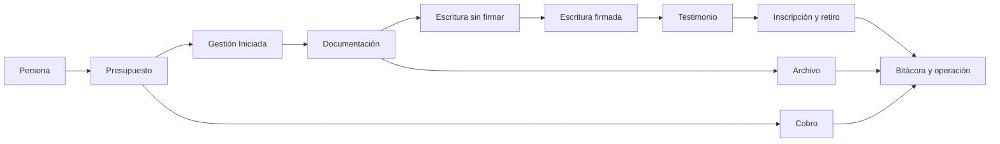

| Proceso | Qué transforma | Casos de uso | Dónde vive la regla |
|---------|----------------|--------------|---------------------|
| Presupuestar | Ítems y total de un trámite | CU01, CU45, CU60 | `budgets.status` (vocabulario) |
| Cobrar | Pagos contra el saldo | CU15, CU47 | `PaymentStatus` derivado |
| Abrir gestión | Presupuesto aceptado → gestión en nodo inicial | CU02, CU83 | `WorkflowNode` INITIAL |
| Documentar | Certificados y papeles del cliente o de un organismo | CU04, CU10, CU43, CU72 | Flags de `submitted_documents` |
| Escriturar y firmar | Borrador con folio → escritura firmada | CU05, CU06 | `deeds.status` y estado de gestión, por separado |
| Testimonio e inscripción | Movimiento ante el Registro | CU07, CU11, CU12, CU44, CU82 | Movimiento de testimonio y minuta |
| Archivar | Gestión y carpetas cerradas, con o sin deuda | CU16, CU85 | Transición a `Archivada` |
| Operar | Auditoría, salud, incidentes | CU13, CU73, CU76, CU77 | Bitácora, actuator, observabilidad |

## 2. Mapa de casos de uso

Un óvalo por caso de uso no se lee. El sistema se usa en seis capacidades.
El catálogo completo sigue en `docs/100-business/102-use-cases/` (CU01–CU87).
Actores atómicos: [lista de actores](../../100-business/103-actors/Lista%20de%20actores.md).

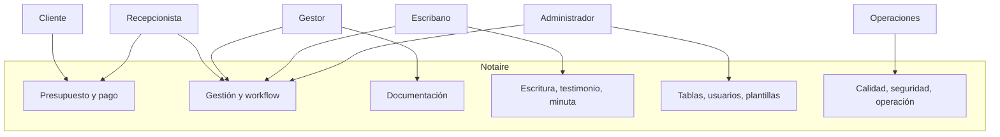

| Capacidad | Casos que la sostienen | Requerimiento ancla |
|-----------|------------------------|---------------------|
| Presupuesto y pago | CU01, CU15, CU45, CU47, CU60 | RF de abonar trámite y cuotas |
| Gestión y workflow | CU02, CU14, CU16, CU30, CU35, CU67, CU83, CU85 | RF de estados y transiciones |
| Documentación | CU04, CU10, CU43, CU72 | RF de certificados y seguimiento |
| Escritura y testimonio | CU05, CU06, CU07, CU11, CU12, CU44, CU82, CU86 | RF de firma, inscripción, numeración |
| Administración | CU20–CU37, CU48, CU79, CU80 | RF de tablas base y usuarios |
| Operación | CU73–CU78 | RNF de auditoría, pruebas, monitoreo, seguridad |

La matriz RF ↔ CU sigue en
[trazabilidad](../../100-business/104-traceability/Matriz%20de%20Trazabilidad%20Requerimientos-Casos%20de%20Uso.md).
Este mapa no la reemplaza.

## 3. Máquinas de estado

Hay varias máquinas. No se colapsan en una: el pago no es un estado de la
gestión, y el movimiento del testimonio no es un nodo del workflow sembrado.

### 3.1 Gestión — workflow estándar sembrado

Definición `Workflow de Gestión Estándar`, asignada a Compraventa, Donación
e Hipoteca (`V10` + `V41`). Sucesión y Poder quedan sin workflow: cualquier
`POST /api/v1/gestiones/{id}/transition` se rechaza.

El cambio de estado de una gestión existente solo entra por
`POST /api/v1/gestiones/{id}/transition` o por el archivado. Un `PUT` que
cambie el estado responde 400. Cada transición válida escribe la bitácora
(CU13).

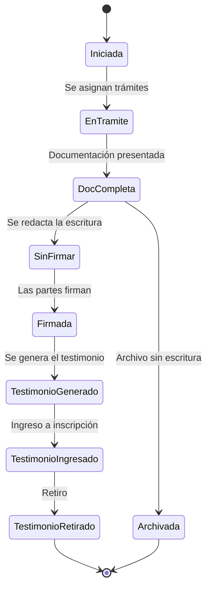

| Nodo | Estado de gestión | Tipo |
|------|-------------------|------|
| 1 | Iniciada | INITIAL |
| 2 | En Tramite | INTERMEDIATE |
| 3 | Documentacion Completa | INTERMEDIATE |
| 4 | Gestion con Escritura Sin Firmar | INTERMEDIATE |
| 5 | Gestion con Escritura Firmada | INTERMEDIATE |
| 8 | Testimonio Generado | INTERMEDIATE |
| 9 | Testimonio Ingresado a Inscripcion | INTERMEDIATE |
| 10 | Testimonio Retirado | FINAL |
| 7 | Archivada | FINAL |

La arista sembrada hacia `Archivada` sale solo de `Documentacion Completa`.
Archivar desde `Testimonio Retirado` exige que un administrador agregue esa
arista (CU83). El archivado calcula el saldo de los presupuestos de la
gestión y advierte si es mayor a cero; la deuda no bloquea. Si alguna carpeta
sigue en `Espera`, hay que confirmar explícitamente.

CU10, al marcar entregado el último documento de entidad externa, intenta
pasar la gestión a `Documentacion Completa`. Si esa arista no existe desde
el estado actual, el movimiento del documento queda guardado y la transición
se registra en el log.

El tablero animado del dashboard lee este mismo grafo más el historial:
[FRONTEND-WORKFLOW-TRACKER.md](FRONTEND-WORKFLOW-TRACKER.md).

### 3.2 Estados de gestión que el grafo estándar no usa

Siguen en el catálogo (`V2` y el residuo de `V41`). No son destinos del
workflow sembrado. Un tipo de trámite puede incorporarlos con otra
`WorkflowDefinition`.

| Id | Nombre | Situación |
|----|--------|-----------|
| 5 | Gestion Modificada | Catálogo, sin arista sembrada |
| 8 | Gestion con Escritura Anulada | Catálogo, sin arista sembrada |
| 9 | Gestion con Escritura No Paso | Catálogo, sin arista sembrada |
| 10 | Gestion con Escritura Inscripta | Sacado del grafo en V41; la fila queda |

### 3.3 Escritura

`deeds.status` empieza en `Sin Firmar`. La única transición que el servicio
de firma exige es esa, y solo si hay al menos un folio (CU06). Anulada, No
Paso e Inscripta son valores del vocabulario. `GET /api/v1/escrituras?status=`
acepta solo esos cinco textos, en cualquier mayúscula, y responde 400 ante
otro valor. El `PUT` genérico persiste el texto que reciba: no consulta el
workflow de la gestión ni ese vocabulario.

Firmar la escritura no mueve la gestión. La gestión pasa a `Gestion con
Escritura Firmada` solo si alguien aplica esa transición del workflow.

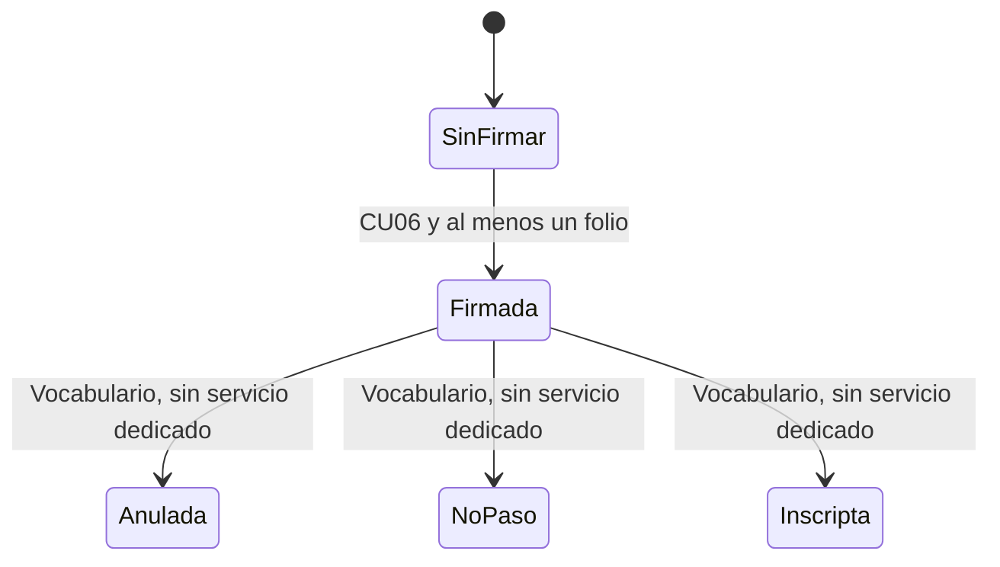

### 3.4 Testimonio — línea de tiempo aparte

`V41` deja el bucle de reingreso fuera del grafo de la gestión. El estado
de la gestión (`Testimonio Generado` → `Ingresado` → `Retirado`) es el
resumen. El detalle es una lista de movimientos.

Reglas de `testimonio-movimiento-inscripcion`:

- Ingresar exige testimonio verificado y que no haya un movimiento abierto
  (fecha de ingreso sin fecha de salida).
- Inscribir exige un ingreso previo y marca `registered` con fecha.
- Retirar exige inscripto, y guarda fecha de salida y número de cartón.
- Reingresar exige que el movimiento más reciente tenga fecha de salida, y
  crea un movimiento nuevo. El anterior no se pisa.
- `observed_by_registry` es una marca del movimiento, no un nodo de la gestión.

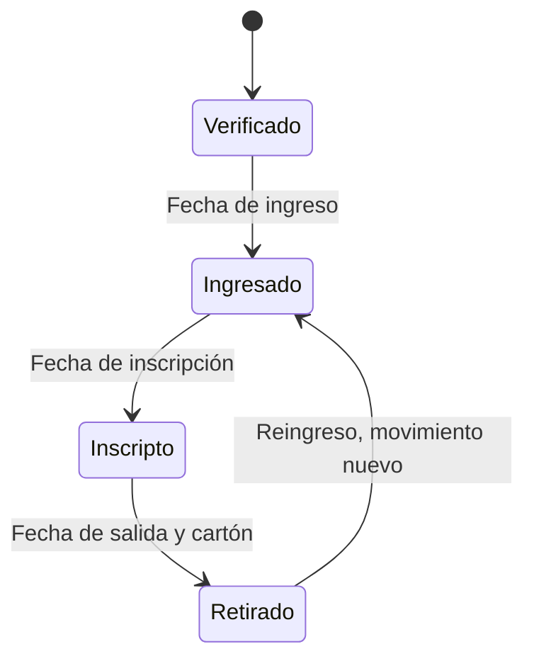

### 3.5 Minuta de inscripción

Circuito propio de la minuta (`RegistrationDraftService`, CU82), no de la
gestión. Generar exige escritura `Firmada` y datos catastrales y registrales
completos del inmueble.

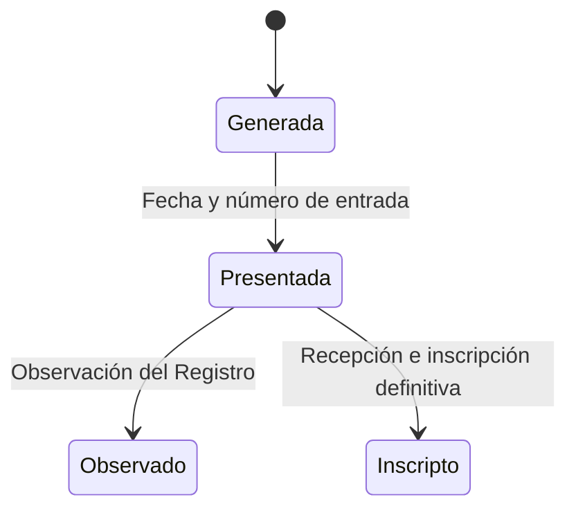

`Observado` no tiene vuelta codificada a `Presentada` ni camino a `Inscripto`.
Inscribir solo se acepta desde `Presentado para inscripción`.

### 3.6 Documentación

Un documento presentado no tiene un enum de estado. El seguimiento es un
conjunto de marcas, y pueden combinarse.

| Marca | Columna | Lectura de negocio |
|-------|---------|--------------------|
| Preparado | `prepared` | El papel ya se pidió o se armó |
| Entregado | `delivered` | Llegó. Si todos los de entidad externa están entregados, CU10 intenta completar la gestión |
| Observado | `observed` | El organismo o la escribanía lo observó |
| Liberado | `released` + `released_date` | Salió del organismo |
| Reingresado | `reentered` | Volvió a presentarse (CU43) |
| Vencimiento | `expires`, `due_date` | Plazo heredado del tipo de documento |

Quién lo trae (`delivered_by`): `Cliente` (CU72) o `Entidad Externa` (CU10).
El curso de CU72 dice “Presentado”; en datos eso es `delivered` / `prepared`,
no un estado llamado Presentado.

Progresión que el negocio lee, linealizada. Las marcas reales pueden salirse
de esta línea.

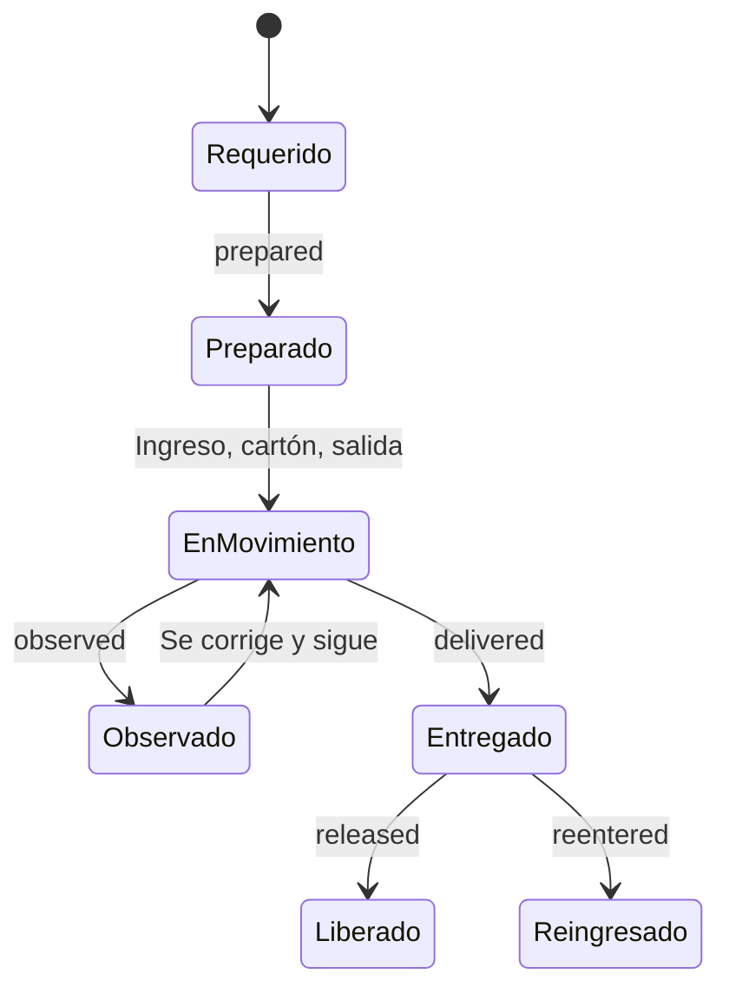

### 3.7 Presupuesto

`budgets.status` acepta solo estos códigos (cualquier otro `PUT` responde
400). El comentario del enum los ordena, pero el controlador no valida la
arista: se puede escribir cualquiera de los cinco.

`BORRADOR` → `PENDIENTE` → `APROBADO` o `RECHAZADO` → `FACTURADO`

Ese orden es la lectura de negocio. No es un grafo custodiado.

### 3.8 Pago

Un pago es un hecho: monto, fecha, método, observaciones, presupuesto. No
tiene estado propio. El estado del presupuesto se calcula
(`GET /api/v1/pagos/presupuesto/{id}/estado`):

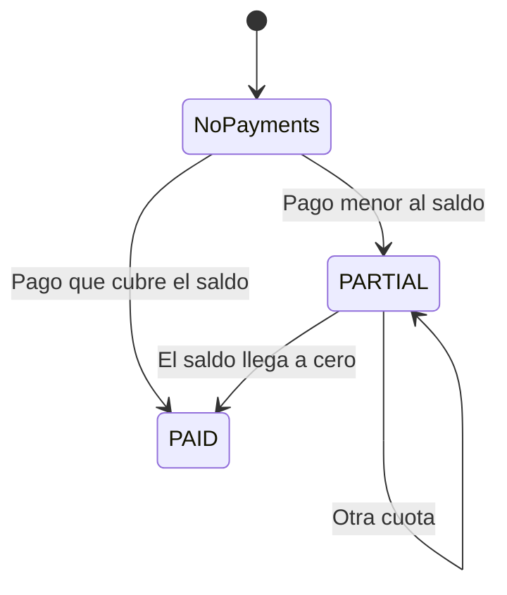

| Código publicado | Condición |
|------------------|-----------|
| `NoPayments` | Nada pagado, o total pagado nulo o cero |
| `PARTIAL` | Hay pagos y el saldo sigue siendo positivo |
| `PAID` | Hay pagos y el saldo es cero o negativo |

El monto no puede superar el saldo (`BigDecimal` escala 2). Un rechazo no
persiste el pago. El nombre `NoPayments` es contrato REST: no se renombra
sin versionar la API.

El cobro no transiciona la gestión. Solo alimenta el aviso de deuda al
archivar.

### 3.9 Carpeta de trámite

Cada trámite nuevo genera una carpeta `Activa` (CU85).

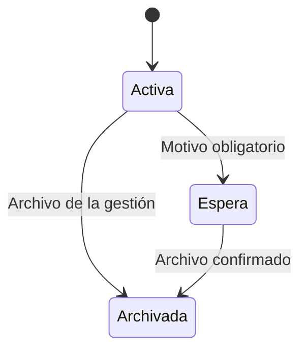

Archivar la gestión pasa todas sus carpetas a `Archivada`. Si alguna está en
`Espera` y el cliente no confirma, el archivado se rechaza.

## 4. Secuencias del camino principal

Una secuencia por decisión que el sistema toma. El resto de los casos de uso
siguen en su ficha; los `.puml` de `204-diagrams/Secuencias/` son legado.

### 4.1 Abrir la gestión y avanzar hasta el testimonio

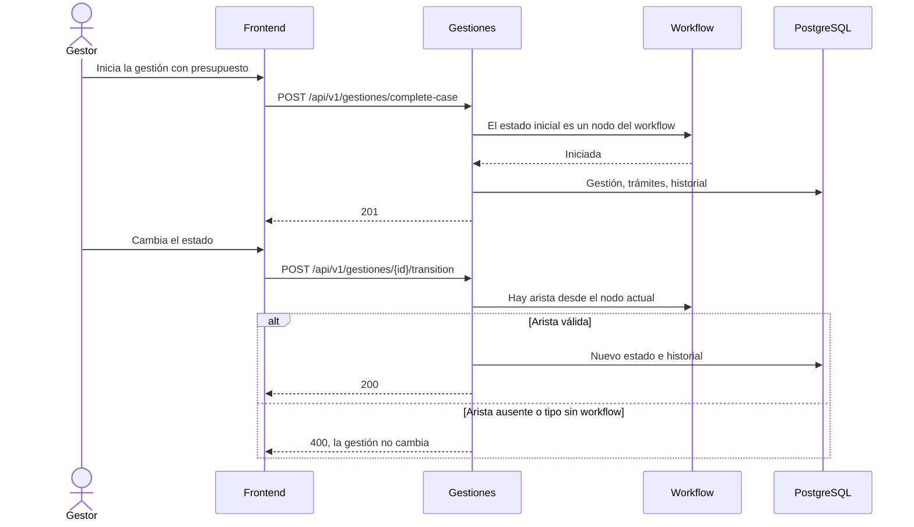

### 4.2 Documentación de entidad externa

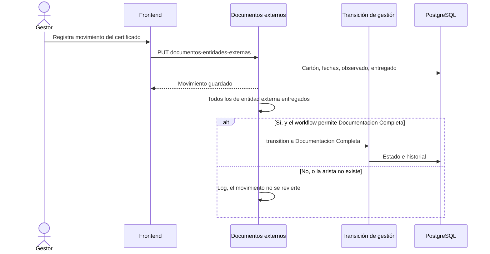

### 4.3 Cobrar y archivar

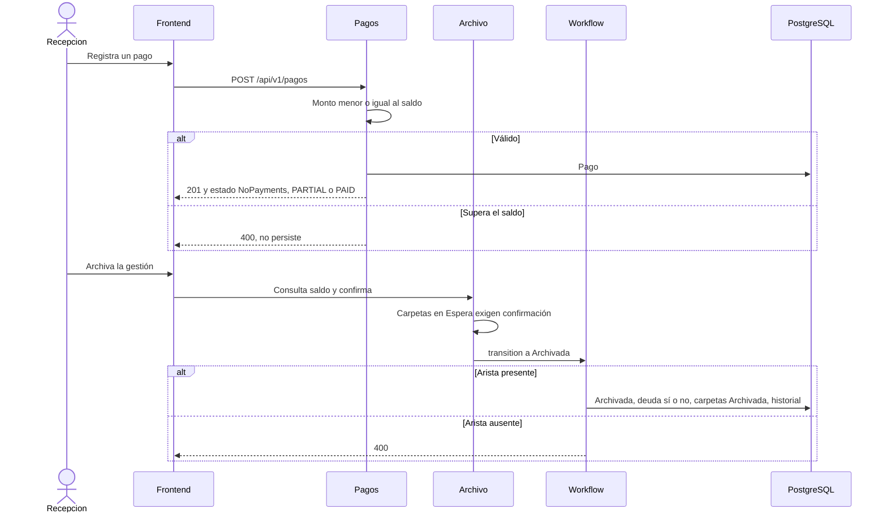

## 5. Vistas C4

Nivel 4 (clases) no se dibuja aquí: el costo no paga el detalle, y el código
ya es esa vista. El SAD arc42 sigue siendo `DOC-SAD`.

### 5.1 Contexto

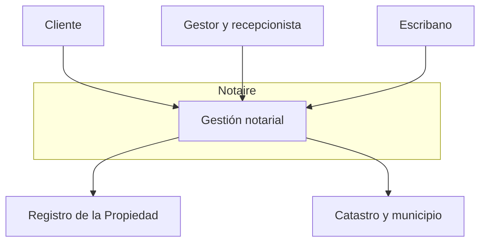

El cliente pide el trámite y paga. El gestor documenta y hace avanzar la
gestión. El escribano firma y archiva. Registro y catastro están fuera del
sistema: la minuta y los certificados se registran en Notaire; el organismo
no tiene API en este modelo.

### 5.2 Contenedores

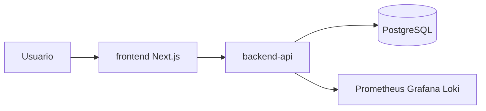

### 5.3 Componentes del backend que sostienen el ciclo

El pago es el corte hexagonal ([ADR-021](../202-ADR/ADR-021-hexagonal-architecture-pilot.md)).
Gestión, documento, escritura, testimonio y minuta viven en casos de uso de
aplicación sobre entidades JPA. El frontend solo habla HTTP.

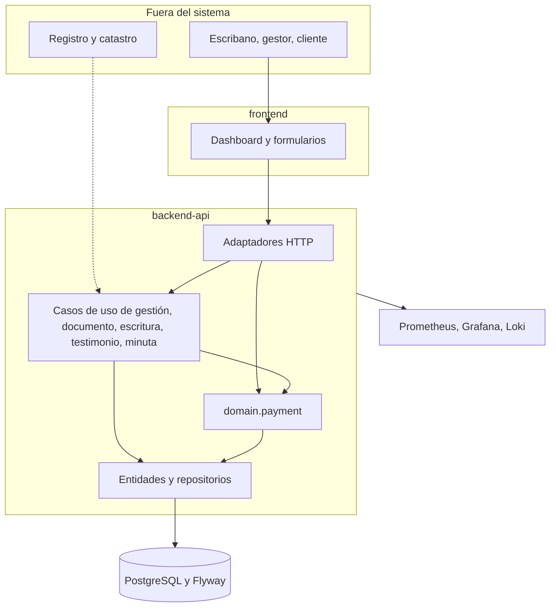

| Pieza | Responsabilidad en el ciclo | Módulo |
|-------|-----------------------------|--------|
| `adapter.in.web` | Contratos REST de gestión, pago, documento, escritura | backend-api |
| `application.usecase.management` | Transición y archivo con deuda | backend-api |
| `application.usecase.document` | Movimiento externo y completitud | backend-api |
| `application.usecase.deed` | Firma con folio | backend-api |
| `application.usecase.testimony` | Ingreso, inscripción, retiro, reingreso | backend-api |
| `application.usecase.registrationdraft` | Minuta | backend-api |
| `domain.payment` | Saldo, cuotas, estado derivado | backend-api |
| `frontend` | Tracker del workflow y formularios | frontend |
| Flyway | Catálogo de estados y grafo sembrado | backend-api |
| Observabilidad | Salud, métricas, logs de operación | infra |

El mapa de módulos del repositorio está en
[MODULE-OWNERSHIP.md](../../300-development/MODULE-OWNERSHIP.md). El despliegue
y el rollback están en
[DEPLOYMENT-PLAN.md](../../300-development/DEPLOYMENT-PLAN.md). La operación
diaria (métricas, logs, incidentes) está en
[monitoreo](../207-monitoring/README.md) y CU77.

## 6. Trazabilidad de punta a punta

El hilo adelante y atrás, con el ejemplo de CU15, está en
[INGENIERIA.md §3](../../300-development/INGENIERIA.md#3-trazabilidad).
Esta tabla es el mapa de documentos del dominio.

| Pregunta | Documento permanente | Contrato de cambio | Código |
|----------|----------------------|--------------------|--------|
| Qué debe hacer el negocio | SRS y casos de uso | OpenSpec `specs/` | — |
| Qué estados puede tomar una gestión | §3.1 de este archivo | `gestion-workflow-transicion` | `V10`, `V41`, `ManagementTransitionService` |
| Cómo se cobra | §3.8 | `pagos`, `pagos-parciales-cuotas` | `PaymentStatus`, `ProcessPaymentService` |
| Cómo viaja un certificado | §3.6 | `submitted-document-update` | `ExternalEntityDocumentService` |
| Cómo se inscribe | §3.4 y §3.5 | `testimonio-movimiento-inscripcion`, `minuta-inscripcion` | `TestimonyMovementService`, `RegistrationDraftService` |
| Cómo se archiva con deuda | §3.1 y §3.9 | archivo / CU16 | `ManagementArchiveDebtService` |
| Cómo se prueba | [TEST-PLAN.md](../../300-development/303-testing/TEST-PLAN.md) | tareas OpenSpec | JUnit, Bruno, Playwright |
| Cómo se entrega | [github/README.md](../../github/README.md) | issue + PR | tablero de entrega |
| Cómo se opera | [209-deployment](../209-deployment/README.md), CU77 | — | Compose, Kustomize, actuator |

## 7. Gestión del trabajo

El tablero de GitHub no es el workflow de la gestión. Un issue `In Progress`
no es una gestión `En Tramite`.

La etiqueta `in-review` marca un PR en revisión. La columna del tablero sigue
en curso hasta que el issue se cierra.

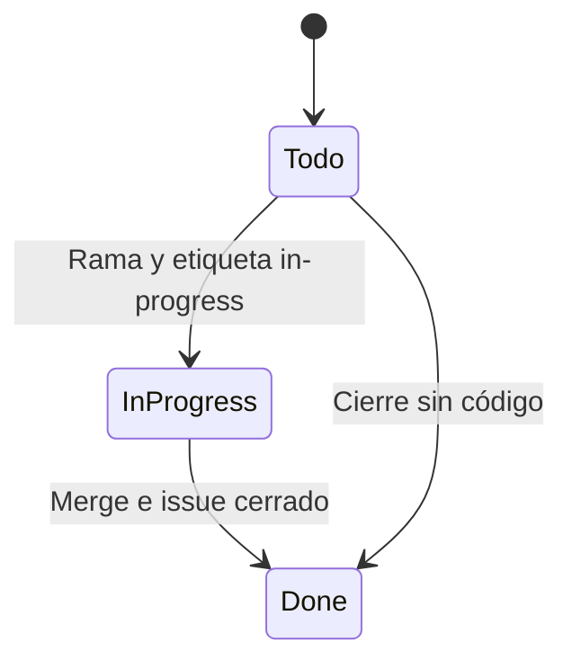

| Capa | Estados | Dónde se lee |
|------|---------|--------------|
| Trabajo | Todo, In Progress, Done (`in-review` es etiqueta, no columna) | [Organización de GitHub](../../github/README.md) |
| Ingeniería | Issue, OpenSpec, TDD, preflight, PR, CI pesado, review, merge, smoke | [CONSTITUTION.md](../../../CONSTITUTION.md) |
| Dominio | §3 de este archivo | Código y Flyway |

Hitos: `v1.0 — Production Ready` (prioridad crítica y alta), `v1.1 — Hardening`
(media), `Backlog` (baja). Los issues ancla de RF y de caso de uso permanecen
abiertos; el trabajo los referencia, no los cierra.

Una issue de trabajo lleva caso de uso, criterios de aceptación, un área, una
prioridad y un hito. El cambio que altere un estado de §3 actualiza este
archivo además del spec OpenSpec.

## 8. Divergencias conocidas

Hechos del sistema de hoy. No son una propuesta de cambio.

1. El diagrama de actividad legado
   `204-diagrams/Diagrama de Estados/transicion-de-estados.puml` archiva al
   final, después de los testimonios. El grafo sembrado solo archiva desde
   `Documentacion Completa`.
2. `DeedSigningService` cambia `deeds.status`. No cambia el estado de la
   gestión.
3. `Gestion con Escritura Inscripta` ya no está en el grafo. La inscripción
   que el workflow recorre es la del testimonio.
4. La minuta `Observado` no vuelve a presentarse ni se inscribe por el
   servicio actual.
5. El orden del presupuesto no está custodiado por aristas.
6. “Presentado” en CU72 no es un valor persistido.

## 9. Regla para el AI SDLC

En la fase de documentación de un cambio:

- Si el cambio agrega, quita o condiciona un estado de §3, se edita este
  archivo y, si el grafo sembrado cambia, la migración Flyway. Una sola
  fuente.
- El spec OpenSpec dice el delta. Este archivo dice el resultado.
- No se crea un `.puml` nuevo para el mismo ciclo.
- Los casos de uso se tocan solo cuando cambia el relato del actor. El grafo
  no se copia dentro de cada CU.

Detalle de flota: [FLEET-ARCHITECTURE.md](../../300-development/304-ai-sdlc-cloud/FLEET-ARCHITECTURE.md).
