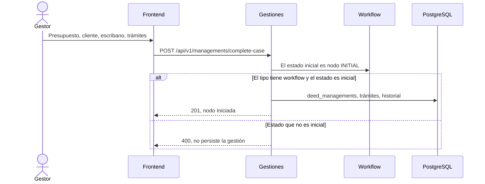
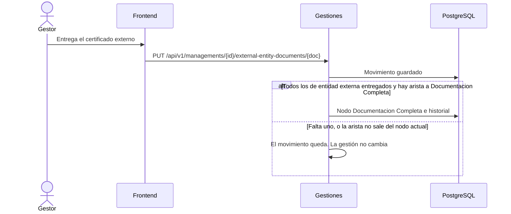
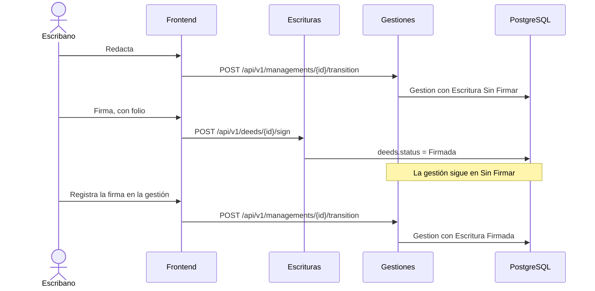
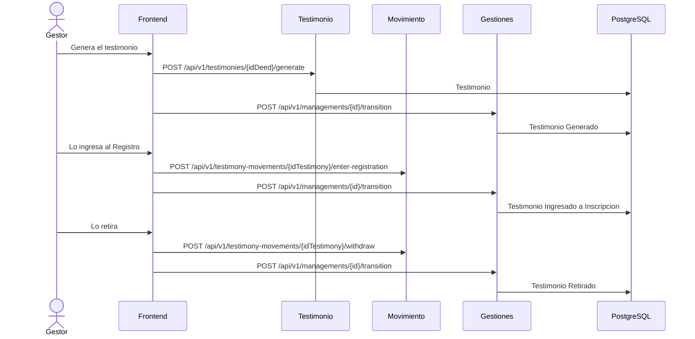
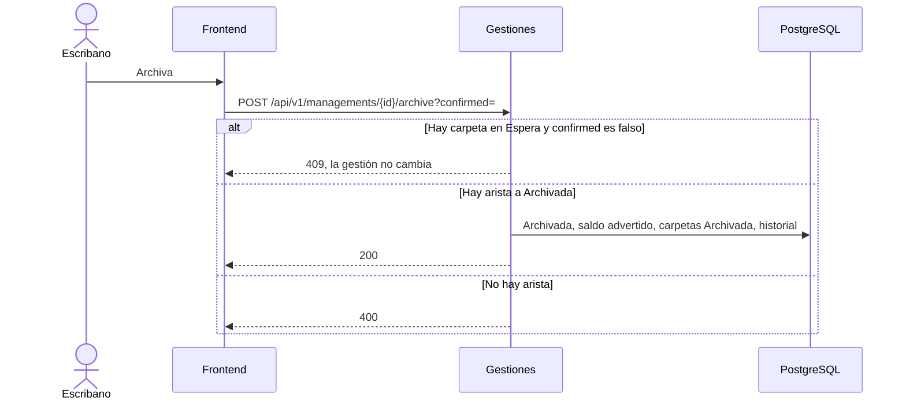
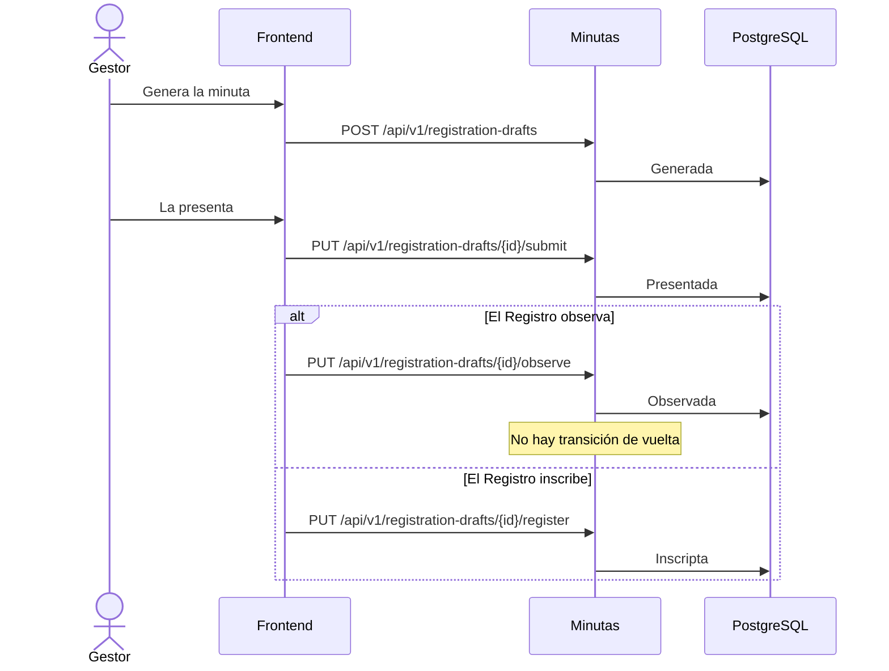

# Gestión — análisis y diseño del proceso central

El trámite notarial (la gestión) es el proceso central. Este documento es el
esquema de análisis y diseño de ese proceso: actores, casos de uso, qué tiene
que existir para dar cada paso, y una secuencia por paso que el sistema
realmente ejecuta.

Las máquinas de estado no se copian. Gestión, escritura, testimonio, minuta,
documento, presupuesto, pago y carpeta están en
[CICLO-DE-VIDA.md](CICLO-DE-VIDA.md) §3. Si un cambio mueve un estado, se
edita ese archivo. La decisión del motor está en
[ADR-014](../202-ADR/ADR-014-workflow-engine.md). Los diagramas activos son
Mermaid ([ADR-027](../202-ADR/ADR-027-mermaid-diagrams.md)).

## 1. Casos de uso del proceso

Un caso de uso no es un estado. Varios casos recorren una sola gestión.

```mermaid
flowchart TB
  cliente[Cliente]
  gestor[Gestor / Recepcionista]
  escribano[Escribano]

  subgraph notaire [Notaire]
    cu01[CU01 Preparar presupuesto]
    cu02[CU02 Iniciar gestión]
    cu04[CU04 Recibir documentación]
    cu10[CU10 Movimiento de entidad externa]
    cu05[CU05 Preparar escritura]
    cu06[CU06 Firmar escritura]
    cu07[CU07 Generar testimonio]
    cu11[CU11 Ingresar a inscripción]
    cu12[CU12 Retirar testimonio]
    cu82[CU82 Minuta de inscripción]
    cu16[CU16 Archivar]
    cu15[CU15 Procesar pago]
    cu83[CU83 Definir workflow]
  end

  cliente --> cu01
  cliente --> cu15
  gestor --> cu02
  gestor --> cu04
  gestor --> cu10
  gestor --> cu05
  escribano --> cu06
  escribano --> cu07
  gestor --> cu11
  gestor --> cu12
  gestor --> cu82
  escribano --> cu16
  cu83 -.-> cu02
  cu83 -.-> cu16
```

`cu83` no lo dispara el gestor en cada trámite: define las aristas que CU02
y CU16 consultan. El pago (CU15) corre al lado; no cambia el nodo de la gestión.

## 2. Dependencias de cada paso

El estado de la gestión solo cambia por `POST /api/v1/managements/{id}/transition`
o por `POST /api/v1/managements/{id}/archive`. Un `PUT` que cambie el estado
responde 400. Sucesión y Poder no tienen workflow sembrado: cualquier
transición responde 400.

| Paso | Nodo antes | Tiene que existir | Caso | Llamada | No alcanza |
|------|------------|-------------------|------|---------|------------|
| Abrir | — | Presupuesto, cliente, escribano, tipo con workflow | CU02 | `POST /api/v1/managements/complete-case` | Un `POST /api/v1/managements` sin trámite no exige nodo inicial |
| Asignar trámites | Iniciada | Arista «Se asignan trámites» | CU02, CU83 | `POST /api/v1/managements/{id}/transition` | Crear la gestión otra vez |
| Completar papeles | En Tramite | Arista «Documentación presentada», o el último certificado externo entregado | CU04, CU10 | transición, o `PUT /api/v1/managements/{id}/external-entity-documents/{doc}` | Guardar un documento si la arista no existe: el documento queda y la gestión no se mueve |
| Redactar | Documentacion Completa | Arista «Se redacta la escritura» | CU05 | transición | El estado de `deeds` |
| Firmar el instrumento | cualquiera | Escritura `Sin Firmar` y al menos un folio | CU06 | `POST /api/v1/deeds/{id}/sign` | Esa llamada no mueve la gestión |
| Registrar la firma en la gestión | Gestion con Escritura Sin Firmar | Arista «Las partes firman» | CU06, CU83 | transición | Haber firmado la escritura |
| Generar testimonio | Gestion con Escritura Firmada | Arista «Se genera el testimonio» | CU07 | `POST /api/v1/testimonies/{idDeed}/generate` y, aparte, la transición | Una sola de las dos llamadas |
| Ingresar a inscripción | Testimonio Generado | Arista «Ingreso a inscripción» | CU11 | `POST /api/v1/testimony-movements/{idTestimony}/enter-registration` y la transición | — |
| Retirar | Testimonio Ingresado a Inscripcion | Arista «Retiro» | CU12 | `POST /api/v1/testimony-movements/{idTestimony}/withdraw` y la transición | — |
| Archivar sin escritura | Documentacion Completa | Arista a `Archivada`. Si hay carpeta en Espera, `confirmed=true` | CU16, CU85 | `POST /api/v1/managements/{id}/archive` | Saldo pendiente: advierte y no bloquea |
| Minuta | — | Escritura. No es un nodo de la gestión | CU82 | `POST /api/v1/registration-drafts`, luego `submit`, `observe` o `register` | Desde `Observado` no hay vuelta en el servicio |

`Testimonio Retirado` y `Archivada` son finales. El grafo sembrado no archiva
después del retiro.

## 3. Secuencias

### 3.1 Iniciar

### 3.2 Documentación que puede completar la gestión

### 3.3 Escritura y firma, en dos máquinas

Anulada, No Paso e Inscripta son valores de `deeds.status`. No hay arista
sembrada hacia `Gestion con Escritura Anulada` ni `No Paso`.

### 3.4 Testimonio

El movimiento del testimonio (verificado, ingresado, inscripto, retirado,
reingresado) es otra máquina. Está en CICLO-DE-VIDA §3.4. Esta secuencia es
solo el acoplamiento con el nodo de la gestión.

### 3.5 Archivar

La arista sembrada sale solo de `Documentacion Completa`. Archivar desde
`Testimonio Retirado` exige que un administrador agregue esa arista (CU83).

### 3.6 Minuta

La minuta no mueve el nodo de la gestión.

## 4. Dónde está el resto

| Pregunta | Documento |
|----------|-----------|
| Grafo de estados y divergencias | [CICLO-DE-VIDA.md](CICLO-DE-VIDA.md) §3 y §8 |
| Actividad de negocio del mismo grafo | [transicion-de-estados.puml](../204-diagrams/Diagrama%20de%20Estados/transicion-de-estados.puml) — legado, alineado al grafo; no es la fuente |
| Evaluación de requisitos y huecos | [EVALUACION-DOCUMENTACION.md](../../100-business/EVALUACION-DOCUMENTACION.md) |
| Motor | [ADR-014](../202-ADR/ADR-014-workflow-engine.md) |
| Vista de runtime del SAD | [sad.md](../201-SAD/sad.md) §6 |
