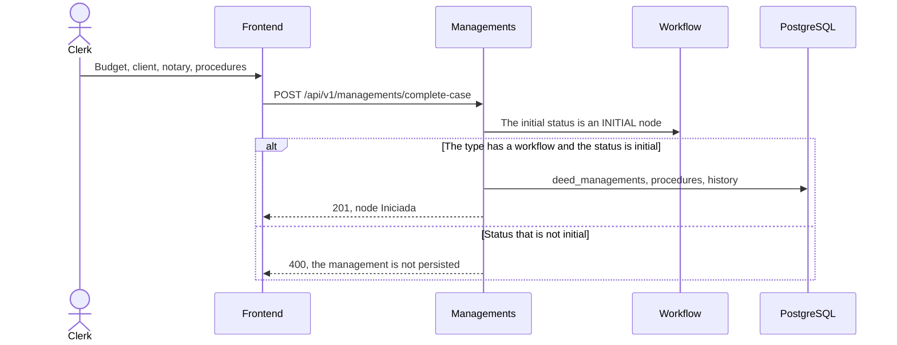
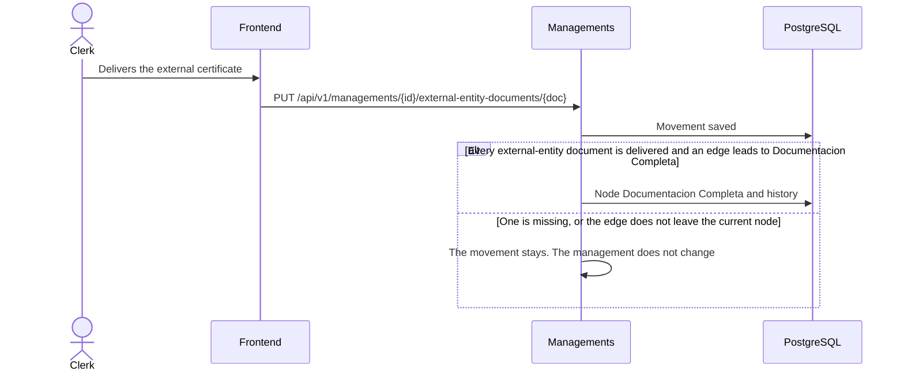
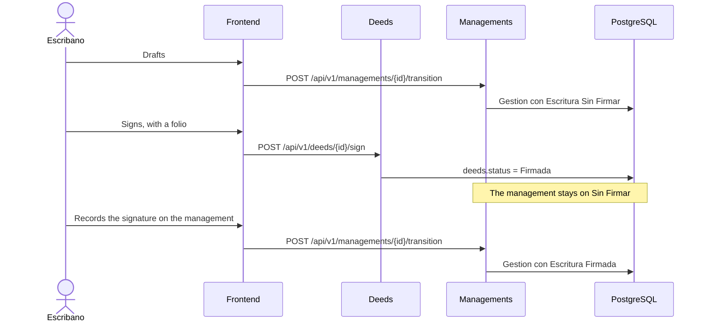
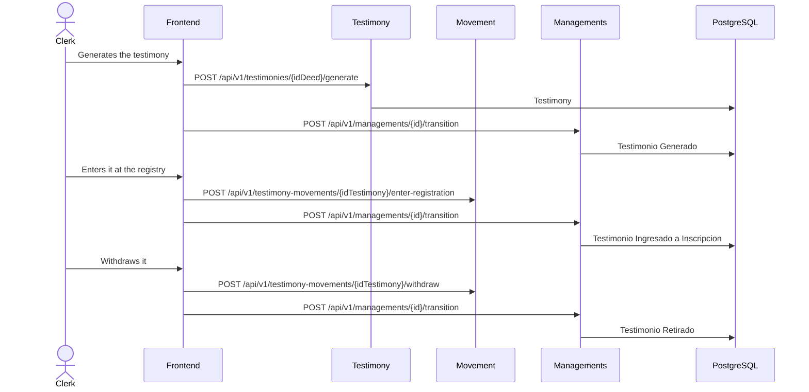
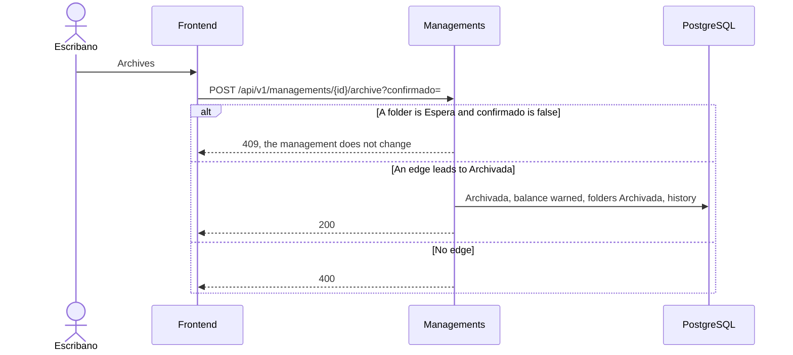
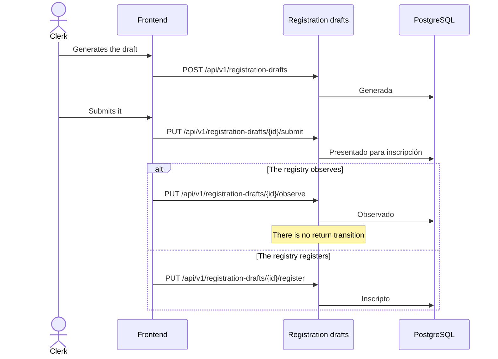

# Case process — analysis and design

The notarial procedure (the management) is the central process. This document
is the analysis and design of that process: actors, use cases, what must
exist before each step, and a sequence for each step the system actually runs.

State machines are not copied here. Management, deed, testimony, registration
draft, document, budget, payment, and procedure folder live in
[CICLO-DE-VIDA.md](CICLO-DE-VIDA.md) §3. If a change moves a status, edit that
file. The engine decision is in
[ADR-014](../202-ADR/ADR-014-workflow-engine.md). Active diagrams are Mermaid
([ADR-027](../202-ADR/ADR-027-mermaid-diagrams.md)).

## 1. Use cases of the process

A use case is not a status. Several use cases walk one management.

```mermaid
flowchart TB
  cliente[Client]
  gestor[Clerk / Receptionist]
  escribano[Escribano]

  subgraph notaire [Notaire]
    cu01[CU01 Preparar presupuesto]
    cu02[CU02 Iniciar gestión]
    cu04[CU04 Recibir documentación]
    cu10[CU10 Movimiento de entidad externa]
    cu05[CU05 Preparar escritura]
    cu06[CU06 Firmar escritura]
    cu07[CU07 Generar testimonio]
    cu11[CU11 Ingresar a inscripción]
    cu12[CU12 Retirar testimonio]
    cu82[CU82 Minuta de inscripción]
    cu16[CU16 Archivar]
    cu15[CU15 Procesar pago]
    cu83[CU83 Definir workflow]
  end

  cliente --> cu01
  cliente --> cu15
  gestor --> cu02
  gestor --> cu04
  gestor --> cu10
  gestor --> cu05
  escribano --> cu06
  escribano --> cu07
  gestor --> cu11
  gestor --> cu12
  gestor --> cu82
  escribano --> cu16
  cu83 -.-> cu02
  cu83 -.-> cu16
```

`cu83` is not fired by the clerk on every procedure: it defines the edges
that CU02 and CU16 consult. Payment (CU15) runs alongside; it does not change
the management node.

## 2. Dependencies of each step

The management status changes only through
`POST /api/v1/managements/{id}/transition` or through
`POST /api/v1/managements/{id}/archive`. A `PUT` that changes the status
answers 400. Stored procedure types `Sucesion` and `Poder` have no seeded
workflow: any transition answers 400.

| Step | Node before | Must exist | Use case | Call | Not enough |
|------|-------------|-------------------|----------|---------|------------|
| Open | — | Budget, client, notary, a type with a workflow | CU02 | `POST /api/v1/managements/complete-case` | A `POST /api/v1/managements` without a procedure does not require an initial node |
| Assign procedures | Iniciada | Edge `Se asignan trámites y comienza la gestión` | CU02, CU83 | `POST /api/v1/managements/{id}/transition` | Creating the management again |
| Complete the papers | En Tramite | Edge `Toda la documentación requerida fue presentada`, or the last external certificate delivered | CU04, CU10 | transition, or `PUT /api/v1/managements/{id}/external-entity-documents/{doc}` | Saving a document when the edge does not exist: the document stays and the management does not move |
| Draft | Documentacion Completa | Edge `Se redacta la escritura` | CU05 | transition | The `deeds` status |
| Sign the instrument | any | Deed `Sin Firmar` and at least one folio | CU06 | `POST /api/v1/deeds/{id}/sign` | That call does not move the management |
| Record the signature on the management | Gestion con Escritura Sin Firmar | Edge `Las partes firman la escritura` | CU06, CU83 | transition | Having signed the deed |
| Generate testimony | Gestion con Escritura Firmada | Edge `Testimony generated after deed signing` | CU07 | `POST /api/v1/testimonies/{idDeed}/generate` and, separately, the transition | Only one of the two calls |
| Enter for registration | Testimonio Generado | Edge `Testimony submitted for inscription` | CU11 | `POST /api/v1/testimony-movements/{idTestimony}/enter-registration` and the transition | — |
| Withdraw | Testimonio Ingresado a Inscripcion | Edge `Testimony withdrawn after inscription cycle` | CU12 | `POST /api/v1/testimony-movements/{idTestimony}/withdraw` and the transition | — |
| Archive without a deed | Documentacion Completa | Edge `La gestión se archiva sin escritura`. If a folder is `Espera`, `confirmado=true` | CU16, CU85 | `POST /api/v1/managements/{id}/archive` | Outstanding balance: it warns and does not block |
| Registration draft | — | A deed. It is not a management node | CU82 | `POST /api/v1/registration-drafts`, then `submit`, `observe`, or `register` | From `Observado` the service has no return |

`Testimonio Retirado` and `Archivada` are final. The seeded graph does not
archive after withdrawal.

## 3. Sequences

### 3.1 Open

### 3.2 Documentation that can complete the management

### 3.3 Deed and signature, on two machines

`Anulada`, `No Paso`, and `Inscripta` are values of `deeds.status`. No seeded
edge leads to `Gestion con Escritura Anulada` or `Gestion con Escritura No Paso`.

### 3.4 Testimony

The testimony movement (verified, entered, registered, withdrawn, re-entered)
is another machine. It is in CICLO-DE-VIDA §3.4. This sequence is only the
coupling with the management node.

### 3.5 Archive

The seeded edge leaves only from `Documentacion Completa`. Archiving from
`Testimonio Retirado` requires an administrator to add that edge (CU83).

### 3.6 Registration draft

The registration draft does not move the management node.

## 4. Where the rest lives

| Question | Document |
|----------|----------|
| State graph and divergences | [CICLO-DE-VIDA.md](CICLO-DE-VIDA.md) §3 and §8 |
| Business activity of the same graph | [transicion-de-estados.puml](../204-diagrams/Diagrama%20de%20Estados/transicion-de-estados.puml) — legacy, aligned to the graph; not the source |
| Requirements evaluation and gaps | [EVALUACION-DOCUMENTACION.md](../../100-business/EVALUACION-DOCUMENTACION.md) |
| Engine | [ADR-014](../202-ADR/ADR-014-workflow-engine.md) |
| SAD runtime view | [sad.md](../201-SAD/sad.md) §6 |
