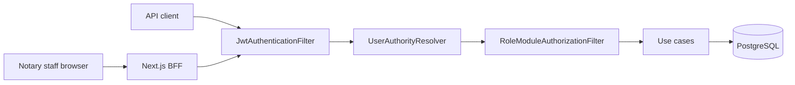

# Security assessment — 2026-11-05

Use case: **CU78**. Issue: **#2003**.

Scope: the tree on this change. Trust boundaries, the STRIDE and LINDDUN
registers, the testing tools and where they run after release-only product CI
(#2001), and how findings are reported. This assessment is not a pentest. Status
words are design status. They are not a claim that an attacker failed.

Agent procedure stays in the AI Factory note
[SECURITY-GATES.md](../../300-development/304-ai-sdlc-cloud/SECURITY-GATES.md).
This file is the product assessment.

## 1. Architecture and trust boundaries

Four boundaries, matching [diagrams/trust-boundaries.puml](diagrams/trust-boundaries.puml):

1. **Public internet.** The browser and any API client are untrusted. Headers,
   body, and query are data. `X-Notaire-User` is not an identity.
2. **Next.js BFF.** Staff browsers send an HttpOnly cookie. The BFF proxies
   `/api/v1` with server-side `BACKEND_URL` (#1055). Production CSP is a
   per-request nonce without `'unsafe-eval'` (`frontend/src/lib/csp.ts`, #1051).
3. **backend-api.** `JwtAuthenticationFilter` authenticates. `UserAuthorityResolver`
   maps roles (`Escribano` is `ROLE_NOTARY`, not admin, #1638).
   `RoleModuleAuthorizationFilter` then requires the module grant for the path
   (#1683, ADR-029 W2). Use cases talk to PostgreSQL with parameterized JPA.
4. **PostgreSQL.** Personal data and notarial records. Production compose does
   not publish the database port (#1044).

Assets are the same classes as the system model: credentials (critical),
`Person` and notarial records (high), budgets and payments (medium, no card
data), and the audit trail (medium). No user-controlled outbound HTTP client
was found in `backend-api` (`RestTemplate` / `WebClient` absent). SSRF is not a
current exposure. Re-open the model if an integration fetches a caller-supplied
URL.

There is no Terraform. Container images are pinned and checked by
`security/tests/test_image_pins_and_dependabot.py`.

## 2. Threat modeling

Primary method: **STRIDE**, in
[THREAT-MODEL-AUTH-AUDIT.md](THREAT-MODEL-AUTH-AUDIT.md) (`SR-01`..`SR-10`) and
[THREAT-MODEL-SYSTEM.md](THREAT-MODEL-SYSTEM.md) (`SR-11`..`SR-16`).

Privacy method: **LINDDUN** rows `LD-1`..`LD-6` in the system model. Testimony,
folio, and submitted documents are not modeled in depth. That is #2007. This
assessment does not interpret a statute. Counsel owns that reading. Issue #309
is closed and is not reopened here.

The id register checked by `security/tests/test_threat_register.py` is
[threat-model/system.stride.yml](threat-model/system.stride.yml).

### Tools evaluated for the register

| Tool | Decision |
|------|----------|
| PlantUML | Kept. `diagrams/trust-boundaries.puml` is the diagram the catalog already requires. |
| Mermaid | Kept on the portfolio and in this file for the same boundaries. |
| Checked-in YAML | Adopted. Small enough for unittest. Not a Threagile schema. |
| OWASP Threat Dragon | Not adopted. The JSON model needs the editor, and CI has no Dragon binary. #2009. |
| pytm | Not adopted. It would generate a second diagram beside PlantUML. |
| Threagile | Not adopted. Sound YAML, and a Go binary this pipeline does not pin. |

### STRIDE snapshot

| Id | Property | Status on this date | Evidence |
|----|----------|---------------------|----------|
| SR-11 | Elevation | Accepted inside one office. Function grants mitigated | `RoleModuleAuthorizationFilter`, #1683. Cross-notary access is a deployment property (ADR-029) |
| SR-12 | Spoofing | Partial | HttpOnly cookie. Login JSON still returns a bearer token for API clients |
| SR-13 | Tampering | Partial | Trivy fails the release job. It does not run on pull_request |
| SR-14 | Disclosure | Partial | `security/scan_secrets.py`. GitHub push protection is an admin setting |
| SR-15 | Denial of service | Open | Login lockout only. #2010 |
| SR-16 | Elevation | Mitigated | `Escribano` is `ROLE_NOTARY` (#1638) |

### ATT&CK names

Names only, so a reader can see which control the class hits. No procedure.

| Technique | Name | Mapped control |
|-----------|------|----------------|
| T1110 | Brute Force | Login lockout (SR-01) |
| T1078 | Valid Accounts | Session handling (SR-12) |
| T1190 | Exploit Public-Facing Application | CodeQL, ZAP, input validation |
| T1552 | Unsecured Credentials | Secret scan (SR-14) |
| T1195 | Supply Chain Compromise | Trivy, Dependabot, cosign (SR-13) |

## 3. Security testing inventory

Product GitHub Actions do not run on a branch push (#2001). The security job does not run on pull_request. Day-to-day proof is `bash workspace/sdlc/preflight.sh --full`,
whose pre-push hook is the same command. A version tag (`v*` / `notaire-v*`)
or `workflow_dispatch` runs the product workflows. Release Please on `main`
dispatches the tag workflows because a `GITHUB_TOKEN` tag push does not start
them (#1599).

| Family | Local preflight / pipeline | Version tag or manual | Schedule | Gap |
|--------|----------------------------|------------------------|----------|-----|
| Secrets | `security/scan_secrets.py` inside `security/run_gates.py` | `ci.yml` security job | — | Push protection is outside git |
| SAST | Semgrep `security/semgrep/notaire.yml` | Same job, plus `codeql.yml` | `codeql.yml` Monday 06:30 UTC | CodeQL does not fail on findings (#2011). It does not run locally |
| SCA | Trivy fs, `--exit-code 1`, fixed CRITICAL/HIGH | Same, plus image scan CRITICAL in `docker-build` | — | A pull request is not scanned by GitHub until the tag |
| DAST | `security/dast_baseline.py` after the stack is up (pipeline, not the short preflight) | — | `dast-zap.yml` Monday 05:00 UTC, `fail_action: true` | ZAP does not run on the version tag (#2004) |
| Policy | `security/cases/catalog.yml` evidence checks | `run_gates.py --profile ci` | — | — |
| AuthZ tests | JUnit `RoleModuleGrantIntegrationTest` and neighbours, inside `mvn verify` when preflight runs the suite | `ci.yml` | — | The matrix is thin (#2006) |
| Supply chain | image-pin unit tests | `cd.yml` cosign and CycloneDX | — | CD does not publish on a merge to `main` |
| IaC | image-pin tests. No Terraform | — | — | Checkov/tfsec do not apply |
| Secrets in CI config | `security/tests/` | the release security job | — | — |

`copilot-setup-steps.yml` still has a `pull_request` trigger limited to its own
file path. It installs the OpenSpec CLI for GitHub Copilot. It is not a product
test. `opencode.yml` runs on a comment that contains `/oc`. Neither is part of
the security gate.

Trivy was kept. OSV-Scanner and OWASP Dependency-Check were not added: they
would open a second database for the same patch path. Gitleaks stays the
reference rule set. The Python scanner is the gate.

The catalog flag `fail_on_findings: true` on `SEC-SCA-01` matches the runner,
which passes `--exit-code 1` to Trivy. The flag used to say `false` and the
runner ignored it.

## 4. Reporting and dashboard

| Surface | What it shows | Who can see it | Live findings? |
|---------|---------------|----------------|----------------|
| `reports/security/latest/index.html` | Case pass/fail from `run_gates.py` | The person who ran the gate | Local only |
| Homer `security-reports` on port 8890 | That HTML | Local Docker stack (#1506) | Local only |
| Actions job summary | `security/publish_summary.py` | People with access to the workflow run | Release or manual run only |
| Artifacts `security-case-report`, `trivy-results`, `trivy-image-results` | JSON and HTML | Same | Release or manual run only |
| CodeQL | SARIF on the GitHub Security tab | Repository security access | Tag, Monday, or manual. Upload does not fail the job |
| ZAP | Workflow logs and artifacts | Same | Weekly or manual |
| Grafana `notaire-auth` | Login metrics | Local observability stack | Metrics, not a vuln list |
| Portfolio `/security/` | Public posture and cadence | Anyone | **No.** Checked-in demo snapshot. Not a live scan |

A pipeline that publishes a redacted summary into the portfolio is #2008.
Until that exists, the site must not imply it is reading production scan data.

## 5. Gap analysis

Priority is what changes risk or what the docs had wrong. Work that is not in
the #2003 pull request is an issue.

| Priority | Gap | Issue |
|----------|-----|-------|
| Now, in #2003 | Docs still said module grants were pending and that the image scan was report-only. Both were false after #1683 and the Trivy `exit-code: '1'` lines | This assessment |
| Now, in #2003 | Portfolio and the AI Factory pages still described pull-request product CI | Portfolio and `SECURITY-GATES.md` |
| Next | ZAP does not run on the version tag | #2004 |
| Next | Missing `Referrer-Policy` and `Permissions-Policy`. CSP nonce stays as it is | #2005 |
| Next | Authorization tests do not cover every module path | #2006 |
| Next | LINDDUN does not cover testimony and submitted documents | #2007 |
| Next | No redacted findings feed for the portfolio | #2008 |
| Later | Threat Dragon model checked in CI | #2009 |
| Next | No general API rate limit. Login lockout remains | #2010 |
| Decision | CodeQL findings do not fail the release | #2011 |
| Open, already filed | MFA | #1640 |
| Owner only | Live `protect-main` ruleset may still require checks that no longer run on a pull request. Desired JSON in git already dropped them | #2001 |

Closed issues this review stopped citing as open work: #254, #267, #280, #282,
#283, #309, #1465, #1738. #1994 (mobile E2E) is closed and is not part of this
assessment.

## What changed in the program because of this review

[CYBERSECURITY-PROGRAM.md](CYBERSECURITY-PROGRAM.md),
[SECURITY-TOOLS.md](SECURITY-TOOLS.md),
[THREAT-MODEL-SYSTEM.md](THREAT-MODEL-SYSTEM.md), and
[OWASP-TOP10.md](OWASP-TOP10.md) now match the rows above. The portfolio
explains the same cadence with demo data only.
