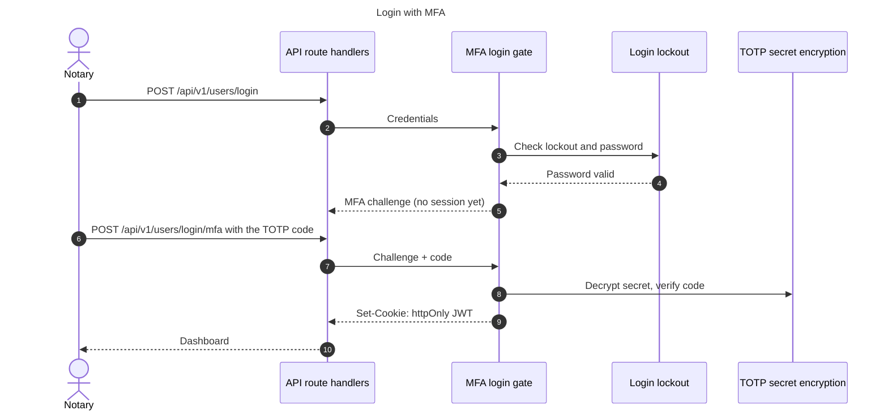
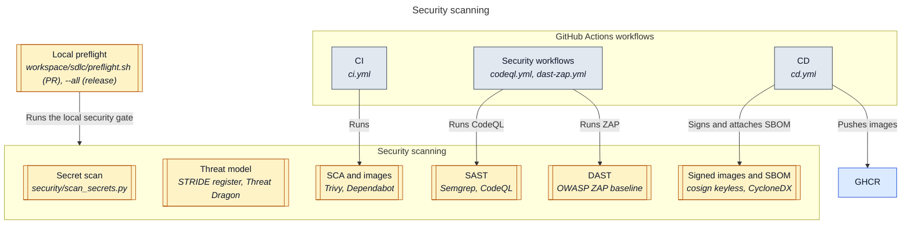

# Security Policy

**Fleet split (#2514):** program/procedure docs (CYBERSECURITY-PROGRAM, assessment,
SECURITY-TOOLS, MONITORING, HTTPS-TLS runbook, installation-isolation checklist)
live in [matiaspakua/notaire-security](https://github.com/matiaspakua/notaire-security)
(`docs/`). This directory keeps **code-tied** threat models, diagrams and guides.
Stubs in this folder link to the fleet copies.

The system threat model is [THREAT-MODEL-SYSTEM.md](THREAT-MODEL-SYSTEM.md).
Program entry points: [CYBERSECURITY-PROGRAM.md](CYBERSECURITY-PROGRAM.md) (stub → fleet),
[ASSESSMENT-2026-11-05.md](ASSESSMENT-2026-11-05.md) (stub → fleet).
Gates run from the `security/` submodule (`bash security/verify.sh`,
`python3 security/run_gates.py`).

## Supported Versions

We actively support and provide security updates for the following versions:

| Version | Supported          | Notes |
| ------- | ------------------ | ----- |
| 1.x     | :white_check_mark: | Current stable release |

## Reporting a Vulnerability

If you discover a security vulnerability within Notaire, please send an e-mail to the maintainer. All security vulnerabilities will be promptly addressed.

Please include the following information:

- Type of vulnerability
- Full paths of source file(s) related to the vulnerability
- Location of the affected source code (tag/branch/commit or direct URL)
- Any special configuration required to reproduce the issue
- Step-by-step instructions to reproduce the issue
- Proof-of-concept or exploit code (if possible)
- Impact of the issue, including how an attacker might exploit it

## Data Classification & Threat Model

Notaire manages **notarial deeds and personal data** (`Person` records
include DNI, email, and legal-act involvement) subject to Argentine legal
retention requirements (see the SAD's Legal Constraints, §2.3) — a breach
exposes both PII and legally-binding document metadata, not just
application data.

### Data sensitivity

| Category | Examples | Sensitivity |
|----------|----------|--------------|
| PII | `Person` (DNI, email, firstName/lastName) | High — regulated personal data |
| Legal/notarial records | `Deed`, `Testimony`, `Folio`, `SubmittedDocument` | High — legally binding, indefinite retention |
| Financial | `Budget`, `Payment` | Medium — budget/payment amounts, no card data stored |
| Operational | `AuditRecord`, `History` | Medium — who-did-what audit trail, itself a control |
| Credentials | `User.password` (BCrypt hash) | Critical |

### Primary threats and current mitigations

| Threat | Mitigation | Gap |
|--------|-----------|-----|
| Credential stuffing / brute force on login | `LoginAttemptService` lockout (5 attempts / 15 min) | Single-instance only — see [ADR-018](../202-ADR/ADR-018-rate-limiting-policy.md) |
| Unauthorized data access | JWT on `/api/**`, `ROLE_ADMIN` for admin paths and admin writes (#559), and module grants in `RoleModuleAuthorizationFilter` (#1683) | Cross-notary access is excluded by single-tenant deployment. Inside the office, object sharing is accepted (SR-11). See [THREAT-MODEL-SYSTEM.md](THREAT-MODEL-SYSTEM.md) |
| Credential leakage via defaults | `ProductionCredentialsGuard` blocks startup on default `.env` values in production | Only catches the literal `"admin"` default, not weak passwords generally — see [ADR-019](../202-ADR/ADR-019-secrets-management.md) |
| API surface reconnaissance | Swagger UI/spec denied in production | Non-production environments remain fully open — see [ADR-020](../202-ADR/ADR-020-openapi-exposure-policy.md) |
| SQL injection | JPA/Hibernate parameterized queries throughout (see [SQL Injection Prevention](SQL-INJECTION-PREVENTION.md)) | None known |
| Tampering with audit trail | `AuditRecordService` records acting user from `SecurityContextHolder` (JWT identity), never a client-supplied header | GETs are not audited (read access to PII is not logged) |

For the two highest-risk subsystems — authentication and the audit trail —
this table is superseded by a formal STRIDE threat model:
[THREAT-MODEL-AUTH-AUDIT.md](THREAT-MODEL-AUTH-AUDIT.md), with numbered
security requirements (`SR-01`..`SR-10`) and an explicit
Mitigated/Partial/Open status per threat. The rest of the system, including
personal data and notarial records, is covered by
[THREAT-MODEL-SYSTEM.md](THREAT-MODEL-SYSTEM.md) (`SR-11` onward).

## Security Features

### Implemented Security Measures

1. **Docker Security**
   - Non-root user execution
   - Minimal base image (Alpine Linux)
   - Read-only file system recommended
   - Security scanning with Trivy

2. **Application Security**
   - Input validation with Spring Boot Validation
   - SQL injection prevention via JPA/Hibernate
   - Secure password storage (bcrypt)
   - CORS configuration

3. **CI/CD Security**
   - Dependency vulnerability scanning (Trivy)
   - SAST scanning (Semgrep, CodeQL, SpotBugs)
   - DAST baseline (OWASP ZAP)
   - Signed images (cosign keyless) with CycloneDX SBOM
   - Docker image scanning
   - SBOM generation

4. **GitHub Security Features**
   - Dependency Graph
   - Dependabot alerts
   - Secret scanning
   - Code scanning alerts

## Security architecture views

Generated from the [LikeC4 model](../210-architecture-model/README.md) (ADR-033); interactive on
[GitHub Pages](https://matiaspakua.github.io/notaire/architecture-model/#/view/security/). The trust-boundary
DFD used by the threat model stays in [`diagrams/trust-boundaries.puml`](diagrams/trust-boundaries.puml).

### Controls along the request path and on stored data

The production ingress forwards only `/actuator/health` (SR-18, [#2487](https://github.com/matiaspakua/notaire/issues/2487)),
and production deployments wire the MFA key, the MFA policy and `COOKIE_SECURE`
([#2488](https://github.com/matiaspakua/notaire/issues/2488)). Red dashed elements are open findings.

```mermaid
---
title: "Security controls"
---
flowchart TB
  notary(["Notary"])
  subgraph notaire["Notaire"]
    notaire_frontend_edge_proxy["Route proxy<br/><i>src/proxy.ts</i>"]
    notaire_frontend_edge_bff["API route handlers<br/><i>app/api/*/route.ts</i>"]
    subgraph notaire_backend["Backend API<br/><i>Spring Boot 4.1, Java 26</i>"]
      subgraph notaire_backend_security["Security filter chain"]
        notaire_backend_security_lockout["Login lockout<br/><i>LoginAttemptService</i>"]
        notaire_backend_security_csrf["CSRF double submit<br/><i>Spring Security CSRF</i>"]
        notaire_backend_security_credentialsGuard["Production credentials guard<br/><i>ProductionCredentialsGuard</i>"]
        notaire_backend_security_jwtFilter["JWT authentication filter<br/><i>JwtAuthenticationFilter, JwtTokenService</i>"]
        notaire_backend_security_mfaGate["MFA login gate<br/><i>TokenLoginMfaGate, TOTP</i>"]
        notaire_backend_security_actuatorChain["Actuator chain<br/><i>HTTP Basic, @Order(1)</i>"]
        notaire_backend_security_rateLimit["API rate limit<br/><i>ApiRateLimitFilter</i>"]
        notaire_backend_security_tokenRevocation["Token revocation<br/><i>TokenRevocationService</i>"]
        notaire_backend_security_moduleAuthz["Role-module authorization<br/><i>RoleModuleAuthorizationFilter</i>"]
      end
      subgraph notaire_backend_crosscutting["Cross-cutting"]
        notaire_backend_crosscutting_audit["Audit aspect<br/><i>Spring AOP</i>"]
      end
      subgraph notaire_backend_outbound["Outbound adapters"]
        notaire_backend_outbound_crypto_totpCipher["TOTP secret encryption<br/><i>AES-256-GCM</i>"]
      end
    end
    subgraph notaire_database["Notarial database<br/><i>PostgreSQL 16</i>"]
      notaire_database_auditLog["Append-only audit log<br/><i>audit_records, V47 trigger</i>"]
      notaire_database_leastPrivilege["Least-privilege roles<br/><i>Flyway V12, V51 exporter role</i>"]
    end
    notaire_ingress["Reverse proxy<br/><i>nginx 1.27</i>"]
  end
  subgraph observability["Observability and DevSecOps stack"]
    observability_prometheus["Prometheus<br/><i>Prometheus 3.15</i>"]
    observability_exporters["Exporters<br/><i>postgres-exporter, blackbox, node-exporter, cAdvisor</i>"]
  end
  notaire_ingress -- "Login and MFA challenge (production wires the MFA key, policy and COOKIE_SECURE)" --> notaire_backend_security_mfaGate
  notaire_ingress -- "Forwards only /actuator/health, other actuator paths answer 404" --> notaire_backend_security_actuatorChain
  notaire_backend_security_jwtFilter -- "Authenticated request" --> notaire_backend_security_rateLimit
  notaire_backend_security_jwtFilter -- "Checks revoked tokens" --> notaire_backend_security_tokenRevocation
  notaire_backend_security_rateLimit -- "Within quota" --> notaire_backend_security_moduleAuthz
  notaire_backend_security_mfaGate -- "Decrypts the TOTP secret" --> notaire_backend_outbound_crypto_totpCipher
  notaire_backend_crosscutting_audit -- "Appends" --> notaire_database_auditLog
  observability_prometheus -- "Authenticates scrapes" --> notaire_backend_security_actuatorChain
  observability_prometheus -. "Scrapes" .-> observability_exporters
  observability_exporters -- "Connects as" --> notaire_database_leastPrivilege
  classDef c_primary fill:#dbeafe,stroke:#1d4ed8,color:#0f172a
  classDef c_sky fill:#e0f2fe,stroke:#0369a1,color:#0f172a
  classDef c_green fill:#dcfce7,stroke:#15803d,color:#0f172a
  classDef c_red fill:#fee2e2,stroke:#b91c1c,color:#0f172a
  class notary c_green
  class notaire_frontend_edge_proxy,notaire_backend_security_lockout,notaire_backend_security_csrf,notaire_backend_security_credentialsGuard,notaire_database_auditLog,notaire_database_leastPrivilege,notaire_backend_security_jwtFilter,notaire_backend_security_mfaGate,notaire_backend_security_actuatorChain,notaire_backend_security_rateLimit,notaire_backend_security_tokenRevocation,notaire_backend_security_moduleAuthz,notaire_backend_outbound_crypto_totpCipher c_red
  class notaire_frontend_edge_bff,notaire_backend_crosscutting_audit c_sky
  class observability_prometheus,observability_exporters,notaire_ingress c_primary
```

<!-- likec4-view: security -->

<!-- /likec4-view -->

### Login with MFA

<!-- likec4-view: loginMfa -->

<!-- /likec4-view -->

### Security scanning

`security/run_gates.py --profile local` runs the case catalog before every PR; the release workflows repeat the
scanners on a version tag and weekly.

<!-- likec4-view: securityPipeline -->

<!-- /likec4-view -->

## Dependencies Security

This project uses the following security tools:

- **Trivy**: Vulnerability scanner for containers and dependencies
- **SpotBugs**: Static analysis for Java bytecode
- **Dependabot**: Automated dependency updates
- **GitHub Code Scanning**: SAST integration

## Security Best Practices

When deploying Notaire:

1. **Environment Variables**
   - Never commit secrets to version control
   - Use Docker secrets or environment variables
   - Rotate database credentials regularly

2. **Database**
   - Use strong passwords
   - Enable SSL connections
   - Restrict network access

3. **API Security**
   - JWT authentication on every `/api/**` endpoint (see [API Authentication Guide](API-AUTHENTICATION-GUIDE.md))
   - Login brute-force lockout per username (`LoginAttemptService`, counters in the shared `login_attempts` table)
   - Enable HTTPS in production ([HTTPS-TLS-RUNBOOK.md](./HTTPS-TLS-RUNBOOK.md) (stub → fleet))
   - Run the [installation isolation checklist](./INSTALLATION-ISOLATION-CHECKLIST.md) (stub → fleet) before go-live
   - General API rate limiting is not implemented. Only login attempts are throttled (#2010)

4. **Docker**
   - Run containers as non-root
   - Use read-only volumes where possible
   - Scan images before deployment
