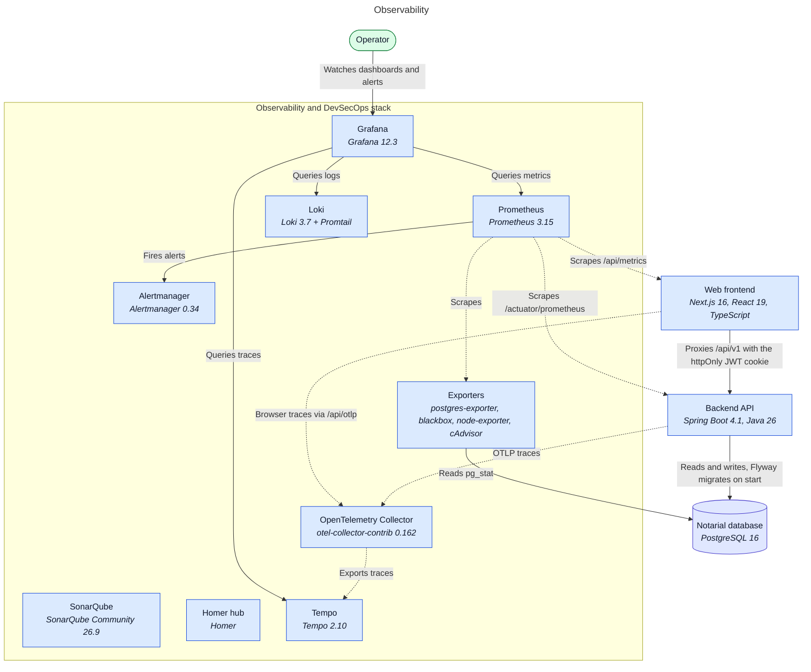

# Monitoring & Observability - Notaire Project

## Overview

This document describes the monitoring and observability infrastructure for the Notaire
system. The backend API and PostgreSQL database are monitored through a unified
observability stack: **Prometheus**, **Grafana**, **Loki**, **Promtail**, and
**postgres-exporter**, fronted by a **Homer** landing page. The stack lives in the
[`matiaspakua/infrastructure`](https://github.com/matiaspakua/infrastructure) product
(git submodule at `infra/`); see [`infra/README.md`](../../../infra/README.md) and the
[system contract](https://github.com/matiaspakua/infrastructure/blob/main/docs/SYSTEM-CONTRACT.md).
Notaire publishes [`ops/system.yaml`](../../../ops/system.yaml) plus runtime metrics, logs and
traces so the stack can manage this system.

## Architecture

Generated from the [LikeC4 model](../210-architecture-model/README.md) (ADR-033). Prometheus scrapes the backend
(`/actuator/prometheus`, Basic Auth), the frontend (`/api/metrics`), the exporters and blackbox probes, and fires
alerts to Alertmanager. Promtail ships container logs to Loki. Backend and frontend send OTLP traces to the
collector, which exports them to Tempo. Grafana (`:3001`) reads all three; Homer (`:8888`) links every tool.

<!-- likec4-view: observability -->

<!-- /likec4-view -->

## Services Overview

### 1. Backend API Monitoring

**Metrics Collection:** Spring Boot Actuator with Micrometer

- **Endpoint:** `http://localhost:8080/actuator/prometheus`
- **Auth:** Basic Auth via `ACTUATOR_USER` / `ACTUATOR_PASSWORD` (set in `.env`). Prometheus reads the same two values as
  Compose secrets (`username_file` / `password_file` under `/run/secrets`), so no credential is committed in
  `prometheus.yml` (#1657). `.env.example` ships a `change-me-actuator` placeholder; `start-infra.sh` and
  `workspace/stack/start.sh` call `infra/scripts/ensure-actuator-credentials.sh`, which replaces a missing or
  placeholder password with a random one and keeps any real value. Restart the backend after the value changes.
- **Scrape Interval:** Every 10 seconds

**Metrics Exposed:**

- JVM metrics (memory, GC, threads, classes)
- HTTP request metrics (rate, duration, errors)
- Database connection pool (HikariCP)
- Logback event rate
- Custom business metrics (operation counts, durations, API errors, login attempts)

**Metrics topology:** the backend exposes Actuator metrics (scraped with Basic auth) and also pushes them over OTLP to
`devsecops-otel-collector`, which Prometheus scrapes. The frontend serves Node runtime metrics at `/api/metrics`;
cAdvisor and node-exporter cover containers and the host. On Docker Desktop the last two describe the Linux VM.
OTLP export needs both `micrometer-registry-otlp` and `spring-boot-opentelemetry` on the backend classpath.
OTLP metrics push is **opt-in** (`MANAGEMENT_OTLP_METRICS_EXPORT_ENABLED=true`); root `docker-compose.yml` enables it
with the collector URL. When the flag is false (bare jar, ZAP CI, partial stack), the backend does not open the
exporter and does not spam `UnknownHostException` ERROR (#1736). Actuator scrape stays on either way.

**Tracing topology:** the backend uses the OpenTelemetry tracer (replacing Brave/Zipkin) and exports spans over OTLP to
the collector, which forwards them to Tempo when `MANAGEMENT_TRACING_EXPORT_OTLP_ENABLED=true` (set by Compose).
Resource attribute `service.version` equals the packaged Maven
`app.version` (#1591). JSON logs include `serviceVersion` with the same value. In Grafana, Explore -> Tempo finds traces
by service/name; a trace links to its Loki logs by `service`. Frontend browser spans
are opt-in via `NEXT_PUBLIC_OTEL_TRACES_ENABLED=true` (#1739): the Next.js layout
passes the flag into a client `WebTracerProvider` (`service.name=notaire-frontend`)
with fetch instrumentation; the browser posts OTLP to same-origin
`POST /api/otlp/v1/traces`, and the Route Handler proxies to
`OTEL_EXPORTER_OTLP_TRACES_ENDPOINT` (Compose default:
`http://devsecops-otel-collector:4318/v1/traces`). No PII attributes — only
resource `service.name` / `service.version` and standard fetch span names.
Root `docker-compose.yml` enables the flag for the full stack; without a collector
the proxy returns 503 and the UI stays up.

**Alerting:** Prometheus evaluates `alert-rules.yml` and `alert-rules-stack.yml` and sends firing alerts to Alertmanager
(http://localhost:9093). Catalogue: `ServiceDown` and `TargetDown` (availability), `HighHttp5xxRatio`, `HighApiLatency`,
`HighJvmHeapUsage`, `HighDatabaseConnections`, `ConnectionPoolSaturated`, `HostMemoryLow`, `HostDiskLow`, plus the login
alerts. Each carries `severity`, `summary` and `description`. There are no per-container alerts: cAdvisor on Docker Desktop
reports cgroup ids without container names. No external notification channel is configured.

**Log fields and log-to-trace navigation:** the backend writes one `http_request` line per API request (method, path, status,
duration; never the query string, headers or body; Actuator is skipped), and the frontend BFF proxy writes one `api_proxy`
line per proxied request, both as structured JSON. Promtail stores `traceId`/`spanId` as Loki *structured metadata* (not
labels, which would be high-cardinality), so `{container="notary-backend"} | traceId="<id>"` finds a request's lines and the
Loki datasource's `TraceID` derived field opens the trace in Tempo. Loki needs `allow_structured_metadata: true`.

**Client error beacon (#1483):** browsers POST allow-listed JSON to `POST /api/client-errors` (Next.js only; not under
`/api/v1`). The route validates `level` (`ERROR`|`WARN`) and `message`, optional `name`/`path`/`stack`, enforces size caps
and a per-client rate limit, then emits a structured `client_error …` log line with `service: "notaire-frontend"`. Promtail
scrapes it like other frontend JSON. Example LogQL:
`{container="notaire-frontend"} |= "client_error"` or `{service="notaire-frontend"} |= "client_error"`.

**Drill-down dashboards:** `notaire-infra-resources` (Docker host and aggregate container usage; on Docker Desktop it describes
the Linux VM), `notaire-frontend` (Node runtime, proxied requests by status from logs), `notaire-observability-health`
(Prometheus, Loki, Tempo, Alertmanager, Promtail and the collector, scraped natively), `notaire-traces` (recent traces and
the request logs that link to them). The frontend `api_proxy` log line carries `method`, `path`, `status` and `durationMs`
in its message, because Promtail keeps only the message and dashboards parse it with a LogQL `regexp`.

**Overview dashboards (start here):** `notaire-stack-status` (every service in the stack) and
`notaire-status` (Notaire only). Both show availability from blackbox probes, firing alerts and recent
errors, and link to the specialist dashboards below. `notaire-status` and `notaire-backend` also show
the packaged product version (Micrometer tag `version=${app.version}`, same value as OTel
`service.version`). Quality tooling: `notaire-quality` (SonarQube / sonar-db probes and how to run
`bash infra/scripts/run-sonar.sh`).

**Grafana Dashboard:** `notaire-backend` (pre-provisioned)

- API request rate & response time (P95)
- JVM memory usage & garbage collection
- Active threads & database connection pool
- HTTP error rate & application health
- Log rate by level

### 2. PostgreSQL Database Monitoring

**Metrics Collection:** postgres-exporter

- **Endpoint:** `http://localhost:9187/metrics`
- **Configuration:** `infra/observability/prometheus/postgres_exporter.yml`
- **Connection:** connects with a dedicated, least-privilege role (granted only
  `pg_monitor`, created by Flyway migration `V12`) — **not** the application's own
  admin datasource credentials (issue #675). Set `POSTGRES_EXPORTER_USER` /
  `POSTGRES_EXPORTER_PASSWORD` in `.env`.

**Grafana Dashboard:** `notaire-postgres` (pre-provisioned)

- Database size & connection count
- Transaction commit/rollback rates
- Query performance

### 3. Log Aggregation (Loki + Promtail)

**Loki Endpoint:** `http://localhost:3100`
**Promtail Configuration:** `infra/observability/loki/promtail-config.yaml`

**Scraped Containers:** all `notaire-*`, `notary-*`, and `devsecops-*` containers.

**Log Labels:** `container`, `container_name`, `service`, `app`, `level`.

**Grafana Dashboard:** `notaire-logs` (pre-provisioned) — query in Grafana → Explore →
Loki datasource: `{container_name="notary-backend"} | json`.

### 4. Auth & Security Monitoring

**Metrics Source:** the same backend Micrometer registry as section 1 (custom login
counters), plus Loki for raw log lines.

**Grafana Dashboard:** `notaire-auth` (pre-provisioned)

- Login attempts — total rate
- Successful logins
- Failed logins (bad credentials)
- Inactive user attempts
- Login outcomes over time
- Login failure rate (% of attempts)
- All operations (login by status)
- Recent login errors (from logs)

Backs the `HighLoginFailureRate` and `SuspiciousLoginActivity` alerts (see
[Alerting Rules](#alerting-rules-and-code-quality) below).

## Operating the stack

Setup, credentials, startup, health checks, dashboards and troubleshooting are
maintained with the infrastructure code, not duplicated here:

- [Preparation](../../../infra/docs/PREPARATION.md) · [Configuration](../../../infra/docs/CONFIGURATION.md)
  · [Operation](../../../infra/docs/OPERATION.md)
- Backend API authentication: [API Authentication Guide](../206-security/API-AUTHENTICATION-GUIDE.md)

## Alerting Rules and Code Quality

Alert rules (`HighLoginFailureRate`, `SuspiciousLoginActivity`, `BackendDown`,
`HighJvmHeapUsage`) are defined in `infra/observability/prometheus/alert-rules.yml`
and tabulated in [infra DEFINITION](../../../infra/docs/DEFINITION.md#alert-rules-prometheusalert-rulesyml).
SonarQube analysis is run as described in [infra OPERATION](../../../infra/docs/OPERATION.md#code-quality-sonarqube).

Local Grafana and SonarQube open without a login (Grafana anonymous Admin; Sonar
`forceAuthentication=false`) with ports bound to `127.0.0.1` — see
[ADR-016](../202-ADR/ADR-016-observability-stack.md) (#1413). Production overlays
keep authentication.

---

**Related Documents:**

- [Infrastructure README](../../../infra/README.md) — complete infra setup (source of truth for ports/credentials)
- [DevSecOps Pipeline](../208-devsecops/README.md) — CI/CD pipeline documentation
- [Deployment Guide](../209-deployment/README.md) — deployment procedures
- [Security Policy](../206-security/README.md) — security overview
