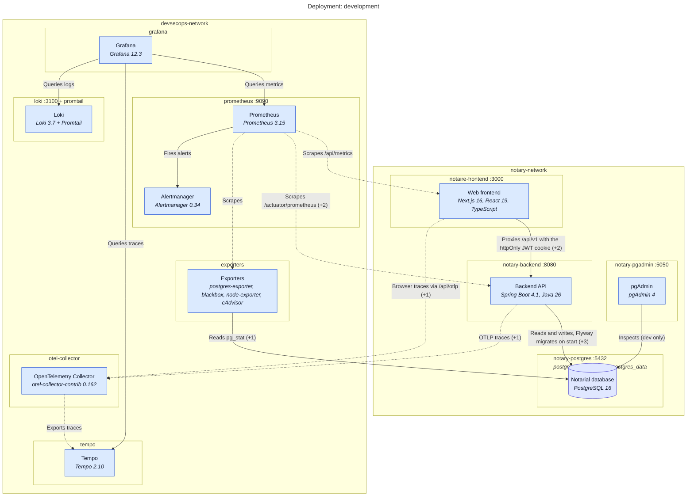
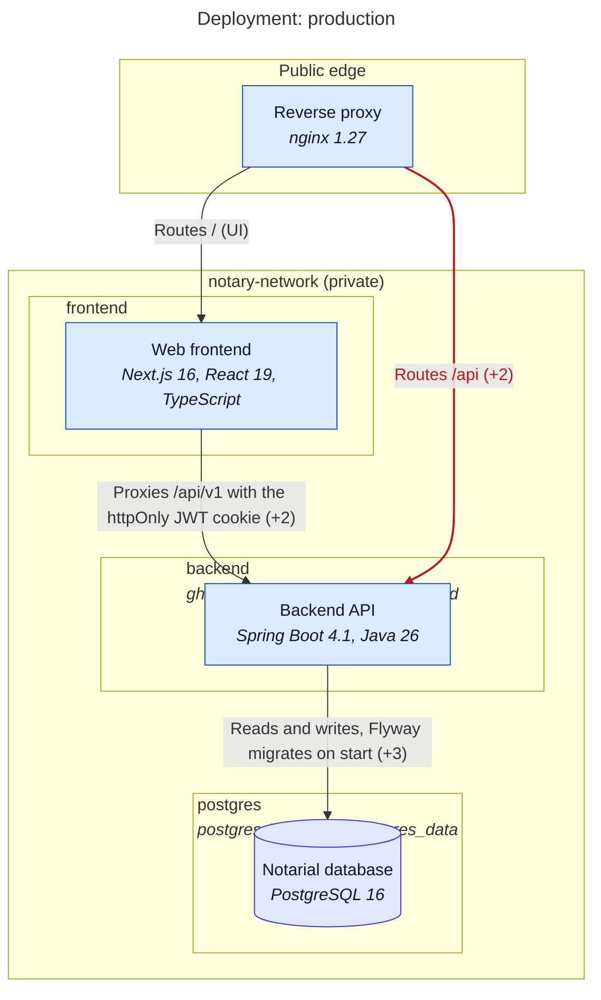
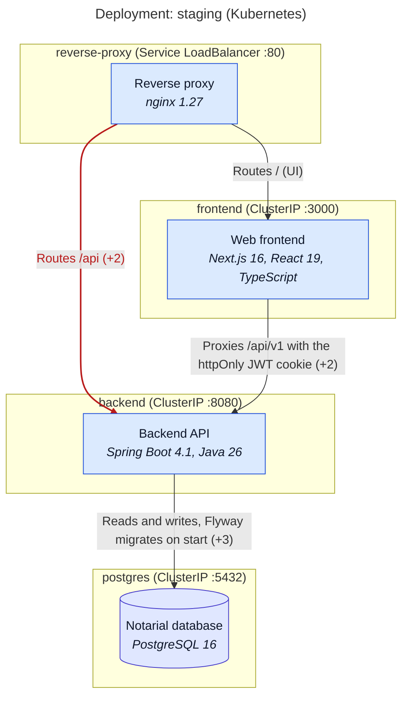

# Deployment Guide - Notaire Project

## Overview

This guide covers how to deploy the complete Notaire system: the application stack and the
observability/quality infrastructure stack.

## Architecture

Generated from the [LikeC4 model](../210-architecture-model/README.md) (ADR-033); interactive on
[GitHub Pages](https://matiaspakua.github.io/notaire/architecture-model/#/view/dev/).

### Development (`docker-compose.yml` + `infra/observability/docker-compose.yml`)

<!-- likec4-view: dev -->

<!-- /likec4-view -->

### Production (`docker-compose.prod.yml`)

Host `:80` → reverse proxy → frontend (`/`) and backend (`/api`). PostgreSQL, backend and frontend publish no
host port; no pgAdmin; `ENVIRONMENT=production`; Flyway baseline off. TLS terminates in front of the proxy.
The proxy forwards only `/actuator/health` ([#2487](https://github.com/matiaspakua/notaire/issues/2487)). Open
finding (red): the backend gets no MFA key, MFA policy or `COOKIE_SECURE`
([#2488](https://github.com/matiaspakua/notaire/issues/2488)).

<!-- likec4-view: prod -->

<!-- /likec4-view -->

### Staging (`infra/deploy/kustomize/overlays/staging`, #901)

Same four services, one replica each; PostgreSQL, backend and frontend are `ClusterIP`, the proxy is a
`LoadBalancer`. Images are pinned to the release tag; secrets are placeholders. CD stays publish-only: apply the
manifests to a cluster by hand. The PostgreSQL pod keeps its data on `emptyDir`, so a restart loses it
([#2489](https://github.com/matiaspakua/notaire/issues/2489)).

<!-- likec4-view: staging -->

<!-- /likec4-view -->

## Deployment Steps

### Prerequisites

- Docker and Docker Compose v2+
- Java 26 (the release pinned in the root `pom.xml`) (for local development)
- Maven 3.9+ (for local builds)

### 1. Build Application

```bash
# Build entire project
mvn clean install -DskipTests

# Build only backend + shared module
mvn clean install -pl backend-api -am -DskipTests
```

### 2. Start the Application Stack (development)

```bash
bash workspace/stack/start.sh
# or, from repo root:
docker-compose up -d

# Verify services are running
docker-compose ps
```

This starts the **dev** stack:

- **PostgreSQL 16** on port 5432
- **Backend API** on port 8080
- **Frontend (Next.js)** on port 3000
- **pgAdmin** on port 5050 (started by default; skip with `bash workspace/stack/start.sh --no-admin`)

> Production must use `docker-compose.prod.yml` (below) — never the published
> Postgres/pgAdmin ports from the dev compose.
>
### 3. Start Monitoring & Quality Infrastructure

```bash
bash infra/scripts/start-infra.sh
```

Prerequisites, environment file and operation details: [infra docs](../../../infra/README.md).

This starts:

- **Prometheus** on port 9090
- **Grafana** on port 3001 (credentials via `.env`)
- **Loki + Promtail** — log aggregation (queried at port 3100)
- **SonarQube** on port 9000
- **PostgreSQL Exporter** on port 9187
- **Homer** on port 8888 — landing page linking every service

### 4. Verify Complete Deployment

```bash
# Check all services
curl http://localhost:8080/actuator/health   # Backend
curl http://localhost:3000                   # Frontend
curl http://localhost:9090/-/ready           # Prometheus
curl http://localhost:3001/api/health        # Grafana
curl http://localhost:3100/ready             # Loki
```

## Docker Compose Details

### Root docker-compose.yml (development)

- **Services**: `postgres`, `backend`, `frontend`, `pgadmin`
- **Network**: `notary-network` (bridge)
- **Volumes**: `postgres_data`, `pgadmin_data`
- **Backend health check**: `/actuator/health`
- **Environment variables**: Configured via `.env` file (see `.env.example`)
- **Not for production** — publishes Postgres/pgAdmin/app ports and uses
  `${VAR:-admin}` defaults for local ergonomics

#### Parallel dev stacks (issue #1186)

Host ports and container names can be overridden from `.env` (or the shell) so a second stack
runs beside the first. Defaults are unchanged.

| Variable | Default |
|----------|---------|
| `POSTGRES_PORT` / `BACKEND_PORT` / `PGADMIN_PORT` / `FRONTEND_PORT` | `5432` / `8080` / `5050` / `3000` |
| `NOTAIRE_POSTGRES_CONTAINER_NAME` | `notary-postgres` |
| `NOTAIRE_BACKEND_CONTAINER_NAME` | `notary-backend` |
| `NOTAIRE_PGADMIN_CONTAINER_NAME` | `notary-pgadmin` |
| `NOTAIRE_FRONTEND_CONTAINER_NAME` | `notaire-frontend` |

```bash
COMPOSE_PROJECT_NAME=notaire_alt BACKEND_PORT=18080 FRONTEND_PORT=13000 POSTGRES_PORT=15432 \
PGADMIN_PORT=15050 NOTAIRE_POSTGRES_CONTAINER_NAME=alt-postgres NOTAIRE_BACKEND_CONTAINER_NAME=alt-backend \
NOTAIRE_PGADMIN_CONTAINER_NAME=alt-pgadmin NOTAIRE_FRONTEND_CONTAINER_NAME=alt-frontend \
bash workspace/stack/start.sh
```

A distinct `COMPOSE_PROJECT_NAME` also separates volumes and the network. The observability
stack (`infra/`) scrapes `notary-backend` and `notary-postgres` on `notaire_notary-network`, so it
only works with the default container names. `workspace/stack/start.sh` defaults
`COMPOSE_PROJECT_NAME` to `notaire` so git worktrees still publish that network; override it
only for intentional parallel stacks. `docker-compose.prod.yml` and
`docker-compose.cloud.yml` are not affected.

### docker-compose.prod.yml (production entrypoint — issue #1044)

- **Services**: `postgres`, `backend`, `frontend`, `reverse-proxy` (**no pgAdmin**)
- **Host ports**: only the reverse proxy (`:80`); postgres/backend/frontend stay on the Docker network
- **Secrets**: required via `${VAR:?...}` — compose fails fast if `.env` is incomplete; no `admin` defaults
- **MFA and session cookie** (#2488): `NOTAIRE_MFA_ENCRYPTION_KEY` is required (`infra/scripts/ensure-mfa-encryption-key.sh .env` writes one); `NOTAIRE_MFA_POLICY` defaults to `OPTIONAL` (ADR-032); `COOKIE_SECURE` defaults to `true` because TLS terminates in front of the proxy (set `false` only on a plain-HTTP lab). The Kustomize base reads the key from `notaire-secrets`
- **Backend**: `ENVIRONMENT=production` (activates `ProductionCredentialsGuard`); least-privilege env (no Grafana/pgAdmin/exporter credential keys); `SPRING_FLYWAY_BASELINE_ON_MIGRATE=false`
- **Proxy config**: `infra/deploy/kustomize/base/nginx.conf` — `/` → frontend, `/api/` and `/actuator/` → backend
- **TLS**: terminate TLS in front of this proxy (or extend the nginx config); see [HTTPS-TLS-RUNBOOK.md](../206-security/HTTPS-TLS-RUNBOOK.md) (#254)
- **Backups**: automated backup productization remains issue #256. CI verification
  of backup→restore→smoke is scaffolded in `.github/workflows/backup-restore-smoke.yml`
  (#1067) and **skips with an explicit #256 message** until `infra/scripts/backup-postgres.sh`
  exists (no false-green restore).

### infra/deploy/kustomize (staging manifests — issue #901)

- **Base** (`infra/deploy/kustomize/base`): same four services as `docker-compose.prod.yml`
  (postgres, backend, frontend, reverse-proxy) — **no pgAdmin**
- **Staging overlay** (`infra/deploy/kustomize/overlays/staging`): GHCR **semver**
  image tags for backend/frontend (release-please markers, #1591);
  `app.kubernetes.io/version` on workloads; `environment: staging` labels
- **Service isolation**: postgres/backend/frontend are `ClusterIP` (internal-only);
  reverse-proxy is the sole external `LoadBalancer`
- **Secrets**: `notaire-secrets` uses **placeholders only** (`PLACEHOLDER_SET_AT_APPLY_TIME`);
  replace before apply — never commit real credentials
- **Backend posture**: `ENVIRONMENT=production`, `SPRING_FLYWAY_BASELINE_ON_MIGRATE=false`
- **CD**: `.github/workflows/cd.yml` stays **publish-only** (GHCR). Manifest apply is
  operator-owned; there is no automated “deploy to cluster” job yet
- **Validate**: `python3 infra/tests/test_staging_kustomize.py` (requires `kustomize` on PATH)

### Infrastructure stack (`infra/`)

Observability and quality services (Homer, SonarQube, Prometheus, postgres-exporter, Grafana,
Loki, Promtail) are defined in `infra/observability/docker-compose.yml`; what each service
does and how it couples to the application is in
[infra DEFINITION](../../../infra/docs/DEFINITION.md).

## Environment Configuration

All credentials live in a single, git-ignored `.env` file at the repo root (copy `.env.example`).
`docker-compose.yml`, `docker-compose.prod.yml`, and `infra/observability/docker-compose.yml` read from it —
never hard-code secrets in compose files or docs.

Key variables include `POSTGRES_DB`, `POSTGRES_USER`, `POSTGRES_PASSWORD`, `JWT_SECRET`,
`ACTUATOR_USER`/`ACTUATOR_PASSWORD` (Prometheus scrape auth), `APP_ADMIN_USER` /
`APP_ADMIN_PASSWORD`, and (for Flyway V12 / infra exporter) `POSTGRES_EXPORTER_USER` /
`POSTGRES_EXPORTER_PASSWORD`. See the production section in `.env.example`.

### Frontend upstream URL (issue #1055)

- Browser traffic stays on same-origin `/api/v1` (HttpOnly cookie path, #1051).
- The Next.js App Router Route Handler BFF reads **runtime** `BACKEND_URL`
  (server-only) on each request — one frontend image works across environments
  without baking `next.config` rewrite destinations at `next build`.
- Compose sets `BACKEND_URL=http://backend:8080/api/v1` (dev/prod/cloud). Do
  **not** put Docker-internal hosts in `NEXT_PUBLIC_API_URL`; the public login
  page must not display backend infrastructure URLs (CU78).

## Production deployment (docker-compose.prod.yml)

1. Copy and harden secrets (do **not** keep `.env.example` `admin` placeholders):

```bash
cp .env.example .env
# Set strong unique values for POSTGRES_*, JWT_SECRET, ACTUATOR_*, APP_ADMIN_*,
# and POSTGRES_EXPORTER_* (used as Flyway placeholders; not injected as Grafana/pgAdmin env on the backend).
```

1. Start the production stack:

```bash
docker compose -f docker-compose.prod.yml --env-file .env up -d --build
docker compose -f docker-compose.prod.yml ps
```

1. Verify through the reverse proxy only:

```bash
curl -fsS http://localhost/                  # frontend via reverse proxy
curl -fsS http://localhost/actuator/health   # backend via reverse proxy
# Postgres (:5432), backend (:8080), frontend (:3000), and pgAdmin must NOT be published on the host.
```

1. Confirm Flyway baseline-on-migrate is off in the prod file (`SPRING_FLYWAY_BASELINE_ON_MIGRATE=false`).

## Staging deployment (Kustomize — issue #901)

Step-by-step apply (image pinning, Secret creation, render and validate) lives in
[infra OPERATION](../../../infra/docs/OPERATION.md#staging-deployment-kustomize). The staging
topology mirrors `docker-compose.prod.yml`; CD stays publish-only, so applying the manifests
is a manual operator step.

## Production Considerations

For production deployment, ensure:

1. **Use `docker-compose.prod.yml`** — not the dev compose with published DB/admin ports
2. **Change default credentials** — do not reuse `.env.example` values; prod compose requires them via `${VAR:?}`
3. **Enable HTTPS** — [HTTPS-TLS-RUNBOOK.md](../206-security/HTTPS-TLS-RUNBOOK.md) (#254)
4. **Set a strong `JWT_SECRET`** — see [API Authentication Guide](../206-security/API-AUTHENTICATION-GUIDE.md)
5. **Database backups** — configure periodic `pg_dump` backups (issue #256); after
   that lands, the scheduled backup→restore→smoke workflow (#1067) will exercise restore
6. **Resource limits** — set Docker resource constraints
7. **Log rotation** — configure Docker log rotation
8. **Monitoring alerts** — configure Prometheus alerting rules (`infra/observability/prometheus/alert-rules.yml`)

## Rollback Procedure

```bash
# Stop production stack
docker compose -f docker-compose.prod.yml down

# Or stop the development stack
docker-compose down

# Remove specific volumes if needed
docker compose -f docker-compose.prod.yml down -v

# Restore database from backup (container must be running / on the compose network)
docker exec -i notary-postgres psql -U "$POSTGRES_USER" "$POSTGRES_DB" < backup.sql

# Restart previous version
docker compose -f docker-compose.prod.yml --env-file .env up -d
```

## Related Documentation

- [Monitoring Guide](../207-monitoring/README.md)
- [DevSecOps Pipeline](../208-devsecops/README.md)
- [Architecture Overview](../README.md)
