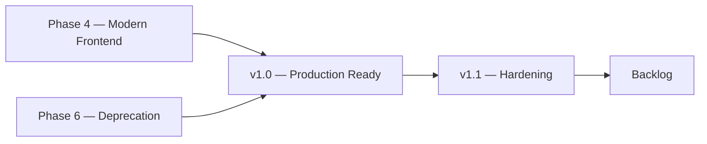

# Project management

How a project manager reads Notaire, and how the Cloud AI SDLC schedules work
so several agents can run at once without editing the same surface.

| Document | What it answers |
|----------|-----------------|
| [MILESTONES.md](MILESTONES.md) | Which milestone an issue belongs to, including history and the requirements catalog |
| [LABELS.md](LABELS.md) | The label set: area, priority, lane, phase, workflow |
| [ROADMAP.md](ROADMAP.md) | Board views, the 2026-10-12 chart, and how to apply the plan on GitHub |
| [PARALLEL-AGENTS.md](PARALLEL-AGENTS.md) | The rule that keeps agents off each other's files |
| [RELEASES.md](RELEASES.md) | How a semver cut relates to trains, the board, the SBOM, and the AI SDLC |
| [roadmap-snapshot.json](roadmap-snapshot.json) | Counts behind the chart (regenerate; do not edit by hand) |

The GitHub Pages chart is the Docs tab **Roadmap**:
`github-page/app/docs/roadmap/page.tsx`.

## Roles

| Role | Owns |
|------|------|
| Project manager agent | Milestone, priority, lane, and board hygiene. Does not write product code. [`.claude/agents/project-manager.md`](../../../.claude/agents/project-manager.md) |
| Cloud foreman | Picks **one claimable issue in a free lane**, then runs the Constitution loop |
| Specialists | Implement inside the lane the issue already has |

Skill: [`.claude/skills/project-management/SKILL.md`](../../../.claude/skills/project-management/SKILL.md).

## Three questions, three fields

Every issue answers three different questions. They are not interchangeable.

| Question | Field | Rule |
|----------|--------|------|
| When does this ship, or which catalog is it? | **Milestone** (exactly one) | See [MILESTONES.md](MILESTONES.md) |
| How urgent is the delivery work? | **`priority:*`** (exactly one on claimable work) | critical, high, medium, low |
| Which agent may claim it? | **`lane:*`** (exactly one) | See [PARALLEL-AGENTS.md](PARALLEL-AGENTS.md) |

Phase labels (`phase:1-analysis` … `phase:6-deprecation`) record the migration
stream. They do not replace the milestone.

Board Status stays **Todo / In Progress / Done**. Blocked work uses the
`blocked` label. There is no Blocked column.

## What this organization is for

On 2026-10-12 the repository had **799** issues (**295** open, **504** closed).
**607** had no milestone, so the roadmap could not show how the project had been
built or what was left. Closed phase milestones had been replaced by three
priority buckets (`v1.0`, `v1.1`, `Backlog`), and the SAD still linked milestone
numbers that no longer exist (#6, #7, #8, #10).

The target layout:

- **History** — closed cohorts, so a manager can see the sequence of work.
- **Delivery** — the open trains a manager schedules.
- **Scope** — RF, CU, and RNF catalogs. They stay open and agents do not pick them.

Classifier and dry-run:

```bash
python3 workspace/sdlc/organize-roadmap.py --fetch \
  --snapshot docs/300-development/305-project-management/roadmap-snapshot.json
python3 -m unittest workspace.tests.test_roadmap_classify
```

`--apply` does not mutate GitHub. Applying the plan needs a token that can edit
issues, labels, and milestones. The steps are in [ROADMAP.md](ROADMAP.md).

## Scheduling and priority

Precedence of the open trains, from earlier to later:



Priority is urgency **inside** a train, not a second schedule.

| Priority | Default train when no phase rule applies |
|----------|------------------------------------------|
| critical, high | v1.0 — Production Ready |
| medium | v1.1 — Hardening |
| low | Backlog |

Exceptions (the classifier applies these first):

- Frontend product slices go to **Phase 4**, unless they are critical or a security/audit finding.
- `phase:6-deprecation`, and non-critical `tech-debt` that retires the `jpa` package, go to **Phase 6**.
- Security and `audit-2026-09` findings stay on the production gate (v1.0, or Backlog when priority is low).

Non-functional **catalog** items (RNF-*) stay on `Scope — Non-functional requirements`.
Each one also records which train the requirement informs:

| RNF numbers | Theme | Informs |
|-------------|--------|---------|
| 01–04 | performance | v1.1 — Hardening |
| 05–10 | experience | Phase 4 — Modern Frontend |
| 11–16 | security and access | v1.0 — Production Ready |
| 17–24 | platform constraints | Backlog |

## Related

- Delivery board mechanics: [docs/github/README.md](../../github/README.md)
- Fleet: [304-ai-sdlc-cloud](../304-ai-sdlc-cloud/README.md)
- Use case for this process work: CU76
- Backlog triage that this grouping does **not** finish: [#1248](https://github.com/matiaspakua/notaire/issues/1248)
