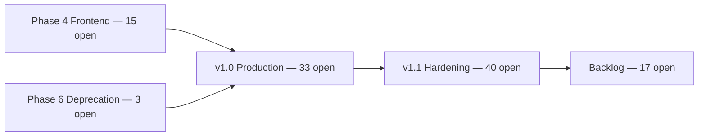
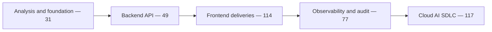

# Roadmap view and chart

The chart a manager should open first is the GitHub Pages Docs tab **Roadmap**
(source: `github-page/app/docs/roadmap/page.tsx`). The numbers on that page are
[roadmap-snapshot.json](roadmap-snapshot.json), produced by:

```bash
python3 workspace/sdlc/organize-roadmap.py --inventory issues.jsonl \
  --snapshot docs/300-development/305-project-management/roadmap-snapshot.json
cp docs/300-development/305-project-management/roadmap-snapshot.json \
  github-page/lib/roadmap-snapshot.json
```

`--fetch` replaces `--inventory` when `gh` can read issues. The command prints
the snapshot and does not edit GitHub. `--apply` exits with a message and
changes nothing.

## Snapshot on 2026-10-12

| | |
|--|--|
| Issues | 799 |
| Open / closed | 295 / 504 |
| Currently missing a milestone | 607 |
| Issues the plan would move or newly assign | 617 |
| Claimable open work | 108 |
| Scope catalog (not claimable) | 187 |



Closed history, oldest cohort first:



Older closed milestones that already had a name (Phase 0, Phase 1 - Backend
Complete, Phase 2 - Kubernetes, Phase 3 - Modern Frontend, Phase 4 - Production
Ready) stay as they are. Their titles use a hyphen and a different numbering
than the SAD. [MILESTONES.md](MILESTONES.md) lists both.

## Interesting readings

- **Most closed work was invisible on the roadmap.** 607 issues had no milestone. The history cohorts above are that missing story.
- **Two phase languages coexist.** SAD Phase 3 is the backend API. Milestone #4 is named "Phase 3 - Modern Frontend" and holds 3 closed issues. Both stay; the titles are the distinction.
- **Phase 4 progress is the open train, not the July–August pile.** 114 historical frontend issues sit on their own closed milestone. The open train is 15 closed and 15 open (50%).
- **The catalog is larger than the backlog.** 187 open RF, CU, and RNF issues are scope, not unfinished features. Agents that pick "the oldest open issue" will spend their run on a catalog row.
- **v1.0 is still a wide gate.** 33 open issues remain after frontend slices and `jpa` retirement move to Phase 4 and Phase 6. Many of those 33 are operational guides filed as high or critical.
- **Eight lanes can run together.** The fullest lanes are devops (25), backend (24), and docs (19). Security is small (3) and exclusive. Owner (14) waits for a person.
- **NFR catalog assessed onto trains:** 6 security → v1.0, 6 experience → Phase 4, 4 performance → v1.1, 8 platform constraints → Backlog. The RNF issues themselves stay on the scope milestone.
- **This plan does not close stale issues.** [#1248](https://github.com/matiaspakua/notaire/issues/1248) still asks for a valid / done / duplicate / obsolete decision on each open issue.

## GitHub project views

Board: [Notaire — Delivery Board](https://github.com/users/matiaspakua/projects/1).

Create these views on that project. This agent's token cannot edit project
views; the names below are the configuration to save.

| View | Layout | Group by | Filter |
|------|--------|----------|--------|
| Delivery roadmap | Roadmap | Milestone | `-milestone:"Scope — Functional requirements" -milestone:"Scope — Use cases" -milestone:"Scope — Non-functional requirements"` |
| How the project was organized | Roadmap | Milestone | `is:closed` |
| Ready for agents | Board | Status | `is:open -label:in-progress -label:blocked -label:needs-info` and exclude the three Scope milestones |
| One lane | Board | Status | `is:open label:lane:frontend` (repeat per lane) |

Status options remain Todo, In Progress, Done.

Milestone dates used as roadmap bar ends are the due markers in
[MILESTONES.md](MILESTONES.md). Start of a bar is the day the milestone was
created, or the cohort start in that file.

## Applying the plan on GitHub

A maintainer with permission to edit issues, labels, and milestones:

1. Create the eight `lane:*` labels ([LABELS.md](LABELS.md)) and set the `FRONTEND` description.
2. Create the milestones in [MILESTONES.md](MILESTONES.md) that do not exist yet. Reopen **#9** (Phase 4 — Modern Frontend) and **#11** (Phase 6 — Deprecation). Leave deleted numbers #6, #7, #8, and #10 unused.
3. Set due dates and descriptions from `MILESTONE_META` in `workspace/sdlc/organize-roadmap.py`.
4. Re-fetch and classify:

```bash
python3 workspace/sdlc/organize-roadmap.py --fetch \
  --snapshot docs/300-development/305-project-management/roadmap-snapshot.json \
  --moves /tmp/roadmap-moves.jsonl
```

5. For each row in the moves file, set the issue milestone when `milestone_change` is true, add `lane`, and remove any other `lane:*` label. Do not close issues from this file.
6. Save the three project views in the table above.
7. Copy the snapshot into `github-page/lib/roadmap-snapshot.json` and ship the Pages update.

Until step 5 runs, the live board still shows the priority buckets from the
September 2026 audit. The Pages chart shows the target layout.
