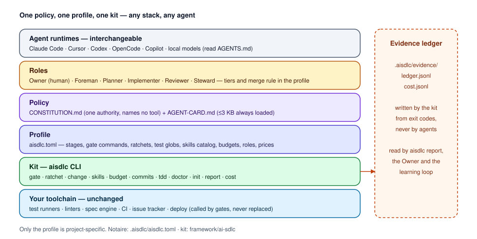
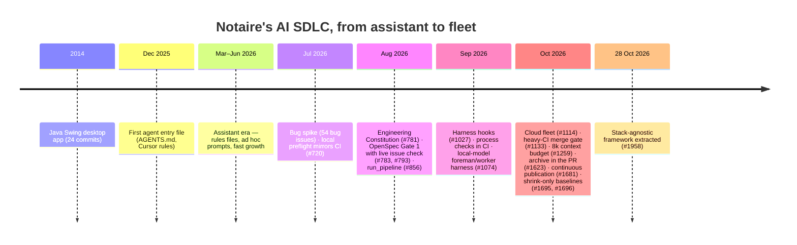
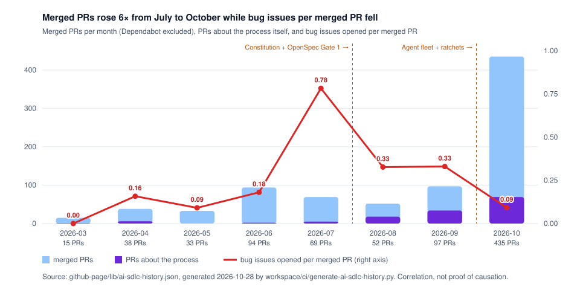
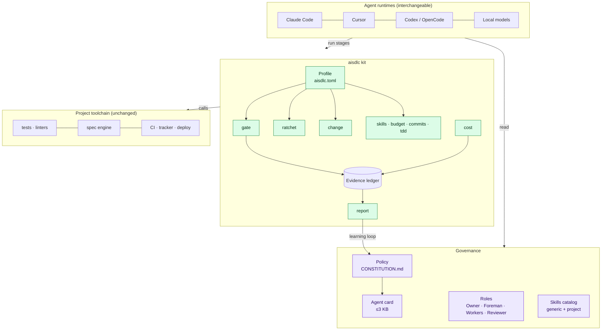
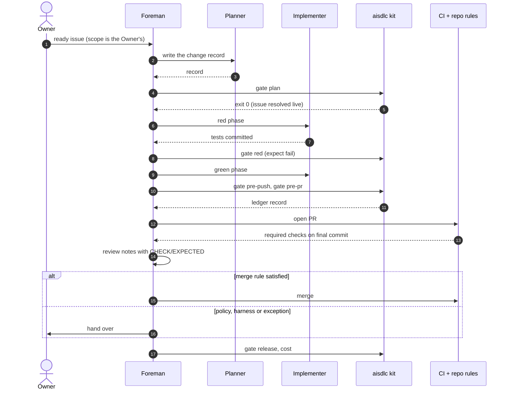
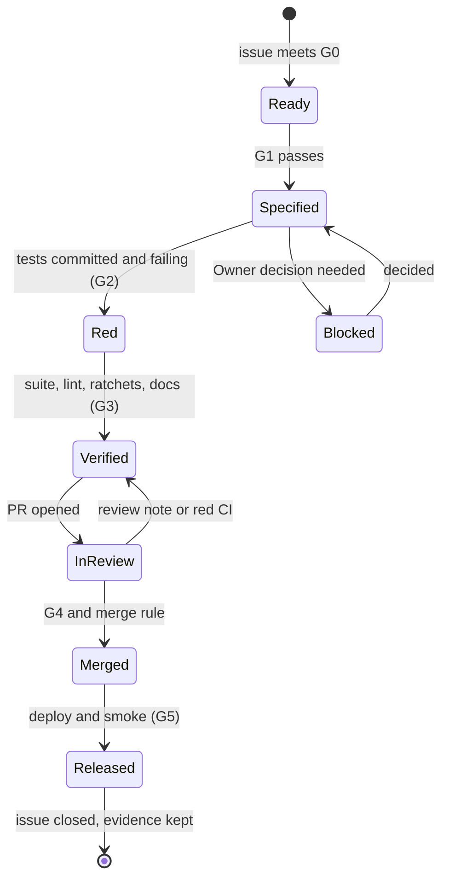
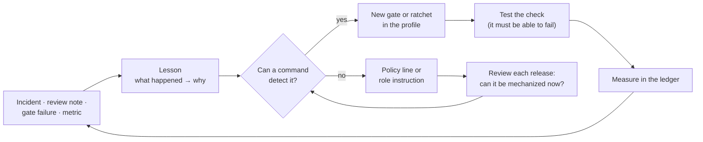
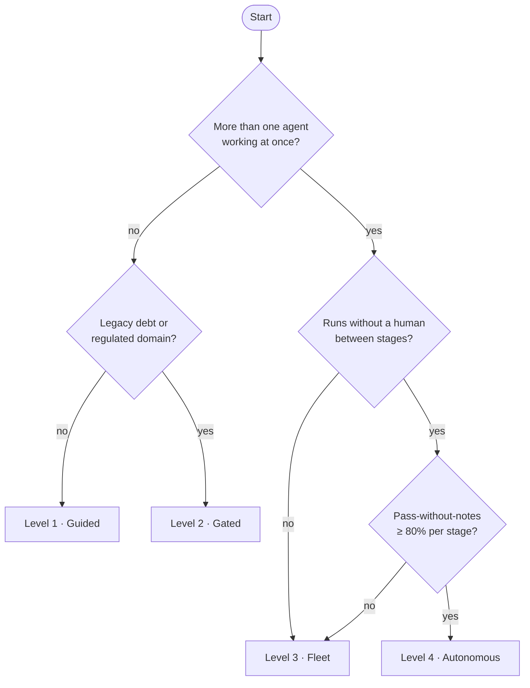

# AI SDLC Framework — a stack-agnostic process for AI-built software, derived from Notaire

| Field | Value |
|-------|-------|
| Status | v1.0 — first adopter: Notaire |
| Issue | [#1958](https://github.com/matiaspakua/notaire/issues/1958) · Use Case CU-76 |
| Kit | [`framework/ai-sdlc/`](../../../framework/ai-sdlc/) (adoption guide: [`README.md`](../../../framework/ai-sdlc/README.md)) |
| Notaire profile | [`.aisdlc/aisdlc.toml`](../../../.aisdlc/aisdlc.toml) |
| Data snapshot | [`github-page/lib/ai-sdlc-history.json`](../../../github-page/lib/ai-sdlc-history.json) (2026-10-28) |
| Public case study | GitHub Pages → AI Factory → Case study / Framework |

**How to read this report.** Every finding is labelled. **Evidence (E)** is something you can open in
the repository or on GitHub: a file, a commit, an issue, a count from the snapshot. **Inference (I)**
is a conclusion drawn from evidence, and could be wrong. **Open question (Q)** is something the evidence
cannot settle yet. Section 10 lists them all in one place.

## Contents

1. [Summary](#1-summary)
2. [What the framework is](#2-what-the-framework-is)
3. [Why it exists](#3-why-it-exists)
4. [Method](#4-method)
5. [Notaire: the evidence base](#5-notaire-the-evidence-base)
6. [Three iterations: hypotheses, challenge, refinement](#6-three-iterations-hypotheses-challenge-refinement)
7. [The framework in detail](#7-the-framework-in-detail)
8. [Applying it to a real project](#8-applying-it-to-a-real-project)
9. [Extending and customizing](#9-extending-and-customizing)
10. [Evidence, inference and open questions](#10-evidence-inference-and-open-questions)
11. [What this change added to the repository](#11-what-this-change-added-to-the-repository)

---

## 1. Summary

- **What.** A process for building software when AI agents write most of the code: one policy
  document, one project profile, and a small kit (`aisdlc`) that runs **gates** (commands judged
  only by their exit codes), **ratchets** (debt that may only shrink), and an **evidence ledger**.
  It names no language, build tool, agent product or cloud.
- **Where it comes from.** Ten months of Notaire, a legacy Java Swing system rebuilt as Spring Boot,
  Next.js and PostgreSQL mostly by AI agents: 2,187 commits, 954 merged pull requests, 985 issues
  (E, snapshot). Every rule in the framework traces to something that happened there.
- **The central lesson.** Agents are fast and confident; they are not reliable witnesses of their
  own work. What made Notaire work was moving each rule from prose into a command that can fail —
  and keeping a human Owner on the decisions that matter (I, §6).
- **The cost.** Process is not free. PRs about the process itself were 35% of merged PRs in
  August–September 2026 and 16% in October (E). The framework adds **adoption levels** so a small
  project does not pay for a fleet's process (§7.9).
- **Validation.** The kit runs Notaire's real gates and caught a hand-added baseline line in a live
  test; it also scaffolds, checks and gates a fresh repository with POSIX tools only, and validates
  example profiles for Python, TypeScript, Java and Go (E, §6.3). It has not yet been adopted by a
  second real project (Q).

## 2. What the framework is

The framework is a **contract between humans, agents and machines** about when a change is done.

| Element | One sentence |
|---------|--------------|
| Policy | One document above every agent file, rule and prompt; it says *what* must be true, never *which tool* checks it. |
| Agent card | A ≤3 KB digest of the policy that every agent loads; everything else loads on demand. |
| Profile | The only project-specific input: stages, gate commands, ratchets, test globs, skills catalog, budgets, roles, prices. |
| Stages and gates | Seven lifecycle stages and five hard gates (G0–G5); a gate is a command, an exit code and an expectation. |
| Ratchets | Known violations live in baselines that may only shrink; quality metrics have floors that may only rise. |
| Roles | Owner (human), Foreman (orchestrates and merges under a written rule), Workers (implement), Reviewer. |
| Evidence | Append-only records of every stage run and every priced agent run, written by the kit — never by agents. |
| Learning loop | Every incident becomes *what happened → rule → check*; a rule that can be a command becomes a gate. |

## 3. Why it exists

AI agents changed the economics of writing code in Notaire: merged pull requests went from 15 in
March 2026 to 435 in October (E). They did not change what makes software correct. The failure modes
recorded in Notaire are not "bad code" in the usual sense; they are failures of **evidence**:

- a model wrote "1,940 tests pass" and "PR created" into a task list that no command had produced
  (E, `local-ai/sdlc/AI-SDLC.md`, #1049, #1063);
- a proposal cited issue `#999999` and passed Gate 1, because the gate checked the format only
  (E, #793);
- an agent merged on "all 18 checks success" while integration and end-to-end suites were still
  pending (E, #1133);
- a duplicate test, an absolute home path and an invented requirement all *passed* their gates and
  were caught only by human review (E, `local-ai/AUDIT.md` §2).

At the same time, the process that fixed these problems became **welded to Notaire**: the
Constitution names Maven, JaCoCo and Playwright; three agent runtimes kept three configurations
(`.aisdlc/project.yml`, `fleet-manifest.yaml`, `opencode.json`); and the harness audit concluded that
nothing was portable without editing code (E, `local-ai/AUDIT.md` §1, §3.5). The framework exists to
keep what worked and make it usable anywhere.

## 4. Method

| Source | What was read | Kind |
|--------|---------------|------|
| Git history | 2,187 commits, Conventional Commit types, co-author trailers, first commit of each process file | E |
| GitHub | 954 merged PRs (title, author, dates, size), 985 issues (labels, dates), process issues by keyword | E |
| Process documents | `CONSTITUTION.md`, `AGENTS.md`, `.claude/` (13 agents, 35 skills, 9 rules, 3 hooks), `workspace/sdlc/` | E |
| Fleet and harness lessons | `docs/300-development/304-ai-sdlc-cloud/`, `local-ai/sdlc/AI-SDLC.md`, `local-ai/AUDIT.md` | E |
| Quality ratchets | ArchUnit and ESLint baselines, coverage floors, their history | E |

The monthly series is reproducible: `python3 workspace/ci/generate-ai-sdlc-history.py` rebuilds the
snapshot from git and `gh`. A "process PR" is a merged PR whose title names the SDLC itself (sdlc,
openspec, agents, fleet, harness, constitution, preflight, skills, archive…); a "bug issue" is an
issue labelled `type:bug`, counted by creation month. Both definitions are crude and stated so that
they can be challenged.

The framework was then designed in **three explicit iterations** (§6): hypotheses written first,
each challenged against the evidence, then refined and validated by building the kit and running it.

## 5. Notaire: the evidence base

### 5.1 The project in numbers

| Measure | Value | Source |
|---------|------:|--------|
| Commits (2014 legacy: 24) | 2,187 | snapshot |
| Merged PRs (without Dependabot) | 954 (834) | snapshot |
| Issues (labelled `type:bug`) | 985 (169) | snapshot |
| Commits with an AI co-author trailer (Claude or Cursor) | 519 — a lower bound | `git log` trailers |
| Median PR size, lines changed (p90) | 548 (2,175) | GitHub, non-bot PRs |
| Median time from PR open to merge | 0.1–0.8 h per month since May 2026 | GitHub |
| OpenSpec changes archived · living capability specs | 457 · 322 | `docs/openspec/` |
| Hexagon ArchUnit baseline: at introduction → now | 512 → 0 in four days (#1695 → #1914) | git history |
| Frontend boundary suppressions: at introduction → now | 66 → 0 (#1696 → #1846) | git history |
| Always-loaded agent context | 16k → ≤8k tokens (#1259); ~2k measured | `REPO-METRICS-BASELINE.md` |

The median merge time is short because most review is mechanical: required checks and the Foreman
merge rule replace a human waiting in a queue (E, CONSTITUTION §5 step 20–21). That is a design
choice with a risk (Q2).

### 5.2 How the process evolved

| Month | Merged PRs | Process PRs | Share | Bug issues | Bugs per PR |
|-------|-----------:|------------:|------:|-----------:|------------:|
| 2026-06 | 94 | 2 | 2% | 17 | 0.18 |
| 2026-07 | 69 | 5 | 7% | 54 | 0.78 |
| 2026-08 | 52 | 18 | 35% | 17 | 0.33 |
| 2026-09 | 97 | 34 | 35% | 32 | 0.33 |
| 2026-10 | 435 | 69 | 16% | 40 | 0.09 |

### 5.3 What worked (evidence)

| Practice | Evidence |
|----------|----------|
| One authority above all agent files | `CONSTITUTION.md` "prevails"; every runtime entry point (`AGENTS.md`, `opencode.json`, OpenSpec config) points at it (§10). |
| Context injected by a tool every agent uses | The Constitution reaches agents through the OpenSpec schema and `config.yaml`, not through one vendor's feature (CONSTITUTION §10). |
| Gates as commands | `validate-sdlc-plan.sh` (Gate 1), `check-tdd-evidence.sh`, `preflight.sh` (pre-push hook), `run_pipeline.sh`, `check-heavy-ci.sh`. |
| Live verification of references | Gate 1 resolves the issue on GitHub; an invented number fails (#793). |
| Ratchets for legacy debt | ArchUnit hexagon baseline 512 → 0 and ESLint suppressions 66 → 0, each PR shrinking and committing the smaller file (#1693). |
| Harness-owned truth for weak models | The local harness owns the ledger, the pushes and the frozen test command; the worker cannot write them (`local-ai/sdlc/AI-SDLC.md`, "Guardrails"). |
| Machine-checkable review notes | Notes with `CHECK:`/`EXPECTED:` lines are re-run after the fix; half-applied notes fail (#1102). |
| Cost-matched delegation | Model tier by task: cheap for mechanical work, top tier for judgment (CONSTITUTION §5; `fleet-manifest.yaml`). |
| Writing lessons down, then mechanizing them | `FLEET-LESSONS-HEX-1693.md`, `CI-MERGE-GATE.md`; many lessons became scripts and tests (e.g. `test_fleet_lessons_1858.py`). |

### 5.4 What failed, and the rule each failure produced (evidence)

| Incident | Root cause | Rule now | Refs |
|----------|-----------|----------|------|
| Merge on light-green CI | Advisory checks finished first; heavy suites still pending | Merge only when `check-heavy-ci.sh` exits 0 | #1126, #1133 |
| Bot `[skip ci]` commits stalled merges | Report workflows committed onto PR heads | Judge CI on the last real commit; bots never commit to PR heads | #1111, #1117 |
| Invented issue number passed Gate 1 | Format-only check | Live issue lookup | #793 |
| Closed issues blocked every PR | Unarchived OpenSpec changes | Archive in the implementing PR; Main Health fails on leftovers | #1252, #1623 |
| Model claimed unearned success | Worker wrote ledgers and results | Harness owns ledgers and pushes; Gate 4 checks claims | #1049, #1063 |
| Context crowded out the task | Bulk rule imports, always-on skills | ≤8k always-loaded tokens, measured in CI | #1259 |
| Docs PRs ran full Java + E2E | Workflow-level triggers | Path-scoped CI with aggregators that accept `skipped` | #1257 |
| Parallel heavy PRs were slower | Shared runners queued | Serialize heavy CI; one domain per PR | #1858, #1907 |
| Board, labels and state disagreed | Several agents, no single state | One coherent state, checked by a script | #1550 |
| Finished work invisible on one disk | Unpushed branches | Push at creation and after every stage | #1647, #1681 |
| Scaffolds failed the repo's own lint | Templates not lint-clean | Lint-clean templates; fix at the source | #1689 |
| Merge authority contradicted itself | Three documents, three rules | One Foreman merge rule in the Constitution | #1624 |
| Self-tests rewrote the shared `.git/config` during a push (found while building this framework) | In a linked worktree the pre-push hook exports `GIT_DIR`; fixtures ran `git init`/`git config` against it: `core.bare = true` and a fixture identity broke every checkout | `preflight.sh`, the kit and its fixtures drop hook-exported git variables; guarded by tests | #1958 |
| Two agents took the same issue (found while building this framework) | One session created the issue and pushed its branch; another claimed it with the claim protocol minutes later; the first never posted a claim marker | Claim before branching, in every runtime — a pushed branch is not a claim | #1646, #1958 |

### 5.5 Complexity and effectiveness

Notaire's process grew with its complexity: a single developer with an assistant (spring 2026), then
a written Constitution and spec gates (August), then two agent fleets and an architecture migration
across backend and frontend at once (October). Three observations, all inferences:

- **(I1) The process paid off when volume rose.** Bug issues per merged PR fell from 0.78 (July) to
  0.33 (August–September) and 0.09 (October) while throughput grew six-fold. Caveats: bug issues are
  counted by creation month, some were filed in batches by audits, and October's denominator holds
  many small refactor slices. The direction is consistent; the size of the effect is not proven.
- **(I2) The process tax peaked while the process was being built**, at a third of all merged PRs
  in August–September, and fell to 16% once scaffolders, archive-in-the-PR and path-scoped CI
  automated the toil. Archive-only housekeeping PRs alone were 8, 15 and 30 in August, September and
  October (E).
- **(I3) Gates distinguish pass from fail, not a correct pass from a cheap one.** The audit of the
  local-model harness found that every observed failure was caught, but a human-grade reviewer had to
  explain the fix in each case, and some cheap passes (duplicate test, absolute path, invented scope)
  needed review to be caught (E, `local-ai/AUDIT.md` §2). Review cannot be removed; it can be made
  checkable.

## 6. Three iterations: hypotheses, challenge, refinement

### Iteration 1 — initial hypotheses

| # | Hypothesis |
|---|------------|
| H1 | More, better-written rules produce better agent output. |
| H2 | Gates with exit codes are sufficient to guarantee quality. |
| H3 | Parallel agents scale throughput roughly linearly. |
| H4 | Notaire's process is already generic, because the Constitution is agent-agnostic. |
| H5 | The cost of the process is small compared with the speed agents bring. |

### Iteration 2 — challenge against the evidence

| # | Evidence against | Evidence for | Verdict |
|---|------------------|--------------|---------|
| H1 | Always-loaded context reached 16k tokens and had to be halved (#1259); documents contradicted each other on coverage floors (#588) and merge authority (#1624); a DRY audit of the governance layer was needed (#1033). Agents skipped prose rules that had no check (#1028: skills "used aspirationally"). | Rules that became scripts held (Gate 1 live check, TDD evidence, archive hygiene). | **Rejected.** Fewer always-loaded rules, one authority, and mechanization beat more prose. |
| H2 | Cheap passes passed (duplicate test, absolute path, invented requirement); light-green was mistaken for green (#1133); a `[skip ci]` bot commit made the gate read the wrong SHA (#1117). | Gates caught every observed failure in the harness runs (AUDIT §2). | **Refined.** Gates are necessary, not sufficient: they need integrity (right commit, full suite) and an independent, checkable review. |
| H3 | Parallel heavy PRs queued behind each other (#1858); one writer for `CHANGELOG [Unreleased]` was needed; board drift (#1550); unarchived changes from one PR blocked all others (#1623); unpushed work hid claimed lanes (#1647). | October: 435 merged PRs; hexagon baseline 512 → 0 in four days with one-domain slices. | **Refined.** Throughput scales with parallelism only when scarce resources (heavy CI, shared files, the merge) are serialized and state is published continuously. |
| H4 | The Constitution names Maven, JaCoCo, Flyway and Playwright; three runtimes keep three configs; AUDIT §3.5: "not portable". | Agent-agnosticism via the OpenSpec CLI did work across Claude Code, Cursor, Codex and OpenCode. | **Rejected as stated.** Agent-agnostic ≠ stack-agnostic. Policy, profile and runtime must be separate layers. |
| H5 | Process PRs: 35% of merged PRs in Aug–Sep; repeated hand-fixes of scaffolds on 8+ branches (#1689); 30 archive-only PRs in October. | The share fell to 16% after automation. | **Rejected.** The tax is real; it must be automated, measured and sized to the project (adoption levels). |

### Iteration 3 — refined principles and validation

The refined principles are the framework's core (§7.1). Each one answers a rejected or refined hypothesis:

| Refined principle | Answers |
|-------------------|---------|
| **Mechanical over aspirational:** a rule without an exit code is a wish; prefer a gate to a sentence. | H1 |
| **Machines check machines, humans check meaning:** gates for pass/fail; an independent reviewer with checkable notes for cheap passes. | H2 |
| **Gate integrity:** judge the final commit, the full suite, and resolve references live. | H2 |
| **Serialize what is scarce, publish what is in flight.** | H3 |
| **Policy ⟂ profile ⟂ runtime:** the policy names no tool; the profile names no agent; agents read both. | H4 |
| **Size the process to the project, and measure its tax.** | H5 |

**Validation performed (E):**

| Check | Result |
|-------|--------|
| Kit self-tests (temp git repos, no network, no Java/Node) | all pass — `python3 -m unittest discover -s framework/ai-sdlc/tests` |
| Fresh repository: `init` → `doctor` → `gate pre-push` with POSIX tools only | passes; placeholders reported as TODO, not as passes |
| Fresh repository with code and no test | `tdd` gate fails and names the file |
| Notaire profile: `doctor` | 0 errors, 0 warnings — 10 gates in 6 stages, 5 ratchets, 7 roles |
| Notaire plan gate through the kit | runs `validate-sdlc-plan.sh`, live issue check, passes |
| A hand-added line in Notaire's hexagon baseline | ratchet fails with exit 1 and prints the line |
| Notaire skills catalog lint | found 4 real defects (3 skills without description, 1 name collision); fixed in this change |
| Example profiles: Python, TypeScript web, Java/Maven, Go with Jira commits | all validate |
| Kit independence | a test fails if `aisdlc/`, `bin/` or `templates/` mention an adopter path; stdlib-only imports |

**Not validated (Q):** adoption by a second real project and team; the claim that adoption levels
match team sizes; cost figures (no agent run in Notaire records tokens yet).

## 7. The framework in detail

### 7.1 Purpose, scope, principles and non-goals

**Purpose.** Let AI agents carry most of the delivery work of a professional software product while
keeping correctness, traceability, security and the decisions that matter verifiable by humans.

**Scope.** Every change to a repository — features, fixes, refactors, tests, docs, CI, infrastructure —
from the issue to the release, for one product or one module of a larger one.

**Principles.**

1. **Policy first, one authority.** One policy document prevails over every agent file, rule and prompt.
2. **Spec before code, red before green.** No code without a change record; no implementation before a failing test.
3. **Mechanical over aspirational.** A rule that can be a command is a gate; prose is for what cannot be.
4. **Machines check machines, humans check meaning.** Agents' claims are never evidence; reviewers check what gates cannot.
5. **Gate integrity.** Final commit, full suite, live references; no "light green".
6. **Ratchet, do not big-bang.** Debt shrinks monotonically; floors only rise.
7. **Serialize what is scarce, publish what is in flight.**
8. **Least context, least privilege.** A small always-loaded card; rules and skills on demand; narrow tokens.
9. **Traceable end to end.** Issue → change record → tests → commits → PR → release evidence.
10. **Size the process to the project, and measure its tax.**

**Non-goals.** It is not an agent, an orchestrator product, a CI system, a spec engine or a model
router; it calls those. It does not replace human ownership of product scope, exceptions or policy.
It does not promise autonomy: level 4 is earned by measurement, not declared.

### 7.2 Components and responsibilities

| Component | Responsibility | Never |
|-----------|----------------|-------|
| Policy (`CONSTITUTION.md`) | Principles, roles, stages and gates, merge rule, never-list, exceptions | Names a tool or a command |
| Agent card | The non-negotiables every agent loads | Grows past ~3 KB |
| Profile (`aisdlc.toml`) | Every project-specific value: commands, globs, baselines, roles, prices | Holds policy |
| `gate` | Runs a stage's gates, path-scoped, red or green, and records the run | Trusts an agent's report |
| `ratchet` | Baselines only shrink against the base; floors only rise | Accepts a hand-added entry |
| `change` | Built-in change records; complete sections; live issue check | Replaces a project's spec engine |
| `skills`, `budget`, `commits`, `tdd` | Catalog lint, context budget, commit subjects, tests-with-code | — |
| Evidence ledger, `report`, `cost` | Audit trail, gate health, token cost per model and agent | Is written by agents |
| Role agents (`.aisdlc/agents/`) | Foreman, planner, implementer, reviewer, steward instructions in tool-neutral Markdown | Duplicate the policy |

### 7.3 End-to-end workflow

```mermaid
flowchart LR
  I(["Issue"]) --> G0{{"G0 intake<br/>problem · requirement"}}
  G0 --> P["Change record<br/>why · what · scenarios · test plan"]
  P --> G1{{"G1 plan<br/>complete · real issue"}}
  G1 --> R["Write tests"] --> G2{{"G2 red<br/>tests fail"}}
  G2 --> C["Implement"] --> G3{{"G3 verify · pre-PR<br/>suite · lint · ratchets · docs"}}
  G3 --> PR["Pull request"] --> G4{{"G4 merge<br/>full CI on final commit · review"}}
  G4 --> M["Merge"] --> G5{{"G5 release<br/>deploy · smoke"}}
  G5 --> D(["Issue closed · evidence"])
  G5 -.->|"incidents · notes · metrics"| I
  classDef gate fill:#fde68a,stroke:#b45309,color:#451a03
  class G0,G1,G2,G3,G4,G5 gate
```

### 7.4 Agents, skills, rules, guardrails and decision policies

**Roles.** The Owner owns scope, specifications, exceptions and the policy. The Foreman orchestrates
one change at a time, runs gates, writes checkable review notes and merges only under the merge rule;
it never implements what it reviews. Workers implement phase by phase and never merge. The Reviewer
is independent of the implementer and checks what gates cannot.

**Skills.** Reusable execution guidance, never a second policy. Two kinds: *generic* lifecycle skills
(QA strategy, CI/CD gates, threat modeling, traceability, observability, UI) that must stay free of
project paths, and *project* skills that carry local commands. The kit lints the catalog: present,
described, unique, and generic skills clean of the patterns the profile forbids.

**Rules.** Few and layered: the policy (always), the card (always), topic rules (on demand, by path).
A rule that keeps being violated is a candidate for a gate.

**Guardrails — defence in depth.**

| Layer | Guardrail | Notaire implementation |
|-------|-----------|------------------------|
| 1 Policy | One authority, never-list | `CONSTITUTION.md` |
| 2 Context | Card ≤3 KB, on-demand rules | `CONSTITUTION-AGENT-CARD.md`, `agent-context-budget.py` |
| 3 Catalog | Skills and agents in one place, linted | `.claude/skills`, `.claude/agents`, `aisdlc skills` |
| 4 Agent harness | Hooks, scope and ref guards, frozen test command | `.claude/hooks/`, `local-ai/sdlc/` |
| 5 Local gates | Pre-push and pre-PR stages | `preflight.sh`, `run_pipeline.sh` |
| 6 CI process checks | Commits, TDD evidence, spec, archive, ratchets, board | `sdlc-process.yml` |
| 7 CI quality and security | Tests, coverage floors, SAST, SCA, DAST | `ci.yml`, `codeql.yml`, `security/` |
| 8 Repository rules | PR-only, required checks, no force-push | `protect-main` ruleset |
| 9 Human | Owner decisions, exceptions, policy merges | CONSTITUTION §10, §12 |

**Decision policies.**

| Decision | Policy |
|----------|--------|
| Which model | By task: low tier for mechanical edits, mid for tests and routine implementation, top for architecture, security and ambiguous judgment. Escalate a role's tier after repeated gate failures. |
| When to stop and ask | When a gate fails after the retry budget, when scope must grow, when a decision is the Owner's. |
| When to merge | Required checks green on the final commit, `merge` stage passes, no open review note; otherwise the Owner merges. |
| When to parallelize | Only work that shares no scarce resource (heavy CI, a shared file such as the changelog, the same domain). |
| When to grant an exception | Owner only; documented in the commit and PR; labelled so process checks can see it. |

### 7.5 Inputs, outputs, artifacts and state

| Stage | Inputs | Outputs and artifacts |
|-------|--------|-----------------------|
| intake | Request, incident, metric | Issue with requirement link and acceptance intent |
| plan | Issue, permanent docs | Change record (or spec engine change); ledger record |
| red | Change record | Failing tests, committed first |
| verify / pre-PR | Tests, code | Green suite, shrunk baselines, updated docs; ledger records |
| merge | PR, CI results, review notes | Merge commit; archived change record |
| release | Merge commit | Deployed artifact, smoke result, closed issue, cost entries |

State lives in three places, by design: **the remote repository** (branches pushed at creation and
after each stage), **the tracker** (one coherent issue state), and **the evidence ledger** (what ran,
when, with which result). Agents keep no state that is not in one of the three.

### 7.6 Validation, testing, quality gates and rollback

- **Gate catalogue.** Every gate is `name · stage · run · expect · required · timeout · paths`.
  `expect = "fail"` makes TDD's red step mechanical. `required = false` keeps a check advisory
  while it earns trust; `placeholder = true` keeps an unconfigured gate visible as TODO instead of a
  silent pass.
- **Ratchets.** Introduce a strict rule on day one by freezing today's violations in a baseline; the
  kit fails any added entry against the base revision, and the owning tool fails stale entries. Floors
  (coverage, performance budgets) only rise; `ratchet` prints the new floor when a value beats it.
- **Test pyramid.** Unchanged from the project's own; the framework requires only that each
  acceptance scenario maps to a test and that the test was seen failing.
- **Rollback.** Code: revert the merge commit through a PR (never rewrite pushed history). Release:
  redeploy the previous artifact; smoke tests decide. Agent work: the harness resets the worker's
  branch to the last passing stage; scope and ref guards revert out-of-scope edits. Process: a gate
  that misfires is made advisory by a PR, never bypassed locally.

### 7.7 Observability, auditability and cost

`aisdlc report` turns the ledger into per-gate pass rates, median durations and last status, plus
cost per model and agent from `aisdlc cost`. Recommended indicators:

| Indicator | Why | Source |
|-----------|-----|--------|
| Gate pass rate and median duration per gate | Finds flaky or slow gates and where agents struggle | ledger |
| Process share of merged PRs | Measures the process tax (§5.5) | tracker |
| Pass-without-reviewer-notes rate per stage | Measures earned autonomy; ≥80% for a stage before automating it further | ledger + reviews |
| Baseline sizes over time | Debt burn-down | ratchet output |
| Lead time, deployment frequency, change failure rate, recovery time | DORA outcomes | CI/CD, incidents |
| Cost per merged change, per model | Cost-matched delegation works or not | cost ledger |

Auditability comes from three facts: records are append-only, written by the kit from exit codes,
and tied to a commit SHA. The ledger is git-ignored by default; teams that need a shared audit trail
publish `aisdlc report` as a CI summary (template provided) or commit the ledger.

### 7.8 Continuous improvement

Notaire did this by hand: incidents went into `FLEET-LESSONS-HEX-1693.md` and `CI-MERGE-GATE.md`, and
the ones that could be checked became scripts. The framework makes the loop explicit and gives the
"can a command detect it?" branch a home (the profile).

### 7.9 Adapting to technology, team size and complexity

| Level | Name | Fits | Adds | Notaire period |
|-------|------|------|------|----------------|
| 1 | Guided | One developer with an assistant | Policy, card, profile, change records, `plan` and `pre-push` gates | Mar–Jul 2026 (partly) |
| 2 | Gated | Small team; agents write most code | Red gates, ratchets, CI mirror, evidence report | Aug–Sep 2026 |
| 3 | Fleet | Several agents in parallel, one Owner | Roles with a merge rule, `merge` gate on the full suite, serialization, claims, continuous publication | Oct 2026 |
| 4 | Autonomous | Bounded autonomous runs, local models | `release` gate, cost prices, harness-owned ledgers and pushes, measured autonomy | local harness (experimental) |

**Technology.** Only the profile changes: four worked examples (Python, TypeScript web, Java/Maven,
Go with Jira) are in `framework/ai-sdlc/profiles/`. **Spec engines** (OpenSpec, Spec Kit) plug in as
`plan` gates. **Agent runtimes** read `AGENTS.md` and `.aisdlc/agents/`. **Trackers** other than
GitHub change `[tracker]` only.

## 8. Applying it to a real project

1. **Baseline.** Count what exists: tests, CI, debt (lint warnings, architecture violations), process
   docs. Decide the level with the flow above.
2. **Vendor and scaffold.** Copy `framework/ai-sdlc` into the repository; `aisdlc init --name … --level …`.
3. **Write the policy.** Edit the generated `CONSTITUTION.md`: keep the principles, adapt roles and
   the merge rule. Keep the card under 3 KB.
4. **Fill the profile.** Replace placeholders with real commands; add path scoping for slow gates.
5. **Freeze the debt.** Generate baselines with the tools that own them; declare them as ratchets.
6. **Mirror in CI.** Add the workflow template; make it a required check; add the pre-push hook.
7. **Point the agents.** Every runtime's entry file → `AGENTS.md`; role agents from `.aisdlc/agents/`.
8. **Run one change end to end**, by hand, with the Foreman role played by a person.
9. **Measure for a month.** `aisdlc report`, process share, pass-without-notes per stage.
10. **Raise the level only on evidence.**

**Notaire mapping.**

| Framework concept | Notaire implementation |
|-------------------|------------------------|
| Policy and card | `CONSTITUTION.md`, `CONSTITUTION-AGENT-CARD.md` |
| Profile | `.aisdlc/aisdlc.toml` (plus `.aisdlc/project.yml` for the local harness, `fleet-manifest.yaml` for the cloud fleet) |
| Change records | OpenSpec, schema `notaire-sdlc`, `validate-sdlc-plan.sh` |
| G3 verify | `preflight.sh` (pre-push hook) — now includes `aisdlc ratchet` and `aisdlc skills` |
| G3 pre-PR | `run_pipeline.sh` with the security case catalog |
| G4 merge | `check-heavy-ci.sh`, archive hygiene, `protect-main` ruleset, Foreman merge rule |
| G5 release | `cd.yml`, product version coherence, smoke |
| Ratchets | ArchUnit hexagon, cycle, loose-returns and entity-DTO baselines; ESLint suppressions; JaCoCo and Vitest floors |
| Roles | Owner; `cloud-foreman`; `openspec-planner`, `backend-implementer`, `frontend-design`, `testing-qa`; `code-reviewer` |

## 9. Extending and customizing

- **Gates:** any command with an exit code. Use `{base}`, `{root}`, `{profile}` and `--var key=value`.
- **Stages:** canonical names map to gates G0–G5; custom kebab-case stages work and `doctor` notes them.
- **Ratchets:** line baselines, JSON count baselines (e.g. ESLint suppressions), and numeric floors or ceilings.
- **Change records:** built-in, or your spec engine through a `plan` gate.
- **Roles:** add roles with tiers and models; only roles with `may_merge` may merge, and the policy says when.
- **Cost:** add `[cost.prices]` and call `aisdlc cost` after each agent run (from the harness, not the agent).
- **New kit commands:** keep them stdlib-only, adopter-free (`test_independence.py`) and exit-code driven.

## 10. Evidence, inference and open questions

### Evidence (selection; all re-checkable)

- E1: 2,187 commits, 954 merged PRs, 985 issues, 169 bug issues; snapshot 2026-10-28.
- E2: merged PRs per month 15 (Mar) → 69 (Jul) → 435 (Oct); process PRs 18/52, 34/97, 69/435 (Aug–Oct).
- E3: hexagon ArchUnit baseline 512 → 0 (2026-10-14 → 2026-10-17); ESLint suppressions 66 → 0.
- E4: always-loaded context cut from ~16k to ≤8k tokens (#1259).
- E5: the incidents and rules in §5.4, each with its issue.
- E6: `local-ai/AUDIT.md` §2 run data: #1063 needed 16 worker runs, 17 retries, 10 gate failures, 5 notes, 3 stops.
- E7: the validation results in §6, reproducible with the commands shown.

### Inference

- I1: the process reduced defects per change as volume rose (direction consistent, size unproven).
- I2: the process tax peaks while the process is built and falls with automation.
- I3: gates must be paired with independent, checkable review.
- I4: agent-agnostic and stack-agnostic are different properties; Notaire had the first only.
- I5: serialization of scarce resources, not more agents, set October's throughput.

### Open questions

- Q1: Does the framework transfer to a second real project and team without changes to the kit?
- Q2: Is near-zero human review time safe for high-risk changes, or should the merge rule require a
  human reviewer above a risk threshold (security, data migrations)?
- Q3: What is the real cost per merged change? Notaire records no token usage yet; `aisdlc cost`
  exists but is not wired into a harness.
- Q4: Can "cheap passes" be detected mechanically beyond static checks (mutation testing, duplicate
  test detection, scope diffing against the change record)?
- Q6: Continuous publication (#1681) asks for a push after every stage, but the pre-push
  preflight requires the active OpenSpec change to be archived with its tasks ticked, so a
  mid-change push is blocked unless the hook is skipped (which needs the Owner). Should the
  archive-hygiene check be scoped to `pre-pr`/CI instead of `pre-push`? Observed while building
  this framework.
- Q5: Should the three Notaire runtime configs (`.aisdlc/project.yml`, `fleet-manifest.yaml`,
  `opencode.json`) fold into the one profile? This change deliberately did not touch them.

## 11. What this change added to the repository

| Path | What |
|------|------|
| `framework/ai-sdlc/` | The kit: `aisdlc` CLI, templates (policy, card, AGENTS.md, profile, role agents, CI and hook), example profiles, tests |
| `.aisdlc/aisdlc.toml` | Notaire's profile |
| `workspace/sdlc/preflight.sh`, `.github/workflows/sdlc-process.yml` | Baseline ratchet and skills lint as blocking process checks; kit self-tests |
| `.claude/skills/ui-design/` and three skill frontmatters | New showcase-UI skill with a unique name; descriptions agents can select by |
| `workspace/ci/generate-ai-sdlc-history.py`, `github-page/lib/ai-sdlc-history.json` | Reproducible history snapshot |
| `github-page/app/ai-sdlc/case-study/`, `github-page/app/ai-sdlc/framework/` | Portfolio case study and framework pages |
| This report and `assets/` | Design, evidence and diagrams |
