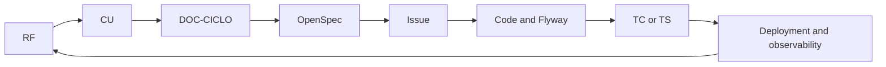
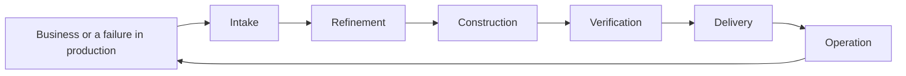
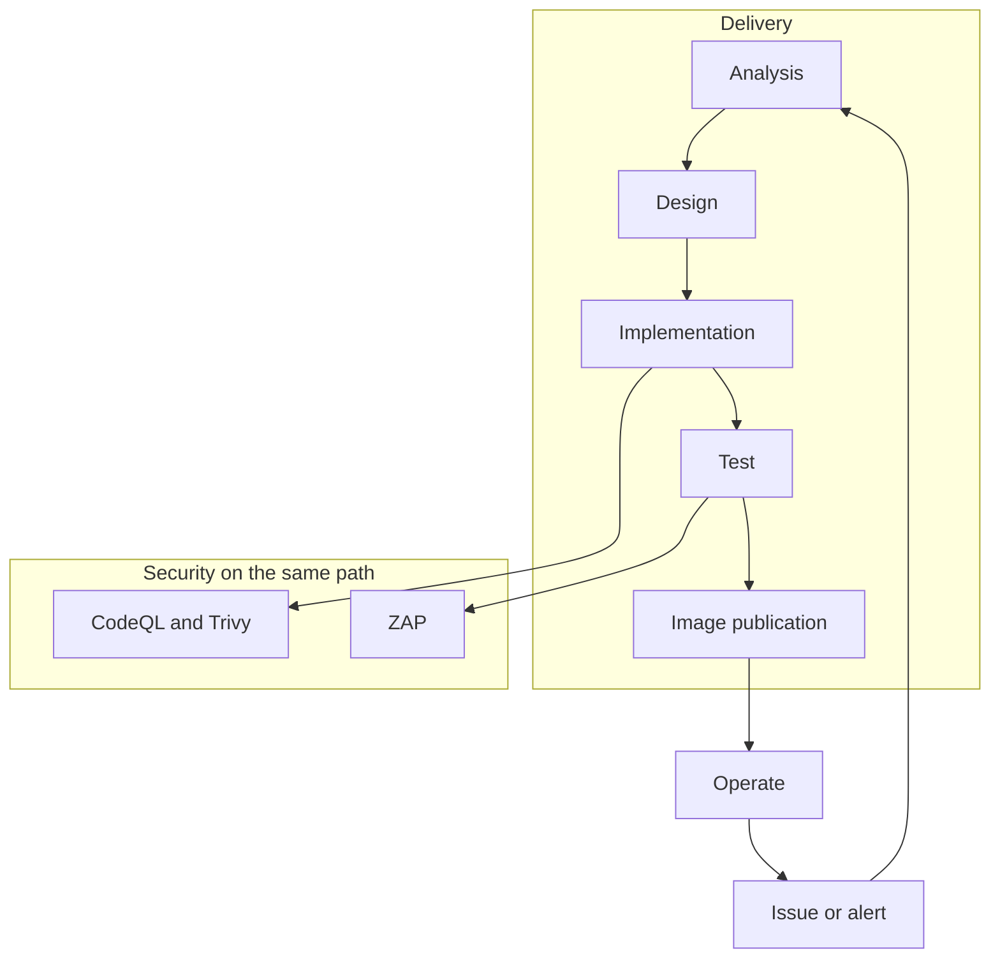

# Software engineering — method applied to Notaire

How information is organized, how artifacts are identified, and how the
processes run from the requirement to operation.

Reference guide:
[TPF Especialización — DevSecOps desde QA Automation](https://github.com/matiaspakua/tech.notes.io/blob/main/pages/sw_eng_specialization/final_projects_specialization.md)
(Matías Miguez). The practices below are taken from that guide. The
three-week Scrum calendar, GitFlow (`develop` / `master`), and the SecTx
case are not copied: Notaire already has a mainline, a board, and a
Constitution.

The product (states, sequences, components) is in
[CICLO-DE-VIDA.md](../200-architecture/203-design/CICLO-DE-VIDA.md).
The step-by-step case, including testimony and document re-entry, is
[GESTION.md](../200-architecture/203-design/GESTION.md) (`DOC-GESTION`).
Which engineering documents exist, and which gaps are product behaviour
rather than a missing file, is in
[EVALUACION-INGENIERIA.md](EVALUACION-INGENIERIA.md).
This file is the process.

## 1. What is adopted

| Practice from the guide | In Notaire |
|-------------------------|------------|
| Single knowledge base | This repository, `docs/` |
| Artifacts with an ID, and an input and output for each process | §2 and §4 |
| Traceability backward and forward | §3 and the lifecycle |
| Light design up front, detail at implementation (RDUF) | The change's OpenSpec plus permanent documents |
| C4, levels 1 to 3 | [CICLO-DE-VIDA.md §5](../200-architecture/203-design/CICLO-DE-VIDA.md#5-c4-views) |
| QA by model: pyramid and four phases | [TEST-PLAN.md](303-testing/TEST-PLAN.md) is the master plan |
| Security from design | [threat model](../200-architecture/206-security/THREAT-MODEL-AUTH-AUDIT.md), `SR-01`… |
| Design to operate, and operate to design | [DEPLOYMENT-PLAN.md](DEPLOYMENT-PLAN.md), [monitoring](../200-architecture/207-monitoring/README.md) |
| Pipeline with a feedback loop | §6 |
| KIS: do not build a maze of folders | `100` / `200` / `300` stay |

## 2. Identification

The ID that already exists is the one that is cited. Files are not renamed.

| Prefix | What it identifies | Where |
|--------|--------------------|-------|
| `RF #n` / `RNF` | Requirement | `docs/100-business/101-requirements/` |
| `CUxx` | Use case | `docs/100-business/102-use-cases/` |
| `ADR-nnn` | Architecture decision | `docs/200-architecture/202-ADR/` |
| `SR-nn` | Security requirement | authentication and audit threat model |
| `TC-nnn` | Business test case | `docs/300-development/303-testing/test-cases/` |
| `TS-nnnn` | E2E suite | `testing/e2e`, index in the test plan |
| `#n` | Work issue | GitHub board |
| `DOC-CICLO` | Domain state model | [CICLO-DE-VIDA.md](../200-architecture/203-design/CICLO-DE-VIDA.md) |
| `DOC-GESTION` | Case-process analysis | [GESTION.md](../200-architecture/203-design/GESTION.md) |
| `DOC-SAD` | arc42 architecture | [sad.md](../200-architecture/201-SAD/sad.md) |
| `DOC-ING` | This method | this file |
| `DOC-MTP` | Master test plan | [TEST-PLAN.md](303-testing/TEST-PLAN.md) |

An artifact cites the ID of the previous one and of the next one. A use
case cites its `RF`. An issue cites its `CU`. A commit and a PR cite the
`#n`. A `TS-` or `TC-` test cites the `CU`.

## 3. Traceability

Forward: a requirement can be followed to the screen and to the operational
log. Backward: an incident or a bug can be followed to the use case and the
requirement.

Example, collecting a payment (CU15):

| Direction | Step |
|-----------|------|
| Backward | Odd receipt or balance → `PaymentStatus` → CU15 → RF to pay and to installments |
| Forward | RF → CU15 → lifecycle §3.8 → spec `pagos` → `POST /api/v1/payments` → Bruno / budget `TS-` → debt warning at archive |

The RF ↔ CU matrix stays in
[traceability](../100-business/104-traceability/Matriz%20de%20Trazabilidad%20Requerimientos-Casos%20de%20Uso.md).

## 4. High-level processes

Each box is a process. The team can be the same people. The interface
between boxes is an artifact, not a meeting without a record.

| Process | In | Out | Who uses it |
|---------|----|-----|-------------|
| Intake | Business request or an observed defect | Issue with `CU`, priority, area, milestone | [Board](../github/README.md) |
| Refinement | Open issue | OpenSpec: proposal, spec, design, tasks | Gate 1, `openspec validate` |
| Construction | Spec and a failing test | Code, a migration if needed, `DOC-CICLO` if a state moved | TDD, branch from `main` |
| Verification | Change on the branch | Unit, integration, contract, E2E, SAST | [CI-PREFLIGHT.md](CI-PREFLIGHT.md) |
| Delivery | Heavy CI green and review | Published image, issue closed | [CD](../200-architecture/209-deployment/README.md) publishes; applying to the cluster is manual |
| Operation | A running version | Metrics, logs, alerts, history | CU77, Prometheus, Grafana, Loki |
| Return | An operational or usage finding | A new issue at intake | Closes the loop |

The board is a three-column Kanban: Todo, In Progress, Done. The
`in-review` label is not a column. That is separate from the statuses of a
management: [lifecycle §7](../200-architecture/203-design/CICLO-DE-VIDA.md#7-managing-the-work).

## 5. Design by discipline

Strategy: preliminary design (RDUF). The change's OpenSpec is enough to
build. The permanent document is updated when the change lands. The whole
system is not rewritten before coding, and the model is not left only in
the PR.

### 5.1 QA

The master plan (`DOC-MTP`) names `TS-nnnn` and ties them to use cases.
Each automated test follows four phases: prepare, exercise the system,
verify, clean up.

The pyramid the pipeline already separates, from most frequent to most
expensive:

1. Unit (`ci.yml`, Vitest).
2. Integration and contract (API, Bruno, OpenAPI).
3. UI E2E (Playwright).
4. Load (k6, performance workflow) and security (CodeQL, Trivy, ZAP).

### 5.2 Development

Architecture model: C4 in the lifecycle, arc42 SAD, an ADR per decision.
The code lives in one repository with short branches on `main`. The branch
name and the commit cite the issue. There is no long-lived `develop` or
`master` branch.

### 5.3 Security

The login and audit threat model numbers `SR-01` onward and marks each one
mitigated, partial, or open. A change to authentication, a secret, or the
schema goes through that document. CodeQL, Trivy, and ZAP are in the
workflows; a CodeQL finding does not fail the job by itself. The detail of
that policy is in
[DevSecOps](../200-architecture/208-devsecops/README.md).

### 5.4 Operation

Twelve factors, in the product's current state:

| Factor | Situation |
|--------|-----------|
| One codebase, many deploys | One repository; local compose, production compose, staging Kustomize |
| Explicit dependencies | Maven and npm |
| Configuration outside the code | Environment variables, [ADR-019](../200-architecture/202-ADR/ADR-019-secrets-management.md) |
| Attached backing services | PostgreSQL, and the observability stack apart |
| Build, release, run separated | CI builds; CD publishes the image to GHCR; a person applies compose or Kustomize |
| Stateless processes | The API does not store business session; the JWT and PostgreSQL hold the state |
| Port | Backend on 8080 |
| Concurrency | Container replicas |
| Startup and shutdown | Containers |
| Environment parity | Compose brings local and production closer; there is no automatic apply to the cluster |
| Logs as a stream | Loki |
| One-off admin tasks | Flyway at startup; backup smoke in its own workflow |

Flow metrics, with no invented numbers. They are read from the board when
needed: work closed per week, time from Todo to Done, how many issues are
in progress, and the split among feature, defect, risk, and debt. Those
four classes already have labels (`enhancement`, `bug`, `risk`,
`tech-debt`).

Operation returns design when an alert, an audit, or a CI failure opens an
issue. That issue enters again through intake.

## 6. Pipeline

Level 0, the boxes. The loop below is the feedback: if a box fails, the
work returns to intake and is not published.

Level 1, the workflows that exist today
([CI-PREFLIGHT.md](CI-PREFLIGHT.md)):

| Stage | Workflow | What cuts the path |
|-------|----------|--------------------|
| Build | `ci.yml` build | It does not compile |
| Fast test | unit, integration, coverage, frontend Vitest | A test fails or coverage drops |
| Contract | `openapi-contract.yml`, Bruno inside Playwright | The contract or the API do not match |
| Security | `codeql.yml`, Trivy in `ci.yml`, `dast-zap.yml` | Image Trivy is a report; CodeQL reports and does not block alone |
| Code quality | `pr-validation.yml` (Checkstyle, Spotless), ESLint | Lint |
| E2E | `playwright-e2e.yml` | The UI does not meet the use case |
| Process | `sdlc-process.yml` | Commit, TDD evidence, agent rules |
| Publication | `cd.yml` | Publishes a signed image; does not deploy the cluster |
| Data | `database-vv.yml`, `backup-restore-smoke.yml` | The migration or the restore does not close |

Level 2 is written only when a stage asks for it. Today the detail that is
already written is the login threat model and the CodeQL policy. A generic
pentest is not added, nor a control the repository does not run.

## 7. Roles

The same person can cover more than one role. The Cloud fleet agents
execute the role; they do not replace the artifact.

| Role | Responsibility | Where it is written |
|------|----------------|---------------------|
| Product | Priority, milestone, use case on the issue | [github/README.md](../github/README.md) |
| Analyst | Requirement, use case, states | `docs/100-business/`, `DOC-CICLO` |
| Development | TDD, API, UI | `backend-api` and `frontend` modules |
| QA | Pyramid, `TS-` / `TC-` | `DOC-MTP` |
| Security | `SR-`, SAST, secrets | `docs/200-architecture/206-security/` |
| Operation | Image, health, logs, alerts | `docs/200-architecture/207-monitoring/`, CU77 |
| Fleet | Gate 1, CI, review, merge | [FLEET-ARCHITECTURE.md](304-ai-sdlc-cloud/FLEET-ARCHITECTURE.md) |

## 8. Rule for a change

1. The issue cites `CUxx` or `RF`.
2. The OpenSpec describes only the delta.
3. If the delta moves a state in `DOC-CICLO`, that file is edited in the same PR.
4. The test cites the use case (`TS-` or `TC-`).
5. The PR cites the issue. The merge closes the issue.
6. If operation shows a failure, the failure comes back as an issue. It is not documented only in chat.
7. The change's traceability names the permanent documents the delta touches (use case, `DOC-CICLO` section, SAD or ADR, diagram). Those files are in the same diff. `workspace/sdlc/check-doc-traceability.py` checks it. Do not copy the diagram into a second file to satisfy the rule.
