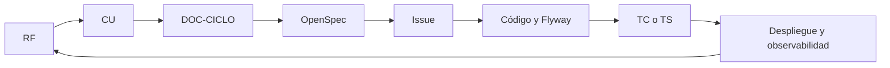
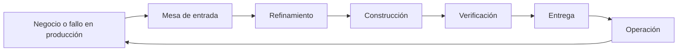
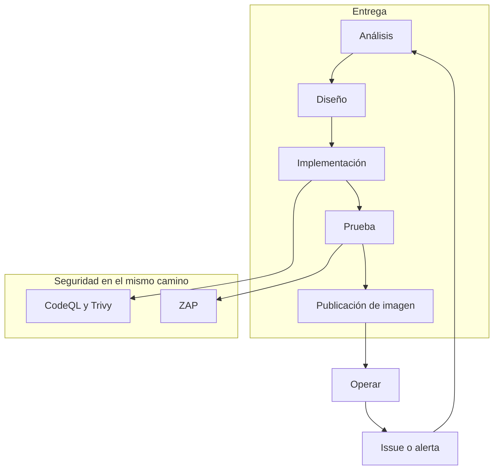

# Ingeniería de software — método aplicado a Notaire

Cómo se organiza la información, cómo se identifican los artefactos y cómo
corren los procesos desde el requerimiento hasta la operación.

Guía de referencia:
[TPF Especialización — DevSecOps desde QA Automation](https://github.com/matiaspakua/tech.notes.io/blob/main/pages/sw_eng_specialization/final_projects_specialization.md)
(Matías Miguez). De esa guía se toman las prácticas de abajo. El calendario
Scrum de tres semanas, GitFlow (`develop` / `master`) y el caso SecTx no se
copian: Notaire ya tiene mainline, tablero y Constitución.

El producto (estados, secuencias, componentes) está en
[CICLO-DE-VIDA.md](../200-architecture/203-design/CICLO-DE-VIDA.md).
Este archivo es el proceso.

## 1. Qué se adopta

| Práctica de la guía | En Notaire |
|---------------------|------------|
| Base de conocimiento única | Este repositorio, `docs/` |
| Artefactos con ID, entrada y salida de cada proceso | §2 y §4 |
| Trazabilidad hacia atrás y hacia adelante | §3 y el ciclo de vida |
| Diseño liviano al inicio, detalle al implementar (RDUF) | OpenSpec del cambio + documentos permanentes |
| C4, niveles 1 a 3 | [CICLO-DE-VIDA.md §5](../200-architecture/203-design/CICLO-DE-VIDA.md#5-vistas-c4) |
| QA por modelo: pirámide y cuatro fases | [TEST-PLAN.md](303-testing/TEST-PLAN.md) es el plan maestro |
| Seguridad desde el diseño | [modelo de amenazas](../200-architecture/206-security/THREAT-MODEL-AUTH-AUDIT.md), `SR-01`… |
| Diseñar para operar y operar para diseñar | [DEPLOYMENT-PLAN.md](DEPLOYMENT-PLAN.md), [monitoreo](../200-architecture/207-monitoring/README.md) |
| Pipeline con lazo de feedback | §6 |
| KIS: no armar un laberinto de carpetas | Se mantiene `100` / `200` / `300` |

## 2. Identificación

El ID que ya existe es el que se cita. No se renombran los archivos.

| Prefijo | Qué identifica | Dónde |
|---------|----------------|-------|
| `RF #n` / `RNF` | Requerimiento | `docs/100-business/101-requirements/` |
| `CUxx` | Caso de uso | `docs/100-business/102-use-cases/` |
| `ADR-nnn` | Decisión de arquitectura | `docs/200-architecture/202-ADR/` |
| `SR-nn` | Requerimiento de seguridad | modelo de amenazas de autenticación y auditoría |
| `TC-nnn` | Caso de prueba de negocio | `docs/300-development/303-testing/test-cases/` |
| `TS-nnnn` | Suite E2E | `testing/e2e`, índice en el plan de pruebas |
| `#n` | Issue de trabajo | tablero de GitHub |
| `DOC-CICLO` | Modelo de estados del dominio | [CICLO-DE-VIDA.md](../200-architecture/203-design/CICLO-DE-VIDA.md) |
| `DOC-SAD` | Arquitectura arc42 | [sad.md](../200-architecture/201-SAD/sad.md) |
| `DOC-ING` | Este método | este archivo |
| `DOC-MTP` | Plan maestro de pruebas | [TEST-PLAN.md](303-testing/TEST-PLAN.md) |

Un artefacto cita el ID del anterior y del siguiente. Un caso de uso cita su
`RF`. Un issue cita su `CU`. Un commit y un PR citan el `#n`. Una prueba
`TS-` o `TC-` cita el `CU`.

## 3. Trazabilidad

Hacia adelante: el requerimiento se puede seguir hasta la pantalla y hasta
el log de operación. Hacia atrás: un incidente o un bug se puede seguir
hasta el caso de uso y el requerimiento.

Ejemplo, cobrar (CU15):

| Sentido | Paso |
|---------|------|
| Atrás | Recibo o saldo raro → `PaymentStatus` → CU15 → RF de abonar y de cuotas |
| Adelante | RF → CU15 → §3.8 del ciclo de vida → spec `pagos` → `POST /api/v1/pagos` → Bruno / `TS-` de presupuestos → aviso de deuda al archivar |

La matriz RF ↔ CU sigue en
[trazabilidad](../100-business/104-traceability/Matriz%20de%20Trazabilidad%20Requerimientos-Casos%20de%20Uso.md).

## 4. Procesos de alto nivel

Cada caja es un proceso. El equipo puede ser la misma gente. La interfaz
entre cajas es un artefacto, no una reunión sin registro.

| Proceso | Entra | Sale | Quién lo usa |
|---------|-------|------|----------------|
| Mesa de entrada | Pedido de negocio o defecto observado | Issue con `CU`, prioridad, área, hito | [Tablero](../github/README.md) |
| Refinamiento | Issue abierto | OpenSpec: propuesta, spec, diseño, tareas | Gate 1, `openspec validate` |
| Construcción | Spec y prueba que falla | Código, migración si hace falta, `DOC-CICLO` si movió un estado | TDD, rama desde `main` |
| Verificación | Cambio en la rama | Unitarias, integración, contrato, E2E, SAST | [CI-PREFLIGHT.md](CI-PREFLIGHT.md) |
| Entrega | CI pesado en verde y review | Imagen publicada, issue cerrado | [CD](../200-architecture/209-deployment/README.md) publica; el apply al cluster es manual |
| Operación | Versión en marcha | Métricas, logs, alertas, bitácora | CU77, Prometheus, Grafana, Loki |
| Vuelta | Hallazgo de operación o de uso | Issue nuevo en la mesa | Cierra el lazo |

El tablero es Kanban de tres columnas: Todo, In Progress, Done. La etiqueta
`in-review` no es una columna. Eso está separado de los estados de una
gestión: [ciclo de vida §7](../200-architecture/203-design/CICLO-DE-VIDA.md#7-gestión-del-trabajo).

## 5. Diseño por disciplina

Estrategia: diseño preliminar (RDUF). El OpenSpec del cambio alcanza para
construir. El documento permanente se actualiza cuando el cambio queda. No
se reescribe el sistema entero antes de codear, y no se deja el modelo solo
en el PR.

### 5.1 QA

El plan maestro (`DOC-MTP`) nombra `TS-nnnn` y los ata a casos de uso. Cada
prueba automatizada sigue cuatro fases: preparar, ejercer el sistema,
verificar, limpiar.

Pirámide que el pipeline ya separa, de más frecuentes a más caras:

1. Unitarias (`ci.yml`, Vitest).
2. Integración y contrato (API, Bruno, OpenAPI).
3. E2E de UI (Playwright).
4. Carga (k6, workflow de performance) y seguridad (CodeQL, Trivy, ZAP).

### 5.2 Desarrollo

Modelo de arquitectura: C4 en el ciclo de vida, SAD arc42, ADR por decisión.
El código vive en un solo repositorio con ramas cortas sobre `main`. El
nombre de la rama y el commit citan el issue. No hay rama `develop` ni
`master` de larga vida.

### 5.3 Seguridad

El modelo de amenazas de login y auditoría numera `SR-01` en adelante y
marca cada uno como mitigado, parcial o abierto. Un cambio de autenticación,
secreto o esquema pasa por ese documento. CodeQL, Trivy y ZAP están en los
workflows; un hallazgo de CodeQL no falla el job por sí solo. El detalle de
esa política está en
[DevSecOps](../200-architecture/208-devsecops/README.md).

### 5.4 Operación

Doce factores, en el estado actual del producto:

| Factor | Situación |
|--------|-----------|
| Un código, varios deploys | Un repositorio; compose local, compose de producción, Kustomize de staging |
| Dependencias explícitas | Maven y npm |
| Configuración fuera del código | Variables de entorno, [ADR-019](../200-architecture/202-ADR/ADR-019-secrets-management.md) |
| Servicios de apoyo adjuntos | PostgreSQL, y el stack de observabilidad aparte |
| Build, release, run separados | CI construye; CD publica la imagen en GHCR; una persona aplica el compose o el Kustomize |
| Procesos sin estado | La API no guarda sesión de negocio; el JWT y PostgreSQL llevan el estado |
| Puerto | Backend en 8080 |
| Concurrencia | Réplicas del contenedor |
| Arranque y apagado | Contenedores |
| Paridad de ambientes | Compose acerca local y producción; no hay apply automático al cluster |
| Logs como flujo | Loki |
| Tareas de admin de un solo uso | Flyway al arrancar; smoke de backup en workflow propio |

Métricas de flujo, sin números inventados. Se leen del tablero cuando haga
falta: trabajo cerrado por semana, tiempo de Todo a Done, cuántos issues
están en curso, y el reparto entre funcionalidad, defecto, riesgo y deuda.
Esas cuatro clases ya tienen etiquetas (`enhancement`, `bug`, `risk`,
`tech-debt`).

La operación devuelve diseño cuando una alerta, un audit o un fallo de CI
abre un issue. Ese issue vuelve a entrar por la mesa.

## 6. Pipeline

Nivel 0, las cajas. El lazo de abajo es el feedback: si una caja falla, el
trabajo vuelve a la mesa, no se publica.

Nivel 1, los workflows que existen hoy
([CI-PREFLIGHT.md](CI-PREFLIGHT.md)):

| Etapa | Workflow | Qué corta el camino |
|-------|----------|---------------------|
| Construcción | `ci.yml` build | No compila |
| Prueba rápida | unitarias, integración, cobertura, frontend Vitest | Falla el test o baja la cobertura |
| Contrato | `openapi-contract.yml`, Bruno dentro de Playwright | El contrato o la API no coinciden |
| Seguridad | `codeql.yml`, Trivy en `ci.yml`, `dast-zap.yml` | Trivy de imagen es reporte; CodeQL informa y no bloquea solo |
| Calidad de código | `pr-validation.yml` (Checkstyle, Spotless), ESLint | Lint |
| E2E | `playwright-e2e.yml` | La UI no cumple el caso de uso |
| Proceso | `sdlc-process.yml` | Commit, evidencia TDD, reglas de agente |
| Publicación | `cd.yml` | Publica imagen firmada; no despliega el cluster |
| Datos | `database-vv.yml`, `backup-restore-smoke.yml` | La migración o el restore no cierran |

Nivel 2 se baja solo cuando una etapa lo pide. Hoy el detalle que ya está
escrito es el modelo de amenazas del login y la política de CodeQL. No se
agrega un pentest genérico ni un control que el repositorio no ejecuta.

## 7. Roles

La misma persona puede cubrir más de un rol. Los agentes de la flota Cloud
ejecutan el rol; no reemplazan el artefacto.

| Rol | Responsabilidad | Dónde está escrito |
|-----|-----------------|--------------------|
| Producto | Prioridad, hito, caso de uso en el issue | [github/README.md](../github/README.md) |
| Analista | Requerimiento, caso de uso, estados | `docs/100-business/`, `DOC-CICLO` |
| Desarrollo | TDD, API, UI | módulos `backend-api` y `frontend` |
| QA | Pirámide, `TS-` / `TC-` | `DOC-MTP` |
| Seguridad | `SR-`, SAST, secretos | `docs/200-architecture/206-security/` |
| Operación | Imagen, salud, logs, alertas | `docs/200-architecture/207-monitoring/`, CU77 |
| Flota | Gate 1, CI, review, merge | [FLEET-ARCHITECTURE.md](304-ai-sdlc-cloud/FLEET-ARCHITECTURE.md) |

## 8. Regla para un cambio

1. El issue cita `CUxx` o `RF`.
2. El OpenSpec describe solo el delta.
3. Si el delta mueve un estado de `DOC-CICLO`, ese archivo se edita en el mismo PR.
4. La prueba cita el caso de uso (`TS-` o `TC-`).
5. El PR cita el issue. El merge cierra el issue.
6. Si la operación muestra un fallo, el fallo vuelve como issue. No se documenta solo en el chat.
7. La trazabilidad del cambio nombra los documentos permanentes que el delta toca (caso de uso, sección de `DOC-CICLO`, SAD o ADR, diagrama). Esos archivos van en el mismo diff. `workspace/sdlc/check-doc-traceability.py` lo verifica. No se copia el diagrama a un segundo archivo para cumplir la regla.
