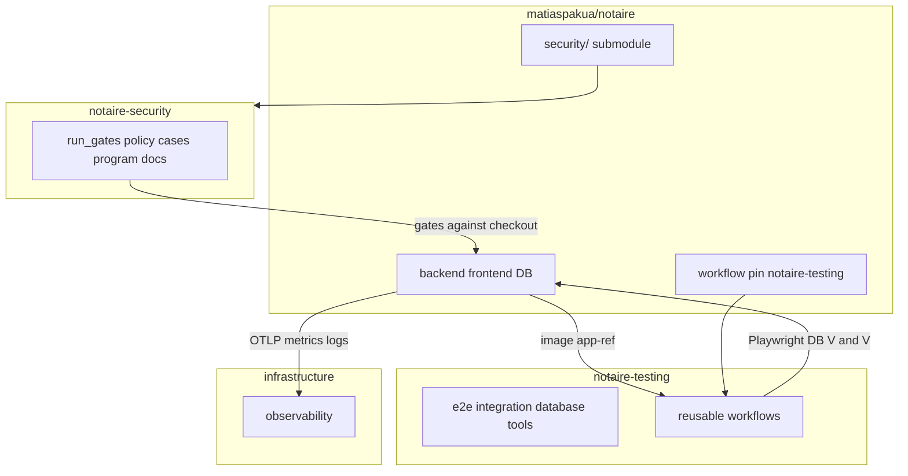

# Multi-team contract (product · infra · QA · Sec)

Four fleets evolve Notaire without mutually blocking merges. Topology after #2512 / #2514:

| Fleet | Repository | How Notaire consumes it |
|-------|------------|-------------------------|
| Product | `matiaspakua/notaire` | Application, Bruno, pg-integration, unit tests, root GitHub security controls |
| Infrastructure | `matiaspakua/infrastructure` | Submodule `infra/` + `ops/system.yaml` |
| Security | `matiaspakua/notaire-security` | Submodule `security/` + fleet contract |
| QA | `matiaspakua/notaire-testing` | Reusable workflows pinned by SHA (`app-ref`) |
| AI SDLC kit | `draclab/ai_sdlc` | Submodule `framework/ai-sdlc` @ release tag |

## Parallel flow (no mutual block)

1. **Product** opens a PR: unit + compile + cheap gates; publishes image / `app-ref`.
2. **Infra** monitors the environment via submodule `infra/` + `ops/system.yaml` — independent of suite PRs.
3. **QA** runs suites from `notaire-testing` (reusable workflow `@pinned-sha` with `app-ref`) in parallel; a spec change is a PR in QA plus a pin bump in Notaire.
4. **Sec** evolves policy/gates/program docs in `notaire-security`; Notaire pins the submodule; SAST/CodeQL stay in the product repo (ADR-024).

## Stable inputs

| Input | Owner | Consumers |
|-------|-------|-----------|
| `app-ref` | Product CI / release | QA reusable workflows |
| `testing-ref` | QA pin (same SHA as `uses:`) | QA reusable workflows |
| Submodule SHA `security` | Sec + product pin bump | Product CI / preflight |
| Submodule SHA `infra` | Infra + product pin bump | Product CI / stack |
| `SYSTEM_DESCRIPTOR` / `ops/system.yaml` | Product | Infra render/start |
| `NOTAIRE_APP_ROOT` / `NOTAIRE_TESTING_ROOT` | Local developers | preflight, inventory, coverage tools |

## Stable check names

Product required checks keep these job **names** (protect-main / branch protection):

- `CI`, `Frontend CI`, `Playwright E2E`, `Code Lint`, `PR Validation`
- Inside the E2E reusable workflow: `UI E2E Tests (Playwright)`, `API Tests (Bruno)`, …
- `Database V&V`

A rename needs a coordinated ruleset update — never as a side effect of a suite edit.

## Ownership and merge order

| Change type | Primary PR repo | Follow-up in Notaire |
|-------------|-----------------|----------------------|
| Application feature | notaire | — |
| Observability / deploy tooling | infrastructure | submodule pin bump |
| Gate policy / program docs | notaire-security | submodule pin bump |
| Spec / database check | notaire-testing | workflow pin bump |
| Threat model / STRIDE register | notaire (`206-security/`) | — |

Pin bumps are small, reviewable Notaire PRs. They do not wait for unrelated product features.

## What does **not** move

- Unit / Vitest / JUnit, Bruno (`backend-api/api-test/`), `pg-integration`
- Root `SECURITY.md`, CODEOWNERS, Dependabot, CodeQL, Trivy workflows (ADR-024)
- Code-tied threat models under `docs/200-architecture/206-security/`

## Related

- [REPO-SPLIT-PLAN.md](REPO-SPLIT-PLAN.md)
- [ADR-024](../200-architecture/202-ADR/ADR-024-repository-topology.md)
- Security fleet: `security/docs/SECURITY-FLEET-CONTRACT.md` (submodule)
- QA fleet: https://github.com/matiaspakua/notaire-testing/blob/main/docs/QA-FLEET-CONTRACT.md
