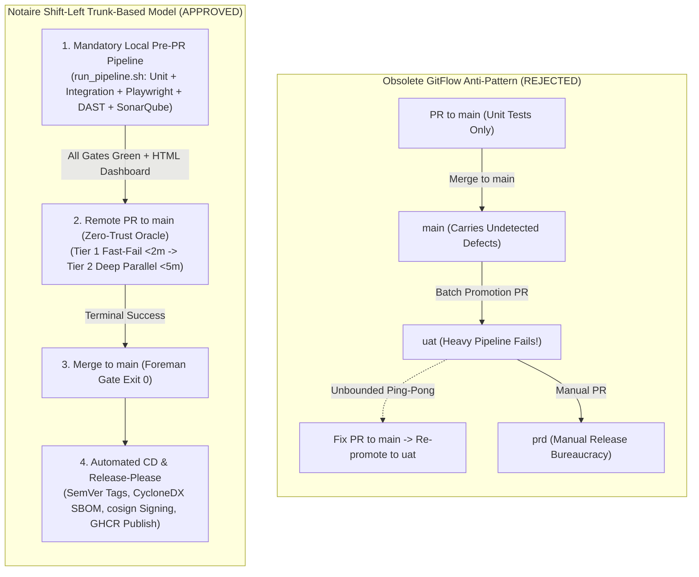
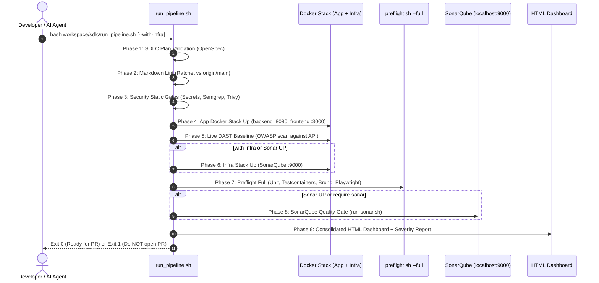

# Architecture Specification: Shift-Left Local Pipeline & Optimized Trunk-Based CI/CD

> **Status:** Approved Architecture Plan (Supersedes obsolete GitFlow proposal)  
> **Authority:** Aligned with [`CONSTITUTION.md`](../../CONSTITUTION.md) (§5, §11, §13), [`CI-MERGE-GATE.md`](304-ai-sdlc-cloud/CI-MERGE-GATE.md), and [`RELEASES.md`](305-project-management/RELEASES.md)  
> **Use Case:** CU76 – Quality Assurance and Testing Infrastructure  
> **Requirements:** RNF-08 (Maintainability), RNF-09 (Reliability), RNF-11 (Efficiency & Resource Usage), RF #90 / RF #91  

---

## 1. Executive Summary & Core Engineering Philosophy

The Notaire software development lifecycle operates on a **True Shift-Left, Local-First Quality Enforcement Architecture**. Rather than relying on cloud runners to discover defects or attempting to defer integration tests to downstream long-lived promotion branches (the rejected GitFlow anti-pattern), the repository establishes a strict two-stage quality contract:

1. **Local Pre-PR Pipeline (`workspace/sdlc/run_pipeline.sh`) is Mandatory and Comprehensive:**  
   Before opening a pull request, the developer or autonomous agent MUST run `run_pipeline.sh` locally. This script brings up the local Docker stack, executes all static, unit, integration, and E2E suites, runs live DAST security baseline scans, and enforces the local infrastructure **SonarQube Quality Gate** (`infra/scripts/run-sonar.sh`) across backend and frontend. It generates a single, immutable HTML dashboard (`reports/pipeline/<timestamp>/index.html`) proving branch readiness.
2. **Remote CI/CD (GitHub Actions) Acts as a Zero-Trust Verification Oracle:**  
   Because all code is pre-validated locally, remote CI runs on pull requests are designed for **deterministic, fail-fast verification and cost efficiency**. Remote CI runs a deduplicated two-tier verification suite (<6–7 minutes total) to confirm clean-room execution before the Foreman merges the PR into `main`.

---

## 2. Re-Challenging the Obsolete GitFlow Proposal

The initial proposal called for a 3-branch GitFlow workflow (`main -> uat -> prd`) where PRs to `main` would run only "fast unit tests", deferring integration, E2E, and security tests to `uat` and `prd`. When evaluated against the project's local pre-PR mandate and local infrastructure capabilities, the GitFlow model is exposed as deeply counter-productive:

### 2.1 Critical Gaps in the GitFlow Proposal
1. **Ignored Mandatory Local Pre-PR Enforcement:**
   CONSTITUTION §5 (step 17.5) mandates running `bash workspace/sdlc/run_pipeline.sh` before any PR is created. If full integration and E2E checks are already mandatory and verified locally, delaying them to a remote `uat` branch introduces artificial lag and destroys trunk stability.
2. **Ignored Local SonarQube DevSecOps Infrastructure:**
   The repository already provides a complete observability and code quality stack in `infra/` (`sonarqube`, `prometheus`, `grafana`, `loki`). The script `infra/scripts/run-sonar.sh` enforces the **"Notaire way" Quality Gate** (zero new blocker/critical/major issues, new code coverage ≥ 70%). GitFlow completely ignored this local capability.
3. **Created Cascading Agent Stalls ("Ping-Pong" Hell):**
   In a multi-agent autonomous fleet (Foreman + Workers), multiple PRs merge into `main` daily. If integration tests only run during promotion from `main` to `uat`, any batch failure requires git bisecting across dozens of merged PRs, freezing the entire fleet.
4. **Security Vulnerability in Git History:**
   Skipping security scans on PRs to `main` would allow secrets and SQL injection vulnerabilities into trunk git history. Once pushed, credentials must be considered compromised.
5. **Broke Automated SemVer & Release Please:**
   Notaire's automated release train uses Google's `release-please` directly on `main` ([`.github/workflows/release-please.yml`](../../.github/workflows/release-please.yml)), cutting releases and tags (`vX.Y.Z`) on merge. GitFlow's `prd` promotion branch would break release-please manifests and version coherence.

---

## 3. The Local Pre-PR Pipeline (`workspace/sdlc/run_pipeline.sh`)

[`workspace/sdlc/run_pipeline.sh`](../../workspace/sdlc/run_pipeline.sh) is the primary gatekeeper of code quality. It is structured into strict, fail-fast execution tiers:

### 3.1 Capabilities of the Enhanced `run_pipeline.sh`
- **Fail-Fast Ordering:** Instant checks (SDLC plan, markdown-lint, secret scanning) execute first, failing within seconds before heavy containers are launched.
- **SonarQube Quality Gate Integration:**
  - Auto-detects if SonarQube is running at `http://localhost:9000`.
  - When running (or requested via `--with-infra`), executes `infra/scripts/run-sonar.sh`, scanning `notaire-backend` (Maven + JaCoCo) and `notaire-frontend` (Sonar scanner container + Vitest + ESLint).
  - Enforces `sonar.qualitygate.wait=true` with the "Notaire way" gate (new blocker/critical/major = 0, new code coverage ≥ 70%).
  - Summarizes blocker/critical/major issue counts via `infra/scripts/sonar-severity-report.py`.
- **Flexible Execution Modes:**
  - `bash workspace/sdlc/run_pipeline.sh`: Standard mandatory pre-PR run.
  - `--with-infra`: Boots observability & SonarQube infra stack (`infra/scripts/start-infra.sh`) and enforces Sonar quality gate.
  - `--require-sonar`: Makes SonarQube analysis strictly blocking (fails if SonarQube is unreachable).
  - `--fast`: Runs fast static and unit checks (skipping server-backed suites).
  - `--fix`: Automatically applies formatting and lint fixes where possible.
- **Consolidated Dashboard Artifact:**
  Writes `reports/pipeline/<timestamp>/index.html` containing phase timings, execution logs, JaCoCo coverage, Checkstyle, SpotBugs, ESLint, Playwright reports, security DAST baseline, and direct links to SonarQube project dashboards.

---

## 4. Optimized Remote CI/CD on Trunk-Based Development

Because PRs are pre-validated locally, the remote GitHub Actions pipeline is optimized for **fast verification, deduplicated execution, and low runner cost**:

### 4.1 Two-Tiered Remote PR Verification Pipeline
1. **Tier 1: Fast-Fail Gate (< 2 mins)**:
   - PR Validation & Conventional Commits (`pr-validation.yml`)
   - SDLC Process & OpenSpec hygiene (`sdlc-process.yml`)
   - Secret Scanning (`security/scan_secrets.py`) & Semgrep SAST (`ci.yml`)
   - Frontend Typecheck & Vitest Unit Tests (`frontend-ci.yml`)
   - Backend Unit Tests with JaCoCo instrumentation (`ci.yml`)
   - *Any failure immediately cancels downstream workflows.*
2. **Tier 2: Deep Verification Gate (Parallelized, ~4–6 mins)**:
   - PostgreSQL Testcontainers Integration Tests (`ci.yml`)
   - Sharded Playwright UI E2E (shards 1/3, 2/3, 3/3 in `playwright-e2e.yml`)
   - Bruno API Contract Tests (`playwright-e2e.yml`)
   - OpenAPI diff check against base branch (`openapi-contract.yml`)
   - **Deduplicated JaCoCo Coverage Ratchet:** The `coverage` job evaluates coverage `.exec` data already produced by unit and integration jobs via `jacoco:report-aggregate` and `jacoco:check` **without re-running tests** (shaving ~5–6 minutes off backend CI).
   - Path-scoped Docker container verification: only builds Docker image on PR if `Dockerfile*` or container scripts change.

### 4.2 Post-Merge Continuous Delivery (`main`)
- **Automated SemVer Releases:** `release-please.yml` generates release PRs, bumps versions, and tags releases (`vX.Y.Z`).
- **Cryptographic Image Publishing:** `cd.yml` triggers on tags or successful `main` CI, builds multi-arch container images, generates CycloneDX SBOMs, and signs images keylessly with `cosign`.
- **Live Documentation Deployment:** `deploy-github-page.yml` continuously deploys the living architecture documentation and cut history to GitHub Pages.

---

## 5. Performance, Time & Cost Matrix

| Pipeline Dimension | Without Local Mandate (Pure Cloud CI) | Obsolete GitFlow Proposal | Optimized Shift-Left + Trunk Tiered CI |
|---|---|---|---|
| **Defect Detection Point** | In GitHub Actions (post-push) | On `uat` promotion (hours/days later) | **Local machine before opening PR** |
| **SonarQube Quality Gate** | None or cloud-only | None | **Enforced locally (`run-sonar.sh`)** |
| **PR CI Turnaround Time** | ~12–15 minutes | ~3 min (false positive) / ~20 min on UAT | **< 6 minutes (first-pass green)** |
| **GitHub Actions Runner Minutes** | High (frequent retry loops) | Extremely high (duplicated pipelines on 3 branches) | **Minimal (eliminated retry loops)** |
| **Branch Maintenance Overhead** | Low (Trunk) | High (syncing `main`, `uat`, `prd`) | **Zero (single trunk `main`)** |
| **Release Traceability** | High | Low (manual promotion PRs) | **Fully automated (`release-please` + `cd.yml`)** |

---

## 6. Implementation Checklist & Acceptance Criteria

- [x] **Local Pipeline Enhanced:** `workspace/sdlc/run_pipeline.sh` updated to support SonarQube quality gate, auto-detection, `--with-infra`, `--require-sonar`, and rich dashboard generation.
- [x] **Invariants Preserved:** All 13 tests in `workspace/tests/test_run_pipeline_invariants.py` pass cleanly.
- [ ] **Remote CI Deduplication:** Update `ci.yml` `coverage` job to use `jacoco:report-aggregate` over existing test `.exec` artifacts instead of re-running `mvn verify`.
- [ ] **Docker PR Scoping:** Add path filtering to `ci.yml` `docker-build` job to skip building when container files are untouched.
- [ ] **CI Merge Gate Maintained:** Ensure all 5 required checks in `protect-main` (`CI`, `Frontend CI`, `Playwright E2E`, Bruno, Playwright) remain enforced.
- [ ] **Documentation & Release Runbooks Synchronized:** Architecture documentation updated and linked to GitHub issue [#1862](https://github.com/matiaspakua/notaire/issues/1862).