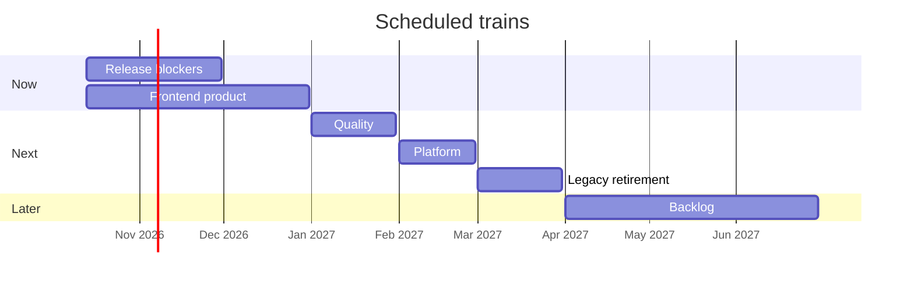

# Project management

How a project manager reads Notaire, and how Cloud agents pick work without
editing the same paths. The board is
[Notaire — Delivery Board](https://github.com/users/matiaspakua/projects/1).
The process that uses an issue (OpenSpec, branch, TDD, PR) stays in
[CONSTITUTION.md](../../CONSTITUTION.md). This page is the schedule.

Snapshot date: **2026-10-12**. Counts below are the assignment produced by
[`workspace/sdlc/milestone_policy.py`](../../workspace/sdlc/milestone_policy.py)
(296 open, 504 closed). Issue [#1561](https://github.com/matiaspakua/notaire/issues/1561)
tracks the reorganization (RNF-21, RNF-22).

## Two axes

| Axis | Where it lives | Question it answers |
|------|----------------|---------------------|
| Schedule | Milestone, with a due date | Which train is this on? |
| Urgency | Exactly one `priority:*` label on work issues | How soon inside that train? |
| Lane | Derived from labels (not a second label) | Which agent may pick it without colliding? |

Priority used to be copied into the milestone (`v1.0` = critical/high,
`v1.1` = medium, `Backlog` = low). That made the roadmap a second copy of
the priority labels and hid the product structure. Priority stays a label.
The milestone is the train.

Catalog anchors (requirements, non-functional requirements, use cases) are
scheduled onto a train so scope is visible. They are not pickable work.
Agents implement a work issue that cites the anchor.

## What is live on GitHub today

The Cloud agent token that opened #1561 cannot edit milestones, labels, or
project views (`HTTP 403 Resource not accessible by integration`). The live
board is still the previous scheme until someone with Issues and Projects
write runs:

```bash
python3 workspace/sdlc/apply_milestone_policy.py --apply
python3 workspace/sdlc/apply_milestone_policy.py --check
```

`--check` is read-only and exits 1 while the live board disagrees with the
policy. Without `gh` auth it skips.

| Live open milestone | Open issues |
|---------------------|-------------|
| (no milestone) | 220 (219 before #1561, plus #1561) |
| v1.0 — Production Ready | 34 |
| v1.1 — Hardening | 33 |
| Backlog | 9 |

388 closed issues also have no milestone. The ROADMAP view on the board has
an empty filter and the open milestones have no due dates, so the timeline
has nothing to plot.

## How the project was organized

Two numbering schemes were both called "Phase" and they do not match.

| What the docs called it | What GitHub actually has | Open issues now |
|-------------------------|--------------------------|-----------------|
| Phase 1 — Analysis, milestone **#6** | Milestone #6 does not exist | — |
| Phase 2 — Foundation, milestone **#7** | Milestone #7 does not exist | — |
| Phase 3 — Backend API, milestone **#8** | Milestone #8 does not exist | — |
| Phase 5 — Observability, milestone **#10** | Milestone #10 does not exist | — |
| Phase 0 — Foundations | #1 Phase 0 - Foundations, **closed**, 6 issues | 0 |
| Phase 1 — Backend complete | #2 Phase 1 - Backend Complete, **closed**, 15 issues | 0 |
| Phase 2 — Kubernetes & observability | #3, **closed**, 5 issues | 0 |
| Early frontend slice | #4 Phase 3 - Modern Frontend, **closed**, 3 issues | 0 |
| Early production slice | #5 Phase 4 - Production Ready, **closed**, 2 issues | 0 |
| SAD "Phase 4 in progress" | #9 Phase 4 — Modern Frontend, **closed**, 15 issues. The remaining work is #898, which sits on v1.0 | 0 |
| SAD "Phase 6 partial" | #11 Phase 6 — Deprecation, **closed**, 2 issues. The epic #899 sits on v1.1 | 0 |

Architecture phases in [SAD §4.3](../200-architecture/201-SAD/sad.md) (analysis,
foundation, API, frontend, observability, deprecation) stay the narrative of
the product. They are not the GitHub milestone numbers #6–#11.

The policy **renames** the closed milestones so a PM can tell the schemes
apart (`History · Phase 0 Foundations`, `History · v1.0 priority bucket`, …)
and **backfills** the 388 closed issues that have no milestone:

| Close date | History milestone | Planned count |
|------------|-------------------|---------------|
| before 2026-07-01 | History · 2026 Q2 — Foundations & API | 80 |
| 2026-07-01 through 2026-09-30 | History · 2026 Q3 — Product build | 179 |
| on or after 2026-10-01 | History · 2026 Q4 — Cloud AI SDLC | 129 |

Issues that already have a milestone stay on it (then the rename applies).
History milestones are closed after the backfill. Open issues are never
left on a history milestone.

## Forward schedule

Six open trains. Due dates are what the roadmap plots. Exit criteria are
for the PM, not a promise that the date moves by itself.

| Train | Due | Planned open | What belongs |
|-------|-----|--------------|--------------|
| 2026-11 · Release blockers | 2026-11-30 | 14 | `priority:critical`, the `security` label, high issues whose title starts with `security(`, security NFRs RNF-11–16 |
| 2026-12 · Frontend product | 2026-12-31 | 184 | Phase 4 scope: open use cases, functional requirements, visual NFRs RNF-05–10, and Next.js behavior. Epic [#898](https://github.com/matiaspakua/notaire/issues/898) |
| 2027-01 · Quality & traceability | 2027-01-31 | 56 | Tests, docs, traceability, performance NFRs RNF-01–04, process NFRs RNF-21–22. Trackers [#902](https://github.com/matiaspakua/notaire/issues/902) and [#921](https://github.com/matiaspakua/notaire/issues/921) |
| 2027-02 · Platform & operability | 2027-02-28 | 7 | CI, observability, and operability **implementation** that is not a release blocker |
| 2027-03 · Legacy retirement | 2027-03-31 | 9 | `jpa` retirement and epic [#899](https://github.com/matiaspakua/notaire/issues/899). Critical legacy defect [#574](https://github.com/matiaspakua/notaire/issues/574) is pulled forward onto Release blockers |
| 2027-06 · Backlog | 2027-06-30 | 26 | `priority:low`, environment NFRs RNF-17–20 and RNF-23–24, and issues with no area label |



Of the 184 frontend-product issues, most are the requirements catalog
(RF and CU), not pages to build this month. The ROADMAP and Delivery
schedule views hide `requerimiento-funcional`, `requerimiento-no-funcional`,
and `CASO-DE-USO` so the timeline shows delivery work. The existing table
views (Requerimientos Func., Casos de Uso, RNF) stay the scope lists. After
`--apply`, set the Roadmap view **Group by → Milestone** in the GitHub UI.
The API can set the filter; it cannot set group-by.

### Requirement assessment

| Anchors | Train | Why |
|---------|-------|-----|
| RF-01–RF-95 and CU01–CU68 | Frontend product | They are the Phase 4 use-case scope (#898) |
| RNF-05–10 (visual design) | Frontend product | Design system and forms |
| RNF-11–16 (session, privacy, access, password, network, database access) | Release blockers | Security and data integrity |
| RNF-01–04 (memory, CPU, response time, concurrent users) | Quality | Performance |
| RNF-21–22 (methodology, development model) | Quality | This process |
| RNF-17–20, RNF-23–24 (JVM, OS, desktop, notebook, language, database engine) | Backlog | Environment constraints already met by the current stack; the anchors stay open |

[#898](https://github.com/matiaspakua/notaire/issues/898) and
[#921](https://github.com/matiaspakua/notaire/issues/921) lose the
`CASO-DE-USO` label when the script runs. They are an epic and a docs audit,
not use cases. The `documentation` label is replaced by `DOC`.

## Priority

| Label | Meaning |
|-------|---------|
| `priority:critical` | Release blocker. Always the November train, even when the theme is later |
| `priority:high` | Do inside the issue's train before medium work |
| `priority:medium` | Scheduled, not a blocker |
| `priority:low` | Backlog train |

Work issues need exactly one priority. Catalog anchors do not. The script
adds a priority only where a work issue has none: `priority:low` on the
backlog train, `priority:high` on in-progress and `[UI]` / `[UX]` issues,
`priority:medium` otherwise.

## Labels

Canonical set. Do not add a second label in another language for the same idea.

| Kind | Labels | Rule |
|------|--------|------|
| Area | `BACKEND`, `FRONTEND`, `DB`, `DEVOPS`, `TEST`, `DOC` | One or more. `FRONTEND` is the Next.js client. `DOC` is the only documentation label |
| Type | `bug`, `enhancement`, `REFACTOR`, `tech-debt`, `chore`, `ci`, `dependencies`, `TAREA` | |
| Priority | `priority:critical`, `priority:high`, `priority:medium`, `priority:low` | Exactly one on work issues |
| Concern | `security`, `a11y`, `i18n`, `risk`, `ux` | `ux` is a concern, not an area |
| Workflow | `in-progress`, `in-review`, `blocked`, `needs-info`, `ready-for-dev` | Board Status stays Todo / In Progress / Done. There is no Blocked column |
| Traceability | `requerimiento-funcional`, `requerimiento-no-funcional`, `CASO-DE-USO` | Anchors. Not pickable |
| Historical | `phase:1-analysis` … `phase:6-deprecation` | Do not schedule with these. Almost unused. The script marks the description as historical |
| Source | `audit-2026-09` | September 2026 audit findings |

`phase:*` is not a lane and not a milestone. Board coherence stays
[the checker](../../workspace/sdlc/check-board-status-label-coherence.py)
from #1550.

## Lanes — several agents, no path fights

A lane is derived. At most one `in-progress` issue per lane. Catalog and
epic issues are never picked (split an epic first).

| Lane | When | May edit | Blocks |
|------|------|----------|--------|
| catalog | RF, RNF, or CU, and no bug / enhancement / task / refactor / chore / roadmap | nobody picks | — |
| epic | `roadmap` label, or a title starting with `📋`, `[Epic]`, `[ROADMAP]` | nobody picks | — |
| security | `security` label, or `priority:critical` on `BACKEND` | `backend-api/` auth, validation, secrets | backend |
| cross | both `BACKEND` and `FRONTEND` | both trees | frontend and backend |
| frontend | `FRONTEND` | `frontend/` | frontend |
| backend | `BACKEND` | `backend-api/` | backend |
| platform | `DEVOPS` without `DOC` / `TEST` / product areas | `infra/`, `.github/` | platform |
| quality | `DOC` or `TEST`, including docs that also carry `DEVOPS` | `docs/`, `testing/`, `github-page/` | quality |

Quality may run beside frontend or backend because the paths differ.
Security and cross may not run beside backend. Cross may not run beside
frontend.

On 2026-10-12 these open issues already overlap, so a new agent must not
start another frontend, backend, or cross issue until one of them closes:

| Issue | Lane | Why it overlaps |
|-------|------|-----------------|
| [#1545](https://github.com/matiaspakua/notaire/issues/1545) | cross | `in-progress`, backend and frontend |
| [#1557](https://github.com/matiaspakua/notaire/issues/1557) | cross | `in-progress`, backend and frontend |
| [#1546](https://github.com/matiaspakua/notaire/issues/1546) | frontend | `in-progress` while a cross issue is also in progress |

Planned open issues by lane: catalog 194, quality 48, backend 20, frontend 13,
platform 9, cross 6, epic 5, security 1. The pickable queue is the 97 issues
that are not catalog or epic.

The foreman rule is in
[FLEET-ARCHITECTURE.md](../300-development/304-ai-sdlc-cloud/FLEET-ARCHITECTURE.md)
and [`.claude/agents/cloud-foreman.md`](../../.claude/agents/cloud-foreman.md).

## Board

| View | Use |
|------|-----|
| KANBAN | Todo / In Progress / Done. Status is the work-item lifecycle, not a deed state |
| Roadmap | Open delivery work on the six trains. Filter out the three catalog labels. Group by Milestone |
| Delivery schedule | Same filter, table layout, so a PM can sort the queue without the catalog |
| Requerimientos Func. / Casos de Uso / RNF | Scope, grouped by the milestone the script assigns |
| Backlog by priority / Triage | Urgency and intake. Priority is the label, not the milestone |

## Progress to read off the chart

| Question | Where |
|----------|--------|
| How was the past grouped? | History milestones and the three 2026 eras above |
| What is the remaining product scope? | Frontend product train, then subtract catalog issues (the CU and RF views) |
| What can ship before the product pages? | 14 release blockers |
| What can agents do in parallel this week? | One security or backend issue, one frontend issue only if no cross issue is in progress, one platform issue, one quality issue |
| What is explicitly later? | Legacy retirement (March 2027) and the June 2027 backlog |

The same figures render on the GitHub Pages technical docs tab at `/docs/management/`.
