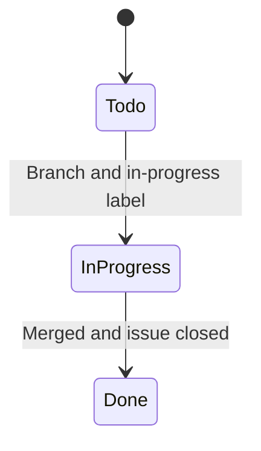

# GitHub Organization

How work is tracked on [matiaspakua/notaire](https://github.com/matiaspakua/notaire).
The process that uses this structure (issue → OpenSpec → branch → PR) is defined in
[CONSTITUTION.md](../../CONSTITUTION.md).

## Board

Everything is on **[Notaire — Delivery Board](https://github.com/users/matiaspakua/projects/1)**.

| Status | Meaning |
|--------|---------|
| Todo | Open, not started |
| In Progress | Branch open; the issue also carries the `in-progress` label |
| Done | Issue closed |

Board status is the **work item** lifecycle. It is not a management state.
`In Progress` on an issue is not `En Tramite` on a deed file. Domain states
live in [CICLO-DE-VIDA.md](../200-architecture/203-design/CICLO-DE-VIDA.md).

**Coherence (mandatory):** Issue `state`, Project Status, and workflow labels
must stay aligned (CONSTITUTION Gate 5 / #1550). Project Status options are
**Todo / In Progress / Done only** — there is no Blocked column; encode blocked
work with the `blocked` label.

| Signal | Status | Labels | Issue state |
|--------|--------|--------|-------------|
| Backlog / ready | Todo | domain labels only | OPEN |
| Active WIP | In Progress | `in-progress` | OPEN |
| Waiting on dependency | Todo *(or In Progress if still owned)* | `blocked` | OPEN |
| Shipped / AC met | Done | no `in-progress` / `blocked` | **CLOSED** |

Validate:

```bash
python3 workspace/sdlc/check-board-status-label-coherence.py --scope pr   # CI / preflight
python3 workspace/sdlc/check-board-status-label-coherence.py --scope wip  # In Progress column
python3 workspace/sdlc/check-board-status-label-coherence.py --scope all  # full board hygiene
```

Without `gh` auth the checker skips with a clear message (never silent pass).

The `in-review` label marks a pull request under review. The board column
stays In Progress until the issue is closed.



## Milestones

Scheduling, history, and the requirements catalog are defined in
[Project management](../300-development/305-project-management/README.md).
A semver release is not a milestone
([RELEASES.md](../300-development/305-project-management/RELEASES.md)).
Short form:

| Kind | Milestones |
|------|------------|
| Release trains (open) | `v0.3 · Hexagonal core & security (2026-11)` through `v1.0 · GA: legacy-free (2027-03)` |
| Continuous (open) | `Backlog · Unscheduled`, `Catalog · Requirements & use cases` |
| History (closed) | Stages `H0`–`H8`, shipped cuts `v0.1`/`v0.2`, and Q2/Q3/Q4 close-date cohorts |

Every issue has exactly one milestone. The full list, assignment precedence,
and read-only verification are in
[MILESTONES.md](../300-development/305-project-management/MILESTONES.md).

The Project views (#1860; set up in the UI, filters checked by
`apply_milestone_policy.py --check`):

- **Kanban** — open non-catalog work, columns by Status
- **Current train** — the open train (`v0.3` today), grouped by Status; retarget each train
- **Agent queue** — Todo, `status:ready`, not blocked / needs-info
- **In flight** — Status In Progress, with linked PRs
- **Needs triage** — open work without a priority label
- **Blocked / needs info** — open work held by a person or dependency
- **Release roadmap** — history through v1.0, grouped by Milestone, Backlog excluded
- **Shipped** — closed work of v0.1/v0.2, grouped by Milestone (CHANGELOG check)
- **Catalog** — RF / RNF / CU anchors, never an agent queue

Priority, area and kind are labels; the project has no Priority/Area/Kind fields.

## Labels

Prefixed families; until phase 2 every legacy name (right) is still read as its new name.

| Kind | Labels | Legacy |
|------|--------|--------|
| Type (exactly one) | `type:feature`, `type:bug`, `type:refactor`, `type:chore`, `type:ci`, `type:epic` | `enhancement`, `bug`, `REFACTOR`, `chore`/`TAREA`, `ci`, `roadmap` |
| Area (one or more) | `area:backend`, `area:frontend`, `area:db`, `area:devops`, `area:test`, `area:docs` | `BACKEND` … `DOC` |
| Priority (exactly one on claimable work) | `priority:critical`, `priority:high`, `priority:medium`, `priority:low` | unchanged |
| Status (workflow) | `status:ready`, `status:in-progress`, `status:in-review`, `status:blocked`, `status:needs-info` | `ready-for-dev`, `in-progress`, `in-review`, `blocked`, `needs-info` |
| Concern | `concern:security`, `concern:a11y`, `concern:i18n`, `concern:ux`, `concern:risk`, `concern:tech-debt` | unprefixed |
| Traceability | `trace:rf`, `trace:rnf`, `trace:cu` | `requerimiento-funcional`, `requerimiento-no-funcional`, `CASO-DE-USO` |
| Source / process / release | `source:audit-2026-09`, `process:sdlc-exception`, `release:breaking` | `audit-2026-09`, `sdlc-exception` |

Agent lanes are derived from area/type labels; `lane:*` labels do not exist.
The full contract, including labels that must not be duplicated, is
[LABELS.md](../300-development/305-project-management/LABELS.md).
Parallel claims are [PARALLEL-AGENTS.md](../300-development/305-project-management/PARALLEL-AGENTS.md).

Run `gh label list` for the live list. Do not create a label that repeats an existing one in
another language. `FRONTEND` means the Next.js client. Swing is not a target.

## Issue checklist

Every claimable issue has a Use Case/RF/RNF reference, acceptance criteria, an
area label, one priority, and one delivery milestone. Catalog anchors are
identified by traceability labels and are not picked by agents. Issue templates
live in [`.github/ISSUE_TEMPLATE/`](../../.github/ISSUE_TEMPLATE/).
