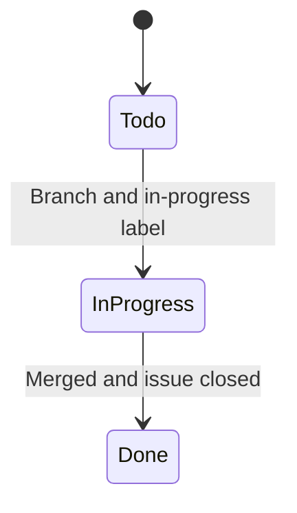

# GitHub Organization

How work is tracked on [matiaspakua/notaire](https://github.com/matiaspakua/notaire).
The process that uses this structure (issue → OpenSpec → branch → PR) is defined in
[CONSTITUTION.md](../../CONSTITUTION.md).

## Board

Everything is on **[Notaire — Delivery Board](https://github.com/users/matiaspakua/projects/1)**.

| Status | Meaning |
|--------|---------|
| Todo | Open, not started |
| In Progress | Branch open; the issue also carries the `in-progress` label |
| Done | Issue closed |

Board status is the **work item** lifecycle. It is not a management state.
`In Progress` on an issue is not `En Tramite` on a deed file. Domain states
live in [CICLO-DE-VIDA.md](../200-architecture/203-design/CICLO-DE-VIDA.md).

**Coherence (mandatory):** Issue `state`, Project Status, and workflow labels
must stay aligned (CONSTITUTION Gate 5 / #1550). Project Status options are
**Todo / In Progress / Done only** — there is no Blocked column; encode blocked
work with the `blocked` label.

| Signal | Status | Labels | Issue state |
|--------|--------|--------|-------------|
| Backlog / ready | Todo | domain labels only | OPEN |
| Active WIP | In Progress | `in-progress` | OPEN |
| Waiting on dependency | Todo *(or In Progress if still owned)* | `blocked` | OPEN |
| Shipped / AC met | Done | no `in-progress` / `blocked` | **CLOSED** |

Validate:

```bash
python3 workspace/sdlc/check-board-status-label-coherence.py --scope pr   # CI / preflight
python3 workspace/sdlc/check-board-status-label-coherence.py --scope wip  # In Progress column
python3 workspace/sdlc/check-board-status-label-coherence.py --scope all  # full board hygiene
```

Without `gh` auth the checker skips with a clear message (never silent pass).

The `in-review` label marks a pull request under review. The board column
stays In Progress until the issue is closed.



## Milestones

| Milestone | Contains |
|-----------|----------|
| v1.0 — Production Ready | Open `priority:critical` / `priority:high` work |
| v1.1 — Hardening | Open `priority:medium` work |
| Backlog | Open `priority:low` work |

Anchor issues get no milestone. These are the traceability catalog: requirements RF/RNF
(#3–#121, labels `requerimiento-funcional` / `requerimiento-no-funcional`) and use cases
CU01–CU68 (#153–#221, label `CASO-DE-USO`). They stay open, and work issues reference them.

## Labels

| Kind | Labels |
|------|--------|
| Area (one or more) | `BACKEND`, `FRONTEND`, `DB`, `DEVOPS`, `TEST`, `DOC` |
| Type | `bug`, `enhancement`, `REFACTOR`, `tech-debt`, `chore`, `ci`, `dependencies`, `TAREA` |
| Priority (exactly one) | `priority:critical`, `priority:high`, `priority:medium`, `priority:low` |
| Concern | `security`, `a11y`, `i18n`, `risk` |
| Workflow | `in-progress`, `in-review`, `blocked`, `needs-info`, `ready-for-dev` |
| Traceability | `requerimiento-funcional`, `requerimiento-no-funcional`, `CASO-DE-USO` |
| Source | `audit-2026-09` (findings of the [2026-09 audit](PRODUCTION-READINESS-AUDIT-2026-09.md)) |

Run `gh label list` for the live list. Do not create a label that repeats an existing one in
another language.

## Issue checklist

Every work issue has: a Use Case reference (CU), acceptance criteria, one area label,
one priority label and a milestone. Issue templates live in
[`.github/ISSUE_TEMPLATE/`](../../.github/ISSUE_TEMPLATE/).
