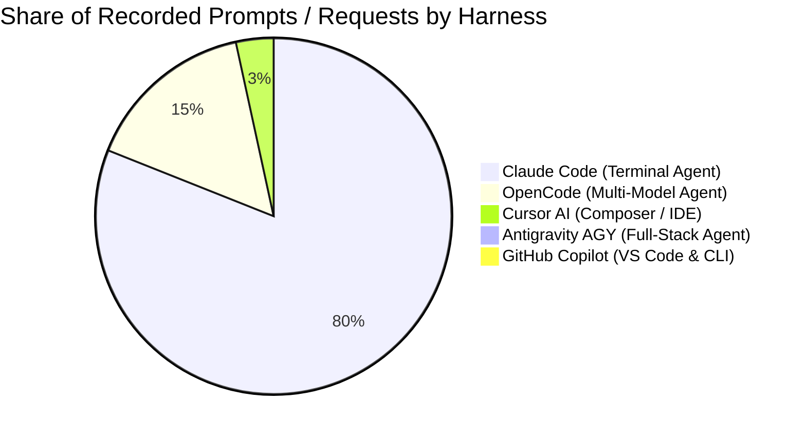
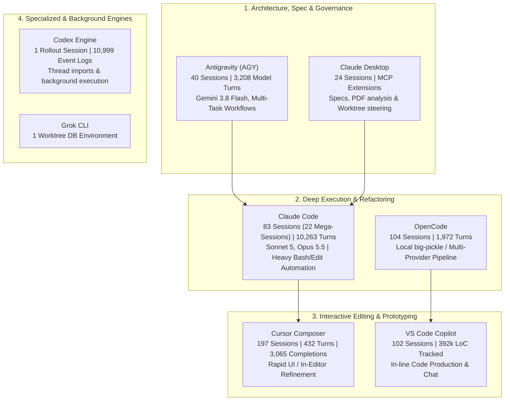
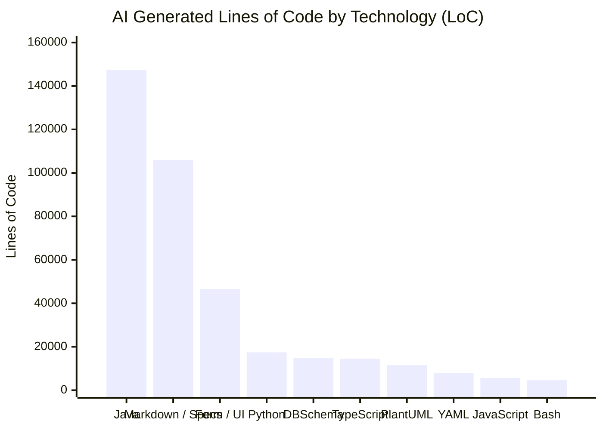
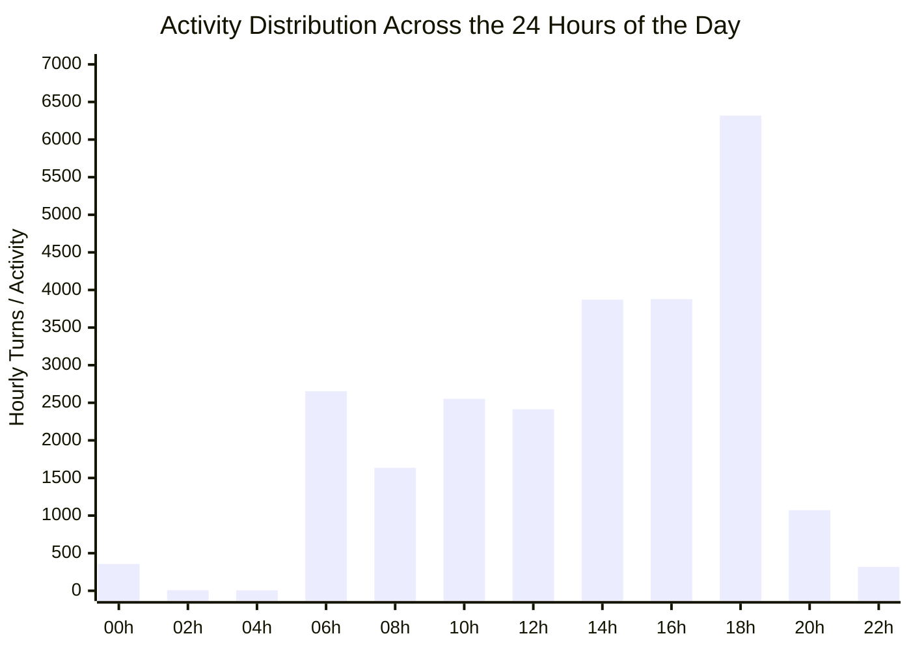

# PC-Wide AI Engineering Audit & Coach Insights

> [!IMPORTANT]
> **AI Engineering Coach Successfully Built & Installed**
> The [`microsoft/ai-engineering-coach`](file:///Users/matiasmiguez/workspace/ai-engineering-coach) repository has been cloned, compiled, packaged into a VSIX extension, and installed into both **Visual Studio Code** and **Cursor**.
> You can launch the interactive dashboard at any time via `Cmd+Shift+P` &rarr; **`AI Engineer Coach: Open Dashboard`**.

---

## 1. Executive Summary: The Agentic Profile

A forensic cross-harness scan across this workstation discovered an extensive AI engineering ecosystem consisting of **552 agentic sessions**, **12,750+ user turns / requests**, and **over 392,000 AI-generated lines of code** across 8 distinct AI harnesses and assistants:

| Metric | Overall Value | Primary Harness Driver |
| :--- | :--- | :--- |
| **Total AI Coding Sessions** | **552** | Cursor (197), OpenCode (104), Claude Code (83), VS Code Copilot (102), AGY (40) |
| **Total Human Turns / Prompts** | **12,750+** | Claude Code (10,263), OpenCode (1,972), Cursor (432), AGY (71+) |
| **AI Lines of Code (LoC)** | **392,443 LoC** | Java (147k), Markdown/Specs (105k), Form (46k), Python (17k), TS (14k) |
| **Active Calendar Span** | **70+ Days** | May 2026 &mdash; November 2026 |
| **Distinct AI Models Utilized** | **38 Models** | Claude 3.5/Sonnet 5, Gemini 3.8 Flash, big-pickle, Claude Opus 5/5.5, GPT-5 |
| **Overall AI Ratio** | **100.0%** | Pure agentic engineering workflow |



---

## 2. Multi-Harness Inventory & Role Breakdown

Each assistant on this workstation fulfills a distinct archetype within your engineering pipeline:



### Detailed Breakdown by Tool

| Harness / Assistant | Storage Location on Disk | Sessions | Prompts / Turns | Top Model(s) | Primary Tools Used |
| :--- | :--- | :---: | :---: | :--- | :--- |
| **Claude Code** | `~/.claude/projects/` | 83 | 10,263 | `claude-sonnet-5` (13,937)<br/>`claude-opus-5-5` (2,557) | `Bash` (6,708), `Read` (1,006), `Edit` (907), `Write` (347), `Browser` (121) |
| **OpenCode** | `~/.local/share/opencode/opencode.db` | 104 | 1,972 | `big-pickle`<br/>`opencode-agent` (3,913) | `bash` (713), `read` (470), `glob` (72), `grep` (61), `edit` (37) |
| **Cursor AI** | `~/.cursor/chats/` & `workspaceStorage` | 197 | 432 | `Claude 3.5 Sonnet / Composer` (3,065) | Native Composer inline diff & workspace indexing |
| **Antigravity (AGY)** | `~/.gemini/antigravity-cli/brain/` | 40 | 71+ | `Gemini 3.8 Flash` (3,208)<br/>`claude-sonnet-4-6` (23) | `run_command` (803), `view_file` (421), `manage_task` (116), `write_to_file` (63) |
| **GitHub Copilot** | `Code/User/workspaceStorage` & `.copilot` | 102 | 12+ | `copilot/auto`, `gpt-5-mini` | In-editor chat editing & tool execution |
| **Claude Desktop** | `Library/Application Support/Claude` | 24 | Metadata | `claude-sonnet-5`, `opus-5` | MCP connectors (PDF server, filesystem, worktrees) |
| **Codex CLI** | `~/.codex/` (`logs_2.sqlite`, `sessions`) | 1 | 10,999 events | Codex background engine | Multi-agent thread import & code generation |
| **Grok** | `~/.grok/` | 1 | Config | Grok CLI runtime | Git worktrees management |

---

## 3. Production Output & Technology Stack

The official **AI Engineer Coach** analyzer evaluated local code generation across workspaces (notaire, hand2notes, sk3, etc.):



- **Enterprise Backend (Java)** dominates generated volume (147,392 LoC), reflecting heavy work in REST API architecture, refactoring, and Maven services.
- **Specification-Driven Development (Markdown & PUML)**: 117,456 LoC combined across architecture decision records, data flow diagrams, and OpenSpec artifacts.
- **Full-Stack Web (TypeScript, Python, JavaScript, CSS, HTML)**: Over 42,000 LoC across modern frontends and tooling.

---

## 4. Behavioral Patterns: Work Habits & Flow Dynamics

The temporal analysis revealed distinct agentic work patterns:



1. **Peak Focus Window (14:00 &mdash; 19:00)**:
   - Absolute apex occurs between **18:00 and 18:59** (6,319 logged turns).
   - Secondary afternoon deep-work peak from 14:00 to 17:59 (~3,900 turns/hr).
2. **The "Early Bird" Agentic Burst (06:00 &mdash; 07:00)**:
   - Significant spike of 2,654 turns at 06:00 AM, indicating batching runs or reviewing overnight agent task completions.
3. **High-Intensity Sprint Days**:
   - Top activity days include **2026-09-05 (7,050 turns)**, **2026-08-19 (5,510 turns)**, and **2026-08-18 (5,013 turns)**. These represent intense end-to-end development sprints where agents were continuously driving implementation.

---

## 5. Anti-Patterns & Risk Detection (Coach Findings)

The AI Engineer Coach rules engine evaluated prompt quality, session hygiene, tool utilization, and context stability:

### Top Anti-Patterns Detected

| Anti-Pattern | Severity | Occurrences | Cause & Manifestation | Recommendation |
| :--- | :---: | :---: | :--- | :--- |
| **Never Uses Plan Mode** | **Medium** | **2,132** | Diving straight into code generation/bash tool calls without a structured `/plan` or architectural agreement turn. | Prepend `/plan` for any multi-file refactoring or feature to align scope and minimize regression cycles. |
| **Low Context Provision** | **High** | **1,972** | Submitting prompts in OpenCode without explicitly referencing target files (`#file`) or repository rules (`.instructions.md`). | Explicitly bind files and instruction docs in prompts rather than letting the agent guess or scan the entire tree. |
| **Repeated Prompts / Retries** | **High** | **1,438** | Retrying identical or near-identical prompts when the agent fails a bash step, rather than modifying constraints or debugging. | If a model gets stuck on a build or test failure, intervene with error diagnostics rather than hitting retry. |
| **Prompt Bloat** | **Medium** | **1,474** | Pasting massive blocks of raw logs or multiple full files directly into chat (observed heavily in Cursor Composer). | Use file path references, grep snippets, or targeted line ranges instead of raw dumps to conserve prompt tokens. |
| **Runaway Agent Loops** | **High** | **441** | Autonomous bash/tool chains looping through iterative search-and-fix without reaching convergence. | Establish clear stopping criteria in agent instructions; break long tasks into phased milestones. |
| **Mega-Sessions (>30 turns)** | **Medium** | **22** | Keeping a single terminal session open for hundreds of turns until context degrades or prompt caching breaks. | Compact sessions or fork new clean sessions once a distinct sub-task/feature branch is complete. |
| **Unsandboxed Host Execution** | **Medium** | **87** | Running AI agent bash scripts directly on the host machine without container isolation. | Use Docker / Dev Containers (`.devcontainer`) for agent workflows with auto-approved bash execution. |

---

## 6. Strategic Recommendations to Level Up

Based on cross-harness analytics, here is your concrete action plan:

### 1. Adopt Phased Architecture ("Plan First, Execute Second")
- Your highest-performing sessions occurred when starting with a clear spec document or task list.
- **Action**: Use `/plan` or write a minimal design note (`SKILL.md` / `spec.md`) before delegating terminal loops to Claude Code or AGY.

### 2. Practice Context Hygiene Across Tools
- **In Cursor Composer**: Avoid pasting hundreds of lines of code into the composer box; tag files with `@filename` to maintain high prompt-cache hit rates.
- **In OpenCode & Terminal Agents**: Leverage `.instructions.md` and repository-level guidelines (`AGENTS.md`, `CLAUDE.md`) so agents don't waste exploratory turns rediscovering project setup.

### 3. Harness Specialization
- **Antigravity (AGY)**: Optimal for full-stack orchestration, complex background tasks, multi-agent pipelines, and high-level reasoning.
- **Claude Code**: The undisputed workhorse for heavy CLI refactoring, deep repository codebase exploration, and multi-file code editing.
- **Cursor Composer**: Best kept for focused, single-component frontend edits, micro-refactorings, and interactive review.

---

> [!TIP]
> **View Live in Your IDE**
> Open VS Code or Cursor and run:
> ```
> AI Engineer Coach: Open Dashboard
> ```
> The webview will load all historical session trends, practice scores, XP achievements, and work-life balance telemetry directly within your editor!
