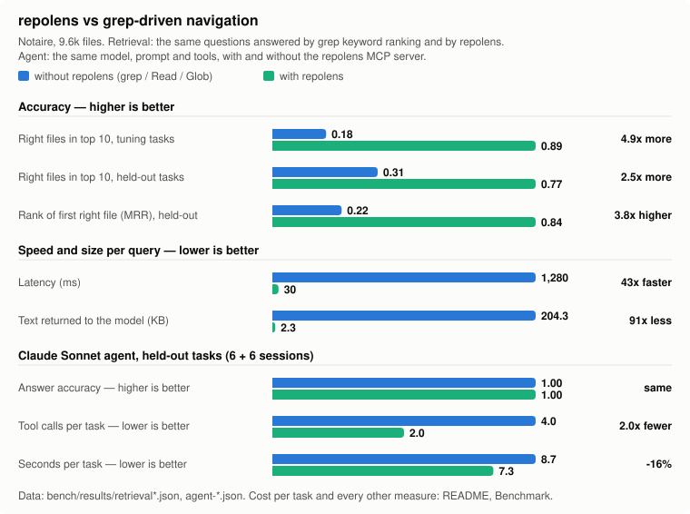
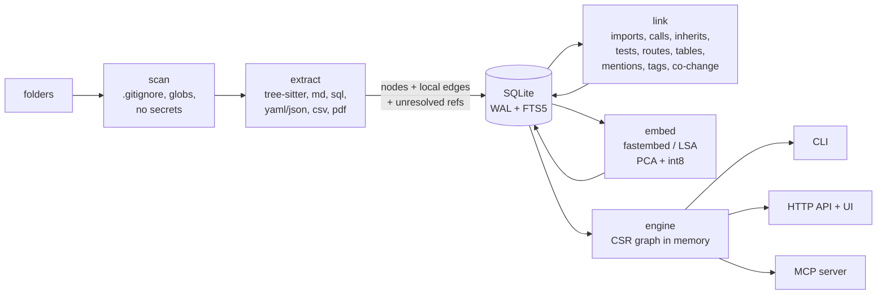

# repolens — a local code knowledge graph for AI agents

repolens reads one or more folders recursively (source code, tests, docs, configs, SQL, CSV, PDF, assets),
turns them into a typed property graph, and serves **hybrid semantic + graph retrieval** to people and to AI
agents through a **CLI**, an **HTTP API**, an **MCP server** and a small **graph explorer UI**. Everything
runs locally on free, open-source components; no code or query leaves the machine.

It is the open-source, stack-agnostic implementation of the *Code Knowledge Graph* lesson
(lesson L4, "Building the Code Knowledge Graph"): nodes (files, symbols, sections, routes, tables) and edges (imports, calls, tests,
co-edits...), two-step retrieval (similarity **anchors**, then **Personalized PageRank**), and near-zero
append cost when the codebase changes.



**Results on this repository (Notaire, 9.6k files)** — see [Benchmark](#benchmark) for method and caveats:

<!-- RESULTS:START -->
| | grep-driven (baseline) | with repolens |
|---|---|---|
| Retrieval recall@10 (tuning / held-out tasks) | 0.18 / 0.31 | **0.89 / 0.77** |
| Recall of one MCP `search` call (top 10 + 10 one-line results) | n/a | **0.94 / 0.96** in 3.2 KB |
| Retrieval latency per query | 1,280 ms | **30 ms** |
| Text returned per query (top 10) | 204 KB | **2.3 KB** |
| Agent, Sonnet, held-out tasks (repolens 0.3.0, 6 tasks): recall / tool calls / time / input tokens / cost | 1.00 / 4.0 / 8.7 s / 21.9k / $0.0323 | **1.00 / 2.0 / 7.3 s / 24.4k / $0.0331** (tool calls −50%, time −16%, tokens +11%, cost +3%) |
| Agent, Haiku, tuning tasks (repolens 0.2.0): recall / tool calls / time / input tokens / cost | 0.98 / 5.6 / 11.6 s / 56.3k / $0.0036 | **0.99 / 4.5 / 8.8 s / 38.1k / $0.0024** (tool calls −19%, time −24%, tokens −32%, cost −32%) |
| Agent, Haiku, held-out tasks (repolens 0.2.0): recall / tool calls / time / input tokens / cost | 0.97 / 5.9 / 11.6 s / 48.5k / $0.0033 | **0.97 / 4.6 / 8.8 s / 36.2k / $0.0023** (tool calls −23%, time −24%, tokens −25%, cost −32%) |

Agents answer as accurately with or without the graph; with it they need fewer steps and less time. The
held-out tasks were never used for tuning. (150 agent sessions on Notaire, $0.79 in total.) On the
33k-file scale corpus (spring-framework + vscode) Sonnet tied with and without repolens: the model already knows
where things live in such famous repositories; see [Scale](#scale).
<!-- RESULTS:END -->

---

## Contents

1. [How it works](#how-it-works)
2. [Install](#install) · [Quick start](#quick-start)
3. [Configuration](#configuration)
4. [CLI](#cli) · [MCP server](#mcp-server) · [In an agent factory](#in-an-agent-factory) · [HTTP API](#http-api) · [Graph explorer](#graph-explorer)
5. [Extending](#extending)
6. [Performance](#performance) · [Scale](#scale)
7. [Benchmark](#benchmark)
8. [Development and release](#development-and-release)
9. [Components and licenses](#components-and-licenses) · [Limitations](#limitations)

## How it works



| Stage | What happens | Cost on Notaire |
|---|---|---|
| **Scan** | `git ls-files` when the folder is a repository (honours `.gitignore`), otherwise a walk with default excludes (`node_modules`, `target`, `dist`, `.venv`...). `.env`, keys and key stores are never read. Unchanged files (same size and mtime) are not even opened. | 0.4 s |
| **Extract** | One worker per core; changed files only (content hash). | 3 s for all 9.6k files |
| **Link** | Rebuilt from the stored references whenever a file changed, across all projects in the store; skipped when nothing changed. | 1.3 s |
| **Embed** | One vector per distinct node text (content-addressed cache), shortest texts first, worker pool for large jobs; reduced to 128 dimensions and stored as int8. | ~4 min cold, seconds after |
| **Query** | Graph loaded once into CSR arrays; queries are pure in-memory. | ~20 ms p50 |

### Graph vocabulary

| Nodes | From |
|---|---|
| `file`, `dir`, `project` | every scanned file and its folders |
| `class`, `interface`, `enum`, `type`, `function`, `method`, `variable` | tree-sitter (Java, Kotlin, C#, TS/TSX/JS, Python, Go, Rust; generic fallback for other grammars). TS/JS object-literal services (`const api: Port = { get: () => ... }`) become methods. |
| `section`, `chunk` | Markdown headings; long configs, text and PDF pages |
| `route` | `@GetMapping`/`@RequestMapping` (Spring), JAX-RS, FastAPI/Flask, NestJS decorators, Express `app.get(...)` |
| `table` | `CREATE TABLE/VIEW` in SQL, JPA `@Table`, SQLAlchemy `__tablename__` |
| `tag` | configurable regexes, e.g. issues `#1640`, `ADR-030`, `CU-12` |
| `external` | unresolved imports and declared dependencies (`npm:react`, `jvm:org.springframework`) |

| Edge | Meaning |
|---|---|
| `contains`, `dir_contains` | file → symbol → member; folder → file |
| `imports`, `depends_on` | resolved imports (Java FQN, TS `tsconfig` path aliases, Python modules, Go packages); externals |
| `calls`, `references` | calls and type usages, resolved by scope: same file → imported files → same folder → unique in project, never across language families |
| `inherits` | `extends`/`implements`, typed object literals, and **method overrides** (implementation → interface method) |
| `tests` | test file → subject (`FooTest` → `Foo`, `foo.test.ts` → `foo.ts`, `test_foo.py` → `foo.py`) |
| `handles`, `http_call` | route → handler method; client call / MockMvc test / API-test collection (Bruno, Postman) → route. This is what joins a frontend to its backend, even across repositories. |
| `defines_table`, `uses_table` | migration → table; entity / SQL → table |
| `links`, `mentions` | Markdown links; inline code, paths and endpoints mentioned in docs and configs |
| `tagged`, `changed_for` | node → tag; file → issue referenced by the commits that changed it |
| `co_change` | files committed together (normalised count from `git log`) |

### Retrieval

1. **Anchors.** Three ranked lists fused with reciprocal-rank fusion: BM25 over identifier-split tokens
   (`TotpVerificationService` → `totp verification service`; terms present in more than 15% of nodes are
   dropped, they cost the most and score the least), dense similarity over local embeddings (weighted 1.5x),
   and exact identifier/path matches. The best 7 **code** anchors and the best **doc** anchor are taken
   separately (natural-language questions would otherwise anchor only on prose).
2. **Walk.** Personalized PageRank (20 iterations) from the anchors over the typed graph. Each edge kind has a weight
   (`[ranking.weights]`), reverse edges are walked at `reverse_weight`, and transitions into high-degree hubs
   are damped by `1 / log2(2 + degree)`. Graphs above 150k nodes propagate only mass of at least `ppr_eps`
   (a batched forward push), so the walk costs the same on a large repository as on a small one.
3. **Rank.** `0.2 · text score + 0.8 · walk score`, with `demote` globs (e.g. retired code) applied and test
   files at half weight unless the question is about tests (`test_factor`); results can be grouped by file and
   carry a `via` explanation (the relation that put them there).

`impact` is a reverse-dependency closure (who calls, implements, imports, routes to or tests a node);
`path` is a Dijkstra search that prefers strong structural edges and avoids hubs.

## Install

Python 3.11+. Two ways, both one command:

```bash
# inside a repository that vendors repolens (as Notaire does): no install, a launcher runs this checkout
bash framework/ai-sdlc/repolens/bin/repolens setup --install    # deps into ~/.cache/repolens/venv + wiring

# any other repository: install the command, then wire the repository you are in
pipx install /path/to/repolens            # or: pip install "/path/to/repolens[all]"
cd ~/src/my-service && repolens setup
```

`setup` registers the MCP server with every agent harness it knows (Claude Code, Codex, OpenCode, Cursor),
adds the usage hook and the git hooks, and ignores `.repolens/`; `--install` creates the shared environment,
`--index` builds the first index in the background, `--only <target>` and `--dry-run` narrow it. `repolens
doctor` checks the result. The core needs `numpy`, `scipy`, `tree-sitter`, `tree-sitter-language-pack` and
`pyyaml`; without `fastembed` repolens falls back to its dependency-free LSA embedder. The first `fastembed`
run downloads the model (`BAAI/bge-small-en-v1.5`, ~67 MB) into `~/.cache/repolens/models`; later starts
load it from there without touching the network.

## Quick start

No configuration is needed: from anywhere inside a repository, repolens indexes that repository (or the
folder of the nearest `repolens.toml`) and keeps the store in its `.repolens/` folder.

```bash
repolens index                                           # incremental; --full re-extracts everything
repolens search "where are refunds validated?" --files
repolens impact PaymentRepositoryPort                    # what breaks if this changes, which tests to run
repolens path frontend/src/api/refunds.ts refunds        # how a client reaches a DB table
repolens report                                          # how efficiently agents use it (see below)
repolens serve                                           # UI + API on http://127.0.0.1:7474
```

Several repositories in one store, or ranking settings: write a profile (`repolens init <folders...>`) next to
them; Notaire's is [`repolens.toml`](../../../repolens.toml) at the repository root.

## Configuration

Paths are relative to the profile file. Every key is optional except `[[source]]`.

```toml
[index]
db = ".repolens/graph.db"           # SQLite store (one store can hold many projects)
exclude = ["**/generated/**"]     # added to the defaults
max_file_bytes = 1000000          # larger text files are indexed as assets (name only)
workers = 8                       # extraction processes (default: cores - 1)

[[source]]                        # repeat for every folder / repository
name = "api"
path = "../backend"
include = []                      # optional allow-list globs
exclude = ["**/fixtures/**"]

[embed]
backend = "fastembed"             # fastembed | lsa | none | auto
model = "BAAI/bge-small-en-v1.5"  # any fastembed text model
reduce = 128                      # PCA dimensions stored and searched (0 = keep the model's dimensions)
workers = 0                       # embedding worker processes for large jobs (0 = auto)

[git]
commits = 3000                    # history scanned for co-change and issue links (0 disables)
max_files_per_commit = 30         # bigger commits (mass renames) are ignored
min_count = 2

[tags]                            # name = regex with one group; added to the defaults (issue, adr)
usecase = '\bCU-?(\d{2,3})\b'

[routes]
prefixes = ["/api/v1", "/api"]    # lets client calls without the prefix match server routes

[ranking]
demote = ["deprecated/**", "**/archive/**"]   # indexed, but ranked lower
demote_factor = 0.35
reverse_weight = 0.7
[ranking.weights]                  # per edge kind; see repolens/config.py for every kind
http_call = 2.0
co_change = 0.5
[ranking.tuning]                   # any key of DEFAULT_TUNING in repolens/engine.py
restart = 0.15                     # PageRank restart probability
anchors = 7                        # code anchors that seed the walk
```

`REPOLENS_CONFIG`, `REPOLENS_DB` and `REPOLENS_MODEL_CACHE` override the profile, the store and the model cache.

## CLI

| Command | Purpose |
|---|---|
| `repolens init <folders...>` | write a `repolens.toml` |
| `repolens setup [--install] [--index] [--only claude\|codex\|opencode\|cursor\|git\|gitignore] [--dry-run]` | wire repolens into the repository's harnesses (idempotent) |
| `repolens doctor` | check dependencies, config, store freshness, harness wiring, telemetry |
| `repolens index [folders...] [--full] [--no-embed] [--no-wait] [--quiet]` | create or update the graph (incremental; `--no-wait` steps aside when another run holds the store) |
| `repolens report [--since 7d] [--json] [--md f] [--gate]` | usage efficiency report |
| `repolens refresh [--background]` · `repolens hook` | refresh an existing store (git hooks) · record a harness tool call (Claude Code hook) |
| `repolens search "<question>" [--files] [-k 10] [--also 10] [--scope code\|docs\|tests] [--kind method] [--project api]` | hybrid + graph search; `--also` lists more results one line each |
| `repolens node <ref>` | a node and its typed relations both ways |
| `repolens neighbors <ref> [--depth 2] [--kind calls] [--direction in]` | expand the graph |
| `repolens impact <ref>` | reverse-dependency closure + affected tests |
| `repolens path <a> <b>` | cheapest relation chain between two nodes |
| `repolens outline <file>` / `repolens snippet <ref>` | symbols of a file / source of a node |
| `repolens stats` · `repolens export --format graphml -o g.graphml` | store size; export for Gephi, yEd, networkx |
| `repolens serve` · `repolens mcp` | HTTP API + UI · MCP server |

A `<ref>` is a node id, a path, `path:line`, `path#Symbol.member`, a symbol name or a route (`POST /api/v1/mfa/enrollment`).
The query commands take `--json`. Exit codes: 0 ok, 1 not found / no results, 2 usage or configuration error.

## MCP server

`repolens setup` registers it (see [In an agent factory](#in-an-agent-factory)); by hand:

```bash
claude mcp add repolens -- repolens mcp       # Claude Code; any MCP client: command `repolens`, args `["mcp"]`
```

Tools: `search`, `node`, `impact`, `path`, `outline`, `snippet`;
`--all-tools` adds `neighbors`, `stats` and `reindex`. Each tool schema costs the agent input tokens on
every turn, so the default set is kept small. Results are compact text that starts with `path:line`.
`search` returns the top `k` (default 10) with their symbols and the relation that surfaced them, then ten
more as one-line "also relevant" entries: recall keeps rising past the top 10 (0.86 -> 0.94 on the tuning
tasks, 0.77 -> 0.94 held-out) and one line per file costs about 1 KB for all ten. For example:

```text
1. [file] backend-api/.../adapter/out/pdf/PdfBoxReportRenderer.java:1-487  (1.39)
   symbols: PdfBoxReportRenderer.render:77, PdfBoxReportRenderer:40
2. [file] backend-api/.../adapter/out/pdf/ReportAssetCatalog.java:1-50  (0.90)
   via: references <- PdfBoxReportRenderer
...
also relevant:
11. frontend/src/hooks/useReports.ts  downloadPdf
13. backend-api/.../adapter/out/report/ReportService.java
```

## In an agent factory

repolens is built to be the repository-knowledge tool of every agent working on a codebase at the same time:
several harnesses and models, each in its own worktree and branch, opening pull requests while `main` moves.

| Concern | What repolens does |
|---|---|
| Every harness gets it | `repolens setup` writes the native registration of each: `.mcp.json` + `.claude/settings.json` (Claude Code), `.codex/config.toml` (Codex), `opencode.json` (OpenCode), `.cursor/mcp.json` (Cursor). The command resolves the launcher with `git rev-parse --show-toplevel`, so every worktree serves its own checkout. |
| One index per worktree | The store lives in `<worktree>/.repolens/`: an index never mixes branches. |
| Branches and worktrees are cheap | Vectors are content-addressed and shared machine-wide (`~/.cache/repolens/vectors`, with the PCA basis): a new worktree, a branch switch or a rebased branch embeds only text no store has embedded before. Measured on Notaire: a new worktree indexed in 11 s, 82,379 of its 83,241 vectors from the cache (862 texts that differ were embedded), against ~4 min cold. |
| Answers follow the agent's edits | Before a tool call the MCP server starts an incremental refresh in the background (at most every `REPOLENS_REFRESH_SECONDS`, default 15); answers come from the last published graph meanwhile. Git `post-checkout`/`post-merge` hooks refresh after a branch switch or a pull. |
| Many agents, one worktree | An inter-process lock serialises index runs; a refresh that finds the lock taken steps aside. Readers never block (SQLite WAL). |
| First start | An MCP server on an unindexed repository builds the index in the background and tells the agent to retry or use grep meanwhile; the graph and keyword search are published before the slow embedding pass. |
| Evidence | Every tool call is logged (`.repolens/usage.jsonl`), and the Claude Code hook logs Read/Grep/Glob, so `repolens report` measures real use (below). |

### Usage report

```bash
repolens report [--since 7d] [--json] [--md report.md] [--gate]
```

| Measure | Meaning |
|---|---|
| adoption | share of agent sessions that called repolens |
| repolens first | share of sessions whose first navigation call was repolens, not grep/glob/read |
| hit rate | of the files an agent read after a repolens call, the share repolens had already returned: retrieval quality in real work |
| grep fallback | share of repolens calls followed by a grep/glob before the next repolens call |
| navigation tokens | what navigation tools returned to the model, per session, with and without repolens |
| latency, zero-result searches, refreshes | server side, for every harness |

Each finding comes with an action (strengthen the instructions, add the missed questions to `bench/tasks`,
tune `demote`/weights, look at the zero-result queries). `--gate` prints one advisory line; Notaire's AI SDLC
profile runs it in the `signal` stage, so it lands in the factory's evidence ledger next to the other gates.
Session comparisons are observational; the controlled measurement is the benchmark below.

### Adopting it in another project

```bash
pipx install /path/to/repolens && cd my-repo && repolens setup --index && repolens doctor
```

Commit the files `setup` wrote (they hold no machine path), add a pointer to `AGENTS.md` (or the harness's
instruction file) such as "navigate with the repolens MCP tools before grep", and read `repolens report` after
a few days of work.

## HTTP API

`repolens serve [--host 127.0.0.1] [--port 7474]` — OpenAPI docs at `/docs`.

| Endpoint | |
|---|---|
| `GET /api/search?q=&k=&scope=&files=&kind=&project=&graph=` | ranked hits |
| `GET /api/node?ref=` · `/api/neighbors?ref=&depth=&direction=&kind=` | node + relations |
| `GET /api/impact?ref=&depth=` · `/api/path?a=&b=` | impact, relation path |
| `GET /api/outline?path=` · `/api/snippet?ref=&lines=` | file outline, source text |
| `GET /api/subgraph?q=` or `?ref=&depth=` | nodes + edges for visualisation |
| `GET /api/stats` · `POST /api/index?full=` | store statistics, re-index |

## Graph explorer

`repolens serve`, then open `http://127.0.0.1:7474` (or `/?q=your+question`). Search shows the ranked hits and
the subgraph that connects them; click a node for its relations and source, double-click to expand its
neighbours, toggle edge kinds in the legend.

## Extending

- **A language:** add a `Spec` to `SPECS` in [`repolens/extractors/code.py`](repolens/extractors/code.py) (node
  types for definitions, imports, calls, heritage); any grammar in `tree-sitter-language-pack` works.
- **A file family:** register `family -> callable` in `EXTRACTORS`, or ship a package with an entry point in
  the `repolens.extractors` group whose callable receives that dict.
- **Relations:** emit a `Ref(src, kind, target)` from an extractor and resolve it in
  [`repolens/linker.py`](repolens/linker.py); give the new edge kind a weight in `[ranking.weights]`.
- **Domain tags:** add a regex under `[tags]` — no code needed.

## Performance

Measured on Notaire (MacBook, M5 Pro, 15 cores, Python 3.14) with `bench/perf_bench.py`; 0.1.0 is the first
release, 0.2.0 the performance iteration, 0.3.0 the scale iteration (details in [`CHANGELOG.md`](CHANGELOG.md)).

| | 0.1.0 | 0.2.0 | 0.3.0 |
|---|---|---|---|
| Corpus | 9,611 files: Java, TS/TSX, Python, Markdown, YAML, SQL | same | same |
| Graph | 93k nodes, 264k edges, 87k vectors | same | 91k nodes, 260k edges, 82k vectors |
| Store on disk | 606 MB | 121 MB | **122 MB** |
| Server memory, peak (engine + embedding model) | 788 MB | 504 MB | **437 MB** |
| Re-index, nothing changed | 5.0 s | 0.45 s | **0.43 s** |
| Re-index, one file changed | 5.0 s | 1.8 s | **1.75 s** |
| Full re-extract of every file + link | 14.5 s | 5.3 s | 5.25 s |
| First embedding pass (once; cached afterwards) | 10.5 min | 4.2 min | not re-measured (texts 600 -> 300 chars) |
| Engine load / MCP server start | 0.6 s / 0.3 s | 0.5 s / 0.3 s | 0.7 s / 0.3 s |
| Query latency p50 / p95 | 41 / 75 ms | 23 / 38 ms | 25 / 38 ms |
| Recall@10 / MRR, tuning tasks | 0.83 / 0.71 | 0.86 / 0.79 | **0.89 / 0.79** |
| Recall@10 / MRR, held-out tasks | 0.72 / 0.80 | 0.77 / 0.84 | 0.77 / 0.84 |
| Recall in one MCP `search` call (10 detailed + 10 one-line results) | 0.83 / 0.72 | 0.94 / 0.94 | **0.94 / 0.96** |

Where a Notaire query spends its ~25 ms: PageRank 11 ms, BM25 6 ms, vector scan 4 ms, query embedding 2 ms,
the rest is ranking and rendering (names and ids of the results are read from SQLite on demand).

### Scale

`bench/scale_bench.py` indexes two large public repositories as one multi-project store: spring-framework
(11.5k files, 1.7M lines, Java/Kotlin) and vscode (21.5k files, 7.4M lines, TypeScript), 33k files and ~9M
lines in all, about 3x the 10k-file / 1M-line target. Every step runs in a fresh process; quality uses
[`bench/tasks/scale.yaml`](bench/tasks/scale.yaml) (20 questions, validation only, never tuned on).

| | 0.2.0 | 0.3.0 |
|---|---|---|
| Graph | 545k nodes, 2.1M edges | 438k nodes, 1.9M edges, 421k vectors |
| Index without vectors (extract + link) | 93 s (link 69 s), peak 2.3 GB | **29 s** (link 8 s), peak 1.3 GB |
| First embedding pass (once) | not measured | 21 min (~330 texts/s, CPU only) |
| Re-index, one file changed | 72.5 s | **11 s** |
| Re-index, nothing changed | 1.6 s | 1.6 s |
| Store on disk | 553 MB (no vectors) | 554 MB with vectors |
| Engine load / memory after load | 2.2 s / 1.14 GB (no vectors) | 2.4 s / 0.77 GB with vectors |
| Query latency p50 / p95 | 131 / 184 ms (no vectors) | **69 / 140 ms** with vectors |
| Recall@10 / recall@20 / MRR | 0.75 / 0.88 / 0.27 (no vectors) | **0.80 / 0.98 / 0.41** |

What made it scale: symbol references resolve through per-name candidate indexes instead of scanning every
same-named symbol (the `get`/`toString` problem); PageRank propagates only mass above `ppr_eps`, so its cost
follows the walk, not the graph; locals of anonymous functions are no longer symbols; license headers no longer
stand in for file documentation; node names are read from SQLite per result instead of being held for 438k
nodes; vectors are re-projected in bounded chunks. The graph is published before the first embedding pass, so a
running server answers with keyword + graph ranking (recall@20 0.88 here) while vectors are computed.

A cold embedding pass is the one cost that grows with the corpus: ~330 texts/s on CPU (code-dense texts run at
80-110/s). It runs once; afterwards only changed texts are embedded.

**Agents at scale.** 16 Sonnet sessions (8 tasks, with and without repolens) tied: recall 0.94, 2 tool calls each,
repolens +10% time. The model already knows where `CronExpression` or the minimap live in spring-framework and
vscode, so this corpus measures speed and ranking, not agent value; agent value is measured on Notaire, a
codebase the model has not memorised (`bench/results/agent-sonnet-scale.json`).

### Store layout

One SQLite file (WAL). `nodes` holds every node with a relative `parent` (containment needs no edge rows)
and zlib-compressed long text; `edges` holds only linker-derived edges, integer-keyed and without secondary
indexes (the engine loads them once into CSR arrays); each file's unresolved references are one compressed
blob in `files`; `fts` is a contentless FTS5 index updated incrementally; `vectors` is content-addressed by
text hash (identical texts share a vector), PCA-reduced to 128 dimensions and int8-quantised. Older stores
migrate in place on first open and keep their vectors.

### Choosing an embedding model

Any fastembed text model works (`[embed] model`). Measured on this corpus (recall@10 / MRR with the graph
walk; tuning set, held-out set):

| Model | First embedding pass | Tuning | Held-out |
|---|---|---|---|
| `BAAI/bge-small-en-v1.5` (default) | 254 s | 0.82 / 0.71 | 0.77 / **0.80** |
| `snowflake/snowflake-arctic-embed-xs` | **133 s** | 0.85 / 0.71 | 0.77 / 0.73 |
| `sentence-transformers/all-MiniLM-L6-v2` | 130 s | 0.69 / 0.74 | 0.72 / 0.69 |
| `sentence-transformers/paraphrase-multilingual-MiniLM-L12-v2` | 205 s | 0.63 / 0.58 | 0.74 / 0.71 |

(Measured before the final fusion tuning, so compare rows with each other, not with the tables below.)
`arctic-embed-xs` halves the one-time embedding cost at similar recall but ranks the first relevant file
lower on held-out tasks; the default favours ranking quality.

### What was tried and rejected

Each of these was measured on both task sets and not adopted:

| Idea | Result |
|---|---|
| Index path tokens only on file nodes (FTS 18 -> 14 MB) | MRR fell on both sets (0.71 -> 0.64, 0.80 -> 0.77) |
| Fewer than 10 PageRank iterations | MRR starts to fall at 6; 20 is identical to 30 and is the default |
| Drop query terms present in more than 5% of nodes | held-out recall 0.74 -> 0.69; the cutoff is 15% |
| Do not embed doc sections, methods or files | recall -4 to -7 points (variables and doc chunks: no effect) |
| float32 PageRank | no speed-up (the sparse product is index-bound) |
| int8 vectors resident in memory | 4x slower scan than float16 for 34 MB less |
| An "entity" anchor channel from rare query terms | lower recall in every configuration |
| A boost for test files when the question mentions tests | no gain on the tuning set |
| Skip the embedding model at query time (saves ~250 MB) | MRR 0.79 -> 0.55 and 0.84 -> 0.52 |
| Fewer embedding threads to shrink the model's footprint | no change (the ONNX session, not threads, holds the memory) |
| Re-tuning graph blend and edge weights | no configuration beat the current defaults |
| FTS5 `detail=column` / `detail=none` (index 4x smaller) | `bm25()` returns 0 without positions: no ranking |
| Lower query-term cutoff (`max_df` 0.02-0.08) to speed up FTS at scale | lower recall on the tuning set |
| CoreML execution provider, other thread counts or batch sizes for embedding | no gain over the ONNX CPU defaults |
| Sparse PageRank on small graphs | slower than exact iteration below ~150k nodes (now chosen by size) |
| Drop the `id` column (derive ids from project, path and a local key) | ~12% smaller, but needs an equally large unique index and touches every layer |

## Benchmark

Everything to reproduce is in [`bench/`](bench); `bench/run_all.sh` runs all of it and writes
[`bench/results/report.html`](bench/results/report.html) (charts) and
[`bench/results/summary.md`](bench/results/summary.md).

- **Tasks** — two sets of questions with grep-verified expected files, in six categories (lexical,
  cross-stack, multi-hop, impact, tests, docs):
  [`notaire.yaml`](bench/tasks/notaire.yaml) (11 tasks, the **tuning** set: ranking parameters were chosen on
  it) and [`notaire-holdout.yaml`](bench/tasks/notaire-holdout.yaml) (12 tasks on other parts of the
  repository, **held out**: never used to choose anything, only to check that results generalise).
- **Corpus** — a `git clone --shared` of the repository HEAD in `$REPOLENS_BENCH_HOME/corpus/` (default
  `~/.cache/repolens/bench`, outside the repository tree), with this module (the
  benchmark and its answer key) deleted from the clone's working tree, so no arm can read the answers.
- **Retrieval** (deterministic, free) — the prompt goes verbatim to `grep` (one ripgrep per keyword, TF-IDF
  ranking), repolens **hybrid** (no graph walk) and repolens **graph**; recall@k, MRR, latency and output size.
- **Agent** — `claude -p` headless in the clone, same prompt, same model, same built-in tools (Read, Grep,
  Glob); the graph arm also has the repolens MCP server. No system prompt is added. Recall is scored from the
  `FILES:` line of the answer; tool calls, turns, tokens, cost and time come from the session result. Agent
  runs count against the account's usage limits; the harness stops at the first usage-limit error.
- **Performance** — `bench/perf_bench.py --label <name> [--compare <other>]`: store size, index times, load,
  memory, latency by stage, MCP cold start and quality on both task sets, saved per label in
  `bench/results/perf/`.
- **Scale** — `bench/scale_bench.py --label <name> [--embed none|fastembed] [--steps index,noop,touch,query]`:
  the same measurements on spring-framework + vscode (33k files), cloned shallow into `$REPOLENS_BENCH_HOME/scale` (its own
  git root, so agents working there cannot wander into the enclosing repository).

<!-- BENCH:START -->
Results on commit `073e9776`; retrieval and Sonnet runs with repolens 0.3.0, Haiku runs with 0.2.0:

#### Retrieval, task set `notaire-holdout` (top-10 files, 12 tasks, commit 073e9776)

| arm | recall@5 | recall@10 | recall@20 | MRR | latency ms | output KB (top 10) | output KB (top 10 + 10 one-line) |
|---|---|---|---|---|---|---|---|
| grep (keyword ripgrep) | 0.17 | 0.31 | 0.45 | 0.22 | 1,088 | 230.4 | n/a |
| repolens hybrid (no graph) | 0.61 | 0.80 | 0.83 | 0.79 | 21 | 2.3 | 3.2 |
| repolens graph | 0.63 | 0.77 | 0.96 | 0.84 | 28 | 2.4 | 3.3 |

| category | grep (keyword ripgrep) | repolens hybrid (no graph) | repolens graph |
|---|---|---|---|
| cross-stack | 0.00 | 1.00 | 0.58 |
| docs | 0.00 | 0.50 | 0.50 |
| impact | 0.00 | 0.20 | 0.60 |
| lexical | 0.78 | 0.89 | 0.89 |
| multi-hop | 0.21 | 0.81 | 0.81 |
| tests | 0.50 | 1.00 | 1.00 |

#### Retrieval, task set `notaire` (top-10 files, 11 tasks, commit 073e9776)

| arm | recall@5 | recall@10 | recall@20 | MRR | latency ms | output KB (top 10) | output KB (top 10 + 10 one-line) |
|---|---|---|---|---|---|---|---|
| grep (keyword ripgrep) | 0.09 | 0.18 | 0.28 | 0.14 | 1,280 | 204.3 | n/a |
| repolens hybrid (no graph) | 0.59 | 0.79 | 0.90 | 0.72 | 23 | 2.3 | 3.3 |
| repolens graph | 0.67 | 0.89 | 0.94 | 0.79 | 30 | 2.3 | 3.2 |

| category | grep (keyword ripgrep) | repolens hybrid (no graph) | repolens graph |
|---|---|---|---|
| cross-stack | 0.00 | 0.88 | 0.88 |
| docs | 0.50 | 0.83 | 0.83 |
| impact | 0.00 | 0.71 | 0.71 |
| lexical | 0.00 | 0.83 | 1.00 |
| multi-hop | 0.00 | 0.46 | 0.83 |
| tests | 0.50 | 1.00 | 1.00 |

#### Agent: haiku, task set `notaire-holdout` (72 runs, 3 rep., $0.20 total)

| arm | runs | recall | tool calls | turns | time s | input tokens | output tokens | cost USD |
|---|---|---|---|---|---|---|---|---|
| baseline: Read/Grep/Glob | 36 | 0.97 | 5.89 | 6.89 | 11.6 | 48,468 | 2,081 | 0.00334 |
| + repolens MCP | 36 | 0.97 | 4.56 | 5.56 | 8.8 | 36,165 | 1,585 | 0.00228 |
| change |  | +0% | -23% | -19% | -24% | -25% | -24% | -32% |

#### Agent: haiku, task set `notaire` (66 runs, 3 rep., $0.20 total)

| arm | runs | recall | tool calls | turns | time s | input tokens | output tokens | cost USD |
|---|---|---|---|---|---|---|---|---|
| baseline: Read/Grep/Glob | 33 | 0.98 | 5.61 | 6.61 | 11.6 | 56,301 | 2,051 | 0.00360 |
| + repolens MCP | 33 | 0.99 | 4.52 | 5.52 | 8.8 | 38,122 | 1,550 | 0.00245 |
| change |  | +1% | -19% | -17% | -24% | -32% | -24% | -32% |

#### Agent: sonnet, task set `notaire-holdout` (12 runs, 1 rep., $0.39 total)

| arm | runs | recall | tool calls | turns | time s | input tokens | output tokens | cost USD |
|---|---|---|---|---|---|---|---|---|
| baseline: Read/Grep/Glob | 6 | 1.00 | 4.00 | 5.00 | 8.7 | 21,914 | 1,248 | 0.03230 |
| + repolens MCP | 6 | 1.00 | 2.00 | 3.00 | 7.3 | 24,419 | 1,063 | 0.03312 |
| change |  | +0% | -50% | -40% | -16% | +11% | -15% | +3% |

#### Agent: sonnet, task set `scale` (16 runs, 1 rep., $0.42 total)

| arm | runs | recall | tool calls | turns | time s | input tokens | output tokens | cost USD |
|---|---|---|---|---|---|---|---|---|
| baseline: Read/Grep/Glob | 8 | 0.94 | 2.00 | 3.00 | 7.6 | 18,727 | 937 | 0.02573 |
| + repolens MCP | 8 | 0.94 | 2.00 | 3.00 | 8.3 | 22,506 | 888 | 0.02646 |
| change |  | +0% | +0% | +0% | +10% | +20% | -5% | +3% |

#### Performance iteration

| metric | 0.2.0 | 0.3.0 | change |
|---|---|---|---|
| Store size, MB | 121 | 122 |  |
| Server memory, MB | 501 | 437 | 1.1x lower |
| Re-index, no changes, s | 0.46 | 0.43 | 1.1x lower |
| Re-index, one file changed, s | 1.8 | 1.8 | 1.0x lower |
| Full re-extract, s | 5.2 | 5.2 |  |
| Query latency p50, ms | 23 | 25 |  |
| Query latency p95, ms | 38 | 38 | 1.0x lower |
| Tuning set recall@10 / MRR | 0.86 / 0.79 | 0.89 / 0.79 |  |
| Held-out set recall@10 / MRR | 0.77 / 0.84 | 0.77 / 0.84 |  |


<!-- BENCH:END -->

**Caveats.** Two task sets on one repository, 23 questions in total. Ranking parameters were tuned on the
tuning set, so its retrieval numbers are optimistic; the held-out set is the fair estimate (and still small).
Agent runs vary from run to run and with API latency at the time of day: compare the two arms of the same
run, not numbers across runs, and use `--repeat`.

## Development and release

```bash
bash verify.sh                  # ruff, pytest (coverage floor 88%), wheel build, CLI smoke run
python3 -m pytest -q            # 50 tests, ~2 s, offline (LSA embedder, generated fixture repository)
python3 bench/perf_bench.py --label mine --compare final   # size, index, memory, latency, quality
```

- Version in `repolens/__init__.py`, history in [`CHANGELOG.md`](CHANGELOG.md), tags `repolens-v<version>`.
- CI: [`ci/repolens.yml`](ci/repolens.yml) (verify on Python 3.11–3.13; build and attach the wheel on a tag).
  Copy it to `.github/workflows/` to enable it.
- Bump `EXTRACTOR_VERSION` in `repolens/extractors/__init__.py` when extraction output changes; stores
  re-extract automatically.
- Module contract: [`MODULE.md`](MODULE.md).

## Components and licenses

| Component | Role | License |
|---|---|---|
| SQLite (FTS5, WAL) | store, BM25 | Public domain |
| NumPy, SciPy | CSR graph, PageRank, LSA | BSD |
| tree-sitter, tree-sitter-language-pack | parsing | MIT |
| PyYAML | YAML | MIT |
| fastembed + ONNX Runtime, BAAI/bge-small-en-v1.5 | local embeddings (optional) | Apache-2.0, MIT, MIT |
| FastAPI, Uvicorn | HTTP API (optional) | MIT, BSD-3-Clause |
| MCP Python SDK (FastMCP) | MCP server (optional) | MIT |
| pypdf | PDF text (optional) | BSD-3-Clause |
| Cytoscape.js (cdnjs) | explorer UI | MIT |

## Limitations

- Name resolution is static and heuristic: dynamic dispatch, reflection, dependency injection by string and
  generated code are not followed (ambiguous calls are split across at most three candidates or dropped).
- Route matching needs literal paths; URLs assembled at runtime from variables are missed.
- The embedding model is English; mixed-language repositories still work through BM25 and the graph, or
  choose a multilingual fastembed model (`sentence-transformers/paraphrase-multilingual-MiniLM-L12-v2`).
- One writer at a time per store (SQLite); readers (API, MCP) pick up a new index automatically.
- The first embedding pass is CPU-bound (~330 texts/s): about 20 minutes for 1M+ lines. The graph and keyword
  search are usable as soon as linking ends; only changed texts are embedded afterwards.
- Linking is global: a one-file change relinks the whole store (about 1 s per 3k files).
