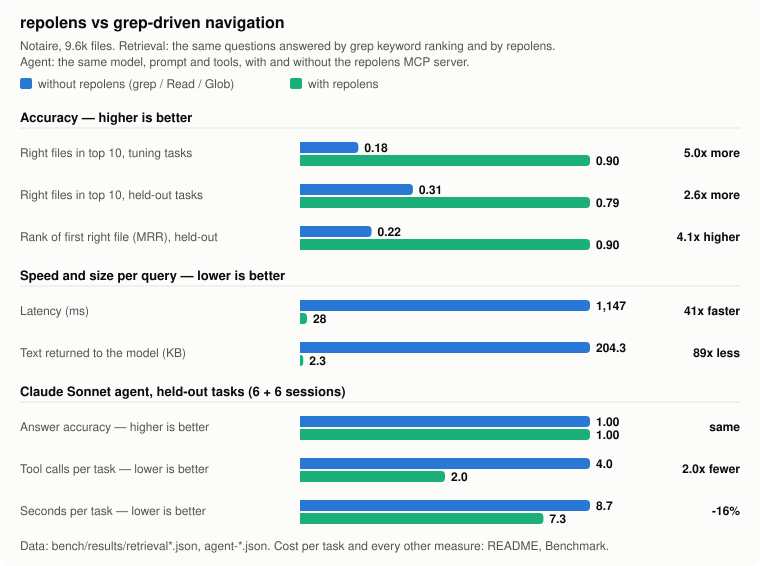

### Retrieval, task set `notaire-holdout` (top-10 files, 12 tasks, commit 073e9776)

| arm | recall@5 | recall@10 | recall@20 | MRR | latency ms | output KB (top 10) | output KB (top 10 + 10 one-line) |
|---|---|---|---|---|---|---|---|
| grep (keyword ripgrep) | 0.17 | 0.31 | 0.45 | 0.22 | 1,034 | 230.4 | n/a |
| repolens hybrid (no graph) | 0.63 | 0.80 | 0.88 | 0.83 | 25 | 2.4 | 3.3 |
| repolens graph | 0.63 | 0.79 | 0.96 | 0.90 | 32 | 2.4 | 3.3 |

| category | grep (keyword ripgrep) | repolens hybrid (no graph) | repolens graph |
|---|---|---|---|
| cross-stack | 0.00 | 1.00 | 0.58 |
| docs | 0.00 | 0.50 | 0.50 |
| impact | 0.00 | 0.20 | 0.60 |
| lexical | 0.78 | 0.89 | 0.89 |
| multi-hop | 0.21 | 0.81 | 0.88 |
| tests | 0.50 | 1.00 | 1.00 |

### Retrieval, task set `notaire` (top-10 files, 11 tasks, commit 073e9776)

| arm | recall@5 | recall@10 | recall@20 | MRR | latency ms | output KB (top 10) | output KB (top 10 + 10 one-line) |
|---|---|---|---|---|---|---|---|
| grep (keyword ripgrep) | 0.09 | 0.18 | 0.28 | 0.14 | 1,147 | 204.3 | n/a |
| repolens hybrid (no graph) | 0.62 | 0.81 | 0.90 | 0.76 | 26 | 2.3 | 3.3 |
| repolens graph | 0.67 | 0.90 | 0.92 | 0.79 | 28 | 2.3 | 3.3 |

| category | grep (keyword ripgrep) | repolens hybrid (no graph) | repolens graph |
|---|---|---|---|
| cross-stack | 0.00 | 0.88 | 0.88 |
| docs | 0.50 | 0.83 | 0.83 |
| impact | 0.00 | 0.71 | 0.86 |
| lexical | 0.00 | 0.83 | 1.00 |
| multi-hop | 0.00 | 0.58 | 0.83 |
| tests | 0.50 | 1.00 | 1.00 |

### Agent: haiku, task set `notaire-holdout` (72 runs, 3 rep., $0.20 total)

| arm | runs | recall | tool calls | turns | time s | input tokens | output tokens | cost USD |
|---|---|---|---|---|---|---|---|---|
| baseline: Read/Grep/Glob | 36 | 0.97 | 5.89 | 6.89 | 11.6 | 48,468 | 2,081 | 0.00334 |
| + repolens MCP | 36 | 0.97 | 4.56 | 5.56 | 8.8 | 36,165 | 1,585 | 0.00228 |
| change |  | +0% | -23% | -19% | -24% | -25% | -24% | -32% |

### Agent: haiku, task set `notaire` (66 runs, 3 rep., $0.20 total)

| arm | runs | recall | tool calls | turns | time s | input tokens | output tokens | cost USD |
|---|---|---|---|---|---|---|---|---|
| baseline: Read/Grep/Glob | 33 | 0.98 | 5.61 | 6.61 | 11.6 | 56,301 | 2,051 | 0.00360 |
| + repolens MCP | 33 | 0.99 | 4.52 | 5.52 | 8.8 | 38,122 | 1,550 | 0.00245 |
| change |  | +1% | -19% | -17% | -24% | -32% | -24% | -32% |

### Agent: sonnet, task set `notaire-holdout` (12 runs, 1 rep., $0.39 total)

| arm | runs | recall | tool calls | turns | time s | input tokens | output tokens | cost USD |
|---|---|---|---|---|---|---|---|---|
| baseline: Read/Grep/Glob | 6 | 1.00 | 4.00 | 5.00 | 8.7 | 21,914 | 1,248 | 0.03230 |
| + repolens MCP | 6 | 1.00 | 2.00 | 3.00 | 7.3 | 24,419 | 1,063 | 0.03312 |
| change |  | +0% | -50% | -40% | -16% | +11% | -15% | +3% |

### Agent: sonnet, task set `scale` (16 runs, 1 rep., $0.42 total)

| arm | runs | recall | tool calls | turns | time s | input tokens | output tokens | cost USD |
|---|---|---|---|---|---|---|---|---|
| baseline: Read/Grep/Glob | 8 | 0.94 | 2.00 | 3.00 | 7.6 | 18,727 | 937 | 0.02573 |
| + repolens MCP | 8 | 0.94 | 2.00 | 3.00 | 8.3 | 22,506 | 888 | 0.02646 |
| change |  | +0% | +0% | +0% | +10% | +20% | -5% | +3% |

### Performance iteration

| metric | 0.2.0 | 0.3.0 | change |
|---|---|---|---|
| Store size, MB | 121 | 122 |  |
| Server memory, MB | 501 | 437 | 1.1x lower |
| Re-index, no changes, s | 0.46 | 0.43 | 1.1x lower |
| Re-index, one file changed, s | 1.8 | 1.8 | 1.0x lower |
| Full re-extract, s | 5.2 | 5.2 |  |
| Query latency p50, ms | 23 | 25 |  |
| Query latency p95, ms | 38 | 38 | 1.0x lower |
| Tuning set recall@10 / MRR | 0.86 / 0.79 | 0.89 / 0.79 |  |
| Held-out set recall@10 / MRR | 0.77 / 0.84 | 0.77 / 0.84 |  |
